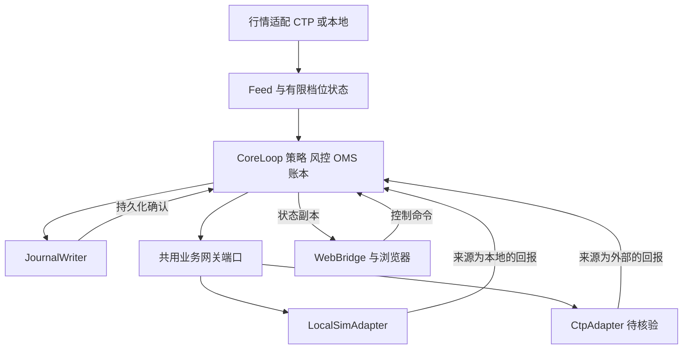
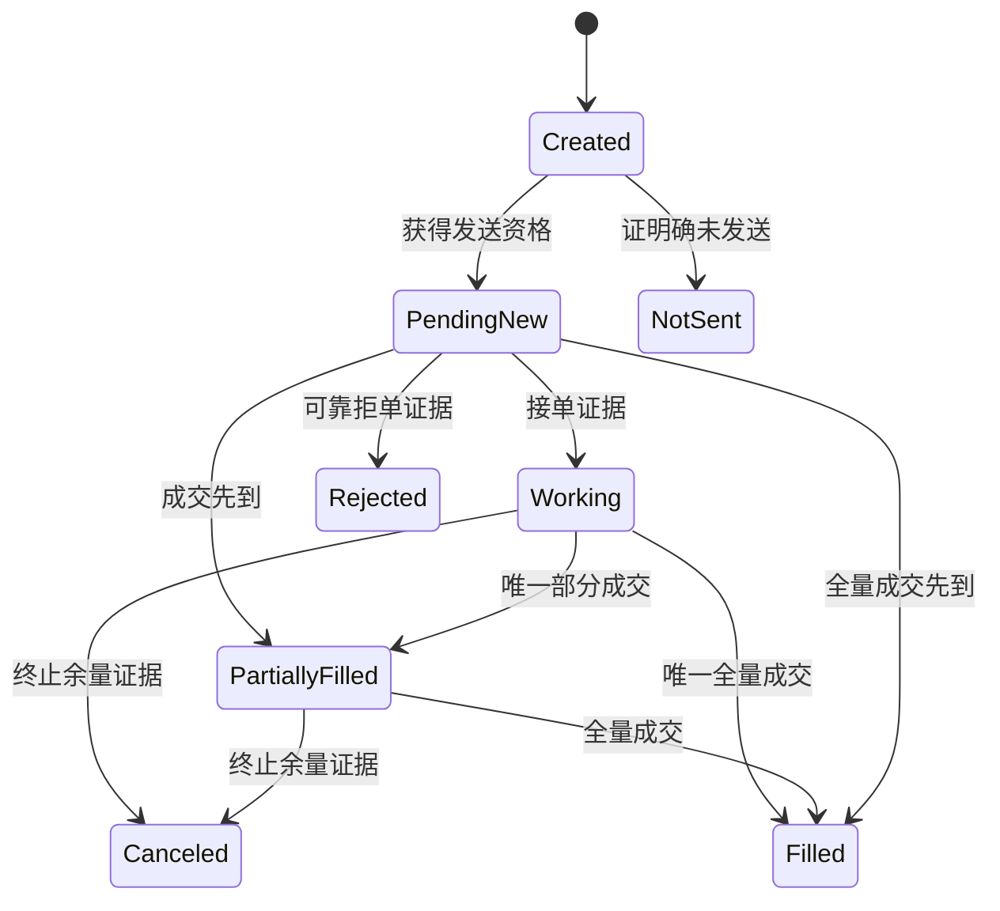
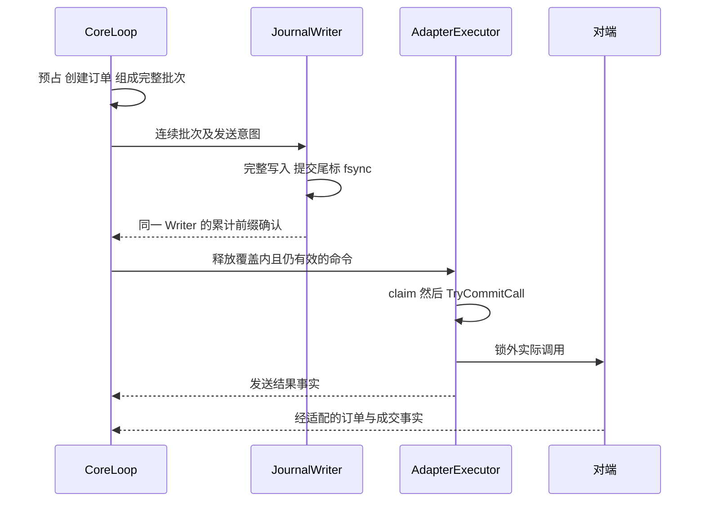

# PROJECT03 完整封存与恢复总报告

整理日期：2026-11-11（Asia/Tokyo）。工程封存基准：第六十七轮已验证实现，以及第六十八轮中断后留下的两份未接入草稿。本轮只整理文档，不修改业务实现、正式架构或 ADR，不启动新里程碑。

本报告按“现状与恢复说明 → 正式规范全文 → ADR 完整决策 → 市场规则原始节选 → 参考模型原始结果”的顺序组织。正式规范只收录一次，不以阶段总结替代；原文中的待审、未实现等状态保留其历史语境。前部明确解释最新状态，后部原始正文供独立阅读。源码路径均相对工作区根目录；附件缺失不妨碍阅读技术结论，但实际复现必须使用完整 ZIP 中的源码和原始证据。

## 1. 结论、证据优先级与授权边界

PROJECT03 是买方 C++20 交易执行基础设施：行情、有限档位状态、简化报价负载、交易前风控、OMS、网关、异步回报、成交账本、持仓、审计与恢复。它不是交易所撮合引擎，也不以策略盈利或金融页面的丰富程度验收。

现有 M1A 候选和后续工作副本确实存在，不能写成“没有业务实现”。但没有可核实的用户正式 M1A 验收通过消息，不能标记 M1A Accepted。M1B 仅在固定本地 profile、单账户/策略/合约、纯内存范围形成门槛证据；M1C 只完成部分双上下文运行时；M1D–M1F 尚未整体完成。当前不能宣称生产就绪、耐久发送保证、真实 CTP 兼容、全量历史事故复现或多合约共享账户风险。

证据优先级：用户明确批准及正式 V1.1/ADR 契约决定“应当怎样”；实际源码及原始运行记录决定“现在做到了什么”。二者冲突必须列为差距，不能用源码悄悄修改规范，也不能用规范文字宣称已有实现。阶段报告只提供时间、动机与定位辅助。测试成功是其声明范围的证据，不是外部能力、生产级或正式用户验收。

历史交接时仅授权 M1A（交接 history/USER_DECISION_RECORD.md C04/C05）。用户后来要求持续本地开发、2026-11-06 要求不逐阶段等待审核，工作副本 DEVELOPMENT_POLICY.md 记录该授权；这解释后续 M1B/M1C 增量的存在，不构成 M1A 正式验收或实盘权限。2026-11-11 封存及本次文档整理指令停止开发，覆盖此前继续推进安排。未来恢复必须取得新的具体任务。

全量原生会话导出未取得。现存决策摘录、原件、源码、失败记录全部保留，但不能承诺补齐未提供的历史讨论。下述事实均基于现存材料；其他项目当前升级能力、SDK 精确行为、真实合约参数明确待核实。

## 2. 背景、目标、市场与技术路线

用户职业目标是买方 C++ 量化开发、交易网关、行情与低延迟基础设施，金融基础需通过可调试业务链路建立。优先级为中国真实市场、C++ 工程、性能与可靠性、完整执行链路、工作台与故障实验、理解源码、真实可复现证据。性能、并发、确定性和 Production Readiness 是建设目标，不是当前已达成指标。

主线正式选择上期所商品期货 RB 螺纹钢，单个实际挂牌合约动态确认，普通账户权限下的简化双边限价当日有效报价。主接口 CTP C++ TraderAPI/MdAPI；开发路径为本地确定性模拟优先，具备 SDK、账号和权限后 SimNow；独立 SMDP 2.0 文档 V1.22 协议实验不冒充实时组播行情授权。

每侧默认最多一笔有效报价、默认一手；测试可用多手验证部分成交。行情与库存产生参考价、价差和库存偏移，QuoteStrategy 只产生目标，OrderPlanner 撤旧等待剩余风险得到处理后再建，核心逐单独立风控。两笔反向开仓不是自动平仓，也不能假定互相抵消最坏风险。缺行情、无效/过期行情、连接或证据故障时撤回目标并停新增风险；不默认自动平仓。

市场规则的完整历史节选见第17节，当前复用需重新核验。关键业务含义如下：RB 历史规则基线为10吨/手、人民币元/吨、tick 1元/吨；实际代码价格为整数 tick、数量为整数手，浮点 SDK 值需校验转换。实际月份、价格带、保证金、手续费、数量与报撤限额、到期禁入窗口按合约及日期加载，不能拿教学配置当交易所最新参数。日盘历史时段09:00–10:15、10:30–11:30、13:30–15:00；RB 夜盘历史21:00–23:00，节假日和临时公告优先。夜盘归属交易日与自然日期分开，不能午夜自行滚仓。集合竞价独立，报价只在已确认连续交易时段执行。首版不交割、不自动换主力，不把主连当可委托合约。

买卖方向与开平分开：买开增加多头、卖开增加空头、买平减少空头、卖平减少多头；平今/平昨按对应桶和柜台映射处理。内部明确 Open/CloseToday/CloseYesterday，不让单笔订单含糊使用 AutoClose。普通账户不具有专业做市商义务、优惠、专用编码或接口特权。原生 Post-only、原子改价、双边原子报价、逐笔 MBO、完整 L2 均不得从快照或本地策略推断。未来外部程序化接入需核验目标机构管理与报告要求，本报告不是当前法规或交易准入确认。

C++ 核心采用标准库与 CMake；初版并发队列用 mutex/condition_variable。核心隔离 CTP 头文件和原生枚举；SDK 当前包未冻结。正式架构的 WebBridge/桥接通信、前端和日志技术选型以第15节全文为准；当前实际页面是 HTML/CSS/JavaScript 离线演示，不等于已建成规划技术栈。Node 用于导出与证据核验，不是交易业务状态权威。

## 3. 架构、数据流和部署边界

正式基线是一个交易核心进程、一个独立 WebBridge 进程；核心进程四个应用执行职责为 CoreLoop、AdapterExecutor、JournalWriter、BridgeIO。核心单线程拥有策略、风控、OMS、账本和运行状态；其他线程传递有界拥有型值事件，不传生命周期不明的 SDK 指针，不直接写业务状态。SDK 自有回调线程不应混为四个应用线程。

正常逻辑流为：市场前置/本地源 → FeedNormalizer → MarketState → QuoteStrategy → OrderPlanner → Risk/OMS 原子预占 → 发送意图 Journal → 连续持久化确认 → gate 领取/调用承诺 → Adapter → 柜台或本地模拟对端 → 回报队列 → CoreLoop → OMS/ExecutionLedger/PositionBook/Funds。行情通道与订单通道分开。订单发送函数返回、本地入队、柜台接单、成交分别是不同事实。

Web 方向是核心状态副本 → BridgeIO 编码 → 本机桥接 → 独立 WebBridge → 浏览器；控制回到版本化命令与核心队列，不提供 rawCtpCall。慢浏览器可丢展示、降采样、断开并记录，不得丢关键成交事实后继续报价。核心不得等待 JSON、网络、文件同步或大查询。

当前真实装配：CoreLoop 拥有者 + 独占 LocalSim 的适配器线程，共两个上下文。LocalRuntimeRunner 拥有核心与会话，销毁顺序保证会话关门/join 后销毁核心。同步 LocalQuoteRunner 仍存在，离线 UI 展示它导出的固定场景；不能把该 UI 说成拥有型异步运行器的在线监控。JournalWriter、完整 BridgeIO/独立 WebBridge 不在已验证运行链中。

## 4. 关键业务设计：状态、资源与证据

### 4.1 Single Writer 与事务

CoreLoop::step 是业务更新入口，统一输入顺序、身份/范围校验、资源与 OMS 变更。现用 copy/validate/noexcept swap：先在候选状态计算，校验后整体提交，失败不暴露半订单、半冻结。它有 O(状态大小)复制与动态分配成本；正确性优先，不是预分配或低延迟达标证明。失败输入仍可能推进 ingress/core 序号和逻辑时间，不能把“业务事务回滚”写成整个 canonical 状态绝对不变。

账户/合约/交易日/position epoch/策略/来源/profile、内部订单/预占/撤单动作/客户端请求等身份分开。内部 ID 不等于 CTP OrderRef 或 OrderSysID；当前内存 instance/序号不提供跨崩溃持久化分配保证。客户端幂等按策略和请求身份核对，相同身份异内容冲突，不让 producer 冒充策略。

### 4.2 OMS 多维与 Q/B/R/E、F/H/P/L/V/X

执行状态、发送状态、撤单动作状态、一致性分开。一笔 PartiallyFilled 订单可同时撤单 Requested、证据 MissingTrades；撤单失败不意味着原订单被拒绝。当前 Order 的发送维度仍固定 SendState::NotImplemented；本地适配器 gate 跟踪不等于该生产状态机已补齐。

Q 是原始数量；B 是账本已记唯一经济成交；R 是可信累计成交下界；E 表示已知成交证据量（规范定义为 max(B,R)），不能把 R 再记一次持仓。可信终止精确量 F 与“状态名终止”不同。H 是已知成交但逐笔未齐的悬置；P 是仍可能成交；L 是证据支持的已释放；V 是终止后仍缺精确量而不可释放的未决余量。正常量内分区 Q=B+H+P+L+V；具体公式、可信升级与终态冲突规则见正式第7章。X 单独保留超量/异常经济事实，不能截断到 Q 伪装正常。

示例：Q=3，已见 T1=1，终态 F=2，再见 T2=1，重复 T2 不变；只能释放确认未成交的1手，其余从订单风险转成持仓风险。无 F 的撤单成功不能 releaseAll；Unknown、待发、待撤、回报缺口仍占最坏风险。相同经济键查询/推送共用去重；异内容保留原事实并 Conflict。正常量内有效迟到成交即使已终止或 Kill 仍记账；若原先释放资源不足，显示亏缺并停报，不删除事实。

### 4.3 四桶、风险预占与资金

多今、多昨、空今、空昨及各自冻结独立；可平量不能被两个意图重复消费。策略可以看净库存，风险必须同时看总仓、方向、未成交开仓、待撤和未知状态。净多2、买余量3、卖余量1的最坏净仓区间为[1,5]，不能假设相反报价替自己对冲。

风险、OMS 建单、reservation、四桶冻结与资金目标在同一核心事务建立。合约/tick/手数/时段/交易日、参考价偏离、资金、最坏持仓、自成交、容量与门禁分别检查。规划不是授权，最终核心再检查。当前费率/保证金是本地保守模型，不能冒充柜台精确试算。

持仓基线为固定启动 anchor + 唯一成交增量；外部聚合观察和结算证据另存，不覆盖业务桶。跨日旧风险未解决先阻断，不自然日午夜换锚。资金按资源 Li 与已证实外部冻结覆盖 Ci 计算差额；Unknown/Excluded 的 Ci=0，同一扣减证明唯一归属；开仓订单变持仓不复制覆盖、不凭平仓臆造退款，费用不消失。资金 CoverageProof 与恢复 Coverage/Certificate 完全不同。

## 5. 五项 P0 的问题、方案及实现落差

用户本次列出 P0-01～04；正式 V1.1 实际有五项，本报告同时保留 P0-05，避免精简丢失恢复安全门槛。每项完整状态、不变量、路径、反例、测试与阶段影响均在第15节规范正文中。

| 项目 | V1.0 模糊点与风险 | V1.1 正式解决方案 | 当前实现边界 |
|---|---|---|---|
| P0-01 | 最大写序号不是连续提交，write 成功不是 fsync；丢确认/崩溃可能误放行 | produced/written/durable/acknowledged/recovered 分开；同 Journal/Writer 连续前缀、完整批次、Poisoned，恢复旧意图不自动外发 | 有 DTO/形状检查和局部内存 gate；无真实 Writer、耐久确认或恢复发送 |
| P0-02 | 检查 gate 后 claim 有竞态；SDK 入口和停领被混淆 | 同锁 gate/claim/TryCommitCall/Kill；承诺点与实际 SDK 入口分开；KillAccepted/CallsQuiesced/ExternalRiskResolved 分开 | gate、barrier、心跳局部测试存在；完整四上下文 K 族与复位尚欠 |
| P0-03 | 不可信累计、终态无精确量、晚成交和查询双记可能早释放 | R 可信下界、F 精确终止、B 唯一成交、H/P/L/V、异常 X；共享经济键、冲突保留 | 实际业务类和排列测试存在；真实厂商可信映射未核验 |
| P0-04 | 聚合外部持仓覆盖四桶、跨日清风险、保证金重复扣/退 | anchor/epoch 分离、旧风险阻断、外部观察独立、Li/Ci 覆盖与唯一扣减证据 | 固定本地模型与测试存在；结算换锚/真实资金口径/完整跨日恢复未完成 |
| P0-05 | 清空队列、登录或查询结束不能证明补齐漏回报 | lossGeneration、完整查询覆盖、恢复证书先耐久化、同锁复核代次、显式复位；新事实可使证书失效 | 关键溢出同步关 gate、故障归并与局部查询补事实存在；无完整证书/复位链 |

## 6. Journal、Snapshot、回放与恢复：设计不等于完成

正式正常发送顺序是预占 → 发送意图记录 → requiredJournalSeq 被同 journalId/writerEpoch 连续 acknowledgedSeq 覆盖 → 当前全部 gate 条件满足 → 领取/调用承诺。约束 ack≤durable≤written≤produced，完整尾标和成功同步后才能确认。旧 Writer 或未来确认不能放行；Writer 失败 Poisoned 后不靠探测自动恢复。日志与外部柜台不存在本地原子事务，不承诺端到端 exactly-once。

Snapshot 设计应包含订单/外部映射、成交去重、四桶/冻结、资金资源和覆盖、风险配置、配置版本、逻辑顺序及日志偏移；需校验兼容版本与完整性。当前 canonical_state、JSON 导出和业务摘要是诊断/固定实验材料，不是可恢复快照，也没有 Snapshot/Restore 完成证据。

Replay 按同版本/同参数/同顺序的已记录输入、定时与种子重建决定，必须禁外发并定位首个分歧。当前 local_quote_replay 能重新执行固定有界实验并比较轨迹，不是耐久全事件日志 ReplayRunner，也不认证输入原始真实性。

正式恢复：禁新增 → 读取可信日志/快照并处理坏尾 → 恢复会话 → 获取能力范围内订单、成交、持仓、资金 → 缓冲/归并查询与推送并共享去重 → 逐项核对身份/日/范围/页/缺项/边界 → 对账覆盖 → 证书耐久化 → 同锁复核 loss/latch/epoch → 显式复位。空查询、队列排空、connected、清告警均不代表恢复完成。未知发送不得盲目重发；覆盖不足保持暂停/NeedsReview。当前只有局部本地查询核验、缺失成交/撤单终态补齐，没有整条流程。

ADR008 日志不可写时允许可靠定位已有单的受限 EmergencyCancel，只减险撤单，不新增/改单增量/自动平仓/复位；必须历史 AuditIncomplete、未决 auditGap 与外部对账、恢复证书耐久化。普通本地 Kill 后撤单不是该契约完整实现。

## 7. 当前源码与工程目录职责

| 位置 | 实际职责及边界 |
|---|---|
| `handover_review/PROJECT03_CODEX_HANDOVER/` | 不可覆盖的需求、M0、V1.0/V1.1 原件、ADR 整理件、决策摘录、原候选、模型及原始证据；adr 独立文件是依据已批准正文整理，不冒充当年另有独立 ADR 原件 |
| `project03/include/p03/` | 业务/运行时公开类型与所有权契约；journal/lifecycle 等事实类型不等于对应服务 |
| `src/types.cpp` | 强 ID、日期、范围、整数/检查算术与错误；不负责厂商 ID 推断 |
| `src/reference_data.cpp` | 合约 tick/数量/交易日/明确会话窗口校验；无实时目录或真实生产日历加载 |
| `src/positions.cpp` | 四桶、冻结、开平与固定 anchor 增量；外部观察不覆盖 |
| `src/oms.cpp` | 执行证据、可信累计/终态、分区、冲突、撤单动作历史；发送维度仍 NotImplemented |
| `src/ledger.cpp` | 经济成交键去重、冲突与异常事实；只有唯一逐笔驱动持仓/费用 |
| `src/funds.cpp` | 资源占用、外部覆盖证明与唯一归属、费用；非柜台保证金/结算系统 |
| `src/risk.cpp` | 合约/资源/最坏仓位/自成交等准入与预占目标；不由 UI 替代 |
| `src/core.cpp` | 单写者业务事务、输入准入、顺序、故障状态、能力边界与 canonical 诊断 |
| `src/step_harness.cpp` | 逻辑时间与插入顺序驱动同步组合测试，非物理延迟/持久化运行器 |
| `src/market_state.cpp` | 最多5档完整快照有效性、来源/epoch/订阅代次/本地接收序/年龄、失效与恢复资格；接收计数不证明交易所上游无丢包 |
| `src/quote_strategy.cpp` | 合格行情/库存→有界目标；重复旧输入拒绝，库存刷新不刷新行情原接收年龄；不能发 SDK |
| `src/order_planner.cpp` | 比较目标和活动单、先撤后建、平昨/平今路由与取整；计划仍须核心逐单授权 |
| `src/local_sim.cpp` | 独立本地对端订单/成交/仓位/冻结/预算、普通限价实验；非官方柜台或真实撮合复刻 |
| `src/local_delivery.cpp` | 显式延迟/乱序/重复等回报交付与记录，区分对端事实与核心接收顺序 |
| `src/local_query_review.cpp` | 校验独立查询身份/范围/完整性/数量，核对核心与对端；不能推断真实 CTP 查询保证 |
| `src/local_quote_runner.cpp` | 有界显式输入的同步本地行情→目标→计划→核心→对端/查询组合，托管暂扣/重试及收尾预算 |
| `src/local_quote_replay.cpp` | 固定实验输入重新执行、逐帧比较状态/决定/输出和拒绝尝试；非耐久回放 |
| `include/p03/bounded_queue.hpp` | 固定槽位 mutex/CV FIFO、超时、关闭唤醒、已接受项排空；节点有界仍须消息大小有界 |
| `include/p03/work_signal.hpp` | 单消费者合并通知，保留先通知后等待，永久关闭；队列事实为准，非多消费者分发器 |
| `include/p03/local_dispatch_gate.hpp` | 同锁许可生命周期、epoch/latch/loss、市场资格、steady 心跳；内存实验门闩，不是实际持久化资格 |
| `include/p03/local_critical_inbox.hpp` | 关键结果入队失败返回前同步关门并推进丢失代次；排空不重开 |
| `src/local_adapter_session.cpp` | 核心独占附着租约；适配器独占 LocalSim；新单/受限撤单/成交刺激独立有界队列；回报托管失败保留/显式重试；pump 有预算且故障优先 |
| `src/local_runtime_runner.cpp` | 私有持有核心与会话，统一 step 生命周期、正常/收尾预算、行情策略异步撤换与只读观察；不是完整四线程或跨线程安全视图 |
| `include/p03/local_view_bridge.hpp`、`src/local_view_bridge.cpp` | 第68轮中断草稿，尝试独立编码只读副本；未列入 CMake、未接入运行器、无新增测试，不能当作 BridgeIO 已实现 |
| `project03/tests/` | 真实业务类测试、720 排列、事务/身份/资金/查询/运行器、真实线程和 barrier 局部测试；不能用负向能力测试 PASS 说功能实现 |
| `examples/` | M1A/LocalSim 演示和快照/固定轨迹 JSON 导出，明确 fixture/simulator 来源 |
| `diagnostics/` | 核心 step、状态复制/分配、资金视图等指定负载的测量；不是实际柜台端到端性能 |
| `scripts/`、`CMakeLists.txt` | 独立构建目录、源码封存、工具链记录、四方用例清单与产物哈希/负控/离线 UI 检查；报告脚本可能改写生成数据和测试矩阵 |
| `project03/evidence-local/` | 全部历次原始构建/测试/导出/失败及来源归档；新运行名不复用、不覆盖旧日志 |
| `demos/round01`、`demos/round02` | 早期和专业工作台风格离线展示；趋势图与行情可视化服从实际数据能力，非在线交易控制面 |

## 8. 能力状态分别列示

**已实现**：M1A 类型与业务内核；客户端/策略身份；Journal/许可/覆盖部分纯类型；独立 LocalSim；快照资格、报价与规划；同步完整固定轨迹、查询核验和重放；有界互斥队列/唤醒；同锁 gate、关键回报溢出停领；独占适配器与租约、结果保留重试、Kill 后受限撤单/经济成交；核心故障归并、pump、拥有型双上下文、行情策略异步迁移和心跳；离线只读页面。单实例固定 profile，非全市场服务。

**已测试**：本次封存 Debug/Release 各342例、28,988断言、0失败及各40产物校验；M1A 真实业务类排列/资源/事务/冲突等，M1B 固定本地场景，M1C 局部真实线程/barrier/溢出/关闭/重试/心跳。14份确定性输出与第67轮、两种构建一致。具体测试声明/JUnit/聚合输出可在封存包核对，不将总用例数当功能覆盖率。

**已验收/批准**：M0 市场接口方向、V1.1 和十项 ADR 是历史正式批准；参考模型是架构契约证据。M1A 本地回归门槛、M1B 限定本地工程门槛有实施方复核，但没有独立正式用户 M1A Accepted 消息，也没有完整平台或生产验收。其他阶段不能由持续开发授权推定通过。

**未完成/未验证**：四上下文全部生命周期/全通道预算与公平/完整 K 族、Writer、真实持久化发送、Snapshot/恢复证书/复位、完整跨日/对端独立存活恢复、独立在线 WebBridge/命令协议、全部事故/故障矩阵、CTP/SimNow/SMDP 实现及外部证据、Linux/TSan/长稳、多合约并发与共享风险、生产治理。第68轮草稿未编译验证；当前主构建通过不覆盖它。

## 9. 测试、性能与完整性证据

| 证据层 | 原始记录与结果 | 能证明和不能证明 |
|---|---|---|
| 独立 C++20 架构模型 | 原始38 PASS，J7/K7/O9/P6/Q9，5个 Kill 插入位置，720 OMS 排列；第18节逐项结果 | 有限模型与两个错误模型检出，不证明真实线程/磁盘/SDK；本轮未重跑 |
| 原 M1A 候选 Debug/Release | 各85/85、0失败、24,868断言，干净 Release 同规模 | 历史原始记录；不是本轮342例，也不是正式验收 |
| 原候选 ASan+UBSan | 85/85、0失败、24,868断言；LSan task 扫描未完成，最终 detect_leaks=0 | 历史候选 sanitizer 证据，不覆盖最新342例；LSan 未通过，不能写成泄漏零 |
| 工作副本第13轮 | Windows Debug/Release 140例、5,645断言 | 本地 M1A 回归门槛，不替代 Linux/SDK/正式验收 |
| 第55轮 M1B 本地门槛 | 278例、28,304断言，固定轨迹/独立查询/14功能输出 | 纯内存、单范围；不以前置要求强行混入 M1C/M1D |
| 第67轮最后完成开发轮 | Debug/Release 各342例、28,988断言 | 双上下文局部运行时与心跳，不是 M1C 全验收 |
| 2026-11-11 封存实测 | `2026-11-11-freeze-debug` / `release`，各342例、28,988断言、0失败；退出0 | 当前 CMake 实际纳入的代码；不包括未接入 Bridge 草稿 |
| 失败负控 | assertion failure 预期退出1，unknown case 预期退出2 | 证明测试设施可检出失败；不是业务失败，也不是未实现能力通过 |
| 构建/产物核验 | 各40产物哈希、来源归档与当前源码一致；14功能输出 Debug/Release/第67轮一致 | 不比较不确定计时，不宣称性能提高 |
| 原交接清单 | 194条全部哈希相符；17份来源原件保留 | 原字节匹配，不等于所有业务义务已验证 |
| 完整 ZIP 验证 | 80,940个文件完整解压；80,939条哈希记录+清单自身比对，无差异；压缩/解压退出0 | 可恢复原封存文件；不等于源码无缺陷 |

原候选历史曾有79例中2个失败、严格编译告警；修正包括迟到 Working 回退累计部分成交、迟到撤单终态覆盖 Filled，并补未知撤单、动作隔离和资金证据唯一归属。中间67/79/81/84例记录均保留，最终候选是85例。工作副本162个运行目录中126 completed、12 failed、24无run-status；12包括预期失败控制，不全是回归缺陷，需看各自日志。后续失败涉及 delivery、held-dedup、ledger aggregation、runner-query、bounded-queue 等旧运行，本报告不猜测未核对的根因。

封存首次全量枚举与构建并行遇到 CMake 临时 Progress 文件消失而失败，已记录并在构建结束后重跑；未用不完整清单出包。第67轮归档已有源码与封存源码零变更，新增仅两份未接入 Bridge 草稿。当前 ASan/UBSan/TSan、Linux、真实OOM、耐久故障、长稳和外部联调均未补跑。

diagnostics 已有原始样本、负载和局限，不能沿用早期“从未测量”描述全部当前工程；但也不能把 CTest 用时、局部 step 纳秒、复制/分配样本等同于全链 P99.9 或高频能力。没有固定目标主机/端到端 SLO 和完整负载下的生产性能结论。本次不汇编不同机器/负载的数字形成虚假排名。

正常轨迹使用规范示例比例缩放与明确构造输入，不是随机生成市场、真实逐笔录制或历史事故原订单。FIX A.1.a 是正向执行流程示例，并非系统已实现 FIX 网关。Knight/Nasdaq 等只可按公开事实迁移机制，界面必须区分历史事实、构造注入和实测结果。没有公司内部源码/订单数据，不补造。

## 10. M1A–M1F 规划、门槛及顺序

| 阶段 | 正式最小交付/验收 | 当前状态 | 恢复后的建议顺序（非授权） |
|---|---|---|---|
| M1A | 身份/合约/四桶/OMS/风险/StepHarness；A01、A04–A08、O01–O09、P01–P06真实业务类 | 候选及增量已实现并有本地回归，未正式验收 | 先按源码逐项审查 DTO 范围及业务义务，提交正式验收材料，不因后续代码已存在而跳过 |
| M1B | A02/A03、完整报价轨迹、独立本地查询；允许纯内存 | 限定本地门槛复核通过 | 原样复现既有证据，不扩称全输入/真实行情 |
| M1C | 四线程职责、有界队列/gate/超时暂停；A10/A11、实际并发 K01–K07、回报溢出同步关门 | 部分双上下文，整体未收口 | 审查草稿，再补通道大小、调度、四上下文、异常/阻塞SDK/旧代次/负例/适用TSan |
| M1D | A12/J01–J07真实Writer、日志/禁外发回放、未知发送不重发、证书先落盘 | 未实现真实耐久链 | 测短写/EINTR/ENOSPC/EIO/fsync/崩溃/坏尾；不能使用内存前缀假装日志资格 |
| M1E | 独立WebBridge/投影与命令；A16慢消费者、旧run、重复/过期命令、重连缺口 | 离线页面，在线桥未完成 | 保持进程隔离、版本/帧上限/游标和幂等，不让网页直接触碰SDK |
| M1F | A15/A18基础及Q01–Q09本地版本，关闭/最小故障脚手架、覆盖不足暂停 | 局部实验，不完整 | 整体组合故障、审计缺口/证书/显式复位与干净交付；不自动清风险 |

正式 M1A 提交需真实源码、模块说明、命令、逐例期望与实际状态/资源、注册表/聚合/JUnit对照、失败非零、原始日志、差距与取舍。重点复核 A04 事务失败、六种开平与冻结竞争、[1,5]最坏区间、可信 R/F、迟到/重复/冲突/异常 X、共享去重、跨日阻断、Ci 唯一归属和费用/资源转移；纯模型或总测试数不能代替。Journal/授权/许可/覆盖的 M1A 类型义务按各 P0 阶段影响核对，不借补类型启动真实文件或SDK。

M2 是当前SDK/profile及SMDP声明子集与外部受阻项；M3 是固定环境性能测点/负载/瓶颈/收益证据；M4 是完整未知发送、跨日和四历史事故机制实验；M5 是七页工作台、导出/CI/复现/长稳；M6 才按证据新增高级能力。M1 本地模拟进程重启丢对端状态的限制可明确声明，但不能标记 A17 完整通过。

## 11. 历史取舍、有效结论与否决原因

正式批准轨迹是 M0 推荐→市场接口确认→V1.0有条件通过→五P0修订/ADR008先批准→V1.1与十ADR正式批准→参考模型/未验收M1A候选→后续工作副本开发→封存。原件“待审”是提交时文字，不能改字节伪装已批准原稿，也不能据此否认后续 C04。

保留结论：单写者、业务端口隔离、先证据后资源释放、先耐久再正常外发、独立 WebBridge、能力 Unknown 不当 Supported、未知不重发、回放禁外发、固定单实例先行。否决/暂缓的不是所有场景下都错误，而是本阶段收益不足或安全证明缺失：

- 多策略/多合约/分片、无锁SPSC、NUMA/DPDK/AF_XDP/io_uring不作M1前置；先有负载证据，不能以“高频”标签跳过正确性。
- 不同时实现多柜台；易盛/XTP是现实备选，FIX/ITCH/OUCH/SBE可对照但不替代已批准中国主线。
- 普通A股不是不适合C++，而是可卖库存/回转约束分散首发主线；ETF需逐产品核验；期权定价/希腊值/对冲暂缓。
- 不建另一个交易所撮合工程，不以模拟盈利/复杂指标/K线装饰代替买方义务；用户最终接受专业工作台与可看趋势的统计展示，但数据来源必须真实标注。
- 不以最大序号当连续前缀、不以write当fsync、不以登录/排空当恢复、不以Kill当撤净、不以撤单响应当精确终态、不以净仓抵消全部风险、不用聚合外部持仓覆盖业务桶。

未提供的额外争论、精确批准时分、历史内部根因均待核实，不在本报告补写成事实。M0曾列八个ADR讨论主题，不对应当前十项编号；现行编号以正式V1.1 §18及第16节为准。

## 12. 技术债务、风险和潜在缺陷

1. **安全资格尚未闭环**：LocalAdapterSession 从核心成功订单派生本地许可，memory prefix不提供真实日志资格；生产发送维度仍NotImplemented。把该路径直接换成SDK是高风险错误。
2. **恢复完整性欠缺**：无恢复证书耐久化/原子复位、完整Snapshot和跨日换锚。query aligned只说明特定本地比较，不解除故障/latch/Kill或所有未决风险。
3. **运行时组合不足**：只有两个执行上下文；逐通道消息大小/公平、完整异常传播、工作线程阻塞、撤后迟到/未知订单并发矩阵、四上下文关闭尚未完成。关键回报满后关门不代表丢失事实已补回。
4. **活性与时间边界**：steady心跳默认5000ms、允许1..60000ms；在领取/承诺/拥有者入口检查，不是独立watchdog。已承诺SDK调用仍可能在关门后进入对端；永久阻塞不能保证及时quiesced或撤净。行情年龄靠owner输入推进，无独立行情watchdog。
5. **事务与性能成本**：copy/swap、map、动态分配、互斥等待都可能限制延迟；必须测量后优化，不能为性能删除证据/持久化约束。所谓只读core引用不保证跨线程访问安全。
6. **本地模型局限**：固定合约/日期/会话/费率/资金单位，不能证明真实数据/结算/队列位置/撮合概率。单实例identity基础不是多合约共享风险或多策略预算。
7. **未完成草稿**：Bridge草稿未纳入编译，枚举/UTF-8/locale、内存边界、worker失败与统计一致性等未形成测试结论；这些是需审查的问题，不冒充已确认缺陷或已修复事项。
8. **外部材料缺口**：SDK可信包/许可/ABI/GetApiVersion、AppID/AuthCode/前置与窗口、订单定位/TradeID作用域/累计F/查询覆盖/续传/回调线程、真实深度/录制权限、资金/持仓口径、SMDP官方PDF字节及修订均待核验。无凭据不猜、不自动连接。
9. **证据和治理**：没有Git历史/Commit，没有全量原生会话；候选旧sanitizer不能覆盖新源码；无当前TSan/LSan/长稳、真实生产治理/跨机器fencing/运维安全证明。
10. **文档时间层混杂**：历史报告数字和“当前”字样不一致是时间层问题，不重写原历史；恢复以本报告、实际源码/新构建证据及正式基线对应审查。新资料不得继续堆叠重复总结。

## 13. PROJECT01/02 的边界与集成建议

已知定位：PROJECT01为低延迟限价订单簿/撮合，后续用户称撮合行情系统；PROJECT02为Muduo二进制RPC，后续称控制面升级。本工作区没有这两个项目的当前源码/版本/测试/许可，不能宣称具体升级能力已完成。

PROJECT03的独立价值是买方在不完整、乱序、迟到、矛盾或未知外部事实下的OMS/风险/资源与恢复义务：成交生成不等于接收侧经济幂等；网络连接恢复不等于账户状态对账；撮合簿不等于今昨四桶/资金覆盖；RPC幂等不等于未知发送安全。应保留这些独立训练与验收。

条件建议（新增、未批准实施）：若项目一有可核验的序列/快照恢复、独立撮合负载与报文夹具，可借其测试方法或经端口接入实验profile；仍须分别核对身份/日/版本/覆盖，不称真实CTP。若项目二有可靠生命周期/背压/命令幂等/观测，可评估用于独立WebBridge与控制面；reactor回调不得写核心，connected不得等于TradingReady。复用前锁定版本/许可、关闭与异常语义、适配成本、证据缺项。

当前没有直接合并必要性或授权。不重做通用交易所撮合、全市场分发、Muduo网络框架、通用权限后台或因子平台；LocalSim保持买方测试对端，工作台聚焦订单证据、资源、gate/日志前缀、覆盖缺项和故障过程。跨项目共享可写账本或把SDK侵入核心会破坏批准边界，若有需求必须另行审查，而非本报告授权。

## 14. 恢复操作与给未来 Codex 的执行约束

### 14.1 先核验再工作

不可修改的完整 ZIP：`PROJECT03_FREEZE_2026-11-11.zip`，3,691,494,946字节，SHA-256：

```text
6faed74c9f68ec8869dbb7c8c04ecef8d468d82c40118d604c8b5f55152f3e4a
```

同名`.zip.sha256`和`ARCHIVE_VERIFICATION.json`是外部锚点。原包中`freeze-2026-11-11/WORKSPACE_FILES.json`覆盖三个原目录80,918文件、24,510,508,740字节；`PACKAGE_FILES.json`覆盖新增封存资料，自身避免递归、由ZIP外部SHA封住。此前完整解压共80,940文件，哈希及源目录对照零差异。为释放空间，用户随后授权删除已验证解压副本`PROJECT03_FREEZE_VERIFY_2026-11-11`，历史验证结果仍保留，需要时从原ZIP重新解压。

先用Get-FileHash核验ZIP，再解压到新的短路径目录，逐文件按清单检查大小/SHA。不要覆盖现有工程，不直接在只读封存区运行可能生成输出的工具。原ZIP包含本次精简前文档，这是历史快照，不能为删旧文档而重打包。精简后的活动目录中旧PACKAGE_FILES描述的是原封存快照，不再代表当前目录文件集合；需要完整核验时从原ZIP新解压，而非把清理后的缺少派生文档误报为原包损坏。

### 14.2 阅读和调试顺序

先读本报告1–14节理解现状，再通读15节正式全文、16节全部ADR、17节市场规则和18节模型结果。报告已包含恢复所需技术知识；源码与原始日志必须实际打开核对。专题查证可读交接00/03/06/08/09/14/15和history/C04、原M1A候选及模型，不将历史“仅M1A”文字抹除；工作副本WORKING_COPY、M1A_CURRENT_GAPS/TEST_MATRIX、M1B_LOCAL_GATE_REVIEW、M1C_ACCEPTANCE和第67轮报告只作时间定位。2026-11-08阶段报告截止第52轮，不当最新。

源码依赖顺序：types/reference_data → positions/oms/ledger/funds/risk → core/step_harness → market_state/quote_strategy/order_planner → local_sim/delivery/query → quote_runner/replay → queue/gate/session/runtime → 导出/页面。每个模块同时读其测试，能解释拥有的数据、失败路径、不变量和一个可复现错误，再推进修改。

### 14.3 构建环境与先运行什么

封存Windows版本10.0.26300.9818；VS安装17.14.37516.0、MSVC编译器19.44.35228.0、工具目录14.44.35207、x64；CMake/CTest4.4.2，Node v24.16.0，Git2.55.0.windows.2，bsdtar3.8.9。业务依赖C++20标准库和Threads，CMake最低3.20；无CTP SDK链接。原候选历史GCC13.3.0/CMake3.31.6不是本轮环境。精确路径/命令见原ENVIRONMENT及各toolchain/configure/build/CMakeCache。

当前根目录不是Git仓库，HEAD/status命令返回fatal，Commit/branch/clean状态不可建立；不要初始化后伪装成旧Commit。用封存SHA作为恢复基准，未来如创建Git应明确新起点并保留原证据。NMake缓存有绝对路径，恢复后重新配置，不拿旧二进制当新构建。

取得恢复授权且在新工作副本中执行：

```powershell
Get-FileHash -LiteralPath .\PROJECT03_FREEZE_2026-11-11.zip -Algorithm SHA256
powershell -NoProfile -ExecutionPolicy Bypass -File project03/scripts/build-msvc.ps1 -RunName resume-debug-001 -Configuration Debug
powershell -NoProfile -ExecutionPolicy Bypass -File project03/scripts/build-msvc.ps1 -RunName resume-release-001 -Configuration Release
node project03/scripts/verify-run.cjs resume-debug-001
node project03/scripts/verify-run.cjs resume-release-001
```

运行名全新、保存退出码和全部成功/失败输出；构建期间不编辑源码/CMake/scripts/静态UI。verify-run核验归档来源和产物，不替代未运行测试。历史模式`--historical`只证明旧来源。report-m1a.cjs会重写当前测试矩阵和生成UI数据，仅在新工作副本确有需要时按Debug后Release运行，不覆盖封存历史。Linux/sanitizer复测用独立目录并明确平台和选项，不能假设Windows `/W4 /WX`通过即其他平台通过。

### 14.4 下一步与禁止事项

第一任务应是M1A正式契约审查与可复现结果，不擅自补第68轮，不直接接CTP。后续按第10节提出具体工作项，在授权范围内实施；不把建议当已批准新ADR。缺外部材料只阻塞对应外部能力，不伪造成功空实现，也不凭此否认本地业务可审查。

未来Codex必须：保持V1.1与ADR原字节；变更架构先报告冲突与影响；不从策略/UI旁路风控或SDK；不删失败证据；不把模型/fixture/单元测试当真实能力；未知保守保留；复位显式有证书；性能给机器/负载/测点/样本/保证范围；不得自动实盘、索取无关凭据、集成项目一二或启动未授权阶段。阶段完成必须以相应义务和原始证据判断，正式用户验收与工程门槛分开记录。

### 14.5 本次文档清理与完整性口径

本报告取代活动封存目录中的状态报告、恢复指南、范围重评及重复入口；3份阅读索引仅含可从保留文件重新生成的标题/标记，不是原始测试证据。7个精确路径在操作前展示、覆盖核验后删除，原字节仍在不可改ZIP中；既有开发阶段报告不在文档删除范围。

原始工程的源码、测试、数据、需求、架构、ADR、全部历史日志/报告不删。环境记录、原始封存测试结果、哈希清单和必要验证程序继续留存，作为证据附件而非另写总结。清理前后精确数量/逻辑字节和本报告校验见`PROJECT03_DOCUMENT_CLEANUP_VERIFICATION.json`、`PROJECT03_COMPLETE_ARCHIVE_AND_RESUME_REPORT.md.sha256`。本次没有重新执行业务测试，也没有因文档清理宣称新功能通过。

### 14.6 后续大体积清理补记

用户进一步授权清理可恢复的全部大体积副本与缓存。本轮删除已验证的完整解压副本、`project03/evidence-local/*/build`共162个构建目录、重复的WORKSPACE_SHA256SUMS文本及两个空压缩日志，原始ZIP不改。构建目录内1,280份日志、配置/编译器记录、CTest记录已按原相对路径复制到各运行的`preserved-build-evidence`，逐份核对SHA-256；来源、去向和精确空间统计见PROJECT03_STORAGE_CLEANUP.json。WORKSPACE_FILES.json继续保留完整原封存清单。

保留源码、测试、正式/历史文档、原始交接资料、各次运行的源码归档、外部构建日志/JUnit/JSON结果和数据。被删对象包括可重建exe/obj/lib/pdb、CMake构建缓存及完整解压副本，其原封存字节仍可从ZIP取回。历史run-status中的build路径与产物哈希描述原构建时刻；活动副本已不再具备所有二进制，不能直接用verify-run宣称原40产物仍齐全。完整历史核验应先从原ZIP新解压到隔离目录；恢复开发应使用全新运行名重新构建。此前DOCUMENT_CLEANUP记录只描述上一轮文档清理，新空间状态以STORAGE_CLEANUP记录为准。本轮未重跑业务测试。

## 15. 正式 V1.1 架构基线全文

以下逐字收录保存的正式V1.1 Markdown正文。原件SHA-256为`95edf48d1f16bf088f3c214afd2d9779cc42c72c0ec6a50699ba9bae4207e2af`。原件日期/待审/未实现表述描述提交时刻，由后续C04批准及前部最新状态解释；不改技术契约，不作为新设计。其章节编号为原编号，不能与本报告外层编号混淆。原文引用R编号为历史来源，不声称本次重新上网核验。

<!-- FORMAL_V11_START -->
# PROJECT 03 系统架构设计 V1.1

C++ 高频做市交易与低延迟执行基础设施平台

日期：2026 年 11 月 5 日，北京时间。阶段：M1 前最终架构审查。V1.0 总体方向已获有条件通过；V1.1 修订五项 P0，尚待最终架构审查。ADR008 已正式批准。生产模块尚未开始实施。

本版保留 V1.0 的 19 章、模块与四个应用线程，不新增运行服务或技术栈。第 12 章处理 P0-01，第 5 章处理 P0-02，第 7 章处理 P0-03，第 9 章处理 P0-04，第 12.6 节处理 P0-05。每项均给出状态、不变量、正常与故障路径、反例、自动化测试及 M1A 至 M1F 影响。

审查导航：先看第 1.2 节变更索引，再看以上五处；第 17 章登记测试层次和阶段门禁，第 18 章登记批准状态。本版另附可独立编译的最小 C++ 契约模型，运行的是架构交错与证据规则测试，不是交易核心、真实磁盘耐久性或 CTP 联调测试。

## 1 架构结论与首版范围

推荐采用**一个 C++ 交易核心进程、一个独立 Web 桥接进程、单线程拥有交易状态、异步适配与持久化**的结构。本地适配与 CTP 适配通过相同业务契约交换命令和事实；适配器的能力、错误解释和证据来源分别登记。

核心先做到单账户、单策略、RB 单个实际挂牌合约。默认每侧最多一笔有效限价当日有效报价，业务默认 1 手；专用测试可使用多手委托覆盖部分成交。合约来自版本化目录，初版不自动滚动主力合约、不进入交割、不使用专业做市商特权。

M1 要实现有限档位行情、报价意图、开平路由、风险预占、OMS、成交账本、异步本地模拟、最小事件日志、回放校验与基础工作台。完整快照恢复、独立存活的模拟柜台、历史事故全实验、多合约、无锁优化依阶段加入。

上期所 RB 合约单位和 tick 等市场依据延续 M0；当前 CTP SDK 构建、SimNow 条件、真实回报语义和外部联调仍待确认。[R01][R03][R04] **这些待确认项关闭真实接入放行，不关闭本地核心的设计与测试。**

### 1.1 当前冻结到什么程度

| 决策 | 本次建议 | 后续变化条件 |
|---|---|---|
| 交易状态所有权 | CoreLoop 单写者 | 多合约负载证明需要分片后另作 ADR |
| 模块通信 | 类型化值事件与有界队列 | 测量证明队列瓶颈后才研究 SPSC |
| 柜台隔离 | 核心不依赖 CTP 头文件、枚举与库 | 保持为长期边界 |
| 正常发送 | 先预占，记录发送意图，达到持久化边界，再进入网关 | 持久化保证改变必须另作 ADR，M1 不提供绕过开关 |
| 改价 | 撤旧并处理剩余风险后再建新单 | 不假设原子 cancel/replace |
| 风控范围 | 账户、合约、策略三层视图；首版实例各一 | 不把首版单实例写死进身份模型 |
| 可视化 | 事件副本与命令桥接；浏览器不持有交易状态 | 保持隔离，不将 UI 开关当风控 |

### 1.2 五项 P0 的修订位置

| 审查项 | 本版形成的契约 | 主要验收位置 |
|---|---|---|
| P0-01 Journal | 连续提交前缀、累计确认、故障隔离、旧意图不自动恢复发送 | 第 12.1 至 12.4 节，J01 至 J07 |
| P0-02 Kill 与发送 | claim、调用承诺点与 SDK 入口分开；停领不冒充撤净 | 第 5.3 至 5.4 节，K01 至 K07 |
| P0-03 OMS 证据 | 累计下界与终止精确量分开，冲突与异常成交有独立保留 | 第 7.3 至 7.5 节，O01 至 O09 |
| P0-04 持仓与资金 | 本地业务桶、外部观察和结算证据分开，资金覆盖按资源核对 | 第 9.3 至 9.6 节，P01 至 P06 |
| P0-05 回报丢失 | 丢失代次、覆盖证明、恢复证书与原子复位检查 | 第 12.6 节，Q01 至 Q09 |

这些编号是项目内部契约和测试编号，不是 CTP 原生字段。J、K、O、P、Q 分别对应五项 P0；A01 至 A18 保留原有模块验收编号。凡正文使用“必须”，均约束后续实现；当前实测范围只限第 17.4 节明确列出的参考模型。

## 2 业务边界与真实链路

### 2.1 三种环境必须分开命名

| 运行模式 | 行情与交易对端 | 能证明什么 |
|---|---|---|
| LOCAL | 项目自建行情源和本地模拟柜台 | 我们定义的场景下，核心业务与故障处理正确 |
| SIMNOW | 已核验条件后接入的外部仿真环境 | 指定 SDK、账户和环境下的实际兼容行为 |
| REPLAY | 已录制且来源清楚的输入日志 | 同版本输入的决策与状态可重建；禁止外部发送 |

未来若增加正式期货公司接入，作为独立环境配置与验收，不由 SIMNOW 自动升级。SMDP_LAB 是独立协议实验模式，不伪装为已获授权的实时交易所行情源。

每个运行绑定唯一订单后端，环境标签由实际装配决定；切换后端须退出原运行并处理未解决风险后再启动。混合行情与交易来源需单独声明 profile，首版不自动混用。

真实接入的订单链路为：我们的 OMS 与网关 → CTP 客户接入前置 → 期货公司柜台与报盘 → 上期所交易系统；订单和成交回报沿适用路径返回。行情通过相应行情前置进入买方 Feed，不要求经过订单网关。CTP 历史厂商指南支持这一区分，但当前 SDK 的具体实现与回调保证须另行核验。[R03]

本地模式替换外部对端，保留相同的命令、事件和错误分层。本地模拟器既不冒充官方柜台，也不通过继承 CTP SPI 来证明自身与真实 CTP 的语义一致。

### 2.2 系统总览



图中的策略、风控、OMS 和账本在同一核心线程内按规则调用；不是四个微服务。Journal 的完成确认只解除对应发送意图的持久化等待，不等于订单被外部接受。

### 2.3 账户边界假设

首版按一个项目实例独占一个本地模拟账户设计。外部仿真联调也先采用可解释的专用账户；不能在未纳入 OMS 的情况下同时从其他终端手工交易并声称账户风险完整。发现外部订单、成交或持仓差异，进入 Unreconciled，暂停新增报价，保留对账记录；不自动删除未知外部订单。

该约束是项目首版简化条件，不是中国市场账户的普遍使用限制。

## 3 模块契约与依赖方向

核心业务库只依赖标准类型、业务模型与端口声明。运行时负责线程、时钟、文件和队列；适配器负责外部 SDK 或本地模拟；Web 只依赖版本化状态投影和控制契约。禁止从策略直接访问 SDK、数据库或 WebSocket。

| 模块 | 输入与输出 | 拥有的状态与边界 |
|---|---|---|
| ReferenceData 与 SessionCalendar | 合约目录、参数和交易日事件 → 可交易事实 | 合约乘数、tick、有效日期、交易时段；缺失不猜测 |
| FeedNormalizer | 原始回调或报文 → MarketSnapshot、FeedHealth | 数据来源与有效性；不推断未提供的逐笔事件 |
| MarketState | 已校验行情 → 行情视图和可用性 | 有限档位、最新有效序、接收年龄、失效原因 |
| QuoteStrategy | 行情、库存视图、配置 → QuoteIntent | 报价目标与策略状态；不能发网关命令 |
| OrderPlanner | 报价目标与当前订单、持仓 → 新单或撤单意图 | 目标与活动报价差异、开平拆分；不自行释放风险 |
| RiskEngine | 意图和一致状态 → 拒绝或 Reservation | 数量、价格、仓位、资金预算、速率和会话门禁 |
| OMS | 授权命令、网关事实 → 订单状态及待发效果 | 内外身份、执行证据、撤单动作与对账状态 |
| ExecutionLedger 与 PositionBook | 唯一有效成交 → 成交记录与分桶持仓 | 账本、今昨仓、冻结；订单累计量不重复记仓 |
| GatewaySupervisor | 核心命令、能力配置 → 会话与发送事实 | 发送工作线程、门闩、节流、外部映射；不改核心账本 |
| Journal 与 Recovery | 输入、决定、意图 → 持久化确认与恢复输入 | 日志格式、快照、截尾检查、恢复进度 |
| FaultLab | 场景配置与原始输入 → 故障化输入、注入记录 | 触发、种子、时序和报告；保护关闭仅限 LOCAL |
| StateProjector 与 Control | 核心事件 → Web 视图；命令 → 核心控制事件 | UI 游标、命令幂等；不提供原始 SDK 下单旁路 |

CoreLoop 是业务协调器，定义同一事件内的更新顺序。风险预占、OMS 订单创建和持仓冻结作为一个业务事务处理：要么全部建立，要么全部不建立；不能暴露“已批准但未冻结”的中间状态给下一笔意图。

模块边界不要求一开始每个模块独立动态库。M1 可将这些职责组织在一个 p03_domain 静态库内，靠清楚的头文件、所有权和测试隔离，避免为了层次制造大量转发类。

## 4 统一业务端口与适配器差异

### 4.1 核心只发送业务命令

| 契约 | 必要信息 | 语义 |
|---|---|---|
| NewOrderCommand | commandId、orderId、account、instrument、side、offset、priceTicks、lots、Day、reservationId、dispatchEpoch、journalId、writerEpoch、requiredJournalSeq | 已被核心批准的单笔普通限价单 |
| CancelCommand | actionId、orderId、可用外部身份、reason、environment | 请求撤销仍可能活动的订单；不保证撤销成功 |
| QueryCommand | queryId、账户、种类、范围、recoveryEpoch | 按适配器能力查询；不默认全历史或原子快照 |
| SubscriptionCommand | subscriptionId、实际合约、generation | 变更行情订阅；先收到确认和有效数据再可用 |
| ControlCommand | commandId、目标运行、配置期望版本、有效期、操作 | 启停、kill、复位等受控操作，不承载原始 SDK 字段 |

offset 仅表达业务上的 Open、CloseToday、CloseYesterday；价格用整数 tick，数量用整数手。若一项需求需要平今和平昨，规划器拆为两个有独立身份与预占的子单，不能让一个普通子单含含糊糊的 AutoClose。

端口可在 C++ 中表达为 IOrderGateway、IMarketDataSource 和事件接收器。接口签名在实施细化时冻结；此处的 enqueue 返回只表示进入本地有界队列，后续调用结果也不代表外部接单。CTP 类名与结构体只在 adapters/ctp 内出现。

NewOrderCommand 由核心受控构造，策略、网页及普通适配器没有构造授权命令并调用发送队列的公开路径。reservationId 是审计和一致性标识，不把一个可伪造的整数当成跨进程安全令牌。

### 4.2 回来的是事实与证据

| 事件 | 最低业务含义 | 必须保留的限制 |
|---|---|---|
| SubmitDisposition | DefinitelyNotSent、HandedOff 或 OutcomeUnknown | 只有有证据未交给外部的路径可立即撤销预占 |
| OrderUpdate | 可用身份、外部状态证据、可选累计成交、剩余、原因 | 不默认每个字段都存在或构成可靠顺序 |
| TradeObserved | 原始成交身份、订单关联、开平、价格、数量、交易日 | 身份唯一性作用域待适配核验；不可用价格和数量替代成交 ID 去重 |
| CancelOutcome | 动作关联、成功或拒绝证据、可选终止余量 | 撤单请求响应不自动等于订单最终撤销 |
| QueryPage 与 QueryEnd | 行、页、完成或失败、覆盖范围 | 结束标记不使多个查询自动成为同一时点快照 |
| GatewayHealth | 连接、认证、交易准备、恢复、错误层级 | Connected 只是其中一个维度 |
| MarketSnapshot 与 FeedHealth | 实收档位、可用字段、源时间与本地时间 | 不编造交易所序号、逐笔成交或队列位置 |

每个事件保留 origin、environment、adapterProfile、原始标识和原始状态码的可追溯引用；不把 CTP 原生枚举强制塞进核心执行状态枚举。OrderUpdate 另带累计证据等级与终止证据等级，TradeObserved 带已核验的身份作用域。QueryPage 和 QueryEnd 必须关联 queryId、recoveryEpoch、lossGeneration、源会话及覆盖描述。没有这些证据时保留 Unknown，不由归一化器补造保证。

requiredJournalSeq 是该新单意图所属批次的提交边界；它不是“核心自称已落盘”的凭证。AdapterExecutor 根据同一 journalId 与 writerEpoch 的累计确认及当前门禁核验，详见第 12 章。

### 4.3 能力通过证据开启

AdapterProfile 至少登记 sdkBuild、verifiedEnvironment、queryCoverage、tradeIdentityScope、privateReplayMode、nativeOrderTypes、cancelAddressing、mdDepth、sourceSequence 和 sessionRules。每项能力状态为 Unknown、Supported 或 Unsupported；Unknown 不按 Supported 处理。V1.1 增加 cumulativeEvidencePolicy、terminalQuantityPolicy、queryCoverageDescriptor 和 recoveryCutPolicy，均是同一 AdapterProfile 内的配置。不能把“查询接口存在”直接升级为“历史覆盖完整、空结果证明不存在或支持共同水位”。

LocalSimProfile 由项目测试规范定义；CtpProfile 必须由当前 SDK 文档、期货公司说明及外部联调分别支持。同一套核心契约测试验证共同义务，另用供应商适配测试验证映射，外部联调验证真实环境。**本地测试通过不能自动填满 CtpProfile。**

当前候选映射仅列到 ReqOrderInsert、ReqOrderAction、OnRtnOrder、OnRtnTrade 等历史接口名称；字段长度、同步错误的含义、回调顺序、流文件续传和查询能力仍是 M2 前置核验项。[R03][R04]

## 5 线程模型与有界通信

### 5.1 两种执行器服务同一业务核心

StepHarness 用于确定性测试：一个线程驱动逻辑时钟和事件调度器，每次完成 core.step 后才递交模拟器输出，再以计划时间和稳定插入序处理未来事件。禁止在 send 调用栈里递归回调核心。它验证业务顺序，不用虚拟时间冒充实际延迟。

RuntimeRunner 用于实际运行和并发测试，采用以下最小结构。M1 的四个应用线程包含核心主线程；真实 SDK 后续自建线程另计，数量与线程约束待核验。

| 执行上下文 | 唯一拥有的数据 | 允许做的工作 |
|---|---|---|
| CoreLoop | 策略、风控、OMS、账本、持仓、运行状态 | 处理业务事件和定时器、产生效果与不可变视图 |
| AdapterExecutor | LocalSim 的外部模型、命令发送过程和会话控制 | 消费授权命令、处理模拟定时事件；M2 调用 SDK |
| JournalWriter | 当前日志文件与落盘批次 | 顺序编码、写入、同步与返回持久化确认 |
| BridgeIO | 与 WebBridge 的非阻塞连接和输出缓存 | 读控制、写观测、编码 JSON；不写核心业务对象 |
| CTP 回调线程 | 仅本次回调参数的临时使用权 | 校验基本长度、复制、自有时间戳、投递；不持有借来的指针 |
| WebBridge 独立进程 | UI 会话、HTTP 与 WebSocket 连接 | 转交命令、维护展示投影；不链接 CTP SDK |

核心线程不做网络等待、fsync、长查询或图表序列化。适配器不通过引用访问正在修改的 Order 或 Position。配置更新和合约目录更新都经事件进入核心，在可核对的版本边界生效。

### 5.2 队列满时的行为属于契约

| 通道 | 正常策略 | 满或断开时 |
|---|---|---|
| 行情输入 | 有界 FIFO；M1 不做隐式合并 | 设置 feed invalid 和安全门闩，记录本地丢失；重新获取可用状态 |
| 订单及成交输入 | 独立有界队列，优先消费且有调度预算 | 同步关闭新增发送资格并提升 lossGeneration；保留风险，按第 12.6 节取得恢复资格 |
| 授权发单输出 | 有界 FIFO，禁止无限重试 | 保留预占，等待或明确撤回；收到未发送证明才释放 |
| 撤单与控制 | 单独预留容量、限速和优先级 | 拒绝新普通控制；kill 可走安全门闩，不依赖普通队列空位 |
| 日志输出 | 有界队列，按 coreSeq 顺序 | 停止新报价与新发送，保留审计缺口或落盘失败状态 |
| Web 观测 | 有界、可降采样、带丢弃计数 | 丢展示更新或断开慢消费者，重连取新视图 |

M1 采用互斥锁与条件变量实现清楚的有界队列，不预设无锁。SPSC 只在端点确实各一且有测量收益时引入；多个 SDK 回调生产者不能共享未经证明的 SPSC。队列节点和每条消息的长度都要有界，否则“节点数有界”仍可能耗尽内存。

安全门闩是少量独立同步状态，不是第二份风险账本。关键回调入队失败时，生产线程先设置 latch，使 AdapterExecutor 停止领取新单；详细故障随后由核心归并。若核心线程长期不推进，发送线程通过核心心跳年龄关闭领取资格。该机制不能保证已在外部活动的订单自动撤净，也不把调度器或 SDK 永不阻塞作为假设。

核心对回报、控制、行情、定时器采用有预算的调度，避免一种输入永久饿死其他输入。跨通道处理顺序记录为 coreSeq，线上多线程运行不保证每次自然产生同样顺序；回放重现已记录的顺序。

### 5.3 发送与 Kill 的精确边界

本节修订 P0-02。DispatchGate 只保存 open、dispatchEpoch、reasonMask、latchVersion、lossGeneration 和尚未结束的发送许可；不持有第二份持仓或风险账本。所有许可状态转移、关闭和复位检查使用同一短临界区。SDK 调用、排队等待、文件操作和回调处理均在锁外。单个 mutex 的加锁解锁为这些局部转移建立同步关系；它不能把外部 SDK 调用变成与 Kill 原子的操作。[R13]

| 许可状态 | 允许的下一步 | 风险含义 |
|---|---|---|
| Queued | claim 或确定撤回 | 未领取不代表可由核心单方面释放，仍需队列与执行器交接证明 |
| Claimed | CallCommitted 或 AbortedBeforeCall | 占在途许可计数，尚可在调用承诺点前撤回 |
| CallCommitted | SDK 入口，然后 CallReturned | 已承诺尝试调用；关闭门闩不能保证此后不会进入 SDK |
| CallReturned | 交付 SubmitDisposition | 调用结束不代表未接单、已撤单或外部风险消失 |
| AbortedBeforeCall | 交付 DefinitelyNotSent | 该次命令未进入 SDK；仅在不存在更早提交证据时释放对应预占 |

claim 在锁内检查当前 epoch、当前日志资格、授权、有效期、节流与门闩，再登记许可。随后执行器在同一锁下进行 TryCommitCall：门闩仍开且 epoch 匹配才进入 CallCommitted，否则进入 AbortedBeforeCall。TryCommitCall 是本项目“允许执行一次 SDK 调用”的线性化点，**不是 SDK 实际入口时刻**。在它与入口之间仍存在调度空隙。

Kill 在锁内关闭门闩、提升 epoch 和 latchVersion。已经 Claimed 但尚未 CallCommitted 的许可在随后 TryCommitCall 时被撤回；已经 CallCommitted 的许可保留到 SDK 返回或已核验的未调用证明。执行器不得把同一许可调用两次，也不得把 SDK 超时或非零返回值一概解释为 DefinitelyNotSent。

**不变量 K-I1 至 K-I5。** 关闭线性化点之后、下一次合格复位之前，新增 claim 和新增 CallCommitted 都为零；每个许可至多调用一次；未复位时，NewOrderCallsQuiesced 只在所有旧许可均为 CallReturned 或 AbortedBeforeCall 后成立；旧 epoch 许可和命令在复位后仍失效；任何 Kill、关闭、过期或 SDK 返回都不单独释放外部风险。

KillAccepted 表示关闭已生效；NewOrderCallsQuiesced 表示调用侧已静止；ExternalRiskResolved 表示订单和成交风险已有外部证据结清。三个状态分别显示。SDK 永久阻塞时可以已 KillAccepted 而长期无法 Quiesced。撤单通道保持受限可用，但同一执行器被 SDK 阻塞时也可能无法及时执行撤单，不能承诺独立即时撤净。

正常路径为 Queued、Claimed、CallCommitted、实际 SDK 调用、CallReturned、回报归并。故障路径为关闭门闩、撤回未承诺许可、等待已承诺调用、保留未知订单、受限撤单和对账。复位要求旧许可结束、旧队列命令已解释、全部恢复门禁通过且用户明确操作；不把 inFlight 计数清零来伪造静止。epoch 或计数器耗尽直接停报。

### 5.4 可执行的交错规约

C 表示 claim，B 表示 TryCommitCall，I 表示 SDK 实际入口，R 表示调用返回，K 表示 Kill。执行器程序顺序固定 C、B、I、R；模型枚举 K 的五个插入位置。未取得许可的后续步骤为空操作，不能悄悄变成发送。测试不使用 sleep 制造时序。

| 交错 | 必须观察到的结果 | 禁止的推断 |
|---|---|---|
| K C B I R | claim 失败，调用次数零 | 不能因历史授权仍在而领取 |
| C K B I R | B 失败，许可撤回，调用次数零 | Claimed 不等于已经调用 |
| C B K I R | 允许一次发生在 KillAccepted 之后的 SDK 入口 | 不能把 KillAccepted 展示为绝无后续 SDK 调用 |
| C B I K R | K 时调用仍在途，R 前不得 Quiesced | 超时不能当作调用已经返回 |
| C B I R K | K 后可达调用静止，外部订单仍待处理 | 调用结束不等于外部风险为零 |

**反例。** 若只在锁外读取 open，随后无条件登记 claim，则可出现“读到开、Kill 关闭、登记新 claim”。若静止条件只数 SDK 已进入的调用，则 C B K 之后会错误报告 Quiesced，I 随后才进入。随附 K06、K07 是负例测试，必须成功找到这两种错误模型的反例，而不是让错误实现通过。

**自动化与通过条件。** K01 穷举五个位置，每条路径都检查调用次数和静止边界；K02 阻塞在 R 前，必须始终未静止；K03 复位后旧 epoch 不能调用；K04 未获日志确认不能 claim；K05 用回报溢出关闭替代 K，得到同样边界；K06、K07 必须检测到错误模型。M1C 后另以 barrier 和可控 FakeSdk 验证真实 mutex、队列及生命周期，再运行 TSan；模型通过不代替这些并发测试。

**对阶段的影响。** M1A 定义许可事实和授权身份；M1B 使用可控本地适配；M1C 实现同锁转移与交错测试；M1D 把日志资格接入 claim；M1E 分别展示三个停止状态；M1F 验收阻塞、撤回、关闭和旧 epoch 不可复活。没有新增发送线程。

## 6 事件 数据与时间模型

### 6.1 统一信封

事件信封包含 schemaVersion、runId、environment、sourceId、sourceEpoch、可选 sourceSeq、receiveMonoNs、可选 wallTime、coreSeq 和 payload。sourceSeq 是来源序号，coreSeq 是本系统处理序；二者都不能冒充不存在的交易所全局序号。

核心事件使用值所有权；禁止把 SDK 指针、裸引用、进程地址或含填充字节的 C++ 结构体直接写入日志。外部字符串校验长度，价格与数量校验有效范围及溢出。M1 允许被记录和测量的动态分配，不预先宣称热路径零分配。

| 事件族 | 代表事件 | 是否可改变交易状态 |
|---|---|---|
| 市场 | MarketSnapshot、FeedInvalid、SessionPhaseChanged | 可改变报价资格与行情状态 |
| 交易 | SubmitDisposition、OrderUpdate、TradeObserved、CancelOutcome | 可改变订单、证据和账本 |
| 控制 | StartRequested、PauseRequested、KillRequested、ConfigChanged | 可改变运行门禁与配置版本 |
| 时间 | QuoteTimer、StaleTimer、OrderTimeout、SessionBoundary | 可导致停止或新意图，必须记录 |
| 恢复 | QueryPage、QueryEnd、ReconcileDifference、ReconcileCompleted | 只在明确恢复周期内更新恢复证据 |
| 观测 | MetricSample、UiSnapshot | 只读投影，不可反向修改核心 |

### 6.2 一步处理的顺序

收到业务输入后，先验证来源、身份及事件完整性，再分配 coreSeq；先归并已有订单与成交证据、更新账本和预占，再评估门禁，最后允许策略生成新意图。这样，策略不能用事件处理前的旧库存立即补单。

一次 step 输出业务状态变化、审计事件和待执行效果。运行时把输入及其决定组成日志批次；外部效果受持久化与发送门闩约束。JournalDurable 是运行时确认，不因“确认自身”再次无限写日志；所有影响业务的实际发送结果、超时和故障会作为有序输入记录。日志确认只改变运行时效果的释放资格，不改变报价决定；因此不把确认到达时序当作未记录的策略输入。若批量释放、超时或发送回执影响后续业务，则以对应的实际效果事实进入 coreSeq。

命令 ID、订单 ID、动作 ID 由核心按持久化实例与计数器生成，不由当前墙钟随机拼接。重启使用新 runId 和恢复 epoch，订单身份保持可关联；计数器耗尽或版本不兼容必须拒绝继续运行。

### 6.3 时间和确定性

运行时超时采用选定单调时钟，交易日历采用北京时间和市场交易日，外部源时间单独保存。回放使用记录的定时事件及配置，不重新读取现在时间决定历史订单。模拟随机数由固定算法和种子控制，算法版本也进入实验记录。

确定性限定为同业务版本、同参数和同已排序输入产生相同决定及规范化业务摘要。摘要排除物理接收耗时、指针地址、容器迭代偶然顺序和 UI 刷新时间；回放不承诺重现原运行的 CPU 延迟。

## 7 OMS 状态机与执行证据

### 7.1 四组状态替代一个过大的枚举

| 维度 | 候选状态 | 作用 |
|---|---|---|
| 执行 | Created、PendingNew、Working、PartiallyFilled、Filled、Canceled、Rejected、NotSent；Expired 仅能力支持时启用 | 表达订单生命期证据 |
| 发送 | AwaitDurability、Queued、Claimed、HandedOff、Unknown | 表达本地与外部发送边界 |
| 撤单动作 | None、Requested、Pending、Succeeded、Rejected、Unknown | 撤单失败不覆盖原订单执行状态 |
| 一致性 | InSync、MissingTrades、Unreconciled、Conflict | 终态订单也可能尚未完成记账或对账 |

风控在建立外部委托前拒绝的是 IntentRejected，保留意图审计，不伪造一笔交易所拒单。NotSent 表示有证据未向外部提交的本地终止。项目的 Unknown 是证据不足的业务状态，不等同于 SDK 中某个同名代码。



图仅表达主要执行路径。撤单等待与断线不删除原执行状态；迟到有效成交可以补充终态订单证据。任何不能解释的回退、数量矛盾或外部身份冲突，进入 Conflict 并停报，不靠禁止所有终态更新来掩盖事实。

### 7.2 转移规则与动作

| 输入 | 条件与状态动作 | 资源动作 |
|---|---|---|
| 新意图通过 | 原子建立预占与 Created，生成待发意图 | 预占成功后才排队；失败不留半份冻结 |
| 未发送证明 | 命令已撤回且不存在先前外部提交证据 | 标记 NotSent，按原 reservation 精确释放 |
| HandedOff | 只说明适配器已提交；不能进入 Working | 全部可能风险保留 |
| Accepted | 可靠外部证据；若成交已到，不回退到未成交 | 保留仍可能成交部分 |
| 唯一有效成交 | 校验身份和累计量，按分桶记账；允许先于 Accepted | 从待成交转为已成交或待补齐证据，不能重复占用 |
| 重复成交 | 同一去重键且内容一致 | 不改仓、不重复扣费用或释放额度 |
| 同键不同内容 | 成交身份或内容冲突 | 原始数据保留、隔离并对账，按保守风险停报 |
| CancelRequested | 对可能活动订单建立独立 action | 不释放任何可成交余量 |
| CancelSucceeded | 必须有订单终止余量的可靠证据 | 只释放确认不再成交的部分；未入账成交继续占用 |
| CancelRejected | 只改变撤单动作状态 | 原订单风险保持；不得标记原单 Rejected |
| 新单拒绝 | 无成交或接单冲突，且证据覆盖整笔未成交委托 | 终止对应剩余风险；与有效成交矛盾时转对账 |
| 超时或断线 | 保留订单原执行状态，标记 Unreconciled | 不自动认定失败，不自动重发 |

交易回报查询和实时推送都进入同一个去重与归并入口。来源不同不构成两笔成交；相同价格、时间和数量也不证明是同一笔。去重键按已核验的账户、交易日、交易所及原始成交标识范围组成，当前 CTP 唯一性细则待确认。

### 7.3 累计成交证据与数量分区

本节修订 P0-03。Q 为原始委托数量，B 为唯一有效且已归入该订单正常账本的成交数量，R 为已通过来源策略核验的累计成交下界，E 为 max(B,R)。R 的“可靠”不能由字段名称、数值看似合理或本地模拟通过来定义。

| 证据等级 | 允许的用途 | 进入条件 |
|---|---|---|
| Raw 或 Unverified | 原始材料留存，必要时触发停报 | 字段未验证、身份不完整或 profile 未确认 |
| CumulativeLowerBound | 可增加 R，不生成逐笔成交 | 账户、订单、交易日、作用域、数量范围及来源语义均核验 |
| NoFutureExecution | 确认不再有新的外部执行 | 终止语义有证据；不自动证明最终成交总量 |
| TerminalExactQuantity | 固定最终累计量 F 并支持释放未成交部分 | 可靠终止证据加精确最终量，二者覆盖同一订单生命期 |

**不变量 O-I1 至 O-I5。** 正常订单满足 0 ≤ B、R、E ≤ Q 且 E=max(B,R)；R 只吸收已验证下界；B 只由唯一逐笔成交增加；精确终止 F 必须与已知 B、R 相容；查询和推送共用同一身份索引。异常材料不能通过截断、覆盖或删除来伪装满足不变量。

B 大于 R 可以是逐笔回报先到，R 大于 B 可以是逐笔尚缺，两者本身不构成 Conflict。R 取可信下界最高值；晚到的较小下界在缺乏可信先后证据时视作旧观察，不降低 R。若 profile 能证明同一源的新版本累计倒退，或同一源版本给出不同累计量，则进入 Conflict。时间戳更晚不自动提供这种顺序保证。

为明确资源释放，对正常订单把 Q 分为五个互斥部分：B 是已记成交，H=E−B 是已知成交悬置，P 是未来仍可能成交量，L 是已证明未成交且不再成交的量，V 是终止后最终数量仍不清楚的量；五者之和等于 Q。

| 订单证据 | P H L V 的取值 | 资源动作 |
|---|---|---|
| 仍活动或状态未知 | P=Q−E，H=E−B，L=0，V=0 | 未入账风险共 Q−B，不能因超时释放 |
| 终止且最终精确量为 F | E=F，H=F−B，P=0，L=Q−F，V=0 | 仅释放 L，悬置继续占用 |
| 已确认不再执行但无精确最终量 | P=0，H=E−B，L=0，V=Q−E | V 可能是已成交未补齐量，不能当作未成交释放 |

只有撤单请求响应而无终止证据时仍使用第一行。拒单或 NotSent 只有在覆盖整笔且与成交无冲突时才能作为 F=0；不得从单一状态名字推断。可信下界也不能单独证明 Q−R 已经被撤净。

数值例子保留：买开 Q=3，T1 成交 1 手，随后收到可信已撤和 F=2。此时 B=1、R=2、E=2、H=1、L=1。只能释放 L；T2 的 1 手迟到后 B=2、H=0；T2 查询和推送各到一次也只记一笔。若只有已撤而没有最终精确量，则 B=1、R=1、V=2，不得释放这 2 手。

**冲突处理。** 精确 F=2 后收到可确认的第三手有效成交，或 F 小于 B、R，立即关闭新单资格，保留所有证据。只要身份、数量、开平等本身有效且 B 加该笔数量不超过 Q，迟到成交仍记一次正常账本，即使与早期终止或拒单证据冲突；原终止证据不得继续支持释放。重算保守占用，若之前释放造成资源不足，显示 RiskDeficit，不能把余额修成零掩盖缺口。

若一笔身份有效的真实成交使该订单总量超过 Q，其经济事实不能消失。该笔进入 ExceptionExecutionLedger，正常 B 保持原值，额外数量记为 X，并参与保守风险；界面显示 B 与 X、观察总量超 Q 和 Conflict。正常路径的数量分区此时失效，禁止继续报价。异常账本和正常账本共用成交去重索引，避免恢复时再次记入。负数量、非法价格或身份不明只作隔离证据，不能伪装成有效成交；对应未知风险另保留。

订单已是 Filled、Canceled、Rejected 或 NotSent 也不得丢弃迟到事实。Filled 可以仍是 MissingTrades；Canceled 可以等待悬置成交；与 Rejected、NotSent 矛盾的有效成交必须入账并进入 Conflict。Created 也可能先收到可关联成交，不依赖模拟器先发 Accepted。

查询与推送的去重键使用已核验的账户、交易日、交易所及原始成交身份作用域；不把 transport source 或 queryId 加入经济身份。相同键比对规范化经济字段，忽略通道与请求编号。相同键同内容只应用一次，同键异价格、数量、方向、开平或订单关联进入 Conflict，不覆盖原交易。查询只有聚合数量、没有可信逐笔身份时不能增加 B，也不能宣称逐笔账本已补全。

### 7.4 报价更新与身份

OrderPlanner 比较 desired quote 与 active quote，默认撤旧后再建新单。待撤和未知订单仍占活动报价槽；MissingTrades 或 Unreconciled 时不基于不完整库存继续补单。每个新意图有 generation，防止旧行情生成的待发命令在新配置或 kill 后继续执行。

本地 orderId、commandId、cancelActionId、vendorRequestId、会话键和 externalOrderKey 分开。没有交易所订单号前使用已有合法关联证据，不能编造 OrderSysID。未知回报先进入隔离区及对账；不能仅因项目暂未认识该 ID 就丢弃。

### 7.5 OMS 的自动化验收

O01 检查未验证、负数和超 Q 的累计值不能进入 R；O02 枚举下界与逐笔的先后，B 大于 R 与 R 大于 B 均按证据处理；O03 重放 Q=3 的撤成例子及查询推送重复；O04 注入 F 小于 B 和终止后矛盾成交，必须记有效事实并停报；O05 验证跨通道同键幂等；O06 验证同键异内容不覆盖；O07 验证超 Q 的有效成交保留为 X 且仍去重；O08 验证无精确 F 时 V 不释放；O09 验证具有可信可比版本的累计倒退触发 Conflict。正常路径按证据归并、入账和调整预占；故障路径先关闭发送资格，保存冲突事实、恢复保守占用，再以覆盖证据对账，不修改历史成交来凑数。

**反例。** 把 Canceled 当作 releaseAll，会在 Q=3、B=1、F=2 的时序中错误释放 2 手而不是 1 手；把来源通道放进去重键，会使 T2 在查询与推送中记两次。测试通过要求每一步的 B、R、E、H、P、L、V、X、冻结、Conflict 和风险缺口与规约一致，不只检查最终状态名。

**对阶段的影响。** M1A 完成证据类型、数量分区和共用去重；M1B 由 LocalSim 明确生成不同证据等级；M1C 检查乱序通道；M1D 持久化原始身份、证据等级、异常账本和去重；M1E 展示悬置与 Conflict；M1F 组合迟到、重复和查询恢复。CTP 证据等级仍在 M2 单独核验。

## 8 风控资源预占与发送授权

### 8.1 在一个业务事务内完成

OrderPlanner 提供明确价格、数量及开平分桶。RiskEngine 在同一个核心 step 中依次检查运行资格、行情、合约与价格、数量、可平资源、最坏持仓、资金模型、意图速率和容量；全部通过才建立 reservation、OMS 订单及冻结。事务中途失败整体回滚，输出明确 reasonCode 和命中规则版本。

每份 reservation 关联 orderId、原始数量、当前可能成交量、成交悬置量、开仓风险、平仓桶、费用预算、风险模型版本及最后应用的证据版本。资源更新按最新事实重算目标占用，再与旧值取差额；不对每条重复终态回报执行一次无条件 releaseAll。

订单超时、kill、断线、过期配置或撤单请求都不自动证明外部风险消失。只有未发送证明、可靠拒绝、确认终止余量或唯一成交消费等证据，才能改变相应资源；成交通常把订单风险转入持仓风险，而不是让风险消失。

### 8.2 净仓与总仓同时检查

N 表示已确认基线和其后唯一成交形成的净仓，UB 表示尚未入账但有可靠买入成交证据的数量，US 表示相应卖出数量，PB 与 PS 表示 P 及 V 形成的买卖未解决风险量；V 虽已停止未来执行，仍可能代表尚未识别的既有成交。保守净仓区间为：

qMin = N − US − PS；qMax = N + UB + PB。

买平空也使净仓上升，卖平多也使净仓下降，所以这一计算按买卖方向处理；总仓上界将开仓的 H、P、V 加到业务总持仓上，不提前假定平仓一定成功。

例：当前净多 2 手，另有可能买入 3 手和卖出 1 手。最坏区间是 [1,5]，不能用“全部都会成交后的净多 4 手”证明满足 4 手上限。此处数值仅为测试样例，不是市场限额。

| 风险项 | 检查对象 | 关键边界 |
|---|---|---|
| 单笔与价格 | 数量手数、合法 tick、当日价格带、偏离 | 价格带或参考行情缺失时拒绝新增报价 |
| 净仓 | qMin、qMax | 不假定另一侧订单替自己对冲 |
| 总仓与单边 | 四桶及开仓的 H、P、V | 不能让多空同时扩大却只看净数 |
| 可平资源 | 指定分桶余额减所有对应冻结 | 未入账开仓不能立即作为可平库存 |
| 资金与费用 | 持仓占用模型、订单预占、悬置和未知缓冲 | 保守模型与实际柜台权益分开展示 |
| 速率 | 意图、实际发送尝试、撤单及合计 | 内部阈值不冒充交易所或柜台统一阈值 |
| 安全门禁 | 行情、交易日、会话、对账、kill、持久化 | 任一关键条件失效即禁止新增风险 |

M1 使用显式配置的保守保证金和费用模型，不实现完整柜台风险引擎。本地预算与外部可用资金分别设门禁；覆盖、增量扣减和未知资金缓冲按第 9.5 节处理。不能把外部可用资金与本地模型余额相加，也不能把同一笔已证实覆盖的冻结重复扣减。

自成交预防覆盖本账户所有已知、仍可能活动的相反方向订单，包括待撤和未知单。新买价与自身卖单相交、或新卖价与自身买单相交时，拒绝新报价并由规划器处理旧单；身份或价格不可解释时停报。该机制是本地保守检查，不声称拥有交易所原生 STP，也不能在账户存在未纳入管理的其他终端订单时保证全账户无自成交。

### 8.3 三层节流与过期命令

核心限制策略意图与账户累计请求；AdapterExecutor 在实际领取发送时再次进行发送节流，避免一批日志同时落盘后瞬间突破发送速率。外部柜台限额及统计范围由已核验 profile 提供，撤单也纳入适用总量限制。

未获得发送令牌的命令继续占用预占，但有报价有效期和排队上限。旧 generation、超时或 epoch 失效的命令申请撤回；只有队列与执行器证明该次命令未进入 CallCommitted，或 Claimed 已在 TryCommitCall 前可靠撤回，才能返回 DefinitelyNotSent。已经 CallCommitted 的命令按在途处理，不能同时被核心当成未发送释放。SDK 实际入口前后的未调用证明如需使用，必须由适配器契约单独核验，不凭超时生成。

### 8.4 Kill 与持久化故障下的撤单

Kill 流程为关闭新单 gate、使旧待发资格失效、由 OMS 对可能活动订单安排撤单、继续处理回报与对账。复位要通过操作命令并检查全部门禁，不自动开仓或自动平仓。

**ADR008 已正式批准。** 日志不可写时，允许 OMS 对可可靠定位的已有订单尝试受限 EmergencyCancel。适配器必须核对账户、环境、来源、完整且无冲突的外部定位证据和 profile；不能猜测或拼造订单号。该路径只允许撤单，不允许新单、改单增量、自动平仓或复位开仓；仍受撤单和柜台适用节流约束。

进入该路径即置历史标记 AuditIncomplete，并设置 auditGapUnresolved。有界内存记录只能尽力保存，不能冒充已持久化。撤单尝试、SDK 返回和撤单请求响应均不等于撤销成功；风险释放仍由第 7 章证据决定。恢复后必须外部对账，RecoveryCertificate 持久化后才可解除 auditGapUnresolved；历史 AuditIncomplete 永不被“清除告警”抹去。无法可靠定位的订单保持未知并提示后续核对，不发猜测性撤单。

## 9 期货今昨仓与成交账本

### 9.1 分桶更新规则

上期技术历史指南说明上期所今昨仓及平今、平昨的区别；它仅作语义依据，当前 SDK 枚举映射仍待核验。[R03] 核心采用以下独立业务模型，不依赖枚举字符值。

| 唯一有效成交 | PositionBook 的更新 | 冻结消费 |
|---|---|---|
| 买开 | LongToday 增加 | 消费开仓订单预占，转为多头持仓风险 |
| 卖开 | ShortToday 增加 | 消费开仓订单预占，转为空头持仓风险 |
| 卖平今 | LongToday 减少 | 消费该订单 LongToday 冻结 |
| 卖平昨 | LongYesterday 减少 | 消费该订单 LongYesterday 冻结 |
| 买平今 | ShortToday 减少 | 消费该订单 ShortToday 冻结 |
| 买平昨 | ShortYesterday 减少 | 消费该订单 ShortYesterday 冻结 |

每个桶保存 booked、closeReserved 和必要的成交悬置冻结。可平量基于已入账且尚未冻结的份额计算，不能让两笔平仓单消费同一持仓。实际柜台拒绝平仓仍需完整处理，本地持仓推导不承诺外部此刻必然接受。

例：LongYesterday 为 3，已有平昨冻结 2，可再平昨只有 1。新的卖平昨 2 手必须拒绝或由规划器拆分为经过分别校验的子单；不能暂时冻结成负数。重复成交和重复撤单确认不重复减少 booked 或 closeReserved。

### 9.2 报价意图怎样选择开平

买侧优先考虑减少已确认空仓，卖侧优先考虑减少已确认多仓；缺少可平资源时才按开仓规则评估。平今与平昨顺序作为项目显式配置，初始可采用平昨优先，不能说成交易所强制要求或最优费用策略。

净仓为零也可能同时持有多空仓，所以策略的库存偏移、总仓约束和开平选择使用不同视图。初版不实现自动移仓、套利组合或对锁保证金优惠，不把买开与卖开自动互相净掉。

### 9.3 本地四桶与外部持仓观察

本节至第 9.6 节修订 P0-04。PositionBook 是本项目在明确交易日和已确认基线之上，由唯一成交推导出的业务持仓。ExternalPositionObservation 保留柜台查询的原始口径、账户、合约、方向、适用投保属性、交易日、查询范围与来源。SettlementRecord 是结算价、费用、保证金和权益等结算证据。三者职责不同，均由现有账本与恢复模块承载，不增加模块或线程。

外部返回不能默认恰好等于 LongToday、LongYesterday、ShortToday、ShortYesterday。聚合持仓、持仓明细、冻结、当日量和历史量的映射由 CtpProfile 核验，不在所有市场上机械采用“总量减今仓”等式。单一交易日字段也不自动证明结算已经完成。M1 的 LocalSimProfile 可以明确给出四桶和基线覆盖，不能据此推断真实柜台。

**不变量 P-I1 至 P-I5。** 每个桶属于确定的 account、instrument、positionEpoch 和 tradingDay；可平量不小于零且每份冻结只消费一次；外部查询不直接覆盖本地账本；新基线与后续成交的覆盖必须不重不漏；旧交易日风险和未识别资金影响未解决前不开放新报价。

恢复时 PositionAnchor 明确基线数量、交易日、来源和所包含成交范围。基线之前已包含的成交保留身份但不再次应用，之后的唯一成交才作为增量。没有可验证覆盖边界时保持 NeedsReview，不能用新查询覆盖桶后又完整重放原交易日志。账本与结算差异要记录成核对项；模型费用和实际结算费用分别标注，不凭成交回报宣称完整账户权益。

正常路径是确认基线、逐笔更新四桶、冻结消费、外部观察核对、结算证据归档。故障路径是保留原基线与原始查询、关闭新单、登记差异和缺失范围、取得新的覆盖证明后再建立基线。

### 9.4 跨日与未解决风险

跨日使用 OpenDay、BoundaryHalted、AwaitDayEvidence、DayAnchorVerified、ReadyPaused 五个业务阶段，归入现有会话与恢复状态。确认交易日边界时先停报价、关闭 gate 并提升 epoch；不在自然日午夜或本机认为夜盘开始时搬桶、清 ID 或重置冻结。

M1 采用保守规则：旧日存在未知发送、未终止订单、H 或 V、冲突、未补齐成交、回报丢失或审计缺口时，不发布可交易的新日持仓基线。CarryRisk 记录旧订单身份、原开平语义、原冻结桶、交易日、缺证据范围和保守暴露；它是现有 reservation 的延续，不是一份可重复相加的新持仓。外部新日查询可保存为候选观察，不能使旧风险消失。

旧日 CloseToday 命令在新日绝不原样重发，也不因本地搬桶自动改成 CloseYesterday。旧日迟到有效成交先按原 positionEpoch 与原语义归并、去重，核对其是否已包含在新日候选基线。旧风险结清且边界映射及覆盖获确认后，才以一个显式 DayAnchor 事务把已确认今仓并入昨仓、建立新交易日，再进入 ReadyPaused。新日参数、资金与行情也必须有效。

真实环境若查不到旧日完整成交或无法确定期末持仓，保持 NeedsReview。人工核对必须附账单或其他适用外部证据、覆盖说明、操作者和审计记录，不能只点击“忽略差异”。M1 可测试停在这个状态；跨日缺证据时继续报价不属于首版交付承诺。M4 再增强跨日恢复材料与独立对端存活实验。

**反例。** D 日卖平今 1 手仍未知，午夜自动把 LongToday 搬到 LongYesterday 并释放旧冻结；D 日成交随后迟到。若把它当新日卖平昨重放，就可能重复减仓或错误冻结。正确行为是保留旧 positionEpoch，停报并核对新日基线覆盖；相同成交无论何时到达只处理一次。

### 9.5 资金查询与本地预占的覆盖

资金查询必须保存 source、account、currency、交易日、口径、请求接收区间、profile 和覆盖证据。Aext 表示这份外部观察的可用金额，不能默认其未包含保证金或委托冻结，也不能从本地回调时间拼造柜台原子时点。

每项风险资源 i 保存本地保守需求 Li 和该外部基线已证实覆盖的金额 Ci。同一外部扣减证据只能归属一份资源覆盖；订单资源转成持仓资源时连同 Ci 迁移，不能复制成两份覆盖。覆盖为 Included、Excluded 或 Unknown；Included 也必须有金额口径，不能仅凭“订单已存在”就假定全部保守需求已覆盖。Ci 只能引用可核对的外部证据；Excluded 和 Unknown 取 Ci=0。

外部可用预算从 Aext 扣除各项 max(0,Li−Ci)、基线后尚未覆盖的费用和其他正向资金消耗，再扣未知及价格变动缓冲；同时独立检查本地配置预算。两套门禁都通过才允许新风险。资源从订单冻结转成持仓占用时继续追踪同一覆盖，不返还后又重新扣一次；基线后的已发生费用也不能随订单终态从预算中消失。未经确认的平仓收益、保证金释放和撤单退款不增加外部可用预算。

例：外部可用 1000 已扣某订单冻结 200，本地需求 200 且覆盖金额证实为 200，则不能再扣这 200；新增尚未外发的预占 100 后预算为 900。若旧 200 的覆盖未知，则保守预算为 700，即扣未知旧资源 200 和新增 100。这是明确展示的保守扣减，不得宣称已完成精确资金核对。需求从 200 增至 250 而覆盖仍为 200 时，额外 50 仍须扣除。金额仅为测试单位，不是 RB 真实保证金。

新查询不能无条件清空所有本地预占。只有它明确覆盖的资源和费用才能换锚；查询窗口内新增的授权、在途订单、悬置成交、异常暴露与费用仍需保留。查询失败、过旧、币种或交易日不符、覆盖不明时，真实接入的资金核对门禁关闭；本地模拟仍可依据已声明的模型运行。CTP 查询字段、冻结口径及覆盖范围留待 M2 核验。

### 9.6 自动化验收与阶段影响

P01 检查平仓冻结竞争与六种开平更新；P02 检查结算或外部查询不会直接覆盖业务桶；P03 注入跨日旧平今单及迟到成交，未解决时必须停在 BoundaryHalted 或 AwaitDayEvidence；P04 检查已证实覆盖不会重复扣减及覆盖不足只扣差额；P05 检查 Unknown 采用 Ci=0；P06 检查订单转持仓和基线后费用不会产生虚假可用资金。

通过要求包括四桶数量、原 positionEpoch、冻结、成交去重、覆盖金额、预算和门禁逐步一致；仅最终净仓相等不算通过。真实外部持仓映射和资金口径另需适配测试，模型通过不能标记其已验证。

M1A 增加基线身份、旧日风险引用和资金覆盖类型；M1B 明确 LocalSim 基线及查询口径；M1C 将交易日边界投递为事件；M1D 记录锚点、冻结和覆盖变更；M1E 分开展示业务桶、外部观察、结算与模型预算；M1F 验收跨日阻断和资金不重复扣减。上期所交易日与当日有效等业务依据沿用当前规则，临时参数仍按运行日期加载。[R02]

## 10 行情状态与独立协议实验

### 10.1 主线行情是有限档位状态

MarketSnapshot 保存 instrument、validDepth、每档价格与数量、有效字段掩码、可选累计统计、源时间、本地接收时间与订阅 generation。MarketState 按完整快照替换对应可用视图，不用快照差额猜出全市场订单增删。

普通 CTP 入口的公开逐笔成交、真实排队位置、完整 MBO、交易所连续序号均不默认可用。累计量差额只显示区间统计；内部接收计数只证明本地链路连续性。档位和推送频率由真实 profile 与样本核验；历史指南的快照描述不替代当前能力测试。[R03]

行情资格有 AwaitingData、Valid、Stale、Invalid、Recovering。交易日或订阅 generation 改变使旧行情失效；重新连接并不让旧缓存自动恢复为 Valid。陈旧检测使用本地单调年龄并结合会话与健康信息，不能把没有价格变化直接证明为上游故障。

### 10.2 SMDP_LAB 与主线分离

SMDP 2.0 文档 V1.22 描述分价格档位切片、MDQP 查询、MIRP 增量及恢复；文档版本不等于报文版本字段。[R05] 本地实验解码器输出规范化 MBP 状态，再通过已声明的实验源接入相同 MarketState；没有实时行情授权时，只使用明确标识的本地夹具。

协议模块包括 CheckedReader、MDQP 流式分帧、MIRP 报文解析、主题与交易日状态、增量缓存、SnapshotAssembler、GapRecovery。按文档做小端读取、长度与字段边界检查，不直接 reinterpret_cast 为宿主结构体；压缩整数长度有上限，未知字段只在规范允许的扩展规则下跳过，影响状态的未知语义必须停用相应能力。

| 实验状态 | 输入与处理 | 放行条件 |
|---|---|---|
| AwaitSnapshot | 缓存有界增量并请求或加载基准快照 | 基准、所属交易日与数据中心可确认 |
| CatchingUp | 按规范丢弃快照已覆盖报文并接续增量 | 缓存与新输入连续且状态摘要通过 |
| Live | 更新 MBP，处理心跳、重复和适用分片 | 仅在有效时期分发可交易状态 |
| GapDetected | 检测到缺口、超时或本地缓存溢出 | 立即使行情不可用，进入恢复 |
| Recovering | 小缺口补足或重新建立快照 | 完整性与中心边界核对后回到 Live |
| Failed | 无法解释的编码、版本或恢复失败 | 保留失败样本；不靠清空告警恢复报价 |

报文号、主题快照编号、合约快照编号分别建模；交易日、数据中心和主题形成恢复上下文，各序号作用域按规范核对。心跳不能简单视为普通报文序号加一。中心切换时不能把旧中心缓存直接拼接到新快照。[R05]

M1 只冻结端口和能力边界；M2 完成可声明的编解码子集与夹具，M4 完成缺口、乱序、缓存饱和与中心切换实验。未覆盖字段和消息类型列入协议覆盖矩阵，不声称完整实现交易所全部行情服务。

## 11 网关会话与本地模拟器

### 11.1 可发送是多个条件的交集

GatewaySupervisor 分别记录 Transport、Authentication、Login、TradingDay、SettlementReadiness、RecoveryReadiness 和 CapabilityReadiness。Start 命令只申请启动；全部业务门禁通过才进入 Ready。连接成功或登录成功不能单独开启策略。

CTP 接入时的认证、登录、结算确认、订阅及查询顺序由当前 profile 固定；并非假定所有行情端和交易端具有同一认证流程。异步查询逐项关联 queryId 和 recoveryEpoch，旧会话返回的页面不得覆盖新恢复周期。[R03][R04]

| 失败层 | 业务解释 | 默认处置 |
|---|---|---|
| 本地队列或编码 | 尚未执行外部调用，可能有确定未发送证据 | 记录 LocalError，按证明释放或撤回 |
| SDK 同步返回 | 是否提交外部取决于当前接口文档 | 不把所有非零值都猜成同一种结果 |
| 响应或异步错误 | 可能属于新单、撤单或查询不同动作 | 归入对应动作，保留原码与证据引用 |
| 外部拒绝 | 需核验拒绝覆盖范围和累计成交情况 | 不与撤单拒绝混淆；矛盾进入对账 |
| 网络断线与超时 | 未知是否接单或成交 | 关新单 gate，保留风险并恢复对账 |
| 无法识别的状态 | 映射或协议能力不足 | Unknown 或 Conflict，不能当成功放行 |

重连采用有上限的退避、尝试预算和清楚的失败状态，不在核心线程循环阻塞。SDK 若自带重连机制，统一由适配器协调，避免业务层再建立另一套互相竞争的连接循环。

### 11.2 LocalSim 的职责

M1 LocalSim 包含合约规则夹具、独立外部订单表、可平与资金模型、脚本事件调度、查询应答和连接状态。它拥有自己的外部世界状态，通过业务端口收发，不能读取核心内部账本来“保证对账一致”。

确定性脚本模式用于给出明确预期；行情驱动模式仅提供带假设的成交负载。外部接单、部分成交、撤单、拒绝、回报延迟、重复和乱序均可配置。模拟器的规则校验不直接复用 RiskEngine 的同一段判断作为唯一测试裁判，避免同一个错误在两边互相证明。

M1 RuntimeRunner 可将 LocalSim 放在 AdapterExecutor 内，便于闭环运行。此时整进程崩溃也会使模拟外部状态消失，不能用它证明“对端仍存活时的进程恢复”。M4 增加 sim_venue 独立进程，或由测试父进程持有外部模型、重启核心子进程，专门验证这种故障边界。

LocalSimProfile、ScenarioFixture 和期望账本分别有版本与输入哈希。模拟成功日志不会写成 CTP 登录成功；同一事件源也不能在 UI 中显示为真实上期所逐笔数据。

## 12 日志 持久化与恢复

### 12.1 连续提交前缀与确认

本节至第 12.4 节修订 P0-01。日志仍是一个 JournalWriter 顺序写的业务事件日志。每个 TxBatch 包含 journalId、writerEpoch、连续 batchNo、firstSeq、lastSeq、prevLastSeq、记录长度、输入与决定、预占变化、发送意图、校验和及完整提交尾标。批次内部不能只恢复订单而遗漏其预占；批次间不允许 coreSeq 空洞或重叠。记录不直接使用 C++ 内存布局。

| 前缀 | 精确定义 | 允许的用途 |
|---|---|---|
| producedSeq | 已由核心组成并按序交给日志通道的连续批次末端 | 说明内存进度，不授予发送资格 |
| writtenSeq | 文件写调用已完整接收的连续批次末端 | 仍不代表持久化 |
| durableSeq | Writer 对连续批次完成成功文件同步的最高末端 | 仅由当前 Writer 发布累计确认 |
| acknowledgedSeq | 核心已接受的同一 Writer 累计确认末端 | 运行时可据此释放相应新单效果 |
| recoveredSeq | 重启扫描找到的结构和校验均有效的连续提交前缀末端 | 用于重建状态，不能推断旧发送是否发生 |

**不变量 J-I1 至 J-I5。** 同一活动 Writer 中 acknowledgedSeq 不大于 durableSeq，durableSeq 不大于 writtenSeq，writtenSeq 不大于 producedSeq；前缀只在完整批次末端推进；有空洞则不得越过；新单 requiredJournalSeq 必须被同一身份的 acknowledgedSeq 覆盖；重启重建不恢复旧命令的发送许可。持久化与发送门禁之外的其他风险门禁仍须通过。

一次 write 成功可能只写部分字节，完整写入也不证明数据已持久化。M1 循环处理短写，EINTR 且零进展时按边界重试；无法完成、零进展耗尽或同步失败则停止该 Writer。文件同步、文件创建和目录发布分别验证；不能用用户态 flush 或 write 成功代替 fsync。具体保证按目标文件系统和存储设备的故障假设验收。[R11][R12]

Writer 必须先完整写批次和提交尾标，再执行成功 fsync，才提高 durableSeq。M1 不提供跳过同步的新单开关。确认是带 journalId、writerEpoch、batchNo、durableSeq 的累计状态；例如确认 12 可以覆盖丢失的确认 11，前提是 Writer 已证明 1 至 12 连续。不是“见过最大序号就取最大值”。

核心只接受当前身份且指向已知合法批次边界的确认；重复或较旧确认幂等忽略，旧 Writer 确认不生效，未知未来边界触发协议故障。确认丢失时不重写原批次，也不重新生成同一订单；发送效果留在 AwaitDurability。可经当前 Writer 的有界状态查询再次取得累计确认。

若确认超时，门闩关闭并提升 dispatchEpoch；随后确认到达只补齐日志事实，不能自动重开或恢复旧授权。待发命令由执行器证明未承诺调用后才能撤回；业务需要重新报价时，在合格复位后用新意图与新身份重新评估。单纯确认丢失不自动标为 AuditIncomplete；若没有回报丢失、写入失败或外部未知订单，可不凭空要求额外外部对账，但仍须完成许可清理和门禁复核。

Writer 状态为 Healthy、AckStalled、Poisoned 和 Recovering。不可完成的写入或同步错误置 Poisoned，并同步关闭新发送资格。durableSeq 停在最后一次确认成功同步的前缀；不能把错误之后看起来完整的字节自动升级为成功同步。Poisoned 状态不再在同一尾部继续正常追加；已经 CallCommitted 的调用仍可能发生，按第 5 章保留风险。

日志失败期间的回报尽力处理以减险，但无法保证完整审计，置 AuditIncomplete 与 auditGapUnresolved。恢复需隔离坏尾、验证前缀、恢复健康写入、生成新的 writerEpoch，再强制外部对账。新 Writer 的前缀确认不能复活旧许可或绕过未解决审计缺口。ADR008 的 EmergencyCancel 是明确且唯一的减险例外。



这仍只是正常路径。文件同步与发送均发生在核心线程外，但等待确认仍计入端到端延迟；外部回报可先于本地发送结果进入核心。

### 12.2 崩溃窗口与发送资格恢复

| 窗口 | 可依赖的事实 | 恢复动作 |
|---|---|---|
| 批次未完整写入 | 正常路径尚无该批次发送许可 | 只恢复有效连续前缀，保留坏尾证据 |
| 批次完整但尚未成功同步 | 不能据此证明当时已持久化或已授权 | 若重启后字节完整可纳入 recoveredSeq；重新同步并重建，旧意图仍不自动发 |
| 同步成功但确认丢失 | Writer 可能已安全提交，核心尚未放行 | 同进程探查累计状态；重启按未知旧意图处理，不靠缺确认证明未发 |
| 已确认，未获得调用承诺 | 运行时可撤回；崩溃可能丢失撤回事实 | 只有已持久化的确定未调用证据才可缩小不确定范围，否则按未知核对 |
| 已 CallCommitted，SDK 入口前后 | 可能未调用，也可能已交给外部 | 保留预占和身份，不自动重发 |
| 对端已成交，回报尚未持久化 | 账户可能领先本地账本 | 外部查询或已核验续传，去重、补齐与核对 |
| 成交已持久化又收到查询或重传 | 有身份索引和历史记录 | 同一有效成交只应用一次 |
| 中段损坏或出现序号空洞 | 后续状态链无可信连续性 | 停止自动恢复，不能跳过或取后面最大序号 |

**recoveredSeq 的边界。** 完整提交尾标与校验只能证明记录可解析，不能证明崩溃前 fsync 已返回。未同步字节也可能留在重启后文件里。因此 recoveredSeq 可以包含此前未确认的完整批次；恢复先保持 gate 关闭，把有效前缀重新同步并写恢复记录，不把磁盘上的旧意图作为重发清单。只允许对已提交新运行日志中的新命令重新授予资格。

只有损坏位于最终未提交尾部时，才可在停报状态保存原证据后截到最后有效批次并同步。中段校验失败、有后续记录却缺前序、同一序号异内容均为 Failed；M1 不自动“修复”后继续。新文件及后续快照的目录同步同样属于恢复验证。[R12]

**反例。** 批次 10 的发送意图已同步，确认被核心处理，SDK 接单；本地发送结果未写完即崩溃。若恢复逻辑看见“有意图、无结果”便重发，就会制造重复订单。另一反例是第 11 批次写坏而第 12 批次校验完整，用 maxSeq=12 放行会丢失第 11 批次的风险预占。

**自动化与通过条件。** J01 拒绝跨空洞推进；J02 丢确认后探查同一累计前缀，必须不重复追加且门闩不自动开启；J03 忽略旧 Writer 确认；J04 写或同步失败后前缀不推进且不再授予资格；J05 重启保留旧意图为未知、重发次数零；J06 尾部半写只恢复有效前缀而中段损坏失败；J07 拒绝未知未来确认。实际 M1D 还必须以可注入 Writer 接口验证短写、EINTR、ENOSPC、EIO 和 fsync 失败，并执行进程崩溃恢复；参考模型没有调用真实 fsync，不证明掉电安全。

**对阶段的影响。** M1A 定义批次身份及 requiredJournalSeq；M1B 使用显式内存测试模式且不宣称持久化；M1C 把 Writer 故障 latch 接入 gate；M1D 完成连续前缀、累计确认、文件故障和禁重发恢复；M1E 展示四个运行前缀、recoveredSeq 及 Writer 状态；M1F 验收崩溃窗口与 ADR008。M3 优化提交调度也不得改变这些不变量。

### 12.3 快照与离线回放

M1 先从完整运行日志回放，不强制实现快照。M4 快照在 coreSeq=S 的一致业务边界捕获订单身份、执行证据、持仓桶、预占、去重状态、配置和日志位置，交给写线程保存；使用临时文件、校验、同步和原子发布，之后只应用 S 之后的连续已提交输入。S 必须是完整批次边界，快照发布前须确认该边界已被连续持久化前缀覆盖；不得发布只有内存状态而缺少相应日志的快照。

离线 ReplayRunner 不加载可外发的网关，将计算出的意图与记录意图逐项比较；首个分歧记录 coreSeq、输入、规则版本及状态差异。历史运行原本为 Ready，也不能使恢复过程绕过启动门禁重新发单。

订单墓碑和成交去重记录不能在终态时立即删除。M1 使用有界运行和显式容量上限，耗尽则暂停；后续依据已核验重传和查询范围定义留存策略。SDK 流文件可以是恢复材料，但不取代本项目账本与未知订单对账。

### 12.4 统一恢复流程

启动固定进入 BootHalted；先加载配置和合约基线，再校验日志与可用快照，重建业务状态；连接对端后进入 Reconciling，核对活动委托、唯一成交、四桶持仓、冻结和资金来源。所有新单门禁在此期间保持关闭。

多个查询未必同一时点。恢复期间缓存或合并实时回报，使用去重、查询覆盖标记和必要的重复核对收敛；没有水位保证时不得凭空构造一个全账户原子快照。QueryEnd 失败、缺页或覆盖不足不能算通过。

恢复结果分为 Consistent、NeedsReview 和 Failed。Consistent 必须有第 12.6 节定义的覆盖证据及已持久化 RecoveryCertificate；只有行情、会话、配置、持久化也有效，才进入 ReadyPaused；用户明确复位后开始报价。未查到订单不等于原订单不存在；旧交易日数据查询受限时，使用适用账单或人工核对，缺证据保持暂停。

V1 为单实例恢复，不设计主备选举。单机启动锁只能防止本机重复运行，不能冒充外部账户的跨机器 fencing 或高可用保证。

### 12.5 安全关闭与线程退出

先关闭新单 gate、提升 epoch、停止策略，再撤回确认未承诺调用的命令并由 OMS 安排适用撤单。关闭期间核心继续消费回报和日志确认，不先停 JournalWriter，也不先销毁回调接收对象。

达到关闭截止时间时，未能确认的外部订单以 Unknown 和未解决风险持久化；停止适配器并确认其不再投递回调后，处理剩余输入、写最终日志与摘要，再停止桥接和写线程、按依赖顺序 join。不得持有核心队列锁等待 SDK 退出。

适配器的停止完成契约是“不再产生回调且不再提交新请求”，CTP 对应的 Release、Join 与回调生命周期必须以当前 SDK 核验。若适配器卡住或最后日志失败，报告关闭不完整；强制进程结束不冒充优雅关闭，下一次启动保持停报并对账。Stop 与 Kill 都不默认自动平仓。

### 12.6 关键交易回报队列溢出后的资格

本节修订 P0-05。关键交易回报队列承载订单、成交、发送结果及恢复所需事实；它与可丢弃的 Web 展示队列不同。每次投递尝试分配 adapterIngressSeq，投递失败也消耗该序号。它仅用于定位本地接收丢失，不冒充柜台或交易所序号。

生产线程发现满时，在同一门闩同步边界置 CallbackLoss、提高 lossGeneration 与 latchVersion 并关 gate，记录有界的首个丢失序号、计数、源会话和时间范围。细节投递失败也不能丢掉这个门闩。元数据计数饱和或范围不明则保守扩大为全账户缺口；不能依赖无界备用队列。

**不变量 Q-I1 至 Q-I5。** lossGeneration 只增不减；队列变空、重连、登录、普通 QueryEnd 或清告警不能解除 CallbackLoss；所有受影响未知订单、H、V、异常成交与预占保留；证书只能覆盖同一恢复与丢失代次；复位与新溢出必须在同一 gate 临界区比较代次和 latchVersion，旧证书不能抹掉新故障。

| 恢复阶段 | 正常工作 | 失败或阻塞 |
|---|---|---|
| LossDetected | 立即停领，旧 CallCommitted 按在途处理 | 不把停止领取当成全部调用取消 |
| HaltedDraining | 结束旧许可，处理已入队事实，OMS 尝试适用撤单 | 队列清空不恢复资格 |
| Collecting | 获取声明覆盖范围的订单、逐笔成交、持仓与资金证据 | 缺页、源会话错、错误或再次丢失使本轮失效 |
| Validating | 对身份、数量分区、四桶、资金及覆盖共同核对 | 仅净仓一致或两次查询相等不能算通过 |
| ReadyPaused | 证书已持久化且安全门禁通过，等待显式复位 | 新故障关闭资格，不能凭旧证书复位 |

覆盖描述至少含 account、合约范围、交易日起止、订单范围包含活动和适用终态、逐笔身份作用域、查询能力与缺项、分页及结束状态、源会话、queryId、recoveryEpoch、lossGeneration 和可核验的边界方法。所有查询保留原始证据。一次关键回报丢失可能涉及未知订单，不能只查本地已知订单；首版专用账户也要证明受影响账户范围完整。

**可接受的恢复边界。** LocalSim 可以显式提供 simRevision 快照及其后无损增量；该能力须由 LocalSimProfile 声明。真实适配必须以已核验的私有流续传水位、共同查询边界，或在账户外部执行已静止后具有完整历史范围的查询证据收敛。外部执行静止要求所有可能的新提交已结束、未知发送得到解释、所有可能活动委托已有终止或可靠不存在证明，且不存在其他终端活动；不能仅从本地 inFlight=0 推导。空查询只有在能力明确保证覆盖和不存在语义时才是不存在证据。

当前 CTP 的历史范围、共同水位、空结果语义和续传保证仍为 Unknown，因此不预先批准真实环境自动恢复。仅有活动订单与持仓查询不能证明所有逐笔成交补齐；聚合持仓相等不证明价格、费用、成交身份或未知订单已解决。缺旧交易日成交、缺最终数量或无法消除窗口时进入 NeedsReview；人工材料也必须形成有证据的核对记录，不能强制把缺项改成通过。

RecoveryCertificate 包含 certificateId、runId、account、recoveryEpoch、lossGeneration、预期 latchVersion、查询与原始材料引用、覆盖边界、未解决项清单、状态摘要、validatedCoreSeq、validatedIngressFence、profile 版本和审计缺口核对结果。源边界之后至本地投递栅栏的回报必须已无损归并；证书生成后若相关经济事实、覆盖或摘要改变，证书失效并重新核验。CoreLoop 在复位事件内先核对当前业务版本，进入 gate 临界区后再核对轻量代次与门闩版本，不能只验证历史证书曾经有效。只有未解决项为空且一致性满足时才能给出 Consistent，并先写入连续持久化前缀，再发布 ReadyPaused。历史 AuditIncomplete 保留，已核对的审计缺口单独记录 resolvedThrough。确认之后仍需在复位锁内重新比较丢失代次和所有门闩版本。

**反例。** 容量 1 的队列中已有 T1，T2 投递失败；核心处理完 T1 后队列为空，持仓查询碰巧仍与旧值一致。若立刻重开，就会在漏记 T2 的库存上报价。另一交错是证书针对 lossGeneration=4 完成，准备复位时第 5 次缺口发生；仅检查“曾有证书”会清掉新故障。正确行为是证书 4 失效，第 5 轮继续停报。

**自动化与通过条件。** Q01 队列变空仍禁止复位；Q02 只有活动订单和持仓覆盖不足；Q03 缺旧日范围不能恢复；Q04 错 queryId、源会话或 recoveryEpoch 的查询不得完成当前轮；Q05 查询中再次丢失使证书失效；Q06 完整同代次证据且证书落盘后只能到 ReadyPaused，显式复位才开 gate；Q07 枚举复位与新缺口的先后，旧证书不能清新故障；Q08 日志失败后的 EmergencyCancel 必须可靠定位、标记 AuditIncomplete，且恢复强制外部对账。M1C 后还要在真实有界队列容量 1 和 2 上注入重复溢出与慢消费者，验证门闩可见性；模型不证明实际队列正确。Q09 验证证书后经济状态变更需要重新核验，旧证书不可发布或复位。

**对阶段的影响。** M1A 定义丢失代次和覆盖类型；M1B 为 LocalSim 提供独立查询与声明边界；M1C 验收立即停领与有界丢失元数据；M1D 持久化恢复证书；M1E 展示覆盖缺项与不可复位原因；M1F 验收当前日、单账户的本地恢复和覆盖不足时保持暂停。跨进程存活、跨日复杂材料仍在 M4；真实 CTP 恢复在 M2 核验能力后单独验收。

## 13 故障注入架构与事故事实边界

FaultLab 由 CaseCatalog、ScenarioScheduler、InjectionHook、InvariantObserver 和 ExperimentReporter 组成。它可以链接为本地测试组件，不先拆成多个服务。故障注入改变输入或适配行为，观察器独立检查不变量，不能直接替核心修改持仓来制造预期答案。

| 注入点 | 典型故障 | 核心预期 |
|---|---|---|
| 原始行情至解码器 | 截断、坏长度、错版本、重复报文 | 解码失败不产出可交易状态 |
| 行情适配至核心 | 丢指定增量、停更、突发与慢消费 | 失效、过期或过载被记录并停报 |
| 策略意图至风控 | 重复意图、数量倍增、洪峰 | 幂等、预占和速率边界有效 |
| 网关与模拟对端 | 发送前后断开、接单结果不明 | 关闭新单并保留未知风险 |
| 模拟回报出口 | 延迟、重复、乱序、撤成竞态 | 不重复记账，不提前释放 |
| 资源与进程边界 | 队列满、分配失败、日志失败、重启 | 可观测降级与恢复，新增风险不可继续 |

每个实验固定输入、版本、种子、注入时刻、持续时间和恢复条件。记录产生意图、拒绝、获批、claim、提交、外部接单与成交各层计数；它们不能互相代替。无保护组仍受本地运行时间和总事件数约束，并列出具体关闭的保护，不声称毫无限制。

| 历史背景 | 迁移到本项目的实验机制 | 不作出的推断 |
|---|---|---|
| Knight 2012 | 版本清单不一致、遗留路径异常产单、父子数量和 kill | 不宣称复现其内部软件或原始订单 |
| Nasdaq SIP 2013 | 连接抖动、突发负载、慢消费与独立缺口恢复实验 | 不把本地丢包模式说成该事故已证实根因 |
| 光大证券 2013 | 错误倍增、回报延迟、只看已回报资金与发送前预占对比 | 不宣称实现其 ETF 业务或持有其原始数据 |
| 上交所 2024 | 对端已处理但确认缓慢、未知订单和对账 | 不猜测公开公告未确认的内部技术根因 |

事故事实来源延续 M0 并登记在文末。[R06][R07][R08][R09] CaseCatalog 分开存放 facts、scenario 和 results。事实条目带来源与日期；scenario 明确为构造输入；results 只有真实运行后生成，当前为空。

故障启用条件同时检查实际 backend 类型和环境，不只信任前端传来的字符串。CTP 等外部适配拒绝 NoBusinessRisk、异常报单压力和本地故障脚本配置；外部环境仅进行许可范围内的功能联调。

## 14 Web 工作台的数据与控制路径

### 14.1 展示流与控制流分开

CoreLoop 产生有界的类型化状态变化副本，BridgeIO 消费并维护展示投影；通过本机 Unix domain socket 与独立 WebBridge 通信，再由 WebSocket 到浏览器。使用长度前缀、版本号、最大帧长度和 UTF-8 JSON 作为项目内部桥接契约，编码全部在 BridgeIO；它不是 CTP 协议。

观测流携带 runId、viewRevision、覆盖的 coreSeq、环境、源时间和生成时间。若丢失副本或重连，投影标记 Stale 并申请某个 coreSeq 下的一致快照，不把不完整增量接着显示为实时。快照范围限定为摘要和有界活动订单；历史明细分页读取持久化材料，不让核心同步扫描全部历史。

浏览器命令经 WebBridge 认证、参数长度检查后进入核心控制队列；业务权限、版本、有效期和幂等在核心再次判断。命令状态分 Received、Applied、Rejected、Failed、OutcomeUnknown；HTTP 返回 202 只代表已受理。客户端可按 commandId 查询，丢失响应不能导致重复撤单或重复复位。

命令绑定目标 runId，旧页面在重启后提交旧运行命令应被拒绝。跨重启审计保留在日志中；前端不能拿旧命令 ID 对新运行隐式重做。Kill 操作有安全门闩及后续状态确认，网页连接本身不承担系统唯一停机路径。

### 14.2 七页使用同一组后端事实

| 页面 | 权威数据与核心视图 | 允许的交互 |
|---|---|---|
| 实时行情与盘口 | MarketState、validDepth、FeedHealth、环境与来源 | 选择已配置合约、查看回放；未取得公共逐笔带明确不可用 |
| 策略控制台 | desired quote、active quote、库存偏移、暂停原因 | Start、Pause、版本化配置修改 |
| OMS 订单工作台 | 订单四组状态、外部身份、B/R/E 与动作时间线 | 请求撤单、查看未知和冲突证据 |
| 风控控制台 | 规则版本、分桶冻结、净仓区间、总仓、资金模型与 gate | Kill、限额修改、条件满足后复位 |
| 性能监控 | 按测点和 runId 汇总的统计、样本数、队列与丢弃 | 选择时段与运行对比，区分测量模式 |
| 故障注入实验台 | facts、scenario、results、保护配置与注入时间线 | 仅 LOCAL 启动、停止、对比与导出实验 |
| 历史回放 | 日志版本、进度、业务摘要及第一个分歧 | 播放、暂停、步进、按 coreSeq 定位 |

M1 先交付这些视图所需的最小数据契约，并完成行情摘要、订单、风险与启停的可用基础页面；M5 才要求七页完整交互。浏览器卡顿、WebSocket 断开、WebBridge 崩溃均不得暂停成交入账；观测降级会被记录，核心是否停报由交易安全条件决定。

建议的外部 Web API 仅为 snapshot、commands、command status、event stream 与实验报告，不开放一个绕过核心的 rawOrder 或 rawCtpCall。账号密码、AuthCode 和终端采集信息不进入浏览器、事件展示或可导出实验报告。

## 15 仓库结构与构建边界

以下是审查用目录规划，本轮不实际创建项目骨架或批量头文件。先保持一个仓库、少量明确构建目标，不先拆为服务集群。

| 路径 | 职责 | 首次进入阶段 |
|---|---|---|
| docs/architecture | 本架构、数据字典与处理顺序 | 审查通过后登记 |
| docs/adr | 重要选择、理由、代价和验证条件 | M1 前 |
| docs/market 与 docs/protocols | 市场依据、能力矩阵、SDK 指纹与覆盖范围 | M1 与 M2 |
| domain/model | 身份、价格、数量、事件和状态类型 | M1 |
| domain/market | 合约日历、有限档位行情与有效性 | M1 |
| domain/strategy | 简化报价与 OrderPlanner | M1 |
| domain/risk | 风险判断、预占和规则版本 | M1 |
| domain/oms 与 domain/ledger | 订单证据、成交、四桶持仓和冻结 | M1 |
| ports | 行情、网关、日志、时钟和控制的业务契约 | M1 |
| runtime | CoreLoop、队列、执行器、发送 gate 和调度 | M1 |
| adapters/local | 本地网关与 LocalSimProfile | M1 |
| adapters/ctp | SDK 隔离与 CtpProfile；未核验时不启用 | M2 |
| protocols/smdp | 官方规范驱动的离线编解码与恢复组件 | M2 |
| persistence 与 recovery | 日志、校验、回放、后续快照和对账 | M1 基础，M4 强化 |
| lab 与 scenarios | 注入点、调度、观察器、事实和构造场景 | M1 脚手架，M4 完整 |
| apps/core_runner 与 apps/replay | 运行与禁止外发的回放入口 | M1 |
| apps/sim_venue | 独立对端存活的模拟柜台 | M4 |
| web/bridge 与 web/ui | Web 桥接与 React TypeScript 工作台 | M1 基础，M5 完善 |
| tests/unit 与 tests/scenario | 核心规则和确定性组合场景 | M1 |
| tests/contract 与 tests/adapter | 共用义务与每个适配器独立语义 | M1 与 M2 |
| tests/fault 与 benchmarks | 故障、压力、长稳与性能原始记录 | 随模块逐步加入 |
| configs、tools 与 runbooks | 参数样例、复现工具、运行排错手册 | M1 起 |

建议核心 CMake 目标为 p03_domain、p03_runtime、p03_local、p03_persistence；后续增加 p03_ctp 与 p03_smdp。p03_domain 不链接 SDK、Web、数据库或 socket；真实适配通过编译选项显式启用，缺少已核验包时失败退出或保持未启用，不能悄悄切换成 LocalSim 后报告真实接入成功。

SDK 动态库、认证配置与市场数据的再分发许可另行核验；默认只提交下载指引、指纹与合规样例，不把商业二进制或授权行情自动放进公开仓库。依赖版本在实施时锁定；主线仍建议 Linux、C++20 与 CMake，兼容约束有证据时再评估 C++17。

旧撮合与 RPC 项目不会仅凭名称被纳入依赖。若后续复用，先读取当前源码，记录具体文件、功能、许可证和必要测试；复用范围经证据确认后再修改 ADR。

## 16 性能测量 可观测性与容量

### 16.1 测点契约

| 测点 | 所在边界 | 解释 |
|---|---|---|
| t0 | 行情回调或本地报文进入适配器 | 不是未经确认的网卡接收时间 |
| t1 | 核心开始处理该行情 | t1−t0 包含归一化与排队，子段可另拆 |
| t2 | 报价意图产生 | 策略决策完成 |
| t3 | 风控与预占完成 | 成功、拒绝分开统计 |
| t4 | 对应发送意图达到持久化边界 | 落盘等待不能从端到端指标中删掉 |
| t5 | 领取后实际调用发送接口 | 同时记录 claim 时刻和门闩 epoch |
| t6 | 关联订单或成交回报进入适配器 | 订单确认和成交不是同一个指标 |
| t7 | 该回报的 OMS 与账本处理完成 | 回报排队和纯处理可分开统计 |

每个直方图记录单位、范围、精度、样本数和溢出。P99.9、最大值、吞吐、未完成、拒绝、丢弃、队列水位、日志积压、gate 状态与恢复进度都按 runId 查询；不把多个阶段 P99 相加作为端到端 P99。

StepHarness 的逻辑时延与 RuntimeRunner 的物理时延分别报告。微基准、模块、端到端、压力、故障和长稳测试各有入口；外部公网或仿真延迟不冒充核心计算性能。时钟、编译器、CPU、内核、亲和、预热、次数和原始数据方法继承 M0 验收要求。

压力负载采用独立计划时刻的 open-loop，并保留实际投放与完成时刻、生成器落后和丢弃计数，避免停顿时同时停止投放造成 Coordinated Omission。closed-loop 另用于受控并发窗口和功能验证。M1 不冻结绝对纳秒目标，M3 在固定硬件和负载后才审定 SLO。

### 16.2 容量与内存

活动订单、待发效果、待撤动作、成交去重、隔离区、恢复缓存、队列、日志磁盘与 UI 帧都有容量和长度上限。配置中区分数量单位、字节与时间；M1 资源预算 ADR 给出初始值及推导，不用“足够大”代替耗尽策略。

小容量测试从 2 或 4 个槽位等容易穷尽的边界开始，证明满、空、关闭与并发唤醒行为。达到终态不代表马上可以删除全部身份；历史保留和墓碑释放必须与重传及恢复能力一致。

先测布局、复制与动态分配成本，再讨论预分配、缓存行、批处理、亲和或 SPSC；NUMA、DPDK、AF_XDP 和 io_uring 不进入 M1 前置。每项优化均需保留正确性、容量、关闭和过载测试，不为了展示技术增加线程或自定义内存回收。

## 17 测试追踪与阶段验收

本章 A01 至 A18 和 M1A 至 M1F 均为后续交易项目验收计划，当前未开始生产模块实现。第 17.4 节另列本次已运行的独立 C++ 参考模型测试，二者不互相替代。每项证据应包含输入、期望与实际状态、运行命令和构建指纹；文档排版检查不算交易系统测试。

### 17.1 核心验收矩阵

| 编号与模块 | 场景与断言 | 调试与讲解入口 |
|---|---|---|
| A01 合约与日历 | 非法 tick、非交易时段、旧交易日、无实际合约均拒绝报价 | 查看 instrumentVersion 与 session reason |
| A02 行情 | 缺档、无效值、过期、重连旧快照不误置 Valid | 追 source、generation 与年龄 |
| A03 策略与规划 | 同样输入同样意图；单侧库存限制、撤旧等待与自身订单相交 | 解释 desired 与 active 的差别 |
| A04 原子预占 | 数量、资金或可平量不足时订单与冻结均不半建立 | 单步观察 reservation 与四桶 |
| A05 最坏暴露 | 净多 2、买余量 3、卖余量 1 得到区间 [1,5] | 解释为何不能假定对侧对冲 |
| A06 开平账本 | 六种方向开平、平仓冻结竞争、重复回报 | 对照交易前后桶与冻结差额 |
| A07 撤成竞态 | 买开 3 手样例，撤单累计与逐笔先后交错 | 观察 Q、B、R、E 和悬置风险 |
| A08 幂等与冲突 | 同成交重复不改账；同键异内容或超量进入故障 | 第一条冲突输入与原始证据 |
| A09 未知发送 | 在提交边界断线或重启，不盲目重发、不释放 | 查询覆盖与未解决订单列表 |
| A10 门闩 | 关闭后新增 claim 为零；未复位期间 quiesced 后无新单发送调用 | 分清 KillAccepted 与 Quiesced |
| A11 有界队列 | 队列满、慢消费、关闭唤醒和核心调度公平 | 水位、入队失败与故障 latch |
| A12 日志回放 | 事件前缀、尾部半写、决定比对和首个分歧定位 | coreSeq、durableSeq 与状态摘要 |
| A13 适配契约 | Local 与 CTP 分别测试；Unknown 能力不能开启 | 查看 AdapterProfile 的证据条目 |
| A14 SMDP | 长度、重复、缺口、快照拼接、中心切换夹具 | 报文位置、恢复上下文与摘要 |
| A15 故障实验 | 注入、发现、阻断、撤单、对账的独立时刻 | facts、scenario、results 三栏 |
| A16 Web 与控制 | 慢浏览器、旧 runId、重复命令、重连缺口 | commandId 与 viewRevision |
| A17 重启与跨日 | 对端存活、恢复缺页、今昨仓和旧订单核对 | 恢复周期、桶迁移与差异记录 |
| A18 关闭与资源 | 日志失败下减险、容量耗尽、安全停止 | 未解决外部风险与 AuditIncomplete |

每模块的源码说明都回答职责、拥有的数据、失败路径、为何这样分层、如何复现一个错误。面试展示由以上可运行证据支撑，不背诵尚未实现的性能或外部能力。

### 17.2 M1 分步交付

| 步骤 | 最小交付 | 放行标准 |
|---|---|---|
| M1A 类型与业务内核 | 身份、合约、四桶、状态机、风险预占及 StepHarness | A01、A04–A08，O01 至 O09、P01 至 P06 的业务实现测试成立 |
| M1B 本地闭环 | 简化策略、LocalSim、普通限价与撤成场景 | A02、A03，完整报价轨迹及独立本地查询证据成立 |
| M1C 运行时 | 有界队列、四线程职责、gate、超时与暂停 | A10、A11、K01 至 K07 的实际并发版本；回报溢出同步关 gate |
| M1D 日志与回放 | 顺序日志、持久化发送约束、禁外发 ReplayRunner | A12、J01 至 J07 的实际 Writer 版本；未知发送不重发，恢复证书先落盘 |
| M1E 基础工作台 | 独立 WebBridge、快照与命令契约、基础页面 | A16；展示停止状态、前缀、证据缺项和资金覆盖，UI 断开不影响回报 |
| M1F 交付复核 | 最小故障脚手架、关闭、文档和干净构建 | A15、A18 基础及 Q01 至 Q09 本地版本；覆盖不足保持暂停 |

M1A 与 M1B 可先用纯内存测试材料验证业务；只有 M1D 验收后，运行演示才可以宣称具有本报告的持久化发送保证。M1 允许单进程 LocalSim 重启后丢失外部模型，但必须说明该限制，不能标记 A17 完整通过。

### 17.3 后续阶段

M2 取得当前 SDK 与 profile 证据，验证候选映射并完成 SMDP 声明子集。外部账号缺失时，外部联调标记 Blocked，不能由本地测试替代；核心构建与本地验收继续推进。

M3 交付基线、测点与负载记录、瓶颈证据和有收益的改进，或证明某优化不成立；正确性不退化。M4 完成 A09、A14、A15、A17、A18 的完整故障与恢复矩阵及四个历史案例实验。M5 完成七页工作台、导出、CI、复现手册和本地长稳；M6 再按证据立项高级能力。

SDK 未启用的构建应清楚展示跳过与阻塞项目，不能输出模糊的“全部功能测试通过”。外部联调和性能报告各有单独验收条目。

### 17.4 随附契约模型与实测范围

随附 contract_model_tests.cpp 使用 C++20 和标准库，单进程按显式调度点运行，无 SDK、网络或真实交易对象。运行命令为 g++ -std=c++20 -O2 -Wall -Wextra -Werror contract_model_tests.cpp -o contract_model_tests，随后执行 ./contract_model_tests。断言通过自定义检查运行，不依赖可能被 NDEBUG 关闭的 assert。失败返回非零并给出测试编号。

本次模型结果：38 项具名测试通过，失败 0；其中 K01 覆盖 5 个 Kill 插入位置，O02 覆盖 720 种证据排列，K06 和 K07 成功检出两种错误模型反例。环境为 GCC 13.3.0、Linux 6.18.57、x86_64；编译选项和原始输出随测试包保存。J 类仅模拟前缀与确认，K 类枚举许可原子转移，O 类验证证据分区与去重，P 类验证桶和预算覆盖，Q 类验证恢复资格。K06、K07 的通过含义是成功检出错误模型反例。

同一测试编号用于追踪参考模型与后续实现；模型覆盖其中的状态规则子集，不代表正文全部通过条件已经完成。这些结果只验证参考模型中列出的状态与有限交错，不证明真实 mutex 实现无数据竞争、实际文件同步耐久性、队列实现、SDK 行为、仿真接入或生产性能。M1C 的真实并发、M1D 的文件故障与进程崩溃、M1F 的完整闭环，以及 M2 的真实适配均尚未执行。所有性能指标仍为空。

## 18 ADR 状态 待确认项与审查点

ADR001 至 ADR007、ADR009、ADR010 的架构方向按本次意见保留并获有条件通过，五项 P0 的实现约束以 V1.1 为准，仍等待最终架构审查。ADR008 已获用户正式批准，不再列为待确认。当前只登记设计与测试规约，不由此开始大规模实现。

| ADR | 建议决定 | 代价与重评条件 |
|---|---|---|
| ADR001 | 单核心写者、单账户单合约先行 | 顺序吞吐有上限；多合约瓶颈出现后才讨论分片 |
| ADR002 | 标准业务端口与独立 AdapterProfile | 需维护映射与能力证据，换来核心不绑 SDK |
| ADR003 | 初版有界互斥队列 | 有锁与唤醒成本；测量后再选择 SPSC |
| ADR004 | 预占与 OMS 原子业务更新 | 状态设计更严谨；必须有异常和容量失败测试 |
| ADR005 | 四维 OMS 与成交悬置 | 状态显示更多；避免把终态与已结清混为一谈 |
| ADR006 | 新单在意图持久化后释放 | 发单包含落盘等待；性能模式必须另报保证 |
| ADR007 | kill 区分停止领取与发送静止 | 不能提供虚假的瞬时撤净承诺；在途风险更可见 |
| ADR008 已批准 | 日志不可写时，对可可靠定位的已有订单受限 EmergencyCancel | AuditIncomplete 永久留痕，恢复后强制外部对账；尝试不等于成功 |
| ADR009 | WebBridge 独立进程与只读投影 | 多一个小进程及本机桥接协议；隔离慢 UI |
| ADR010 | 本地模拟不证明真实 CTP 能力 | 外部验收可能受阻；本地核心仍可独立交付 |

### 18.1 继续待确认但不阻塞本地设计

当前 CTP SDK 精确版本、二进制与头文件匹配、字符编码、看穿式采集与认证要求、SimNow 服务窗口和账号、实际合约与行情档位、回报顺序保证、成交身份作用域、撤单定位方式、流文件恢复与查询覆盖，全部保留 Unknown 或 Blocked。

SMDP 报文夹具覆盖范围和当前目标系统兼容性需要逐条协议测试确认。本地闭环中的数量、资金、速率、容量和超时默认值会在 M1 资源预算与 LocalSimProfile 中冻结，不冒充外部柜台配置。

### 18.2 最终审查的五个问题

1. P0-01 是否接受连续提交前缀、确认超时停领、失败 Writer 隔离，以及旧意图不自动恢复发送。
2. P0-02 是否认可 TryCommitCall 与 SDK 入口的调度空隙，以及 KillAccepted、Quiesced、外部风险结清三个不同状态。
3. P0-03 是否认可下界 R、最终精确量 F、未解决 V 和异常成交 X 的证据边界及保守冲突处理。
4. P0-04 是否认可旧风险未解决时暂停新日可交易基线，以及按金额证据扣减资金覆盖差额。
5. P0-05 是否接受恢复证书必须证明覆盖并持久化，且真实 CTP 覆盖未知时保持 NeedsReview。

ADR008 已按批准范围写入第 8.4 节。其余架构内容延续 V1.0。**本版提交后等待最终架构审查，不开始大规模交易核心或前端实现，不申请或连接外部交易账户。**

## 19 来源与证据登记

市场与接口路线以本次用户确认优先。下列资料用于约束业务语义和协议边界；架构中的内部事件、枚举、gate、日志与 Web 契约是项目设计，不是厂商原生字段或交易所接口。市场和 CTP 资料沿用 V1.0 的 2026 年 11 月 5 日核验记录，本次没有把历史指南升级为当前 SDK 规范。新增 R11 至 R13 为本版文件和线程语义的依据。内部契约与参考模型属于项目设计。

**[R01] 上期所螺纹钢期货业务细则。** 2026-01-01 发布并施行；支持 RB 合约单位、价格步长等规则。临时参数与具体合约另行核验。[官方正文](https://www.shfe.com.cn/regulation/exchangerules/productrules/202512/t20251231_829962.html)

**[R02] 上期所交易规则。** 官网发布日期 2026-06-12；用于交易日、当日有效和交易所参与边界，日历与临时公告仍须按运行日期加载。[官方正文](https://www.shfe.cn/regulation/exchangerules/rules/202606/t20260603_831934.html)

**[R03] 上期技术 CTP 客户端开发指南。** 厂商编写、东方财富期货官网托管；正文修订表 V3.1、2015-10-16，文件名含 2016-10-27。已核对基本请求、订单与成交回报、今昨仓相关内容；仅作历史语义线索，不视作当前 SDK 规范。[厂商指南 PDF](https://www.eastmoneyfutures.com/software/9809db08-c8cb-4cc4-b631-8a16f0c2dfb9/0f757a06-10a5-48c2-817e-362b42202b51/a7a19350-141d-48c0-b586-253cb3ec5b18/CTPcdg_ch_2016-10-27.pdf)

**[R04] 中信期货信息系统外部接入说明。** 期货公司官方动态页面，确认 API 与评测入口及接入审核背景；当前可达性、账户、SDK 模式和功能未实测。[官方页面](https://www.citicf.com/e-futures/csc/app/external_access)

**[R05] 上期所第二代行情发布平台接口规范 V1.22。** 文档日期 2026-07-21，官网发布页日期 2026-07-28；重点约束 MBP 切片、MDQP/MIRP、报文与快照编号、心跳和恢复。核验沿用 M0 与 V1.0 的相关章节及官方入口记录；V1.1 未新增协议能力结论。未声称已实现或获实时授权。[官方 PDF](https://www.shfe.com.cn/services/technology/technical_download/202607/P020260728318635042109.pdf)

**[R06] SEC Knight Capital Americas LLC 行政命令。** Release No. 70694，2013-10-16；历史背景沿用 M0 已核验事实，不作原系统复刻声明。[SEC PDF](https://www.sec.gov/litigation/admin/2013/34-70694.pdf)

**[R07] Nasdaq 对 2013 年 8 月 22 日事件的更新。** 2013-08-29 官方初步调查更新；用于连接与过载机制背景，不将模拟缺口当作历史原始流量。[官方更新](https://ir.nasdaq.com/news-releases/news-release-details/nasdaq-omx-provides-updates-events-august-22-2013)

**[R08] 证监会光大证券异常交易调查处理情况。** 2013-08-30；用于错误订单与在途风险控制背景，案例范围沿用 M0。[监管原文](https://www.csrc.gov.cn/csrc/c100028/c1002255/content.shtml)

**[R09] 上交所 2024 年股票竞价交易异常公告。** 上证公告〔2024〕31、32 号，2024-09-27；只支持外部确认缓慢及恢复现象，未确认内部根因。[31 号](https://www.sse.com.cn/disclosure/announcement/general/c/c_20240927_10762480.shtml)；[32 号](https://www.sse.com.cn/disclosure/announcement/general/c/c_20240927_10762482.shtml)

**[R10] 项目立项与中国市场技术选型报告 V1.0。** 项目 M0 报告，V1.0 编制时已读取；V1.1 按本次用户审查意见保留已批准选型；本报告沿用其市场、接口和技术诚信边界，不把 M0 设计当成已实现事实。[M0 报告](https://chatgpt.com/library?file_id=libfile_383917fadc64819190987118c741aeec&account_id=personal)


**[R11] Linux man-pages write 2。** 当前在线 man-pages 6.19 页面，本版核对日期 2026-11-05；用于短写、错误与 write 成功不等于持久化的边界。适用 Linux 用户态文件接口，不提供柜台交易原子性。[write 文档](https://man7.org/linux/man-pages/man2/write.2.html)

**[R12] Linux man-pages fsync 2。** man-pages 6.19，页面日期 2026-02-08；本版核对成功返回、错误和目录同步边界。实际存储掉电保证仍需目标环境测试。[fsync 文档](https://man7.org/linux/man-pages/man2/fsync.2.html)

**[R13] C++ 工作草案 mutex requirements。** 本版于 2026-11-05 查阅在线工作草案的 thread.mutex.requirements.mutex。用于同一 mutex 的顺序和同步关系；项目仍以 C++20 编译，在线草案不冒充固定 SDK 或已冻结的 ISO C++20 文本。[互斥量规范章节](https://eel.is/c++draft/thread.mutex.requirements.mutex)

<!-- FORMAL_V11_END -->

## 16. ADR001–ADR010 完整决策

以下十份ADR按原保存内容收录，包含背景、决定、原因、约束、代价、状态与对应章节；它们是交接整理件，不冒充额外历史原件。“实施状态”描述交接时刻，最新实现以本报告第7–10节和实际源码为准。原文相对链接以交接包adr目录解析；本报告已包含所需决策正文，不必依赖跳转才能理解。

<!-- ADR001_START -->
# ADR001 · 单核心写者、单账户单合约先行

## 资料性质与当前状态

**Approved / 已正式批准**：用户最终批准 V1.1 与 ADR001～ADR010（history/USER_DECISION_RECORD.md C04）；ADR008 另在 C03 先行批准。

本文件为交接整理件，依据正式架构正文与§18登记展开；不是历史上已经存在的独立ADR原件，不是本轮新作的决定。完整规范优先于本页摘要。

## 决策背景

交易状态散落在线程、策略、适配器和UI会导致不一致；首发应先在一套真实市场规则下把完整业务做深。

## 最终决定

CoreLoop 单写者拥有策略、风险、OMS、账本、持仓及运行状态；首版单账户、单策略、RB单实际合约；适配、文件和Web只交付事件/视图。

## 原因

以清楚所有权和顺序减小正确性/恢复证明范围；模块边界不要求一开始独立动态库或服务。

## 约束

核心不等待网络/fsync/大查询/JSON；值所有权；配置经事件生效；不得从SDK回调或Web直接写核心。单调用者业务类不等于线程安全接口。

## 代价与重评条件

顺序吞吐有上限；只有多合约负载证据说明需要分片时另行ADR。

## 实施状态

M1A候选具同步单写者与const视图；四线程运行时未实现。 设计批准不等于模块实现或用户验收；本次交接不编码。

## 对应章节与证据

V1.1 §1.1、§2.3、§3、§5.1、§6、§18。原件：[V1.1](../architecture/PROJECT03_系统架构设计_V1.1.md)；完整正文：[04](../04_ARCHITECTURE_BASELINE.md)；安全契约：[06](../06_P0_CONTRACTS.md)；当前状态：[07](../07_IMPLEMENTATION_STATUS.md)。


<!-- ADR001_END -->

<!-- ADR002_START -->
# ADR002 · 标准业务端口与独立 AdapterProfile

## 资料性质与当前状态

**Approved / 已正式批准**：用户最终批准 V1.1 与 ADR001～ADR010（history/USER_DECISION_RECORD.md C04）；ADR008 另在 C03 先行批准。

本文件为交接整理件，依据正式架构正文与§18登记展开；不是历史上已经存在的独立ADR原件，不是本轮新作的决定。完整规范优先于本页摘要。

## 决策背景

核心若依赖SDK字段和模拟器回调顺序，无法区分业务义务与特定柜台能力。

## 最终决定

业务命令/事实端口统一；LocalSimProfile与CtpProfile独立记录sdkBuild、环境、身份/查询/续传/行情/会话/证据策略等；Unknown不能当Supported。

## 原因

允许共同业务测试与独立供应商映射验证；换来核心不绑SDK，同时保留真实差异。

## 约束

CTP头文件、原生枚举和库只在适配层；enqueue成功只表示本地入队；查询存在不证明完整历史、原子水位或空结果不存在语义。

## 代价与重评条件

需维护映射和能力证据；接口签名按实施细化冻结，但不得破坏真实/模拟隔离。

## 实施状态

M1A只有业务类型/fixture来源和Blocked边界；完整网关端口、LocalSim与CTP实现未完成。 设计批准不等于模块实现或用户验收；本次交接不编码。

## 对应章节与证据

V1.1 §4、§11、§18。原件：[V1.1](../architecture/PROJECT03_系统架构设计_V1.1.md)；完整正文：[04](../04_ARCHITECTURE_BASELINE.md)；安全契约：[06](../06_P0_CONTRACTS.md)；当前状态：[07](../07_IMPLEMENTATION_STATUS.md)。


<!-- ADR002_END -->

<!-- ADR003_START -->
# ADR003 · 初版有界互斥队列

## 资料性质与当前状态

**Approved / 已正式批准**：用户最终批准 V1.1 与 ADR001～ADR010（history/USER_DECISION_RECORD.md C04）；ADR008 另在 C03 先行批准。

本文件为交接整理件，依据正式架构正文与§18登记展开；不是历史上已经存在的独立ADR原件，不是本轮新作的决定。完整规范优先于本页摘要。

## 决策背景

异步输入会过载，队列节点数有界但消息长度无界仍会耗尽内存；未经测量的无锁增加证明负担。

## 最终决定

M1运行时先用有界mutex/condition_variable队列；行情、交易回报、授权发送、撤单/控制、日志、Web观测分别声明容量与溢出策略。

## 原因

优先可解释的背压、关闭唤醒、生命周期和故障行为；回报/kill不能被行情或UI永久饿死。

## 约束

关键回报满须同步关gate并提高lossGeneration；Web可有界丢展示并计数；多个SDK生产者不能未经证明共享SPSC。

## 代价与重评条件

锁和唤醒有成本；端点确实各一且测量证明收益后才研究SPSC。

## 实施状态

未实现真实运行队列；StepHarness的有界调度列表不是该ADR的并发实现。 设计批准不等于模块实现或用户验收；本次交接不编码。

## 对应章节与证据

V1.1 §5.2、§16.2、§18。原件：[V1.1](../architecture/PROJECT03_系统架构设计_V1.1.md)；完整正文：[04](../04_ARCHITECTURE_BASELINE.md)；安全契约：[06](../06_P0_CONTRACTS.md)；当前状态：[07](../07_IMPLEMENTATION_STATUS.md)。


<!-- ADR003_END -->

<!-- ADR004_START -->
# ADR004 · 预占与 OMS 原子业务更新

## 资料性质与当前状态

**Approved / 已正式批准**：用户最终批准 V1.1 与 ADR001～ADR010（history/USER_DECISION_RECORD.md C04）；ADR008 另在 C03 先行批准。

本文件为交接整理件，依据正式架构正文与§18登记展开；不是历史上已经存在的独立ADR原件，不是本轮新作的决定。完整规范优先于本页摘要。

## 决策背景

先批准订单但冻结尚未建立，会让下一意图消费同一仓位或预算；重复回报releaseAll会过早释放。

## 最终决定

一次核心step内验证并原子建立OMS订单、reservation与四桶/资金冻结；失败全部不建立；后续按证据重算目标占用。

## 原因

正确性先于性能；成交通常把订单风险转入持仓风险，不能当风险消失。

## 约束

包含数量、价格、行情、可平、最坏持仓、资金、容量、速率和安全门禁；待发/待撤/未知/H/V保留；失败路径和不变量可测试。

## 代价与重评条件

状态更新更严谨，需要事务和容量/异常测试；具体内存实现可按同契约演进。

## 实施状态

M1A候选使用copy/validate/noexcept swap；O(状态大小)复制和动态分配未测量，不是新增性能决策。 设计批准不等于模块实现或用户验收；本次交接不编码。

## 对应章节与证据

V1.1 §3、§8.1～8.3、§9、§17.1/A04、§18。原件：[V1.1](../architecture/PROJECT03_系统架构设计_V1.1.md)；完整正文：[04](../04_ARCHITECTURE_BASELINE.md)；安全契约：[06](../06_P0_CONTRACTS.md)；当前状态：[07](../07_IMPLEMENTATION_STATUS.md)。


<!-- ADR004_END -->

<!-- ADR005_START -->
# ADR005 · 四维 OMS 与成交悬置

## 资料性质与当前状态

**Approved / 已正式批准**：用户最终批准 V1.1 与 ADR001～ADR010（history/USER_DECISION_RECORD.md C04）；ADR008 另在 C03 先行批准。

本文件为交接整理件，依据正式架构正文与§18登记展开；不是历史上已经存在的独立ADR原件，不是本轮新作的决定。完整规范优先于本页摘要。

## 决策背景

一个巨型订单枚举混淆执行、发送、撤单和一致性；累计回报先于逐笔不能各记一遍仓。

## 最终决定

执行/发送/撤单动作/一致性分开；Q/B/R/E加F/H/P/L/V和异常X；可信证据分级，查询/推送共用经济成交键。

## 原因

终态也可MissingTrades；真实事实优先保留；通过保守风险处理乱序、迟到、矛盾和超量。

## 约束

R只可信下界，B只唯一逐笔；F须与B/R一致；同键异内容冲突不覆盖；有效迟到成交正常量内仍记，超Q整笔X；未知不释放、不盲重发。

## 代价与重评条件

状态与UI更复杂；需逐步检查数量分区、冻结、缺口，不只最终状态名。

## 实施状态

M1A候选已有业务实现/85测试记录，发送维度固定NotImplemented；未正式验收。 设计批准不等于模块实现或用户验收；本次交接不编码。

## 对应章节与证据

V1.1 §7、§8.1、§9、§18。原件：[V1.1](../architecture/PROJECT03_系统架构设计_V1.1.md)；完整正文：[04](../04_ARCHITECTURE_BASELINE.md)；安全契约：[06](../06_P0_CONTRACTS.md)；当前状态：[07](../07_IMPLEMENTATION_STATUS.md)。


<!-- ADR005_END -->

<!-- ADR006_START -->
# ADR006 · 新单在意图持久化后释放

## 资料性质与当前状态

**Approved / 已正式批准**：用户最终批准 V1.1 与 ADR001～ADR010（history/USER_DECISION_RECORD.md C04）；ADR008 另在 C03 先行批准。

本文件为交接整理件，依据正式架构正文与§18登记展开；不是历史上已经存在的独立ADR原件，不是本轮新作的决定。完整规范优先于本页摘要。

## 决策背景

放进内存队列或write成功不等于耐久；日志与外部接单之间没有本地原子事务。

## 最终决定

正常新单需同journalId/writerEpoch的连续acknowledgedSeq覆盖requiredJournalSeq，且当前全部gate有效，再允许领取和调用；恢复旧意图不自动外发。

## 原因

提供可审计、可恢复的风险边界；明确丢确认、坏尾、崩溃窗口与未知发送。

## 约束

ack≤durable≤written≤produced；完整批次/尾标、成功同步后确认；Writer失败Poisoned；recoveredSeq不证明崩溃前已fsync；M1无绕过同步开关。

## 代价与重评条件

落盘等待计入端到端；M3只能在保持已声明保证下优化调度，保证变化须另ADR。

## 实施状态

模型J族通过；真实Writer/文件/持久化发送未实现，M1A无发送资格。 设计批准不等于模块实现或用户验收；本次交接不编码。

## 对应章节与证据

V1.1 §8.3、§12.1～12.4、§18。原件：[V1.1](../architecture/PROJECT03_系统架构设计_V1.1.md)；完整正文：[04](../04_ARCHITECTURE_BASELINE.md)；安全契约：[06](../06_P0_CONTRACTS.md)；当前状态：[07](../07_IMPLEMENTATION_STATUS.md)。


<!-- ADR006_END -->

<!-- ADR007_START -->
# ADR007 · Kill 区分停止领取与发送静止

## 资料性质与当前状态

**Approved / 已正式批准**：用户最终批准 V1.1 与 ADR001～ADR010（history/USER_DECISION_RECORD.md C04）；ADR008 另在 C03 先行批准。

本文件为交接整理件，依据正式架构正文与§18登记展开；不是历史上已经存在的独立ADR原件，不是本轮新作的决定。完整规范优先于本页摘要。

## 决策背景

claim与SDK实际入口之间存在调度窗口；只数已进SDK调用会错误宣告Quiesced。

## 最终决定

同一短临界区保护gate、claim、TryCommitCall和关闭/复位；KillAccepted、NewOrderCallsQuiesced、ExternalRiskResolved分别表示不同证据。

## 原因

不提供虚假的瞬时撤净或“Kill后绝无任何SDK入口”承诺；在途许可与外部风险可解释。

## 约束

Queued→Claimed→CallCommitted→CallReturned或AbortedBeforeCall；承诺点与实际入口分开；SDK锁外；关闭后不新增claim/承诺；旧epoch不复活；每许可至多一次调用。

## 代价与重评条件

SDK永久阻塞时可能无法Quiesced或及时撤单；不新增线程逃避边界。

## 实施状态

5个插入位置只在模型；真实gate/mutex/FakeSdk/barrier/TSan未实现。 设计批准不等于模块实现或用户验收；本次交接不编码。

## 对应章节与证据

V1.1 §5.3～5.4、§8.4、§18。原件：[V1.1](../architecture/PROJECT03_系统架构设计_V1.1.md)；完整正文：[04](../04_ARCHITECTURE_BASELINE.md)；安全契约：[06](../06_P0_CONTRACTS.md)；当前状态：[07](../07_IMPLEMENTATION_STATUS.md)。


<!-- ADR007_END -->

<!-- ADR008_START -->
# ADR008 · 日志不可写时受限 EmergencyCancel

## 资料性质与当前状态

**Approved / 已正式批准**：用户最终批准 V1.1 与 ADR001～ADR010（history/USER_DECISION_RECORD.md C04）；ADR008 另在 C03 先行批准。

本文件为交接整理件，依据正式架构正文与§18登记展开；不是历史上已经存在的独立ADR原件，不是本轮新作的决定。完整规范优先于本页摘要。

## 决策背景

日志失败必须停新增风险，但已有可定位订单可能仍在外部活动，需要有限减险例外。

## 最终决定

允许OMS对可靠定位的已有订单尝试受限EmergencyCancel；置AuditIncomplete/auditGapUnresolved，恢复后强制外部对账与证书持久化。

## 原因

不因审计不可写而完全丧失减险路径，同时不把尽力内存留痕或撤单尝试伪装为成功。

## 约束

账户/环境/来源/profile与完整无冲突外部身份；不猜ID；仅撤单，禁止新增、增量改价/改单、自动平仓、复位开仓；适用节流；按证据释放。历史AuditIncomplete永久保留。

## 代价与重评条件

审计缺口真实存在；无法可靠定位时保持未知；不能用清告警或本地记录解除强制对账。

## 实施状态

设计先行正式批准；模型Q08有检查；M1A请求EmergencyCancel返回NotImplemented。 设计批准不等于模块实现或用户验收；本次交接不编码。

## 对应章节与证据

V1.1 §8.4、§12.1、§12.6/Q08、§18。原件：[V1.1](../architecture/PROJECT03_系统架构设计_V1.1.md)；完整正文：[04](../04_ARCHITECTURE_BASELINE.md)；安全契约：[06](../06_P0_CONTRACTS.md)；当前状态：[07](../07_IMPLEMENTATION_STATUS.md)。

## 已批准执行契约原文

### 8.4 Kill 与持久化故障下的撤单

Kill 流程为关闭新单 gate、使旧待发资格失效、由 OMS 对可能活动订单安排撤单、继续处理回报与对账。复位要通过操作命令并检查全部门禁，不自动开仓或自动平仓。

**ADR008 已正式批准。** 日志不可写时，允许 OMS 对可可靠定位的已有订单尝试受限 EmergencyCancel。适配器必须核对账户、环境、来源、完整且无冲突的外部定位证据和 profile；不能猜测或拼造订单号。该路径只允许撤单，不允许新单、改单增量、自动平仓或复位开仓；仍受撤单和柜台适用节流约束。

进入该路径即置历史标记 AuditIncomplete，并设置 auditGapUnresolved。有界内存记录只能尽力保存，不能冒充已持久化。撤单尝试、SDK 返回和撤单请求响应均不等于撤销成功；风险释放仍由第 7 章证据决定。恢复后必须外部对账，RecoveryCertificate 持久化后才可解除 auditGapUnresolved；历史 AuditIncomplete 永不被“清除告警”抹去。无法可靠定位的订单保持未知并提示后续核对，不发猜测性撤单。

<!-- ADR008_END -->

<!-- ADR009_START -->
# ADR009 · WebBridge 独立进程与只读投影

## 资料性质与当前状态

**Approved / 已正式批准**：用户最终批准 V1.1 与 ADR001～ADR010（history/USER_DECISION_RECORD.md C04）；ADR008 另在 C03 先行批准。

本文件为交接整理件，依据正式架构正文与§18登记展开；不是历史上已经存在的独立ADR原件，不是本轮新作的决定。完整规范优先于本页摘要。

## 决策背景

浏览器卡顿、慢连接和JSON序列化不可阻塞成交处理；UI不能拥有另一份权威风险状态。

## 最终决定

核心产生有界类型化副本，BridgeIO投影/编码，通过本机Unix domain socket与独立WebBridge再到WebSocket；控制经版本化命令回核心。

## 原因

隔离UI/网络/观测负载，保留真实交易核心权威和独立停止路径。

## 约束

长度前缀/版本/最大帧/UTF-8 JSON为内部桥接协议；runId/viewRevision/coreSeq、Stale/重取快照；命令幂等/有效期/版本；不开放rawCtpCall，不泄露凭据。

## 代价与重评条件

多一个小进程与桥接契约；七页M5完整，M1E最小基础；不在M1A建前端。

## 实施状态

仅设计，WebBridge/BridgeIO/页面尚未实现。 设计批准不等于模块实现或用户验收；本次交接不编码。

## 对应章节与证据

V1.1 §5.1、§14、§18。原件：[V1.1](../architecture/PROJECT03_系统架构设计_V1.1.md)；完整正文：[04](../04_ARCHITECTURE_BASELINE.md)；安全契约：[06](../06_P0_CONTRACTS.md)；当前状态：[07](../07_IMPLEMENTATION_STATUS.md)。


<!-- ADR009_END -->

<!-- ADR010_START -->
# ADR010 · 本地模拟不证明真实 CTP 能力

## 资料性质与当前状态

**Approved / 已正式批准**：用户最终批准 V1.1 与 ADR001～ADR010（history/USER_DECISION_RECORD.md C04）；ADR008 另在 C03 先行批准。

本文件为交接整理件，依据正式架构正文与§18登记展开；不是历史上已经存在的独立ADR原件，不是本轮新作的决定。完整规范优先于本页摘要。

## 决策背景

模拟器常产生理想顺序和完整查询，不能据此声称柜台有相同保证或连接已成功。

## 最终决定

LocalSim、CTP、SIMNOW、REPLAY、SMDP_LAB环境与provenance明确；共用义务、供应商映射和外部联调分别验收；Unknown按未证实处理。

## 原因

保留国内真实接口工程主线，同时使外部条件不足不阻塞本地正确性工作。

## 约束

SDK/ABI/认证/回调/TradeID/累计F/查询范围/空结果/水位/续传/深度分别核验；无账号/包时Blocked；回放禁外发；外部压力故障配置禁止。

## 代价与重评条件

外部验收可能长期受阻；本地闭环仍可交付但不能替代。

## 实施状态

M1A只有LocalFixture；不是LocalSim，更不是CtpProfile完成或SimNow成功。 设计批准不等于模块实现或用户验收；本次交接不编码。

## 对应章节与证据

V1.1 §2.1、§4.3、§10、§11.2、§18.1。原件：[V1.1](../architecture/PROJECT03_系统架构设计_V1.1.md)；完整正文：[04](../04_ARCHITECTURE_BASELINE.md)；安全契约：[06](../06_P0_CONTRACTS.md)；当前状态：[07](../07_IMPLEMENTATION_STATUS.md)。


<!-- ADR010_END -->

## 17. M0 市场规则、接口能力与历史来源登记

以下是M0原第4–6章及来源登记原文，提供市场规则、双边模型和接口选择的完整历史依据；只表示当时报告声称的核验范围，本次未重新联网验证时效。原文“设计建议”是否成为正式契约，应对照第15–16节；涉及未来外部报价的规则、费率、限制、资格和SDK版本必须重新核验，不能把历史数字当当前许可。

<!-- M0_RULES_START -->
## 4 推荐市场的规则基线

### 4.1 首发合约范围

推荐 RB 品种下一个有有效行情、尚未进入项目禁入到期窗口的实际挂牌合约。具体月份在联调时查询确认；不把“主连”当成可委托合约，也不将某个当前热门月份硬编码进系统。

| 规则项 | 本次已核实内容 | V1 建模方式 |
|---|---|---|
| 品种与交易所 | 上期所螺纹钢期货，交易代码 RB | 保存交易所代码与实际 InstrumentID，不凭大小写拼接代码 |
| 交易单位 | 10 吨/手 | 数量用整数手；名义价值结合合约乘数计算 |
| 报价与步长 | 人民币元/吨；1 元/吨 | 内部价格用整数 tick，接口浮点值做有效性与步长校验 |
| 合约月份 | 1 至 12 月 | 合约目录驱动，不自行生成可交易月份 |
| 最后交易日 | 合约月份 15 日，存在节假日顺延及特别调整 | 引入到期日字段，初版禁止进入交割流程 |
| 日盘连续交易 | 09:00–10:15、10:30–11:30、13:30–15:00 | 休市和盘间休息为独立会话状态 |
| 夜盘连续交易 | RB 对应 21:00–23:00 | 以交易日历与临时公告决定是否开放 |
| 交易日 | 夜盘归属后续交易日，不能直接用自然日 | 保存 TradingDay 与本地接收日期并分别解释 |
| 指令有效性 | 规则规定当日有效；部分成交余量可继续参与当日竞价 | 首版使用限价当日有效单，跨交易日重新确认 |
| 数量限制 | 投教页列期货限价单 1–500 手；规则允许另行调整 | 项目起始每单 1 手；外部上限通过当前元数据与公告复核 |
| 价格限制与费用 | 合约基础条款不等于当日实际标准 | 涨跌停价、保证金、手续费和交易限额按合约及日期加载 |

来源分别为 2026 年 1 月 1 日施行的 RB 业务细则、交易时间页、2026 年交易规则与当前交易指令说明。[S01][S02][S03][S18] 交易管理办法已读到 2026 年 9 月 14 日施行版，允许的指令不只限价；V1 的限价子集是项目主动收敛范围，不能解释为交易所不支持其他类型。[S05]

集合竞价单独建模，V1 策略只在核实为连续交易状态时报价。开设夜盘品种的开盘集合竞价安排与日盘集合竞价关系以当前规则为准，不能只靠一张时间表重复生成“开盘”。节假日前后的夜盘安排必须读取相应公告。系统时间一律标明北京时间，超时计时另用单调时钟。

### 4.2 程序化交易与做市身份

证监会《期货市场程序化交易管理规定（试行）》自 2025 年 10 月 9 日施行，涉及报告、接入测试和风险管理。上期所配套通知把自主研发或定制程序化软件等列为报告相关情形；不能将低报单速率理解为当然不需要报告。上期所通知所列原有交易者过渡安排已涉及 2026 年 4 月，不宜继续当作未来豁免期。[S13][S14]

交易所认可的专业做市商有资格管理、协议和专用编码要求。项目只验证双边报价的系统流程，不把普通账户描述为交易所做市商。任何未来真实接入均需按目标期货公司的权限和管理流程核对；本次 M0 不申请或使用实盘账户。[S15]

## 5 真实接口与数据能力选型

### 5.1 必须分清的四个接口层级

| 层级 | 本次对象与版本状态 | 使用范围 | 不作出的承诺 |
|---|---|---|---|
| 交易所交易 API | 上期所 NGES v2.00，2025 年 9 月规范；官网另有 2026 年 7 月程序包 | 作为交易所侧接口对照资料 | 不把它叫作 CTP，也不宣称普通客户可直接连接 |
| 柜台客户 API | 上期技术 CTP TraderAPI 与 MdAPI；当前具体 SDK 构建待锁定 | 买方连接期货公司柜台或相应仿真环境的主线 | 不自行臆造其私有网络协议 |
| 交易所行情报文 | SMDP 2.0，接口文档 V1.22；封面日期 2026-07-21，官网发布 2026-07-28 | 本地规范编解码、序列与恢复实验 | 不宣称获得实时组播权限或原始交易所数据 |
| 项目内部接口 | 自定义规范化事件、命令、日志与 Web 消息 | 模块解耦与可回放 | 不冠以交易所或 CTP 官方协议名称 |

注意文档版本、SDK 构建号与报文中的协议版本字段是不同概念。例如不能把 SMDP 文档的 V1.22 直接写成报文版本字段值。[S04][S24]

### 5.2 CTP 接入证据与版本冻结条件

**已核实：** 上期技术官方产品介绍明确 CTP 面向期货公司的业务定位；中信期货公开评测地址、API 下载和外部接入说明，其生产地址在外部接入审核后提供。SimNow 的上期所官方介绍与投教注册指南证实仿真平台和注册路径存在。[S06][S07][S09][S26]

**已核实但仅为历史基线：** 上期技术编写、东方财富期货网站托管的《CTP 客户端开发指南》，正文修订表为 V3.1、2015-10-16，文件名含 2016-10-27。它可支持理解基本回调与订单标识，不能单凭文件名视为最新版。中信期货开发页展示 CTP V6.6.8_20220712，是明确可追溯的历史版本，不据此建议把旧包直接用于 2026 年环境。[S08][S19]

**待确认：** SimNow 当前可用服务窗口、注册条件、前置地址、BrokerID、AppID/AuthCode 要求、SDK 版本与运行模式、证书或采集组件、支持的具体合约、深度档位、回报重传与查询限制。本次官网 API 下载页访问受限，下载包亦未成功校验；没有进行登录或连通性测试。“7×24”历史宣传不能替代当前维护窗口核对。[S09]

接入冻结记录应保存：发布方、原始下载 URL、下载时间、文件 SHA-256、授权条款、头文件版本、GetApiVersion 实际输出、动态库构建号、操作系统及 ABI、采集库依赖、服务端环境名称、兼容性说明。目标是锁定一组可工作的组合，而非追逐某个未经验证的最新版本号。

获取当前 SDK 后再逐项核验以下候选映射：行情连接、登录、订阅与 OnRtnDepthMarketData；交易认证、登录、结算确认；ReqOrderInsert、ReqOrderAction；OnRtnOrder、OnRtnTrade；同步发送返回、响应错误与异步错误；合约、订单、成交、持仓和资金查询；私有流订阅及恢复。历史指南提供基本接口名称和示例，但所有签名、枚举、字段长度与当前行为必须重新核对。[S19]

### 5.3 行情能力不能超过实际数据源

CTP 主线初版维护的是**有限档位行情状态**。上期技术历史指南描述快照推送，而不是逐笔订单事件。实际频率、档位、字段有效性由所用环境验证；不承诺固定每 500ms 一条，也不因结构体存在五档字段就宣称收到五档。[S19]

普通快照入口不预设存在可用的交易所连续序号。内部接收编号只用于检测自己的队列或日志缺失，不能证明上游没有丢消息。CTP 快照重连后的目标是获得当前可用状态；不能承诺补回断线期间全部行情路径。

上期所二代行情规范明确其为按价格档位组织的切片行情，提供 MDQP 查询与 MIRP 增量服务，包含报文号、快照编号和数据中心切换语义。它可支撑本地缺口恢复实验，但仍不是逐笔订单 MBO 数据。[S04]

| 展示或处理能力 | CTP 普通快照模式 | 二代行情规范本地实验 |
|---|---|---|
| 最优买卖价与有效档位 | 只使用实收到且校验有效的字段 | 按测试主题声明的深度处理 |
| 全市场逐笔成交 | 未取得这种数据时明确显示不可用 | 切片中的成交概要仍不等于逐笔成交带 |
| 本账户逐笔成交 | 使用经核验的成交回报 | 由本地交易模拟器提供并标注 |
| 上游序列缺口 | 无已核验序号时不提供该保证 | 依规范检测，区分交易日、主题与中心变化 |
| 本地队列丢失 | 显式记录并标记状态不可用 | 同样显式记录，禁止静默跳过增量 |
| 恢复 | 重新登录或订阅、等待有效快照并做订单对账 | 依规范选择快照恢复或增量补足 |

累计成交量之差只能显示为区间统计，不得编造成该区间每一笔真实成交、成交方向或订单排队位置。行情无效值、无买盘或无卖盘、涨跌停、时间倒退、累计量重置都要有独立处理路径。

### 5.4 测试环境的实际分工

本地环境负责全部性能压测、错误报文、异常报单和故障注入；SimNow 或期货公司评测环境只用于许可范围内的功能联调。取得真实接口文档不等于取得真实接入资格；取得仿真账号也不等于已经完成登录、订阅或订单测试。

无外部账号时，M1 仍可交付明确标识的本地闭环。M2 可以交付官方 SDK 的编译与字段适配、官方行情规范的本地一致性测试；外部环境联调单独列为未完成项，不能用本地模拟结果替代。

## 6 双边做市业务与模拟成交假设

### 6.1 报价如何产生

设计建议：有效买一与卖一形成参考中间价；基础价差以 tick 为单位。库存偏多时下调报价中心，让系统更倾向于减少多头；偏空则相反。买价向下取整、卖价向上取整，经过价格步长、价格带、自成交和风险校验后形成两笔独立普通限价单。

示例参数仅用于解释：最优买价 3000、卖价 3002，参考价 3001；若半价差为 1 tick、库存偏移为 0，可产生买 3000 与卖 3002。价格为教学构造，不是某时点的真实 RB 行情，也不是盈利建议。库存上限、报价刷新阈值、最小存续时间和速率限制属于项目可配置参数，不冒充交易所统一标准。

本地“尽量被动报价”检查不能保证请求到达市场时仍为被动单；除非当前规范和权限明确支持，不声明原生 Post-only、原子改价或双边原子报价能力。

报价更新先生成目标状态，再由 OMS 比较当前订单。基线采取撤旧、确认剩余风险得到处理、再发新单的方式；等待期间仍可能成交。后续如允许新旧订单短暂并存，风控必须把两者同时计入风险，并通过 ADR 记录理由。

### 6.2 期货库存不能只记一个净数

持仓账本保存多今、多昨、空今、空昨及分别冻结的可平数量。策略可使用净库存做偏移，但风控同时检查总持仓、单边持仓、未成交开仓、待撤单和未知订单。买单可能是开多或平空，卖单可能是开空或平多；自动路由必须有明确开平规则。

上期技术历史指南指出上期所今昨仓区分，以及平仓与平今字段的差异；当前环境需要再次核验枚举映射。[S19] 本项目原则是先使用可确认的平仓资源，缺少可平资源时才按配置考虑开仓，不把两笔相反方向的开仓成交直接当成已平仓。

### 6.3 模拟器提供两类不同证据

**确定性场景模式：** 由预设事件控制接单、拒单、成交和撤单时序，用于验证 OMS 和风控。它不声称成交模型真实。

**行情驱动模式：** 使用显式声明的延迟、可见流动性和保守成交条件。快照无法恢复真实队列位置与切片内路径；“碰到报价就必成交”不可作为默认真实性承诺。可引入固定种子的随机填充，但结果只能用于工程负载和模型对比。

每个测试事件携带 provenance：本地构造、已授权录制或外部仿真回报。账本可计算模型下的费用与盈亏，并显示模型和参数版本；项目验收不以盈利、夏普率或模拟成交概率为依据。


<!-- M0_RULES_END -->

## 17 来源与版本登记

以下来源核验日期均为 2026 年 11 月 5 日。官网动态页面仅表示本次检索时内容；具体接入、行情授权及临时交易参数仍须按执行日期复核。未取得的当前 CTP SDK 没有版本指纹，不列为已验证依赖。本文没有使用媒体猜测来补充事故内部根因。

**[S01] 上期所螺纹钢期货业务细则。** 2026-01-01 发布并施行；已读正文。适用 RB 期货，支持单位、价格步长、月份和到期等业务结论。[官方正文](https://www.shfe.com.cn/regulation/exchangerules/productrules/202512/t20251231_829962.html)

**[S02] 上期所交易时间。** 动态页面；已读 RB 所在时段及交易日说明。临时节假日公告优先，页面未给独立版本号。[官方页面](https://www.shfe.com.cn/services/calenderandholidays/tradinghours/)

**[S03] 上期所交易规则。** 官网发布日期 2026-06-12；已读相关正文。适用上期所，支持交易日、当日有效、撮合优先原则及持仓限额的背景。[官方正文](https://www.shfe.cn/regulation/exchangerules/rules/202606/t20260603_831934.html)

**[S04] 上期所第二代行情发布平台接口规范 V1.22。** 正文封面 2026-07-21，发布页 2026-07-28；已读协议正文相关章节。适用 SMDP 2.0，重点章节 2、4、5、6、7；不等于 CTP MdAPI 规范，不证明本项目有行情许可。[官方 PDF](https://www.shfe.com.cn/services/technology/technical_download/202607/P020260728318635042109.pdf)

**[S05] 上期所交易管理办法。** 2026-09-14 发布并施行；已核对指令、集合竞价及附则。具体下单量可另行公告调整。[官方正文](https://www.shfe.com.cn/regulation/exchangerules/otherrules/202609/t20260914_833388.html)

**[S06] 上期技术 CTP 软件主用业务介绍。** 官方产品动态页，无独立版本号；已读。支持供应商与柜台角色区分。页面上厂商宣称的性能不作为本项目测量结果。[官方页面](https://www.shfe.com.cn/sfit/memberbusiness/ctpsoftwareproduct/ctpsoftwaremain/)

**[S07] 中信期货信息系统外部接入。** 期货公司官方动态页；已读环境、API 下载及生产接入审核说明。地址与参数未实际连接，不能据此保证可用。[官方页面](https://www.citicf.com/e-futures/csc/app/external_access)

**[S08] 中信期货开发专栏。** 官方动态页展示 CTP V6.6.8_20220712 与易盛 V10 1.0.1.24-20250721 等资料入口；已读页面，未成功校验下载包。它们是该页明示版本，不是本项目已冻结版本。[官方页面](https://www.citicf.com/e-futures/csc/app?type=7)

**[S09] 上期所关于 SimNow 仿真交易环境的介绍。** 2021-08-04；已读。证明平台身份与仿真定位，当前服务窗口及准入条件待确认。[官方介绍](https://www.shfe.com.cn/services/indexopt/promotion/202108/t20210804_797695.html)；[平台入口](https://www.simnow.com.cn/)；[API 下载入口](https://www.simnow.com.cn/static/apiDownload.action)。本次后两个入口存在访问超时或拒绝，未完成注册或下载验证。

**[S10] 上交所交易规则 2026 年修订。** 上证发〔2026〕41 号，2026-04-24 发布，2026-07-06 施行；已核对官方发布内容及第 3.1.4、3.1.5 条。继续暂缓实施条文须同时注意，不能将全部新条文视为无条件生效。[官方正文与附件入口](https://www.sse.com.cn/lawandrules/sselawsrules2025/trade/universal/c/c_20260424_10816492.shtml)

**[S11] 中泰证券 XTP 与 XTP-Pro 文档。** 官网动态资料；主页展示传统 XTP SDK 2.2.39.3，XTP-Pro 文档另有迁移与接口说明，未冻结 Pro 版本。已核验产品与文档入口；测试账号、具体功能权限和可达性未测试。[XTP 官网](https://xtp.zts.com.cn/)；[XTP-Pro 官方文档](https://xtp.zts.com.cn/xtp-pro/)

**[S12] 上交所技术接口专区。** 目录列 IS122 竞价 STEP/Binary 0.58 版、IS120 行情 STEP/Binary 0.63 版，日期 2026-09-18。已核验发布目录，未逐字段审查这些候选接口附件。[官方目录](https://www.sse.com.cn/services/tradingtech/data/)

**[S13] 证监会期货市场程序化交易管理规定试行发布说明。** 2025-06-13 发布，自 2025-10-09 实施；已读发布说明。适用于期货市场，不能将证券市场高频阈值直接搬来使用。[官方说明](https://www.csrc.gov.cn/csrc/c100028/c7564353/content.shtml)

**[S14] 上期所关于程序化交易有关事项的通知。** 上期发〔2025〕232 号，2025-08-08；已核验报告范围与过渡安排。报告时点在 2026 年，不能继续使用过期过渡期假设。[官方通知](https://www.shfe.cn/publicnotice/notice/202508/t20250808_828608.html)

**[S15] 上期所做市商管理办法。** 2026-09-11 发布并施行；已读资格、协议及专用编码相关条款。适用经交易所认可的做市商，不授予本项目或普通账户资格。[官方正文](https://www.shfe.com.cn/regulation/exchangerules/otherrules/202609/t20260907_833239.html)

**[S16] 郑商所白砂糖期货业务细则。** 2024-06-26 公告修订版，部分条款 2024-12-01 实施；已读正文。用于候选研究，未确认其后有无整体修订，不作为当前实接参数冻结依据。[官方 PDF](https://www.czce.com.cn/cn/uploadfile/2024/06/26/20240626165544343.pdf)

**[S17] 易盛 API 接入。** 官方页面列 V10 交易 1.0.1.19、行情 1.0.0.7，更新 2024-07-18；已核验页面中的测试和授权说明。当前最新版及可登录性待确认。[官方说明](https://www.esunny.com.cn/market/info/155)

**[S18] 上期所交易投教说明。** 动态页；已核验交易指令与数量说明。实施时仍核对具体合约元数据和最新公告。[官方页面](https://www.shfe.cn/specialtopic/investor/trade/)

**[S19] 上期技术 CTP 客户端开发指南。** 作者为上海期货信息技术有限公司，东方财富期货官方网站托管；正文修订表 V3.1、2015-10-16，文件名含 2016-10-27。已读相关章节，仅作历史基本语义依据，不是当前 SDK 全量规范。[官方期货公司托管 PDF](https://www.eastmoneyfutures.com/software/9809db08-c8cb-4cc4-b631-8a16f0c2dfb9/0f757a06-10a5-48c2-817e-362b42202b51/a7a19350-141d-48c0-b586-253cb3ec5b18/CTPcdg_ch_2016-10-27.pdf)

**[S20] SEC Knight Capital Americas LLC 行政命令。** Release No. 70694，2013-10-16，File No. 3-15570；已读事故事实相关段落。适用美国 2012 年历史事件，本项目为机制迁移实验。[SEC 原文 PDF](https://www.sec.gov/litigation/admin/2013/34-70694.pdf)

**[S21] Nasdaq 对 2013 年 8 月 22 日事件的更新。** 2013-08-29 官方初步调查更新；已读相关结论。早期通报与后续更新应按日期区分，不将 HFT 误当已确认根因。[Nasdaq 官方更新](https://ir.nasdaq.com/news-releases/news-release-details/nasdaq-omx-provides-updates-events-august-22-2013)

**[S22] 证监会光大证券异常交易事件调查处理情况。** 2013-08-30；已读技术过程与额度控制事实。文中亦有后续处置信息，本报告仅提取工程实验需要的技术背景。[监管原文](https://www.csrc.gov.cn/csrc/c100028/c1002255/content.shtml)

**[S23] 上交所 2024 年股票竞价交易异常公告。** 上证公告〔2024〕31 号及 32 号，2024-09-27；已核验异常现象与恢复时刻，内部根因未确认。[31 号公告](https://www.sse.com.cn/disclosure/announcement/general/c/c_20240927_10762480.shtml)；[32 号公告](https://www.sse.com.cn/disclosure/announcement/general/c/c_20240927_10762482.shtml)

**[S24] 上期所 NGES 交易和行情接口规范。** v2.00，2025-09-12 发布，已核验 PDF 版本与官方入口；2026 年 7 月另有程序包目录。仅用于接口层级对照，未声称完成全规范审查或实接。[规范发布页](https://www.shfe.com.cn/services/technology/technical_download/202509/t20250912_829016.html)；[官方更新目录](https://www.shfe.com.cn/services/technology/technical_download/)

**[S25] HdrHistogram 作者仓库。** 在线方法与实现说明，未冻结项目依赖版本。用于直方图与线程隔离方法参考，不能照搬 Java 版的具体性能为 C++ 项目结果。[作者资料](https://github.com/HdrHistogram/HdrHistogram)

**[S26] 上期所投教网 SimNow 使用指南。** 动态页面，无独立版本号；已核验平台归属及注册路径，当前注册与账号能力仍须实际确认。[官方指南](https://edu.shfe.com.cn/home/simulate/simnow.html)

**[S27] wrk2 作者仓库。** 在线 README，无本项目依赖冻结；已读恒定负载与 Coordinated Omission 的方法说明，仅引用测量思想。[作者资料](https://github.com/giltene/wrk2)

**[S28] Linux clock_gettime 手册。** 在线 man-pages；已核验时钟语义，具体运行内核与时钟读取开销待实测。[原始手册](https://man7.org/linux/man-pages/man2/clock_gettime.2.html)

**[S29] 中金所交易员应用程序接口官方存档。** 官方文件路径为 2018 年 12 月，检索正文含报单接口；完整附件抓取受限，精确规范版本与当前适用范围待确认。只证明候选资料线索，未据此冻结金融期货接口。[官方存档](https://www.cffex.com.cn/u/cms/www/201812/06163529dh4x.pdf)


## 18. 独立 C++20 参考模型的38项原始检查结果

来源为保存的model_results.txt，不是本次重新运行。原编译命令为`g++ -std=c++20 -O2 -Wall -Wextra -Werror contract_model_tests.cpp -o contract_model_tests`。38=J7+K7+O9+P6+Q9；K01固定claim→TryCommitCall→SDK入口→返回四点并枚举Kill五个插入位置；O02枚举6!种证据排列；K06/K07通过表示检出两个错误模型反例。该结果不证明真实线程、真实文件同步、SDK、四上下文、完整恢复或生产实现，用户独立重跑仅有确认而无其机器原始日志。业务候选85例和当前342例是不同证据层，不能替代。

`	ext
PASS J01_contiguous_prefix
PASS J02_lost_ack_probe
PASS J03_old_writer_ack
PASS J04_sync_failure_poison
PASS J05_recovered_intent_not_authorized
PASS J06_tail_and_middle_damage
PASS J07_future_ack_rejected
PASS K01_all_kill_insertions
PASS K02_blocked_call_not_quiesced
PASS K03_old_epoch_after_reset
PASS K04_requires_durable_prefix
PASS K05_overflow_uses_same_gate
PASS K06_detect_check_then_claim_mutant
PASS K07_detect_wrong_quiescence_mutant
PASS O01_cumulative_trust
PASS O02_evidence_permutations
PASS O03_cancel_late_trade
PASS O04_terminal_conflict_books_fact
PASS O05_query_push_same_identity
PASS O06_same_identity_different_payload
PASS O07_exception_overfill_retained
PASS O08_terminal_without_final_quantity
PASS O09_comparable_cumulative_regression
PASS P01_close_reservation
PASS P02_external_not_overwrite
PASS P03_unresolved_cross_day
PASS P04_known_money_coverage
PASS P05_unknown_money_coverage
PASS P06_resource_transfer_and_fees
PASS Q01_empty_queue_is_not_recovery
PASS Q02_missing_trade_coverage
PASS Q03_missing_old_day_coverage
PASS Q04_wrong_query_identity
PASS Q05_loss_during_recovery
PASS Q06_certificate_durable_then_explicit_reset
PASS Q07_reset_loss_orderings
PASS Q08_emergency_cancel_audit
PASS Q09_fact_invalidates_certificate
SUMMARY named_tests=38 passed=38 failed=0 kill_schedules=5 oms_permutations=720
`
