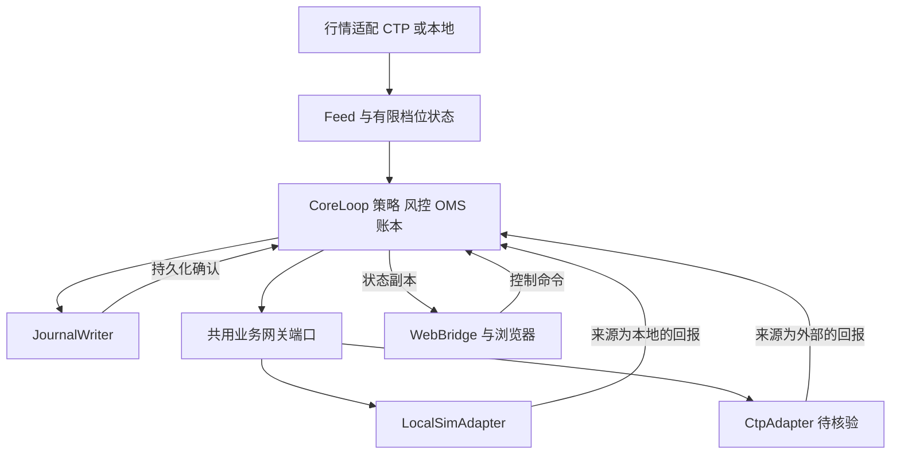
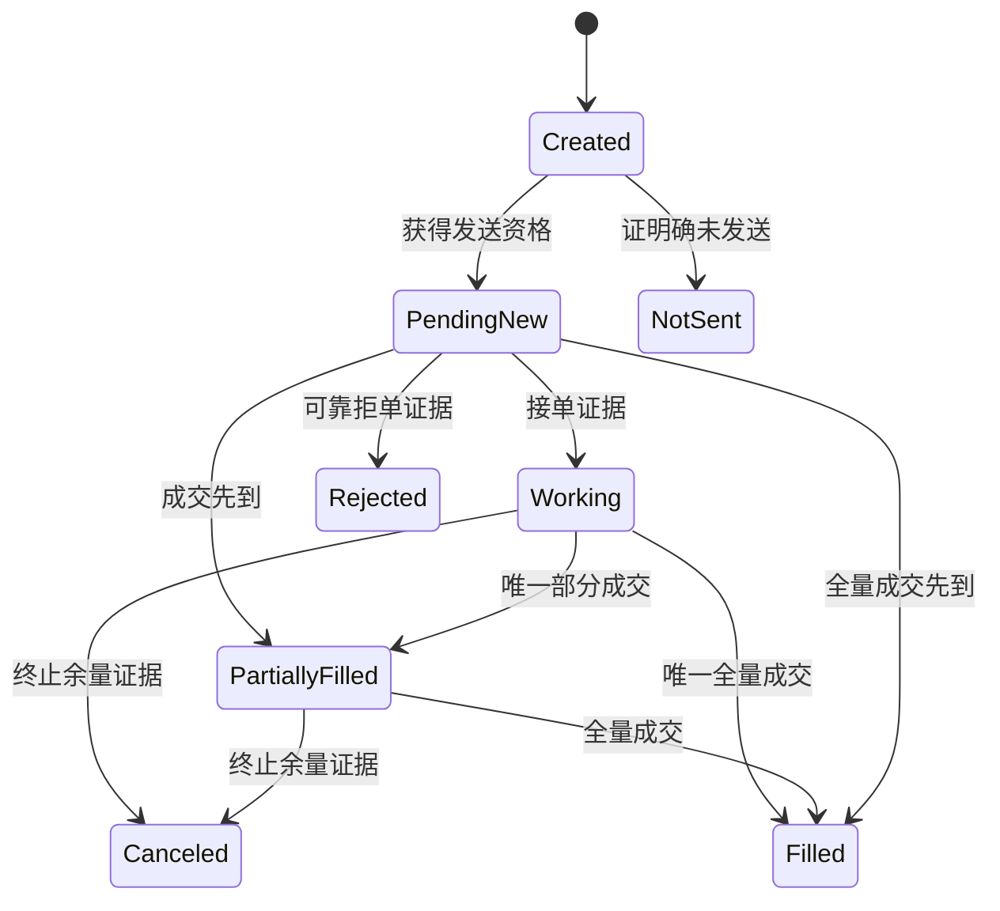
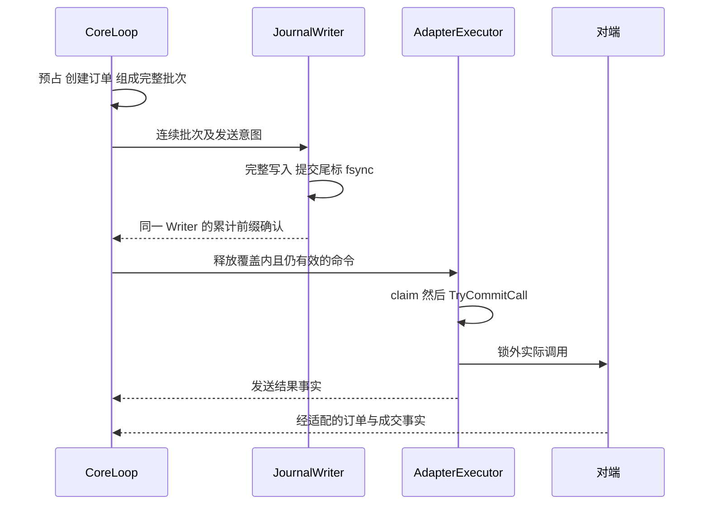

# 当前正式架构基线与全文

**生效状态：V1.1 已经用户正式批准；ADR001～ADR010 现行有效。仅授权 M1A，未授权跳阶段。**

来源原件：[V1.1 Markdown](architecture/PROJECT03_系统架构设计_V1.1.md)、[V1.1 DOCX](architecture/PROJECT03_系统架构设计_V1.1.docx)。Markdown SHA256：`95edf48d1f16bf088f3c214afd2d9779cc42c72c0ec6a50699ba9bae4207e2af`。用户批准摘录在 [C04](history/USER_DECISION_RECORD.md)。

下面完整附入原 Markdown 正文，不以摘要代替。原文中“待最终架构审查”“生产模块尚未开始实施”等是提交时历史状态；当前批准/实施状态由 [07](07_IMPLEMENTATION_STATUS.md) 和用户后续批准消息覆盖。原文契约不因此作任何修改。参考模型和 M1A 候选均不自动改变架构或批准后续阶段。

---

# PROJECT 03 系统架构设计 V1.1

C++ 高频做市交易与低延迟执行基础设施平台

日期：2026 年 11 月 5 日，北京时间。阶段：M1 前最终架构审查。V1.0 总体方向已获有条件通过；V1.1 修订五项 P0，尚待最终架构审查。ADR008 已正式批准。生产模块尚未开始实施。

本版保留 V1.0 的 19 章、模块与四个应用线程，不新增运行服务或技术栈。第 12 章处理 P0-01，第 5 章处理 P0-02，第 7 章处理 P0-03，第 9 章处理 P0-04，第 12.6 节处理 P0-05。每项均给出状态、不变量、正常与故障路径、反例、自动化测试及 M1A 至 M1F 影响。

审查导航：先看第 1.2 节变更索引，再看以上五处；第 17 章登记测试层次和阶段门禁，第 18 章登记批准状态。本版另附可独立编译的最小 C++ 契约模型，运行的是架构交错与证据规则测试，不是交易核心、真实磁盘耐久性或 CTP 联调测试。

## 1 架构结论与首版范围

推荐采用**一个 C++ 交易核心进程、一个独立 Web 桥接进程、单线程拥有交易状态、异步适配与持久化**的结构。本地适配与 CTP 适配通过相同业务契约交换命令和事实；适配器的能力、错误解释和证据来源分别登记。

核心先做到单账户、单策略、RB 单个实际挂牌合约。默认每侧最多一笔有效限价当日有效报价，业务默认 1 手；专用测试可使用多手委托覆盖部分成交。合约来自版本化目录，初版不自动滚动主力合约、不进入交割、不使用专业做市商特权。

M1 要实现有限档位行情、报价意图、开平路由、风险预占、OMS、成交账本、异步本地模拟、最小事件日志、回放校验与基础工作台。完整快照恢复、独立存活的模拟柜台、历史事故全实验、多合约、无锁优化依阶段加入。

上期所 RB 合约单位和 tick 等市场依据延续 M0；当前 CTP SDK 构建、SimNow 条件、真实回报语义和外部联调仍待确认。[R01][R03][R04] **这些待确认项关闭真实接入放行，不关闭本地核心的设计与测试。**

### 1.1 当前冻结到什么程度

| 决策 | 本次建议 | 后续变化条件 |
|---|---|---|
| 交易状态所有权 | CoreLoop 单写者 | 多合约负载证明需要分片后另作 ADR |
| 模块通信 | 类型化值事件与有界队列 | 测量证明队列瓶颈后才研究 SPSC |
| 柜台隔离 | 核心不依赖 CTP 头文件、枚举与库 | 保持为长期边界 |
| 正常发送 | 先预占，记录发送意图，达到持久化边界，再进入网关 | 持久化保证改变必须另作 ADR，M1 不提供绕过开关 |
| 改价 | 撤旧并处理剩余风险后再建新单 | 不假设原子 cancel/replace |
| 风控范围 | 账户、合约、策略三层视图；首版实例各一 | 不把首版单实例写死进身份模型 |
| 可视化 | 事件副本与命令桥接；浏览器不持有交易状态 | 保持隔离，不将 UI 开关当风控 |

### 1.2 五项 P0 的修订位置

| 审查项 | 本版形成的契约 | 主要验收位置 |
|---|---|---|
| P0-01 Journal | 连续提交前缀、累计确认、故障隔离、旧意图不自动恢复发送 | 第 12.1 至 12.4 节，J01 至 J07 |
| P0-02 Kill 与发送 | claim、调用承诺点与 SDK 入口分开；停领不冒充撤净 | 第 5.3 至 5.4 节，K01 至 K07 |
| P0-03 OMS 证据 | 累计下界与终止精确量分开，冲突与异常成交有独立保留 | 第 7.3 至 7.5 节，O01 至 O09 |
| P0-04 持仓与资金 | 本地业务桶、外部观察和结算证据分开，资金覆盖按资源核对 | 第 9.3 至 9.6 节，P01 至 P06 |
| P0-05 回报丢失 | 丢失代次、覆盖证明、恢复证书与原子复位检查 | 第 12.6 节，Q01 至 Q09 |

这些编号是项目内部契约和测试编号，不是 CTP 原生字段。J、K、O、P、Q 分别对应五项 P0；A01 至 A18 保留原有模块验收编号。凡正文使用“必须”，均约束后续实现；当前实测范围只限第 17.4 节明确列出的参考模型。

## 2 业务边界与真实链路

### 2.1 三种环境必须分开命名

| 运行模式 | 行情与交易对端 | 能证明什么 |
|---|---|---|
| LOCAL | 项目自建行情源和本地模拟柜台 | 我们定义的场景下，核心业务与故障处理正确 |
| SIMNOW | 已核验条件后接入的外部仿真环境 | 指定 SDK、账户和环境下的实际兼容行为 |
| REPLAY | 已录制且来源清楚的输入日志 | 同版本输入的决策与状态可重建；禁止外部发送 |

未来若增加正式期货公司接入，作为独立环境配置与验收，不由 SIMNOW 自动升级。SMDP_LAB 是独立协议实验模式，不伪装为已获授权的实时交易所行情源。

每个运行绑定唯一订单后端，环境标签由实际装配决定；切换后端须退出原运行并处理未解决风险后再启动。混合行情与交易来源需单独声明 profile，首版不自动混用。

真实接入的订单链路为：我们的 OMS 与网关 → CTP 客户接入前置 → 期货公司柜台与报盘 → 上期所交易系统；订单和成交回报沿适用路径返回。行情通过相应行情前置进入买方 Feed，不要求经过订单网关。CTP 历史厂商指南支持这一区分，但当前 SDK 的具体实现与回调保证须另行核验。[R03]

本地模式替换外部对端，保留相同的命令、事件和错误分层。本地模拟器既不冒充官方柜台，也不通过继承 CTP SPI 来证明自身与真实 CTP 的语义一致。

### 2.2 系统总览

图中的策略、风控、OMS 和账本在同一核心线程内按规则调用；不是四个微服务。Journal 的完成确认只解除对应发送意图的持久化等待，不等于订单被外部接受。

### 2.3 账户边界假设

首版按一个项目实例独占一个本地模拟账户设计。外部仿真联调也先采用可解释的专用账户；不能在未纳入 OMS 的情况下同时从其他终端手工交易并声称账户风险完整。发现外部订单、成交或持仓差异，进入 Unreconciled，暂停新增报价，保留对账记录；不自动删除未知外部订单。

该约束是项目首版简化条件，不是中国市场账户的普遍使用限制。

## 3 模块契约与依赖方向

核心业务库只依赖标准类型、业务模型与端口声明。运行时负责线程、时钟、文件和队列；适配器负责外部 SDK 或本地模拟；Web 只依赖版本化状态投影和控制契约。禁止从策略直接访问 SDK、数据库或 WebSocket。

| 模块 | 输入与输出 | 拥有的状态与边界 |
|---|---|---|
| ReferenceData 与 SessionCalendar | 合约目录、参数和交易日事件 → 可交易事实 | 合约乘数、tick、有效日期、交易时段；缺失不猜测 |
| FeedNormalizer | 原始回调或报文 → MarketSnapshot、FeedHealth | 数据来源与有效性；不推断未提供的逐笔事件 |
| MarketState | 已校验行情 → 行情视图和可用性 | 有限档位、最新有效序、接收年龄、失效原因 |
| QuoteStrategy | 行情、库存视图、配置 → QuoteIntent | 报价目标与策略状态；不能发网关命令 |
| OrderPlanner | 报价目标与当前订单、持仓 → 新单或撤单意图 | 目标与活动报价差异、开平拆分；不自行释放风险 |
| RiskEngine | 意图和一致状态 → 拒绝或 Reservation | 数量、价格、仓位、资金预算、速率和会话门禁 |
| OMS | 授权命令、网关事实 → 订单状态及待发效果 | 内外身份、执行证据、撤单动作与对账状态 |
| ExecutionLedger 与 PositionBook | 唯一有效成交 → 成交记录与分桶持仓 | 账本、今昨仓、冻结；订单累计量不重复记仓 |
| GatewaySupervisor | 核心命令、能力配置 → 会话与发送事实 | 发送工作线程、门闩、节流、外部映射；不改核心账本 |
| Journal 与 Recovery | 输入、决定、意图 → 持久化确认与恢复输入 | 日志格式、快照、截尾检查、恢复进度 |
| FaultLab | 场景配置与原始输入 → 故障化输入、注入记录 | 触发、种子、时序和报告；保护关闭仅限 LOCAL |
| StateProjector 与 Control | 核心事件 → Web 视图；命令 → 核心控制事件 | UI 游标、命令幂等；不提供原始 SDK 下单旁路 |

CoreLoop 是业务协调器，定义同一事件内的更新顺序。风险预占、OMS 订单创建和持仓冻结作为一个业务事务处理：要么全部建立，要么全部不建立；不能暴露“已批准但未冻结”的中间状态给下一笔意图。

模块边界不要求一开始每个模块独立动态库。M1 可将这些职责组织在一个 p03_domain 静态库内，靠清楚的头文件、所有权和测试隔离，避免为了层次制造大量转发类。

## 4 统一业务端口与适配器差异

### 4.1 核心只发送业务命令

| 契约 | 必要信息 | 语义 |
|---|---|---|
| NewOrderCommand | commandId、orderId、account、instrument、side、offset、priceTicks、lots、Day、reservationId、dispatchEpoch、journalId、writerEpoch、requiredJournalSeq | 已被核心批准的单笔普通限价单 |
| CancelCommand | actionId、orderId、可用外部身份、reason、environment | 请求撤销仍可能活动的订单；不保证撤销成功 |
| QueryCommand | queryId、账户、种类、范围、recoveryEpoch | 按适配器能力查询；不默认全历史或原子快照 |
| SubscriptionCommand | subscriptionId、实际合约、generation | 变更行情订阅；先收到确认和有效数据再可用 |
| ControlCommand | commandId、目标运行、配置期望版本、有效期、操作 | 启停、kill、复位等受控操作，不承载原始 SDK 字段 |

offset 仅表达业务上的 Open、CloseToday、CloseYesterday；价格用整数 tick，数量用整数手。若一项需求需要平今和平昨，规划器拆为两个有独立身份与预占的子单，不能让一个普通子单含含糊糊的 AutoClose。

端口可在 C++ 中表达为 IOrderGateway、IMarketDataSource 和事件接收器。接口签名在实施细化时冻结；此处的 enqueue 返回只表示进入本地有界队列，后续调用结果也不代表外部接单。CTP 类名与结构体只在 adapters/ctp 内出现。

NewOrderCommand 由核心受控构造，策略、网页及普通适配器没有构造授权命令并调用发送队列的公开路径。reservationId 是审计和一致性标识，不把一个可伪造的整数当成跨进程安全令牌。

### 4.2 回来的是事实与证据

| 事件 | 最低业务含义 | 必须保留的限制 |
|---|---|---|
| SubmitDisposition | DefinitelyNotSent、HandedOff 或 OutcomeUnknown | 只有有证据未交给外部的路径可立即撤销预占 |
| OrderUpdate | 可用身份、外部状态证据、可选累计成交、剩余、原因 | 不默认每个字段都存在或构成可靠顺序 |
| TradeObserved | 原始成交身份、订单关联、开平、价格、数量、交易日 | 身份唯一性作用域待适配核验；不可用价格和数量替代成交 ID 去重 |
| CancelOutcome | 动作关联、成功或拒绝证据、可选终止余量 | 撤单请求响应不自动等于订单最终撤销 |
| QueryPage 与 QueryEnd | 行、页、完成或失败、覆盖范围 | 结束标记不使多个查询自动成为同一时点快照 |
| GatewayHealth | 连接、认证、交易准备、恢复、错误层级 | Connected 只是其中一个维度 |
| MarketSnapshot 与 FeedHealth | 实收档位、可用字段、源时间与本地时间 | 不编造交易所序号、逐笔成交或队列位置 |

每个事件保留 origin、environment、adapterProfile、原始标识和原始状态码的可追溯引用；不把 CTP 原生枚举强制塞进核心执行状态枚举。OrderUpdate 另带累计证据等级与终止证据等级，TradeObserved 带已核验的身份作用域。QueryPage 和 QueryEnd 必须关联 queryId、recoveryEpoch、lossGeneration、源会话及覆盖描述。没有这些证据时保留 Unknown，不由归一化器补造保证。

requiredJournalSeq 是该新单意图所属批次的提交边界；它不是“核心自称已落盘”的凭证。AdapterExecutor 根据同一 journalId 与 writerEpoch 的累计确认及当前门禁核验，详见第 12 章。

### 4.3 能力通过证据开启

AdapterProfile 至少登记 sdkBuild、verifiedEnvironment、queryCoverage、tradeIdentityScope、privateReplayMode、nativeOrderTypes、cancelAddressing、mdDepth、sourceSequence 和 sessionRules。每项能力状态为 Unknown、Supported 或 Unsupported；Unknown 不按 Supported 处理。V1.1 增加 cumulativeEvidencePolicy、terminalQuantityPolicy、queryCoverageDescriptor 和 recoveryCutPolicy，均是同一 AdapterProfile 内的配置。不能把“查询接口存在”直接升级为“历史覆盖完整、空结果证明不存在或支持共同水位”。

LocalSimProfile 由项目测试规范定义；CtpProfile 必须由当前 SDK 文档、期货公司说明及外部联调分别支持。同一套核心契约测试验证共同义务，另用供应商适配测试验证映射，外部联调验证真实环境。**本地测试通过不能自动填满 CtpProfile。**

当前候选映射仅列到 ReqOrderInsert、ReqOrderAction、OnRtnOrder、OnRtnTrade 等历史接口名称；字段长度、同步错误的含义、回调顺序、流文件续传和查询能力仍是 M2 前置核验项。[R03][R04]

## 5 线程模型与有界通信

### 5.1 两种执行器服务同一业务核心

StepHarness 用于确定性测试：一个线程驱动逻辑时钟和事件调度器，每次完成 core.step 后才递交模拟器输出，再以计划时间和稳定插入序处理未来事件。禁止在 send 调用栈里递归回调核心。它验证业务顺序，不用虚拟时间冒充实际延迟。

RuntimeRunner 用于实际运行和并发测试，采用以下最小结构。M1 的四个应用线程包含核心主线程；真实 SDK 后续自建线程另计，数量与线程约束待核验。

| 执行上下文 | 唯一拥有的数据 | 允许做的工作 |
|---|---|---|
| CoreLoop | 策略、风控、OMS、账本、持仓、运行状态 | 处理业务事件和定时器、产生效果与不可变视图 |
| AdapterExecutor | LocalSim 的外部模型、命令发送过程和会话控制 | 消费授权命令、处理模拟定时事件；M2 调用 SDK |
| JournalWriter | 当前日志文件与落盘批次 | 顺序编码、写入、同步与返回持久化确认 |
| BridgeIO | 与 WebBridge 的非阻塞连接和输出缓存 | 读控制、写观测、编码 JSON；不写核心业务对象 |
| CTP 回调线程 | 仅本次回调参数的临时使用权 | 校验基本长度、复制、自有时间戳、投递；不持有借来的指针 |
| WebBridge 独立进程 | UI 会话、HTTP 与 WebSocket 连接 | 转交命令、维护展示投影；不链接 CTP SDK |

核心线程不做网络等待、fsync、长查询或图表序列化。适配器不通过引用访问正在修改的 Order 或 Position。配置更新和合约目录更新都经事件进入核心，在可核对的版本边界生效。

### 5.2 队列满时的行为属于契约

| 通道 | 正常策略 | 满或断开时 |
|---|---|---|
| 行情输入 | 有界 FIFO；M1 不做隐式合并 | 设置 feed invalid 和安全门闩，记录本地丢失；重新获取可用状态 |
| 订单及成交输入 | 独立有界队列，优先消费且有调度预算 | 同步关闭新增发送资格并提升 lossGeneration；保留风险，按第 12.6 节取得恢复资格 |
| 授权发单输出 | 有界 FIFO，禁止无限重试 | 保留预占，等待或明确撤回；收到未发送证明才释放 |
| 撤单与控制 | 单独预留容量、限速和优先级 | 拒绝新普通控制；kill 可走安全门闩，不依赖普通队列空位 |
| 日志输出 | 有界队列，按 coreSeq 顺序 | 停止新报价与新发送，保留审计缺口或落盘失败状态 |
| Web 观测 | 有界、可降采样、带丢弃计数 | 丢展示更新或断开慢消费者，重连取新视图 |

M1 采用互斥锁与条件变量实现清楚的有界队列，不预设无锁。SPSC 只在端点确实各一且有测量收益时引入；多个 SDK 回调生产者不能共享未经证明的 SPSC。队列节点和每条消息的长度都要有界，否则“节点数有界”仍可能耗尽内存。

安全门闩是少量独立同步状态，不是第二份风险账本。关键回调入队失败时，生产线程先设置 latch，使 AdapterExecutor 停止领取新单；详细故障随后由核心归并。若核心线程长期不推进，发送线程通过核心心跳年龄关闭领取资格。该机制不能保证已在外部活动的订单自动撤净，也不把调度器或 SDK 永不阻塞作为假设。

核心对回报、控制、行情、定时器采用有预算的调度，避免一种输入永久饿死其他输入。跨通道处理顺序记录为 coreSeq，线上多线程运行不保证每次自然产生同样顺序；回放重现已记录的顺序。

### 5.3 发送与 Kill 的精确边界

本节修订 P0-02。DispatchGate 只保存 open、dispatchEpoch、reasonMask、latchVersion、lossGeneration 和尚未结束的发送许可；不持有第二份持仓或风险账本。所有许可状态转移、关闭和复位检查使用同一短临界区。SDK 调用、排队等待、文件操作和回调处理均在锁外。单个 mutex 的加锁解锁为这些局部转移建立同步关系；它不能把外部 SDK 调用变成与 Kill 原子的操作。[R13]

| 许可状态 | 允许的下一步 | 风险含义 |
|---|---|---|
| Queued | claim 或确定撤回 | 未领取不代表可由核心单方面释放，仍需队列与执行器交接证明 |
| Claimed | CallCommitted 或 AbortedBeforeCall | 占在途许可计数，尚可在调用承诺点前撤回 |
| CallCommitted | SDK 入口，然后 CallReturned | 已承诺尝试调用；关闭门闩不能保证此后不会进入 SDK |
| CallReturned | 交付 SubmitDisposition | 调用结束不代表未接单、已撤单或外部风险消失 |
| AbortedBeforeCall | 交付 DefinitelyNotSent | 该次命令未进入 SDK；仅在不存在更早提交证据时释放对应预占 |

claim 在锁内检查当前 epoch、当前日志资格、授权、有效期、节流与门闩，再登记许可。随后执行器在同一锁下进行 TryCommitCall：门闩仍开且 epoch 匹配才进入 CallCommitted，否则进入 AbortedBeforeCall。TryCommitCall 是本项目“允许执行一次 SDK 调用”的线性化点，**不是 SDK 实际入口时刻**。在它与入口之间仍存在调度空隙。

Kill 在锁内关闭门闩、提升 epoch 和 latchVersion。已经 Claimed 但尚未 CallCommitted 的许可在随后 TryCommitCall 时被撤回；已经 CallCommitted 的许可保留到 SDK 返回或已核验的未调用证明。执行器不得把同一许可调用两次，也不得把 SDK 超时或非零返回值一概解释为 DefinitelyNotSent。

**不变量 K-I1 至 K-I5。** 关闭线性化点之后、下一次合格复位之前，新增 claim 和新增 CallCommitted 都为零；每个许可至多调用一次；未复位时，NewOrderCallsQuiesced 只在所有旧许可均为 CallReturned 或 AbortedBeforeCall 后成立；旧 epoch 许可和命令在复位后仍失效；任何 Kill、关闭、过期或 SDK 返回都不单独释放外部风险。

KillAccepted 表示关闭已生效；NewOrderCallsQuiesced 表示调用侧已静止；ExternalRiskResolved 表示订单和成交风险已有外部证据结清。三个状态分别显示。SDK 永久阻塞时可以已 KillAccepted 而长期无法 Quiesced。撤单通道保持受限可用，但同一执行器被 SDK 阻塞时也可能无法及时执行撤单，不能承诺独立即时撤净。

正常路径为 Queued、Claimed、CallCommitted、实际 SDK 调用、CallReturned、回报归并。故障路径为关闭门闩、撤回未承诺许可、等待已承诺调用、保留未知订单、受限撤单和对账。复位要求旧许可结束、旧队列命令已解释、全部恢复门禁通过且用户明确操作；不把 inFlight 计数清零来伪造静止。epoch 或计数器耗尽直接停报。

### 5.4 可执行的交错规约

C 表示 claim，B 表示 TryCommitCall，I 表示 SDK 实际入口，R 表示调用返回，K 表示 Kill。执行器程序顺序固定 C、B、I、R；模型枚举 K 的五个插入位置。未取得许可的后续步骤为空操作，不能悄悄变成发送。测试不使用 sleep 制造时序。

| 交错 | 必须观察到的结果 | 禁止的推断 |
|---|---|---|
| K C B I R | claim 失败，调用次数零 | 不能因历史授权仍在而领取 |
| C K B I R | B 失败，许可撤回，调用次数零 | Claimed 不等于已经调用 |
| C B K I R | 允许一次发生在 KillAccepted 之后的 SDK 入口 | 不能把 KillAccepted 展示为绝无后续 SDK 调用 |
| C B I K R | K 时调用仍在途，R 前不得 Quiesced | 超时不能当作调用已经返回 |
| C B I R K | K 后可达调用静止，外部订单仍待处理 | 调用结束不等于外部风险为零 |

**反例。** 若只在锁外读取 open，随后无条件登记 claim，则可出现“读到开、Kill 关闭、登记新 claim”。若静止条件只数 SDK 已进入的调用，则 C B K 之后会错误报告 Quiesced，I 随后才进入。随附 K06、K07 是负例测试，必须成功找到这两种错误模型的反例，而不是让错误实现通过。

**自动化与通过条件。** K01 穷举五个位置，每条路径都检查调用次数和静止边界；K02 阻塞在 R 前，必须始终未静止；K03 复位后旧 epoch 不能调用；K04 未获日志确认不能 claim；K05 用回报溢出关闭替代 K，得到同样边界；K06、K07 必须检测到错误模型。M1C 后另以 barrier 和可控 FakeSdk 验证真实 mutex、队列及生命周期，再运行 TSan；模型通过不代替这些并发测试。

**对阶段的影响。** M1A 定义许可事实和授权身份；M1B 使用可控本地适配；M1C 实现同锁转移与交错测试；M1D 把日志资格接入 claim；M1E 分别展示三个停止状态；M1F 验收阻塞、撤回、关闭和旧 epoch 不可复活。没有新增发送线程。

## 6 事件 数据与时间模型

### 6.1 统一信封

事件信封包含 schemaVersion、runId、environment、sourceId、sourceEpoch、可选 sourceSeq、receiveMonoNs、可选 wallTime、coreSeq 和 payload。sourceSeq 是来源序号，coreSeq 是本系统处理序；二者都不能冒充不存在的交易所全局序号。

核心事件使用值所有权；禁止把 SDK 指针、裸引用、进程地址或含填充字节的 C++ 结构体直接写入日志。外部字符串校验长度，价格与数量校验有效范围及溢出。M1 允许被记录和测量的动态分配，不预先宣称热路径零分配。

| 事件族 | 代表事件 | 是否可改变交易状态 |
|---|---|---|
| 市场 | MarketSnapshot、FeedInvalid、SessionPhaseChanged | 可改变报价资格与行情状态 |
| 交易 | SubmitDisposition、OrderUpdate、TradeObserved、CancelOutcome | 可改变订单、证据和账本 |
| 控制 | StartRequested、PauseRequested、KillRequested、ConfigChanged | 可改变运行门禁与配置版本 |
| 时间 | QuoteTimer、StaleTimer、OrderTimeout、SessionBoundary | 可导致停止或新意图，必须记录 |
| 恢复 | QueryPage、QueryEnd、ReconcileDifference、ReconcileCompleted | 只在明确恢复周期内更新恢复证据 |
| 观测 | MetricSample、UiSnapshot | 只读投影，不可反向修改核心 |

### 6.2 一步处理的顺序

收到业务输入后，先验证来源、身份及事件完整性，再分配 coreSeq；先归并已有订单与成交证据、更新账本和预占，再评估门禁，最后允许策略生成新意图。这样，策略不能用事件处理前的旧库存立即补单。

一次 step 输出业务状态变化、审计事件和待执行效果。运行时把输入及其决定组成日志批次；外部效果受持久化与发送门闩约束。JournalDurable 是运行时确认，不因“确认自身”再次无限写日志；所有影响业务的实际发送结果、超时和故障会作为有序输入记录。日志确认只改变运行时效果的释放资格，不改变报价决定；因此不把确认到达时序当作未记录的策略输入。若批量释放、超时或发送回执影响后续业务，则以对应的实际效果事实进入 coreSeq。

命令 ID、订单 ID、动作 ID 由核心按持久化实例与计数器生成，不由当前墙钟随机拼接。重启使用新 runId 和恢复 epoch，订单身份保持可关联；计数器耗尽或版本不兼容必须拒绝继续运行。

### 6.3 时间和确定性

运行时超时采用选定单调时钟，交易日历采用北京时间和市场交易日，外部源时间单独保存。回放使用记录的定时事件及配置，不重新读取现在时间决定历史订单。模拟随机数由固定算法和种子控制，算法版本也进入实验记录。

确定性限定为同业务版本、同参数和同已排序输入产生相同决定及规范化业务摘要。摘要排除物理接收耗时、指针地址、容器迭代偶然顺序和 UI 刷新时间；回放不承诺重现原运行的 CPU 延迟。

## 7 OMS 状态机与执行证据

### 7.1 四组状态替代一个过大的枚举

| 维度 | 候选状态 | 作用 |
|---|---|---|
| 执行 | Created、PendingNew、Working、PartiallyFilled、Filled、Canceled、Rejected、NotSent；Expired 仅能力支持时启用 | 表达订单生命期证据 |
| 发送 | AwaitDurability、Queued、Claimed、HandedOff、Unknown | 表达本地与外部发送边界 |
| 撤单动作 | None、Requested、Pending、Succeeded、Rejected、Unknown | 撤单失败不覆盖原订单执行状态 |
| 一致性 | InSync、MissingTrades、Unreconciled、Conflict | 终态订单也可能尚未完成记账或对账 |

风控在建立外部委托前拒绝的是 IntentRejected，保留意图审计，不伪造一笔交易所拒单。NotSent 表示有证据未向外部提交的本地终止。项目的 Unknown 是证据不足的业务状态，不等同于 SDK 中某个同名代码。

图仅表达主要执行路径。撤单等待与断线不删除原执行状态；迟到有效成交可以补充终态订单证据。任何不能解释的回退、数量矛盾或外部身份冲突，进入 Conflict 并停报，不靠禁止所有终态更新来掩盖事实。

### 7.2 转移规则与动作

| 输入 | 条件与状态动作 | 资源动作 |
|---|---|---|
| 新意图通过 | 原子建立预占与 Created，生成待发意图 | 预占成功后才排队；失败不留半份冻结 |
| 未发送证明 | 命令已撤回且不存在先前外部提交证据 | 标记 NotSent，按原 reservation 精确释放 |
| HandedOff | 只说明适配器已提交；不能进入 Working | 全部可能风险保留 |
| Accepted | 可靠外部证据；若成交已到，不回退到未成交 | 保留仍可能成交部分 |
| 唯一有效成交 | 校验身份和累计量，按分桶记账；允许先于 Accepted | 从待成交转为已成交或待补齐证据，不能重复占用 |
| 重复成交 | 同一去重键且内容一致 | 不改仓、不重复扣费用或释放额度 |
| 同键不同内容 | 成交身份或内容冲突 | 原始数据保留、隔离并对账，按保守风险停报 |
| CancelRequested | 对可能活动订单建立独立 action | 不释放任何可成交余量 |
| CancelSucceeded | 必须有订单终止余量的可靠证据 | 只释放确认不再成交的部分；未入账成交继续占用 |
| CancelRejected | 只改变撤单动作状态 | 原订单风险保持；不得标记原单 Rejected |
| 新单拒绝 | 无成交或接单冲突，且证据覆盖整笔未成交委托 | 终止对应剩余风险；与有效成交矛盾时转对账 |
| 超时或断线 | 保留订单原执行状态，标记 Unreconciled | 不自动认定失败，不自动重发 |

交易回报查询和实时推送都进入同一个去重与归并入口。来源不同不构成两笔成交；相同价格、时间和数量也不证明是同一笔。去重键按已核验的账户、交易日、交易所及原始成交标识范围组成，当前 CTP 唯一性细则待确认。

### 7.3 累计成交证据与数量分区

本节修订 P0-03。Q 为原始委托数量，B 为唯一有效且已归入该订单正常账本的成交数量，R 为已通过来源策略核验的累计成交下界，E 为 max(B,R)。R 的“可靠”不能由字段名称、数值看似合理或本地模拟通过来定义。

| 证据等级 | 允许的用途 | 进入条件 |
|---|---|---|
| Raw 或 Unverified | 原始材料留存，必要时触发停报 | 字段未验证、身份不完整或 profile 未确认 |
| CumulativeLowerBound | 可增加 R，不生成逐笔成交 | 账户、订单、交易日、作用域、数量范围及来源语义均核验 |
| NoFutureExecution | 确认不再有新的外部执行 | 终止语义有证据；不自动证明最终成交总量 |
| TerminalExactQuantity | 固定最终累计量 F 并支持释放未成交部分 | 可靠终止证据加精确最终量，二者覆盖同一订单生命期 |

**不变量 O-I1 至 O-I5。** 正常订单满足 0 ≤ B、R、E ≤ Q 且 E=max(B,R)；R 只吸收已验证下界；B 只由唯一逐笔成交增加；精确终止 F 必须与已知 B、R 相容；查询和推送共用同一身份索引。异常材料不能通过截断、覆盖或删除来伪装满足不变量。

B 大于 R 可以是逐笔回报先到，R 大于 B 可以是逐笔尚缺，两者本身不构成 Conflict。R 取可信下界最高值；晚到的较小下界在缺乏可信先后证据时视作旧观察，不降低 R。若 profile 能证明同一源的新版本累计倒退，或同一源版本给出不同累计量，则进入 Conflict。时间戳更晚不自动提供这种顺序保证。

为明确资源释放，对正常订单把 Q 分为五个互斥部分：B 是已记成交，H=E−B 是已知成交悬置，P 是未来仍可能成交量，L 是已证明未成交且不再成交的量，V 是终止后最终数量仍不清楚的量；五者之和等于 Q。

| 订单证据 | P H L V 的取值 | 资源动作 |
|---|---|---|
| 仍活动或状态未知 | P=Q−E，H=E−B，L=0，V=0 | 未入账风险共 Q−B，不能因超时释放 |
| 终止且最终精确量为 F | E=F，H=F−B，P=0，L=Q−F，V=0 | 仅释放 L，悬置继续占用 |
| 已确认不再执行但无精确最终量 | P=0，H=E−B，L=0，V=Q−E | V 可能是已成交未补齐量，不能当作未成交释放 |

只有撤单请求响应而无终止证据时仍使用第一行。拒单或 NotSent 只有在覆盖整笔且与成交无冲突时才能作为 F=0；不得从单一状态名字推断。可信下界也不能单独证明 Q−R 已经被撤净。

数值例子保留：买开 Q=3，T1 成交 1 手，随后收到可信已撤和 F=2。此时 B=1、R=2、E=2、H=1、L=1。只能释放 L；T2 的 1 手迟到后 B=2、H=0；T2 查询和推送各到一次也只记一笔。若只有已撤而没有最终精确量，则 B=1、R=1、V=2，不得释放这 2 手。

**冲突处理。** 精确 F=2 后收到可确认的第三手有效成交，或 F 小于 B、R，立即关闭新单资格，保留所有证据。只要身份、数量、开平等本身有效且 B 加该笔数量不超过 Q，迟到成交仍记一次正常账本，即使与早期终止或拒单证据冲突；原终止证据不得继续支持释放。重算保守占用，若之前释放造成资源不足，显示 RiskDeficit，不能把余额修成零掩盖缺口。

若一笔身份有效的真实成交使该订单总量超过 Q，其经济事实不能消失。该笔进入 ExceptionExecutionLedger，正常 B 保持原值，额外数量记为 X，并参与保守风险；界面显示 B 与 X、观察总量超 Q 和 Conflict。正常路径的数量分区此时失效，禁止继续报价。异常账本和正常账本共用成交去重索引，避免恢复时再次记入。负数量、非法价格或身份不明只作隔离证据，不能伪装成有效成交；对应未知风险另保留。

订单已是 Filled、Canceled、Rejected 或 NotSent 也不得丢弃迟到事实。Filled 可以仍是 MissingTrades；Canceled 可以等待悬置成交；与 Rejected、NotSent 矛盾的有效成交必须入账并进入 Conflict。Created 也可能先收到可关联成交，不依赖模拟器先发 Accepted。

查询与推送的去重键使用已核验的账户、交易日、交易所及原始成交身份作用域；不把 transport source 或 queryId 加入经济身份。相同键比对规范化经济字段，忽略通道与请求编号。相同键同内容只应用一次，同键异价格、数量、方向、开平或订单关联进入 Conflict，不覆盖原交易。查询只有聚合数量、没有可信逐笔身份时不能增加 B，也不能宣称逐笔账本已补全。

### 7.4 报价更新与身份

OrderPlanner 比较 desired quote 与 active quote，默认撤旧后再建新单。待撤和未知订单仍占活动报价槽；MissingTrades 或 Unreconciled 时不基于不完整库存继续补单。每个新意图有 generation，防止旧行情生成的待发命令在新配置或 kill 后继续执行。

本地 orderId、commandId、cancelActionId、vendorRequestId、会话键和 externalOrderKey 分开。没有交易所订单号前使用已有合法关联证据，不能编造 OrderSysID。未知回报先进入隔离区及对账；不能仅因项目暂未认识该 ID 就丢弃。

### 7.5 OMS 的自动化验收

O01 检查未验证、负数和超 Q 的累计值不能进入 R；O02 枚举下界与逐笔的先后，B 大于 R 与 R 大于 B 均按证据处理；O03 重放 Q=3 的撤成例子及查询推送重复；O04 注入 F 小于 B 和终止后矛盾成交，必须记有效事实并停报；O05 验证跨通道同键幂等；O06 验证同键异内容不覆盖；O07 验证超 Q 的有效成交保留为 X 且仍去重；O08 验证无精确 F 时 V 不释放；O09 验证具有可信可比版本的累计倒退触发 Conflict。正常路径按证据归并、入账和调整预占；故障路径先关闭发送资格，保存冲突事实、恢复保守占用，再以覆盖证据对账，不修改历史成交来凑数。

**反例。** 把 Canceled 当作 releaseAll，会在 Q=3、B=1、F=2 的时序中错误释放 2 手而不是 1 手；把来源通道放进去重键，会使 T2 在查询与推送中记两次。测试通过要求每一步的 B、R、E、H、P、L、V、X、冻结、Conflict 和风险缺口与规约一致，不只检查最终状态名。

**对阶段的影响。** M1A 完成证据类型、数量分区和共用去重；M1B 由 LocalSim 明确生成不同证据等级；M1C 检查乱序通道；M1D 持久化原始身份、证据等级、异常账本和去重；M1E 展示悬置与 Conflict；M1F 组合迟到、重复和查询恢复。CTP 证据等级仍在 M2 单独核验。

## 8 风控资源预占与发送授权

### 8.1 在一个业务事务内完成

OrderPlanner 提供明确价格、数量及开平分桶。RiskEngine 在同一个核心 step 中依次检查运行资格、行情、合约与价格、数量、可平资源、最坏持仓、资金模型、意图速率和容量；全部通过才建立 reservation、OMS 订单及冻结。事务中途失败整体回滚，输出明确 reasonCode 和命中规则版本。

每份 reservation 关联 orderId、原始数量、当前可能成交量、成交悬置量、开仓风险、平仓桶、费用预算、风险模型版本及最后应用的证据版本。资源更新按最新事实重算目标占用，再与旧值取差额；不对每条重复终态回报执行一次无条件 releaseAll。

订单超时、kill、断线、过期配置或撤单请求都不自动证明外部风险消失。只有未发送证明、可靠拒绝、确认终止余量或唯一成交消费等证据，才能改变相应资源；成交通常把订单风险转入持仓风险，而不是让风险消失。

### 8.2 净仓与总仓同时检查

N 表示已确认基线和其后唯一成交形成的净仓，UB 表示尚未入账但有可靠买入成交证据的数量，US 表示相应卖出数量，PB 与 PS 表示 P 及 V 形成的买卖未解决风险量；V 虽已停止未来执行，仍可能代表尚未识别的既有成交。保守净仓区间为：

qMin = N − US − PS；qMax = N + UB + PB。

买平空也使净仓上升，卖平多也使净仓下降，所以这一计算按买卖方向处理；总仓上界将开仓的 H、P、V 加到业务总持仓上，不提前假定平仓一定成功。

例：当前净多 2 手，另有可能买入 3 手和卖出 1 手。最坏区间是 [1,5]，不能用“全部都会成交后的净多 4 手”证明满足 4 手上限。此处数值仅为测试样例，不是市场限额。

| 风险项 | 检查对象 | 关键边界 |
|---|---|---|
| 单笔与价格 | 数量手数、合法 tick、当日价格带、偏离 | 价格带或参考行情缺失时拒绝新增报价 |
| 净仓 | qMin、qMax | 不假定另一侧订单替自己对冲 |
| 总仓与单边 | 四桶及开仓的 H、P、V | 不能让多空同时扩大却只看净数 |
| 可平资源 | 指定分桶余额减所有对应冻结 | 未入账开仓不能立即作为可平库存 |
| 资金与费用 | 持仓占用模型、订单预占、悬置和未知缓冲 | 保守模型与实际柜台权益分开展示 |
| 速率 | 意图、实际发送尝试、撤单及合计 | 内部阈值不冒充交易所或柜台统一阈值 |
| 安全门禁 | 行情、交易日、会话、对账、kill、持久化 | 任一关键条件失效即禁止新增风险 |

M1 使用显式配置的保守保证金和费用模型，不实现完整柜台风险引擎。本地预算与外部可用资金分别设门禁；覆盖、增量扣减和未知资金缓冲按第 9.5 节处理。不能把外部可用资金与本地模型余额相加，也不能把同一笔已证实覆盖的冻结重复扣减。

自成交预防覆盖本账户所有已知、仍可能活动的相反方向订单，包括待撤和未知单。新买价与自身卖单相交、或新卖价与自身买单相交时，拒绝新报价并由规划器处理旧单；身份或价格不可解释时停报。该机制是本地保守检查，不声称拥有交易所原生 STP，也不能在账户存在未纳入管理的其他终端订单时保证全账户无自成交。

### 8.3 三层节流与过期命令

核心限制策略意图与账户累计请求；AdapterExecutor 在实际领取发送时再次进行发送节流，避免一批日志同时落盘后瞬间突破发送速率。外部柜台限额及统计范围由已核验 profile 提供，撤单也纳入适用总量限制。

未获得发送令牌的命令继续占用预占，但有报价有效期和排队上限。旧 generation、超时或 epoch 失效的命令申请撤回；只有队列与执行器证明该次命令未进入 CallCommitted，或 Claimed 已在 TryCommitCall 前可靠撤回，才能返回 DefinitelyNotSent。已经 CallCommitted 的命令按在途处理，不能同时被核心当成未发送释放。SDK 实际入口前后的未调用证明如需使用，必须由适配器契约单独核验，不凭超时生成。

### 8.4 Kill 与持久化故障下的撤单

Kill 流程为关闭新单 gate、使旧待发资格失效、由 OMS 对可能活动订单安排撤单、继续处理回报与对账。复位要通过操作命令并检查全部门禁，不自动开仓或自动平仓。

**ADR008 已正式批准。** 日志不可写时，允许 OMS 对可可靠定位的已有订单尝试受限 EmergencyCancel。适配器必须核对账户、环境、来源、完整且无冲突的外部定位证据和 profile；不能猜测或拼造订单号。该路径只允许撤单，不允许新单、改单增量、自动平仓或复位开仓；仍受撤单和柜台适用节流约束。

进入该路径即置历史标记 AuditIncomplete，并设置 auditGapUnresolved。有界内存记录只能尽力保存，不能冒充已持久化。撤单尝试、SDK 返回和撤单请求响应均不等于撤销成功；风险释放仍由第 7 章证据决定。恢复后必须外部对账，RecoveryCertificate 持久化后才可解除 auditGapUnresolved；历史 AuditIncomplete 永不被“清除告警”抹去。无法可靠定位的订单保持未知并提示后续核对，不发猜测性撤单。

## 9 期货今昨仓与成交账本

### 9.1 分桶更新规则

上期技术历史指南说明上期所今昨仓及平今、平昨的区别；它仅作语义依据，当前 SDK 枚举映射仍待核验。[R03] 核心采用以下独立业务模型，不依赖枚举字符值。

| 唯一有效成交 | PositionBook 的更新 | 冻结消费 |
|---|---|---|
| 买开 | LongToday 增加 | 消费开仓订单预占，转为多头持仓风险 |
| 卖开 | ShortToday 增加 | 消费开仓订单预占，转为空头持仓风险 |
| 卖平今 | LongToday 减少 | 消费该订单 LongToday 冻结 |
| 卖平昨 | LongYesterday 减少 | 消费该订单 LongYesterday 冻结 |
| 买平今 | ShortToday 减少 | 消费该订单 ShortToday 冻结 |
| 买平昨 | ShortYesterday 减少 | 消费该订单 ShortYesterday 冻结 |

每个桶保存 booked、closeReserved 和必要的成交悬置冻结。可平量基于已入账且尚未冻结的份额计算，不能让两笔平仓单消费同一持仓。实际柜台拒绝平仓仍需完整处理，本地持仓推导不承诺外部此刻必然接受。

例：LongYesterday 为 3，已有平昨冻结 2，可再平昨只有 1。新的卖平昨 2 手必须拒绝或由规划器拆分为经过分别校验的子单；不能暂时冻结成负数。重复成交和重复撤单确认不重复减少 booked 或 closeReserved。

### 9.2 报价意图怎样选择开平

买侧优先考虑减少已确认空仓，卖侧优先考虑减少已确认多仓；缺少可平资源时才按开仓规则评估。平今与平昨顺序作为项目显式配置，初始可采用平昨优先，不能说成交易所强制要求或最优费用策略。

净仓为零也可能同时持有多空仓，所以策略的库存偏移、总仓约束和开平选择使用不同视图。初版不实现自动移仓、套利组合或对锁保证金优惠，不把买开与卖开自动互相净掉。

### 9.3 本地四桶与外部持仓观察

本节至第 9.6 节修订 P0-04。PositionBook 是本项目在明确交易日和已确认基线之上，由唯一成交推导出的业务持仓。ExternalPositionObservation 保留柜台查询的原始口径、账户、合约、方向、适用投保属性、交易日、查询范围与来源。SettlementRecord 是结算价、费用、保证金和权益等结算证据。三者职责不同，均由现有账本与恢复模块承载，不增加模块或线程。

外部返回不能默认恰好等于 LongToday、LongYesterday、ShortToday、ShortYesterday。聚合持仓、持仓明细、冻结、当日量和历史量的映射由 CtpProfile 核验，不在所有市场上机械采用“总量减今仓”等式。单一交易日字段也不自动证明结算已经完成。M1 的 LocalSimProfile 可以明确给出四桶和基线覆盖，不能据此推断真实柜台。

**不变量 P-I1 至 P-I5。** 每个桶属于确定的 account、instrument、positionEpoch 和 tradingDay；可平量不小于零且每份冻结只消费一次；外部查询不直接覆盖本地账本；新基线与后续成交的覆盖必须不重不漏；旧交易日风险和未识别资金影响未解决前不开放新报价。

恢复时 PositionAnchor 明确基线数量、交易日、来源和所包含成交范围。基线之前已包含的成交保留身份但不再次应用，之后的唯一成交才作为增量。没有可验证覆盖边界时保持 NeedsReview，不能用新查询覆盖桶后又完整重放原交易日志。账本与结算差异要记录成核对项；模型费用和实际结算费用分别标注，不凭成交回报宣称完整账户权益。

正常路径是确认基线、逐笔更新四桶、冻结消费、外部观察核对、结算证据归档。故障路径是保留原基线与原始查询、关闭新单、登记差异和缺失范围、取得新的覆盖证明后再建立基线。

### 9.4 跨日与未解决风险

跨日使用 OpenDay、BoundaryHalted、AwaitDayEvidence、DayAnchorVerified、ReadyPaused 五个业务阶段，归入现有会话与恢复状态。确认交易日边界时先停报价、关闭 gate 并提升 epoch；不在自然日午夜或本机认为夜盘开始时搬桶、清 ID 或重置冻结。

M1 采用保守规则：旧日存在未知发送、未终止订单、H 或 V、冲突、未补齐成交、回报丢失或审计缺口时，不发布可交易的新日持仓基线。CarryRisk 记录旧订单身份、原开平语义、原冻结桶、交易日、缺证据范围和保守暴露；它是现有 reservation 的延续，不是一份可重复相加的新持仓。外部新日查询可保存为候选观察，不能使旧风险消失。

旧日 CloseToday 命令在新日绝不原样重发，也不因本地搬桶自动改成 CloseYesterday。旧日迟到有效成交先按原 positionEpoch 与原语义归并、去重，核对其是否已包含在新日候选基线。旧风险结清且边界映射及覆盖获确认后，才以一个显式 DayAnchor 事务把已确认今仓并入昨仓、建立新交易日，再进入 ReadyPaused。新日参数、资金与行情也必须有效。

真实环境若查不到旧日完整成交或无法确定期末持仓，保持 NeedsReview。人工核对必须附账单或其他适用外部证据、覆盖说明、操作者和审计记录，不能只点击“忽略差异”。M1 可测试停在这个状态；跨日缺证据时继续报价不属于首版交付承诺。M4 再增强跨日恢复材料与独立对端存活实验。

**反例。** D 日卖平今 1 手仍未知，午夜自动把 LongToday 搬到 LongYesterday 并释放旧冻结；D 日成交随后迟到。若把它当新日卖平昨重放，就可能重复减仓或错误冻结。正确行为是保留旧 positionEpoch，停报并核对新日基线覆盖；相同成交无论何时到达只处理一次。

### 9.5 资金查询与本地预占的覆盖

资金查询必须保存 source、account、currency、交易日、口径、请求接收区间、profile 和覆盖证据。Aext 表示这份外部观察的可用金额，不能默认其未包含保证金或委托冻结，也不能从本地回调时间拼造柜台原子时点。

每项风险资源 i 保存本地保守需求 Li 和该外部基线已证实覆盖的金额 Ci。同一外部扣减证据只能归属一份资源覆盖；订单资源转成持仓资源时连同 Ci 迁移，不能复制成两份覆盖。覆盖为 Included、Excluded 或 Unknown；Included 也必须有金额口径，不能仅凭“订单已存在”就假定全部保守需求已覆盖。Ci 只能引用可核对的外部证据；Excluded 和 Unknown 取 Ci=0。

外部可用预算从 Aext 扣除各项 max(0,Li−Ci)、基线后尚未覆盖的费用和其他正向资金消耗，再扣未知及价格变动缓冲；同时独立检查本地配置预算。两套门禁都通过才允许新风险。资源从订单冻结转成持仓占用时继续追踪同一覆盖，不返还后又重新扣一次；基线后的已发生费用也不能随订单终态从预算中消失。未经确认的平仓收益、保证金释放和撤单退款不增加外部可用预算。

例：外部可用 1000 已扣某订单冻结 200，本地需求 200 且覆盖金额证实为 200，则不能再扣这 200；新增尚未外发的预占 100 后预算为 900。若旧 200 的覆盖未知，则保守预算为 700，即扣未知旧资源 200 和新增 100。这是明确展示的保守扣减，不得宣称已完成精确资金核对。需求从 200 增至 250 而覆盖仍为 200 时，额外 50 仍须扣除。金额仅为测试单位，不是 RB 真实保证金。

新查询不能无条件清空所有本地预占。只有它明确覆盖的资源和费用才能换锚；查询窗口内新增的授权、在途订单、悬置成交、异常暴露与费用仍需保留。查询失败、过旧、币种或交易日不符、覆盖不明时，真实接入的资金核对门禁关闭；本地模拟仍可依据已声明的模型运行。CTP 查询字段、冻结口径及覆盖范围留待 M2 核验。

### 9.6 自动化验收与阶段影响

P01 检查平仓冻结竞争与六种开平更新；P02 检查结算或外部查询不会直接覆盖业务桶；P03 注入跨日旧平今单及迟到成交，未解决时必须停在 BoundaryHalted 或 AwaitDayEvidence；P04 检查已证实覆盖不会重复扣减及覆盖不足只扣差额；P05 检查 Unknown 采用 Ci=0；P06 检查订单转持仓和基线后费用不会产生虚假可用资金。

通过要求包括四桶数量、原 positionEpoch、冻结、成交去重、覆盖金额、预算和门禁逐步一致；仅最终净仓相等不算通过。真实外部持仓映射和资金口径另需适配测试，模型通过不能标记其已验证。

M1A 增加基线身份、旧日风险引用和资金覆盖类型；M1B 明确 LocalSim 基线及查询口径；M1C 将交易日边界投递为事件；M1D 记录锚点、冻结和覆盖变更；M1E 分开展示业务桶、外部观察、结算与模型预算；M1F 验收跨日阻断和资金不重复扣减。上期所交易日与当日有效等业务依据沿用当前规则，临时参数仍按运行日期加载。[R02]

## 10 行情状态与独立协议实验

### 10.1 主线行情是有限档位状态

MarketSnapshot 保存 instrument、validDepth、每档价格与数量、有效字段掩码、可选累计统计、源时间、本地接收时间与订阅 generation。MarketState 按完整快照替换对应可用视图，不用快照差额猜出全市场订单增删。

普通 CTP 入口的公开逐笔成交、真实排队位置、完整 MBO、交易所连续序号均不默认可用。累计量差额只显示区间统计；内部接收计数只证明本地链路连续性。档位和推送频率由真实 profile 与样本核验；历史指南的快照描述不替代当前能力测试。[R03]

行情资格有 AwaitingData、Valid、Stale、Invalid、Recovering。交易日或订阅 generation 改变使旧行情失效；重新连接并不让旧缓存自动恢复为 Valid。陈旧检测使用本地单调年龄并结合会话与健康信息，不能把没有价格变化直接证明为上游故障。

### 10.2 SMDP_LAB 与主线分离

SMDP 2.0 文档 V1.22 描述分价格档位切片、MDQP 查询、MIRP 增量及恢复；文档版本不等于报文版本字段。[R05] 本地实验解码器输出规范化 MBP 状态，再通过已声明的实验源接入相同 MarketState；没有实时行情授权时，只使用明确标识的本地夹具。

协议模块包括 CheckedReader、MDQP 流式分帧、MIRP 报文解析、主题与交易日状态、增量缓存、SnapshotAssembler、GapRecovery。按文档做小端读取、长度与字段边界检查，不直接 reinterpret_cast 为宿主结构体；压缩整数长度有上限，未知字段只在规范允许的扩展规则下跳过，影响状态的未知语义必须停用相应能力。

| 实验状态 | 输入与处理 | 放行条件 |
|---|---|---|
| AwaitSnapshot | 缓存有界增量并请求或加载基准快照 | 基准、所属交易日与数据中心可确认 |
| CatchingUp | 按规范丢弃快照已覆盖报文并接续增量 | 缓存与新输入连续且状态摘要通过 |
| Live | 更新 MBP，处理心跳、重复和适用分片 | 仅在有效时期分发可交易状态 |
| GapDetected | 检测到缺口、超时或本地缓存溢出 | 立即使行情不可用，进入恢复 |
| Recovering | 小缺口补足或重新建立快照 | 完整性与中心边界核对后回到 Live |
| Failed | 无法解释的编码、版本或恢复失败 | 保留失败样本；不靠清空告警恢复报价 |

报文号、主题快照编号、合约快照编号分别建模；交易日、数据中心和主题形成恢复上下文，各序号作用域按规范核对。心跳不能简单视为普通报文序号加一。中心切换时不能把旧中心缓存直接拼接到新快照。[R05]

M1 只冻结端口和能力边界；M2 完成可声明的编解码子集与夹具，M4 完成缺口、乱序、缓存饱和与中心切换实验。未覆盖字段和消息类型列入协议覆盖矩阵，不声称完整实现交易所全部行情服务。

## 11 网关会话与本地模拟器

### 11.1 可发送是多个条件的交集

GatewaySupervisor 分别记录 Transport、Authentication、Login、TradingDay、SettlementReadiness、RecoveryReadiness 和 CapabilityReadiness。Start 命令只申请启动；全部业务门禁通过才进入 Ready。连接成功或登录成功不能单独开启策略。

CTP 接入时的认证、登录、结算确认、订阅及查询顺序由当前 profile 固定；并非假定所有行情端和交易端具有同一认证流程。异步查询逐项关联 queryId 和 recoveryEpoch，旧会话返回的页面不得覆盖新恢复周期。[R03][R04]

| 失败层 | 业务解释 | 默认处置 |
|---|---|---|
| 本地队列或编码 | 尚未执行外部调用，可能有确定未发送证据 | 记录 LocalError，按证明释放或撤回 |
| SDK 同步返回 | 是否提交外部取决于当前接口文档 | 不把所有非零值都猜成同一种结果 |
| 响应或异步错误 | 可能属于新单、撤单或查询不同动作 | 归入对应动作，保留原码与证据引用 |
| 外部拒绝 | 需核验拒绝覆盖范围和累计成交情况 | 不与撤单拒绝混淆；矛盾进入对账 |
| 网络断线与超时 | 未知是否接单或成交 | 关新单 gate，保留风险并恢复对账 |
| 无法识别的状态 | 映射或协议能力不足 | Unknown 或 Conflict，不能当成功放行 |

重连采用有上限的退避、尝试预算和清楚的失败状态，不在核心线程循环阻塞。SDK 若自带重连机制，统一由适配器协调，避免业务层再建立另一套互相竞争的连接循环。

### 11.2 LocalSim 的职责

M1 LocalSim 包含合约规则夹具、独立外部订单表、可平与资金模型、脚本事件调度、查询应答和连接状态。它拥有自己的外部世界状态，通过业务端口收发，不能读取核心内部账本来“保证对账一致”。

确定性脚本模式用于给出明确预期；行情驱动模式仅提供带假设的成交负载。外部接单、部分成交、撤单、拒绝、回报延迟、重复和乱序均可配置。模拟器的规则校验不直接复用 RiskEngine 的同一段判断作为唯一测试裁判，避免同一个错误在两边互相证明。

M1 RuntimeRunner 可将 LocalSim 放在 AdapterExecutor 内，便于闭环运行。此时整进程崩溃也会使模拟外部状态消失，不能用它证明“对端仍存活时的进程恢复”。M4 增加 sim_venue 独立进程，或由测试父进程持有外部模型、重启核心子进程，专门验证这种故障边界。

LocalSimProfile、ScenarioFixture 和期望账本分别有版本与输入哈希。模拟成功日志不会写成 CTP 登录成功；同一事件源也不能在 UI 中显示为真实上期所逐笔数据。

## 12 日志 持久化与恢复

### 12.1 连续提交前缀与确认

本节至第 12.4 节修订 P0-01。日志仍是一个 JournalWriter 顺序写的业务事件日志。每个 TxBatch 包含 journalId、writerEpoch、连续 batchNo、firstSeq、lastSeq、prevLastSeq、记录长度、输入与决定、预占变化、发送意图、校验和及完整提交尾标。批次内部不能只恢复订单而遗漏其预占；批次间不允许 coreSeq 空洞或重叠。记录不直接使用 C++ 内存布局。

| 前缀 | 精确定义 | 允许的用途 |
|---|---|---|
| producedSeq | 已由核心组成并按序交给日志通道的连续批次末端 | 说明内存进度，不授予发送资格 |
| writtenSeq | 文件写调用已完整接收的连续批次末端 | 仍不代表持久化 |
| durableSeq | Writer 对连续批次完成成功文件同步的最高末端 | 仅由当前 Writer 发布累计确认 |
| acknowledgedSeq | 核心已接受的同一 Writer 累计确认末端 | 运行时可据此释放相应新单效果 |
| recoveredSeq | 重启扫描找到的结构和校验均有效的连续提交前缀末端 | 用于重建状态，不能推断旧发送是否发生 |

**不变量 J-I1 至 J-I5。** 同一活动 Writer 中 acknowledgedSeq 不大于 durableSeq，durableSeq 不大于 writtenSeq，writtenSeq 不大于 producedSeq；前缀只在完整批次末端推进；有空洞则不得越过；新单 requiredJournalSeq 必须被同一身份的 acknowledgedSeq 覆盖；重启重建不恢复旧命令的发送许可。持久化与发送门禁之外的其他风险门禁仍须通过。

一次 write 成功可能只写部分字节，完整写入也不证明数据已持久化。M1 循环处理短写，EINTR 且零进展时按边界重试；无法完成、零进展耗尽或同步失败则停止该 Writer。文件同步、文件创建和目录发布分别验证；不能用用户态 flush 或 write 成功代替 fsync。具体保证按目标文件系统和存储设备的故障假设验收。[R11][R12]

Writer 必须先完整写批次和提交尾标，再执行成功 fsync，才提高 durableSeq。M1 不提供跳过同步的新单开关。确认是带 journalId、writerEpoch、batchNo、durableSeq 的累计状态；例如确认 12 可以覆盖丢失的确认 11，前提是 Writer 已证明 1 至 12 连续。不是“见过最大序号就取最大值”。

核心只接受当前身份且指向已知合法批次边界的确认；重复或较旧确认幂等忽略，旧 Writer 确认不生效，未知未来边界触发协议故障。确认丢失时不重写原批次，也不重新生成同一订单；发送效果留在 AwaitDurability。可经当前 Writer 的有界状态查询再次取得累计确认。

若确认超时，门闩关闭并提升 dispatchEpoch；随后确认到达只补齐日志事实，不能自动重开或恢复旧授权。待发命令由执行器证明未承诺调用后才能撤回；业务需要重新报价时，在合格复位后用新意图与新身份重新评估。单纯确认丢失不自动标为 AuditIncomplete；若没有回报丢失、写入失败或外部未知订单，可不凭空要求额外外部对账，但仍须完成许可清理和门禁复核。

Writer 状态为 Healthy、AckStalled、Poisoned 和 Recovering。不可完成的写入或同步错误置 Poisoned，并同步关闭新发送资格。durableSeq 停在最后一次确认成功同步的前缀；不能把错误之后看起来完整的字节自动升级为成功同步。Poisoned 状态不再在同一尾部继续正常追加；已经 CallCommitted 的调用仍可能发生，按第 5 章保留风险。

日志失败期间的回报尽力处理以减险，但无法保证完整审计，置 AuditIncomplete 与 auditGapUnresolved。恢复需隔离坏尾、验证前缀、恢复健康写入、生成新的 writerEpoch，再强制外部对账。新 Writer 的前缀确认不能复活旧许可或绕过未解决审计缺口。ADR008 的 EmergencyCancel 是明确且唯一的减险例外。

这仍只是正常路径。文件同步与发送均发生在核心线程外，但等待确认仍计入端到端延迟；外部回报可先于本地发送结果进入核心。

### 12.2 崩溃窗口与发送资格恢复

| 窗口 | 可依赖的事实 | 恢复动作 |
|---|---|---|
| 批次未完整写入 | 正常路径尚无该批次发送许可 | 只恢复有效连续前缀，保留坏尾证据 |
| 批次完整但尚未成功同步 | 不能据此证明当时已持久化或已授权 | 若重启后字节完整可纳入 recoveredSeq；重新同步并重建，旧意图仍不自动发 |
| 同步成功但确认丢失 | Writer 可能已安全提交，核心尚未放行 | 同进程探查累计状态；重启按未知旧意图处理，不靠缺确认证明未发 |
| 已确认，未获得调用承诺 | 运行时可撤回；崩溃可能丢失撤回事实 | 只有已持久化的确定未调用证据才可缩小不确定范围，否则按未知核对 |
| 已 CallCommitted，SDK 入口前后 | 可能未调用，也可能已交给外部 | 保留预占和身份，不自动重发 |
| 对端已成交，回报尚未持久化 | 账户可能领先本地账本 | 外部查询或已核验续传，去重、补齐与核对 |
| 成交已持久化又收到查询或重传 | 有身份索引和历史记录 | 同一有效成交只应用一次 |
| 中段损坏或出现序号空洞 | 后续状态链无可信连续性 | 停止自动恢复，不能跳过或取后面最大序号 |

**recoveredSeq 的边界。** 完整提交尾标与校验只能证明记录可解析，不能证明崩溃前 fsync 已返回。未同步字节也可能留在重启后文件里。因此 recoveredSeq 可以包含此前未确认的完整批次；恢复先保持 gate 关闭，把有效前缀重新同步并写恢复记录，不把磁盘上的旧意图作为重发清单。只允许对已提交新运行日志中的新命令重新授予资格。

只有损坏位于最终未提交尾部时，才可在停报状态保存原证据后截到最后有效批次并同步。中段校验失败、有后续记录却缺前序、同一序号异内容均为 Failed；M1 不自动“修复”后继续。新文件及后续快照的目录同步同样属于恢复验证。[R12]

**反例。** 批次 10 的发送意图已同步，确认被核心处理，SDK 接单；本地发送结果未写完即崩溃。若恢复逻辑看见“有意图、无结果”便重发，就会制造重复订单。另一反例是第 11 批次写坏而第 12 批次校验完整，用 maxSeq=12 放行会丢失第 11 批次的风险预占。

**自动化与通过条件。** J01 拒绝跨空洞推进；J02 丢确认后探查同一累计前缀，必须不重复追加且门闩不自动开启；J03 忽略旧 Writer 确认；J04 写或同步失败后前缀不推进且不再授予资格；J05 重启保留旧意图为未知、重发次数零；J06 尾部半写只恢复有效前缀而中段损坏失败；J07 拒绝未知未来确认。实际 M1D 还必须以可注入 Writer 接口验证短写、EINTR、ENOSPC、EIO 和 fsync 失败，并执行进程崩溃恢复；参考模型没有调用真实 fsync，不证明掉电安全。

**对阶段的影响。** M1A 定义批次身份及 requiredJournalSeq；M1B 使用显式内存测试模式且不宣称持久化；M1C 把 Writer 故障 latch 接入 gate；M1D 完成连续前缀、累计确认、文件故障和禁重发恢复；M1E 展示四个运行前缀、recoveredSeq 及 Writer 状态；M1F 验收崩溃窗口与 ADR008。M3 优化提交调度也不得改变这些不变量。

### 12.3 快照与离线回放

M1 先从完整运行日志回放，不强制实现快照。M4 快照在 coreSeq=S 的一致业务边界捕获订单身份、执行证据、持仓桶、预占、去重状态、配置和日志位置，交给写线程保存；使用临时文件、校验、同步和原子发布，之后只应用 S 之后的连续已提交输入。S 必须是完整批次边界，快照发布前须确认该边界已被连续持久化前缀覆盖；不得发布只有内存状态而缺少相应日志的快照。

离线 ReplayRunner 不加载可外发的网关，将计算出的意图与记录意图逐项比较；首个分歧记录 coreSeq、输入、规则版本及状态差异。历史运行原本为 Ready，也不能使恢复过程绕过启动门禁重新发单。

订单墓碑和成交去重记录不能在终态时立即删除。M1 使用有界运行和显式容量上限，耗尽则暂停；后续依据已核验重传和查询范围定义留存策略。SDK 流文件可以是恢复材料，但不取代本项目账本与未知订单对账。

### 12.4 统一恢复流程

启动固定进入 BootHalted；先加载配置和合约基线，再校验日志与可用快照，重建业务状态；连接对端后进入 Reconciling，核对活动委托、唯一成交、四桶持仓、冻结和资金来源。所有新单门禁在此期间保持关闭。

多个查询未必同一时点。恢复期间缓存或合并实时回报，使用去重、查询覆盖标记和必要的重复核对收敛；没有水位保证时不得凭空构造一个全账户原子快照。QueryEnd 失败、缺页或覆盖不足不能算通过。

恢复结果分为 Consistent、NeedsReview 和 Failed。Consistent 必须有第 12.6 节定义的覆盖证据及已持久化 RecoveryCertificate；只有行情、会话、配置、持久化也有效，才进入 ReadyPaused；用户明确复位后开始报价。未查到订单不等于原订单不存在；旧交易日数据查询受限时，使用适用账单或人工核对，缺证据保持暂停。

V1 为单实例恢复，不设计主备选举。单机启动锁只能防止本机重复运行，不能冒充外部账户的跨机器 fencing 或高可用保证。

### 12.5 安全关闭与线程退出

先关闭新单 gate、提升 epoch、停止策略，再撤回确认未承诺调用的命令并由 OMS 安排适用撤单。关闭期间核心继续消费回报和日志确认，不先停 JournalWriter，也不先销毁回调接收对象。

达到关闭截止时间时，未能确认的外部订单以 Unknown 和未解决风险持久化；停止适配器并确认其不再投递回调后，处理剩余输入、写最终日志与摘要，再停止桥接和写线程、按依赖顺序 join。不得持有核心队列锁等待 SDK 退出。

适配器的停止完成契约是“不再产生回调且不再提交新请求”，CTP 对应的 Release、Join 与回调生命周期必须以当前 SDK 核验。若适配器卡住或最后日志失败，报告关闭不完整；强制进程结束不冒充优雅关闭，下一次启动保持停报并对账。Stop 与 Kill 都不默认自动平仓。

### 12.6 关键交易回报队列溢出后的资格

本节修订 P0-05。关键交易回报队列承载订单、成交、发送结果及恢复所需事实；它与可丢弃的 Web 展示队列不同。每次投递尝试分配 adapterIngressSeq，投递失败也消耗该序号。它仅用于定位本地接收丢失，不冒充柜台或交易所序号。

生产线程发现满时，在同一门闩同步边界置 CallbackLoss、提高 lossGeneration 与 latchVersion 并关 gate，记录有界的首个丢失序号、计数、源会话和时间范围。细节投递失败也不能丢掉这个门闩。元数据计数饱和或范围不明则保守扩大为全账户缺口；不能依赖无界备用队列。

**不变量 Q-I1 至 Q-I5。** lossGeneration 只增不减；队列变空、重连、登录、普通 QueryEnd 或清告警不能解除 CallbackLoss；所有受影响未知订单、H、V、异常成交与预占保留；证书只能覆盖同一恢复与丢失代次；复位与新溢出必须在同一 gate 临界区比较代次和 latchVersion，旧证书不能抹掉新故障。

| 恢复阶段 | 正常工作 | 失败或阻塞 |
|---|---|---|
| LossDetected | 立即停领，旧 CallCommitted 按在途处理 | 不把停止领取当成全部调用取消 |
| HaltedDraining | 结束旧许可，处理已入队事实，OMS 尝试适用撤单 | 队列清空不恢复资格 |
| Collecting | 获取声明覆盖范围的订单、逐笔成交、持仓与资金证据 | 缺页、源会话错、错误或再次丢失使本轮失效 |
| Validating | 对身份、数量分区、四桶、资金及覆盖共同核对 | 仅净仓一致或两次查询相等不能算通过 |
| ReadyPaused | 证书已持久化且安全门禁通过，等待显式复位 | 新故障关闭资格，不能凭旧证书复位 |

覆盖描述至少含 account、合约范围、交易日起止、订单范围包含活动和适用终态、逐笔身份作用域、查询能力与缺项、分页及结束状态、源会话、queryId、recoveryEpoch、lossGeneration 和可核验的边界方法。所有查询保留原始证据。一次关键回报丢失可能涉及未知订单，不能只查本地已知订单；首版专用账户也要证明受影响账户范围完整。

**可接受的恢复边界。** LocalSim 可以显式提供 simRevision 快照及其后无损增量；该能力须由 LocalSimProfile 声明。真实适配必须以已核验的私有流续传水位、共同查询边界，或在账户外部执行已静止后具有完整历史范围的查询证据收敛。外部执行静止要求所有可能的新提交已结束、未知发送得到解释、所有可能活动委托已有终止或可靠不存在证明，且不存在其他终端活动；不能仅从本地 inFlight=0 推导。空查询只有在能力明确保证覆盖和不存在语义时才是不存在证据。

当前 CTP 的历史范围、共同水位、空结果语义和续传保证仍为 Unknown，因此不预先批准真实环境自动恢复。仅有活动订单与持仓查询不能证明所有逐笔成交补齐；聚合持仓相等不证明价格、费用、成交身份或未知订单已解决。缺旧交易日成交、缺最终数量或无法消除窗口时进入 NeedsReview；人工材料也必须形成有证据的核对记录，不能强制把缺项改成通过。

RecoveryCertificate 包含 certificateId、runId、account、recoveryEpoch、lossGeneration、预期 latchVersion、查询与原始材料引用、覆盖边界、未解决项清单、状态摘要、validatedCoreSeq、validatedIngressFence、profile 版本和审计缺口核对结果。源边界之后至本地投递栅栏的回报必须已无损归并；证书生成后若相关经济事实、覆盖或摘要改变，证书失效并重新核验。CoreLoop 在复位事件内先核对当前业务版本，进入 gate 临界区后再核对轻量代次与门闩版本，不能只验证历史证书曾经有效。只有未解决项为空且一致性满足时才能给出 Consistent，并先写入连续持久化前缀，再发布 ReadyPaused。历史 AuditIncomplete 保留，已核对的审计缺口单独记录 resolvedThrough。确认之后仍需在复位锁内重新比较丢失代次和所有门闩版本。

**反例。** 容量 1 的队列中已有 T1，T2 投递失败；核心处理完 T1 后队列为空，持仓查询碰巧仍与旧值一致。若立刻重开，就会在漏记 T2 的库存上报价。另一交错是证书针对 lossGeneration=4 完成，准备复位时第 5 次缺口发生；仅检查“曾有证书”会清掉新故障。正确行为是证书 4 失效，第 5 轮继续停报。

**自动化与通过条件。** Q01 队列变空仍禁止复位；Q02 只有活动订单和持仓覆盖不足；Q03 缺旧日范围不能恢复；Q04 错 queryId、源会话或 recoveryEpoch 的查询不得完成当前轮；Q05 查询中再次丢失使证书失效；Q06 完整同代次证据且证书落盘后只能到 ReadyPaused，显式复位才开 gate；Q07 枚举复位与新缺口的先后，旧证书不能清新故障；Q08 日志失败后的 EmergencyCancel 必须可靠定位、标记 AuditIncomplete，且恢复强制外部对账。M1C 后还要在真实有界队列容量 1 和 2 上注入重复溢出与慢消费者，验证门闩可见性；模型不证明实际队列正确。Q09 验证证书后经济状态变更需要重新核验，旧证书不可发布或复位。

**对阶段的影响。** M1A 定义丢失代次和覆盖类型；M1B 为 LocalSim 提供独立查询与声明边界；M1C 验收立即停领与有界丢失元数据；M1D 持久化恢复证书；M1E 展示覆盖缺项与不可复位原因；M1F 验收当前日、单账户的本地恢复和覆盖不足时保持暂停。跨进程存活、跨日复杂材料仍在 M4；真实 CTP 恢复在 M2 核验能力后单独验收。

## 13 故障注入架构与事故事实边界

FaultLab 由 CaseCatalog、ScenarioScheduler、InjectionHook、InvariantObserver 和 ExperimentReporter 组成。它可以链接为本地测试组件，不先拆成多个服务。故障注入改变输入或适配行为，观察器独立检查不变量，不能直接替核心修改持仓来制造预期答案。

| 注入点 | 典型故障 | 核心预期 |
|---|---|---|
| 原始行情至解码器 | 截断、坏长度、错版本、重复报文 | 解码失败不产出可交易状态 |
| 行情适配至核心 | 丢指定增量、停更、突发与慢消费 | 失效、过期或过载被记录并停报 |
| 策略意图至风控 | 重复意图、数量倍增、洪峰 | 幂等、预占和速率边界有效 |
| 网关与模拟对端 | 发送前后断开、接单结果不明 | 关闭新单并保留未知风险 |
| 模拟回报出口 | 延迟、重复、乱序、撤成竞态 | 不重复记账，不提前释放 |
| 资源与进程边界 | 队列满、分配失败、日志失败、重启 | 可观测降级与恢复，新增风险不可继续 |

每个实验固定输入、版本、种子、注入时刻、持续时间和恢复条件。记录产生意图、拒绝、获批、claim、提交、外部接单与成交各层计数；它们不能互相代替。无保护组仍受本地运行时间和总事件数约束，并列出具体关闭的保护，不声称毫无限制。

| 历史背景 | 迁移到本项目的实验机制 | 不作出的推断 |
|---|---|---|
| Knight 2012 | 版本清单不一致、遗留路径异常产单、父子数量和 kill | 不宣称复现其内部软件或原始订单 |
| Nasdaq SIP 2013 | 连接抖动、突发负载、慢消费与独立缺口恢复实验 | 不把本地丢包模式说成该事故已证实根因 |
| 光大证券 2013 | 错误倍增、回报延迟、只看已回报资金与发送前预占对比 | 不宣称实现其 ETF 业务或持有其原始数据 |
| 上交所 2024 | 对端已处理但确认缓慢、未知订单和对账 | 不猜测公开公告未确认的内部技术根因 |

事故事实来源延续 M0 并登记在文末。[R06][R07][R08][R09] CaseCatalog 分开存放 facts、scenario 和 results。事实条目带来源与日期；scenario 明确为构造输入；results 只有真实运行后生成，当前为空。

故障启用条件同时检查实际 backend 类型和环境，不只信任前端传来的字符串。CTP 等外部适配拒绝 NoBusinessRisk、异常报单压力和本地故障脚本配置；外部环境仅进行许可范围内的功能联调。

## 14 Web 工作台的数据与控制路径

### 14.1 展示流与控制流分开

CoreLoop 产生有界的类型化状态变化副本，BridgeIO 消费并维护展示投影；通过本机 Unix domain socket 与独立 WebBridge 通信，再由 WebSocket 到浏览器。使用长度前缀、版本号、最大帧长度和 UTF-8 JSON 作为项目内部桥接契约，编码全部在 BridgeIO；它不是 CTP 协议。

观测流携带 runId、viewRevision、覆盖的 coreSeq、环境、源时间和生成时间。若丢失副本或重连，投影标记 Stale 并申请某个 coreSeq 下的一致快照，不把不完整增量接着显示为实时。快照范围限定为摘要和有界活动订单；历史明细分页读取持久化材料，不让核心同步扫描全部历史。

浏览器命令经 WebBridge 认证、参数长度检查后进入核心控制队列；业务权限、版本、有效期和幂等在核心再次判断。命令状态分 Received、Applied、Rejected、Failed、OutcomeUnknown；HTTP 返回 202 只代表已受理。客户端可按 commandId 查询，丢失响应不能导致重复撤单或重复复位。

命令绑定目标 runId，旧页面在重启后提交旧运行命令应被拒绝。跨重启审计保留在日志中；前端不能拿旧命令 ID 对新运行隐式重做。Kill 操作有安全门闩及后续状态确认，网页连接本身不承担系统唯一停机路径。

### 14.2 七页使用同一组后端事实

| 页面 | 权威数据与核心视图 | 允许的交互 |
|---|---|---|
| 实时行情与盘口 | MarketState、validDepth、FeedHealth、环境与来源 | 选择已配置合约、查看回放；未取得公共逐笔带明确不可用 |
| 策略控制台 | desired quote、active quote、库存偏移、暂停原因 | Start、Pause、版本化配置修改 |
| OMS 订单工作台 | 订单四组状态、外部身份、B/R/E 与动作时间线 | 请求撤单、查看未知和冲突证据 |
| 风控控制台 | 规则版本、分桶冻结、净仓区间、总仓、资金模型与 gate | Kill、限额修改、条件满足后复位 |
| 性能监控 | 按测点和 runId 汇总的统计、样本数、队列与丢弃 | 选择时段与运行对比，区分测量模式 |
| 故障注入实验台 | facts、scenario、results、保护配置与注入时间线 | 仅 LOCAL 启动、停止、对比与导出实验 |
| 历史回放 | 日志版本、进度、业务摘要及第一个分歧 | 播放、暂停、步进、按 coreSeq 定位 |

M1 先交付这些视图所需的最小数据契约，并完成行情摘要、订单、风险与启停的可用基础页面；M5 才要求七页完整交互。浏览器卡顿、WebSocket 断开、WebBridge 崩溃均不得暂停成交入账；观测降级会被记录，核心是否停报由交易安全条件决定。

建议的外部 Web API 仅为 snapshot、commands、command status、event stream 与实验报告，不开放一个绕过核心的 rawOrder 或 rawCtpCall。账号密码、AuthCode 和终端采集信息不进入浏览器、事件展示或可导出实验报告。

## 15 仓库结构与构建边界

以下是审查用目录规划，本轮不实际创建项目骨架或批量头文件。先保持一个仓库、少量明确构建目标，不先拆为服务集群。

| 路径 | 职责 | 首次进入阶段 |
|---|---|---|
| docs/architecture | 本架构、数据字典与处理顺序 | 审查通过后登记 |
| docs/adr | 重要选择、理由、代价和验证条件 | M1 前 |
| docs/market 与 docs/protocols | 市场依据、能力矩阵、SDK 指纹与覆盖范围 | M1 与 M2 |
| domain/model | 身份、价格、数量、事件和状态类型 | M1 |
| domain/market | 合约日历、有限档位行情与有效性 | M1 |
| domain/strategy | 简化报价与 OrderPlanner | M1 |
| domain/risk | 风险判断、预占和规则版本 | M1 |
| domain/oms 与 domain/ledger | 订单证据、成交、四桶持仓和冻结 | M1 |
| ports | 行情、网关、日志、时钟和控制的业务契约 | M1 |
| runtime | CoreLoop、队列、执行器、发送 gate 和调度 | M1 |
| adapters/local | 本地网关与 LocalSimProfile | M1 |
| adapters/ctp | SDK 隔离与 CtpProfile；未核验时不启用 | M2 |
| protocols/smdp | 官方规范驱动的离线编解码与恢复组件 | M2 |
| persistence 与 recovery | 日志、校验、回放、后续快照和对账 | M1 基础，M4 强化 |
| lab 与 scenarios | 注入点、调度、观察器、事实和构造场景 | M1 脚手架，M4 完整 |
| apps/core_runner 与 apps/replay | 运行与禁止外发的回放入口 | M1 |
| apps/sim_venue | 独立对端存活的模拟柜台 | M4 |
| web/bridge 与 web/ui | Web 桥接与 React TypeScript 工作台 | M1 基础，M5 完善 |
| tests/unit 与 tests/scenario | 核心规则和确定性组合场景 | M1 |
| tests/contract 与 tests/adapter | 共用义务与每个适配器独立语义 | M1 与 M2 |
| tests/fault 与 benchmarks | 故障、压力、长稳与性能原始记录 | 随模块逐步加入 |
| configs、tools 与 runbooks | 参数样例、复现工具、运行排错手册 | M1 起 |

建议核心 CMake 目标为 p03_domain、p03_runtime、p03_local、p03_persistence；后续增加 p03_ctp 与 p03_smdp。p03_domain 不链接 SDK、Web、数据库或 socket；真实适配通过编译选项显式启用，缺少已核验包时失败退出或保持未启用，不能悄悄切换成 LocalSim 后报告真实接入成功。

SDK 动态库、认证配置与市场数据的再分发许可另行核验；默认只提交下载指引、指纹与合规样例，不把商业二进制或授权行情自动放进公开仓库。依赖版本在实施时锁定；主线仍建议 Linux、C++20 与 CMake，兼容约束有证据时再评估 C++17。

旧撮合与 RPC 项目不会仅凭名称被纳入依赖。若后续复用，先读取当前源码，记录具体文件、功能、许可证和必要测试；复用范围经证据确认后再修改 ADR。

## 16 性能测量 可观测性与容量

### 16.1 测点契约

| 测点 | 所在边界 | 解释 |
|---|---|---|
| t0 | 行情回调或本地报文进入适配器 | 不是未经确认的网卡接收时间 |
| t1 | 核心开始处理该行情 | t1−t0 包含归一化与排队，子段可另拆 |
| t2 | 报价意图产生 | 策略决策完成 |
| t3 | 风控与预占完成 | 成功、拒绝分开统计 |
| t4 | 对应发送意图达到持久化边界 | 落盘等待不能从端到端指标中删掉 |
| t5 | 领取后实际调用发送接口 | 同时记录 claim 时刻和门闩 epoch |
| t6 | 关联订单或成交回报进入适配器 | 订单确认和成交不是同一个指标 |
| t7 | 该回报的 OMS 与账本处理完成 | 回报排队和纯处理可分开统计 |

每个直方图记录单位、范围、精度、样本数和溢出。P99.9、最大值、吞吐、未完成、拒绝、丢弃、队列水位、日志积压、gate 状态与恢复进度都按 runId 查询；不把多个阶段 P99 相加作为端到端 P99。

StepHarness 的逻辑时延与 RuntimeRunner 的物理时延分别报告。微基准、模块、端到端、压力、故障和长稳测试各有入口；外部公网或仿真延迟不冒充核心计算性能。时钟、编译器、CPU、内核、亲和、预热、次数和原始数据方法继承 M0 验收要求。

压力负载采用独立计划时刻的 open-loop，并保留实际投放与完成时刻、生成器落后和丢弃计数，避免停顿时同时停止投放造成 Coordinated Omission。closed-loop 另用于受控并发窗口和功能验证。M1 不冻结绝对纳秒目标，M3 在固定硬件和负载后才审定 SLO。

### 16.2 容量与内存

活动订单、待发效果、待撤动作、成交去重、隔离区、恢复缓存、队列、日志磁盘与 UI 帧都有容量和长度上限。配置中区分数量单位、字节与时间；M1 资源预算 ADR 给出初始值及推导，不用“足够大”代替耗尽策略。

小容量测试从 2 或 4 个槽位等容易穷尽的边界开始，证明满、空、关闭与并发唤醒行为。达到终态不代表马上可以删除全部身份；历史保留和墓碑释放必须与重传及恢复能力一致。

先测布局、复制与动态分配成本，再讨论预分配、缓存行、批处理、亲和或 SPSC；NUMA、DPDK、AF_XDP 和 io_uring 不进入 M1 前置。每项优化均需保留正确性、容量、关闭和过载测试，不为了展示技术增加线程或自定义内存回收。

## 17 测试追踪与阶段验收

本章 A01 至 A18 和 M1A 至 M1F 均为后续交易项目验收计划，当前未开始生产模块实现。第 17.4 节另列本次已运行的独立 C++ 参考模型测试，二者不互相替代。每项证据应包含输入、期望与实际状态、运行命令和构建指纹；文档排版检查不算交易系统测试。

### 17.1 核心验收矩阵

| 编号与模块 | 场景与断言 | 调试与讲解入口 |
|---|---|---|
| A01 合约与日历 | 非法 tick、非交易时段、旧交易日、无实际合约均拒绝报价 | 查看 instrumentVersion 与 session reason |
| A02 行情 | 缺档、无效值、过期、重连旧快照不误置 Valid | 追 source、generation 与年龄 |
| A03 策略与规划 | 同样输入同样意图；单侧库存限制、撤旧等待与自身订单相交 | 解释 desired 与 active 的差别 |
| A04 原子预占 | 数量、资金或可平量不足时订单与冻结均不半建立 | 单步观察 reservation 与四桶 |
| A05 最坏暴露 | 净多 2、买余量 3、卖余量 1 得到区间 [1,5] | 解释为何不能假定对侧对冲 |
| A06 开平账本 | 六种方向开平、平仓冻结竞争、重复回报 | 对照交易前后桶与冻结差额 |
| A07 撤成竞态 | 买开 3 手样例，撤单累计与逐笔先后交错 | 观察 Q、B、R、E 和悬置风险 |
| A08 幂等与冲突 | 同成交重复不改账；同键异内容或超量进入故障 | 第一条冲突输入与原始证据 |
| A09 未知发送 | 在提交边界断线或重启，不盲目重发、不释放 | 查询覆盖与未解决订单列表 |
| A10 门闩 | 关闭后新增 claim 为零；未复位期间 quiesced 后无新单发送调用 | 分清 KillAccepted 与 Quiesced |
| A11 有界队列 | 队列满、慢消费、关闭唤醒和核心调度公平 | 水位、入队失败与故障 latch |
| A12 日志回放 | 事件前缀、尾部半写、决定比对和首个分歧定位 | coreSeq、durableSeq 与状态摘要 |
| A13 适配契约 | Local 与 CTP 分别测试；Unknown 能力不能开启 | 查看 AdapterProfile 的证据条目 |
| A14 SMDP | 长度、重复、缺口、快照拼接、中心切换夹具 | 报文位置、恢复上下文与摘要 |
| A15 故障实验 | 注入、发现、阻断、撤单、对账的独立时刻 | facts、scenario、results 三栏 |
| A16 Web 与控制 | 慢浏览器、旧 runId、重复命令、重连缺口 | commandId 与 viewRevision |
| A17 重启与跨日 | 对端存活、恢复缺页、今昨仓和旧订单核对 | 恢复周期、桶迁移与差异记录 |
| A18 关闭与资源 | 日志失败下减险、容量耗尽、安全停止 | 未解决外部风险与 AuditIncomplete |

每模块的源码说明都回答职责、拥有的数据、失败路径、为何这样分层、如何复现一个错误。面试展示由以上可运行证据支撑，不背诵尚未实现的性能或外部能力。

### 17.2 M1 分步交付

| 步骤 | 最小交付 | 放行标准 |
|---|---|---|
| M1A 类型与业务内核 | 身份、合约、四桶、状态机、风险预占及 StepHarness | A01、A04–A08，O01 至 O09、P01 至 P06 的业务实现测试成立 |
| M1B 本地闭环 | 简化策略、LocalSim、普通限价与撤成场景 | A02、A03，完整报价轨迹及独立本地查询证据成立 |
| M1C 运行时 | 有界队列、四线程职责、gate、超时与暂停 | A10、A11、K01 至 K07 的实际并发版本；回报溢出同步关 gate |
| M1D 日志与回放 | 顺序日志、持久化发送约束、禁外发 ReplayRunner | A12、J01 至 J07 的实际 Writer 版本；未知发送不重发，恢复证书先落盘 |
| M1E 基础工作台 | 独立 WebBridge、快照与命令契约、基础页面 | A16；展示停止状态、前缀、证据缺项和资金覆盖，UI 断开不影响回报 |
| M1F 交付复核 | 最小故障脚手架、关闭、文档和干净构建 | A15、A18 基础及 Q01 至 Q09 本地版本；覆盖不足保持暂停 |

M1A 与 M1B 可先用纯内存测试材料验证业务；只有 M1D 验收后，运行演示才可以宣称具有本报告的持久化发送保证。M1 允许单进程 LocalSim 重启后丢失外部模型，但必须说明该限制，不能标记 A17 完整通过。

### 17.3 后续阶段

M2 取得当前 SDK 与 profile 证据，验证候选映射并完成 SMDP 声明子集。外部账号缺失时，外部联调标记 Blocked，不能由本地测试替代；核心构建与本地验收继续推进。

M3 交付基线、测点与负载记录、瓶颈证据和有收益的改进，或证明某优化不成立；正确性不退化。M4 完成 A09、A14、A15、A17、A18 的完整故障与恢复矩阵及四个历史案例实验。M5 完成七页工作台、导出、CI、复现手册和本地长稳；M6 再按证据立项高级能力。

SDK 未启用的构建应清楚展示跳过与阻塞项目，不能输出模糊的“全部功能测试通过”。外部联调和性能报告各有单独验收条目。

### 17.4 随附契约模型与实测范围

随附 contract_model_tests.cpp 使用 C++20 和标准库，单进程按显式调度点运行，无 SDK、网络或真实交易对象。运行命令为 g++ -std=c++20 -O2 -Wall -Wextra -Werror contract_model_tests.cpp -o contract_model_tests，随后执行 ./contract_model_tests。断言通过自定义检查运行，不依赖可能被 NDEBUG 关闭的 assert。失败返回非零并给出测试编号。

本次模型结果：38 项具名测试通过，失败 0；其中 K01 覆盖 5 个 Kill 插入位置，O02 覆盖 720 种证据排列，K06 和 K07 成功检出两种错误模型反例。环境为 GCC 13.3.0、Linux 6.18.57、x86_64；编译选项和原始输出随测试包保存。J 类仅模拟前缀与确认，K 类枚举许可原子转移，O 类验证证据分区与去重，P 类验证桶和预算覆盖，Q 类验证恢复资格。K06、K07 的通过含义是成功检出错误模型反例。

同一测试编号用于追踪参考模型与后续实现；模型覆盖其中的状态规则子集，不代表正文全部通过条件已经完成。这些结果只验证参考模型中列出的状态与有限交错，不证明真实 mutex 实现无数据竞争、实际文件同步耐久性、队列实现、SDK 行为、仿真接入或生产性能。M1C 的真实并发、M1D 的文件故障与进程崩溃、M1F 的完整闭环，以及 M2 的真实适配均尚未执行。所有性能指标仍为空。

## 18 ADR 状态 待确认项与审查点

ADR001 至 ADR007、ADR009、ADR010 的架构方向按本次意见保留并获有条件通过，五项 P0 的实现约束以 V1.1 为准，仍等待最终架构审查。ADR008 已获用户正式批准，不再列为待确认。当前只登记设计与测试规约，不由此开始大规模实现。

| ADR | 建议决定 | 代价与重评条件 |
|---|---|---|
| ADR001 | 单核心写者、单账户单合约先行 | 顺序吞吐有上限；多合约瓶颈出现后才讨论分片 |
| ADR002 | 标准业务端口与独立 AdapterProfile | 需维护映射与能力证据，换来核心不绑 SDK |
| ADR003 | 初版有界互斥队列 | 有锁与唤醒成本；测量后再选择 SPSC |
| ADR004 | 预占与 OMS 原子业务更新 | 状态设计更严谨；必须有异常和容量失败测试 |
| ADR005 | 四维 OMS 与成交悬置 | 状态显示更多；避免把终态与已结清混为一谈 |
| ADR006 | 新单在意图持久化后释放 | 发单包含落盘等待；性能模式必须另报保证 |
| ADR007 | kill 区分停止领取与发送静止 | 不能提供虚假的瞬时撤净承诺；在途风险更可见 |
| ADR008 已批准 | 日志不可写时，对可可靠定位的已有订单受限 EmergencyCancel | AuditIncomplete 永久留痕，恢复后强制外部对账；尝试不等于成功 |
| ADR009 | WebBridge 独立进程与只读投影 | 多一个小进程及本机桥接协议；隔离慢 UI |
| ADR010 | 本地模拟不证明真实 CTP 能力 | 外部验收可能受阻；本地核心仍可独立交付 |

### 18.1 继续待确认但不阻塞本地设计

当前 CTP SDK 精确版本、二进制与头文件匹配、字符编码、看穿式采集与认证要求、SimNow 服务窗口和账号、实际合约与行情档位、回报顺序保证、成交身份作用域、撤单定位方式、流文件恢复与查询覆盖，全部保留 Unknown 或 Blocked。

SMDP 报文夹具覆盖范围和当前目标系统兼容性需要逐条协议测试确认。本地闭环中的数量、资金、速率、容量和超时默认值会在 M1 资源预算与 LocalSimProfile 中冻结，不冒充外部柜台配置。

### 18.2 最终审查的五个问题

1. P0-01 是否接受连续提交前缀、确认超时停领、失败 Writer 隔离，以及旧意图不自动恢复发送。
2. P0-02 是否认可 TryCommitCall 与 SDK 入口的调度空隙，以及 KillAccepted、Quiesced、外部风险结清三个不同状态。
3. P0-03 是否认可下界 R、最终精确量 F、未解决 V 和异常成交 X 的证据边界及保守冲突处理。
4. P0-04 是否认可旧风险未解决时暂停新日可交易基线，以及按金额证据扣减资金覆盖差额。
5. P0-05 是否接受恢复证书必须证明覆盖并持久化，且真实 CTP 覆盖未知时保持 NeedsReview。

ADR008 已按批准范围写入第 8.4 节。其余架构内容延续 V1.0。**本版提交后等待最终架构审查，不开始大规模交易核心或前端实现，不申请或连接外部交易账户。**

## 19 来源与证据登记

市场与接口路线以本次用户确认优先。下列资料用于约束业务语义和协议边界；架构中的内部事件、枚举、gate、日志与 Web 契约是项目设计，不是厂商原生字段或交易所接口。市场和 CTP 资料沿用 V1.0 的 2026 年 11 月 5 日核验记录，本次没有把历史指南升级为当前 SDK 规范。新增 R11 至 R13 为本版文件和线程语义的依据。内部契约与参考模型属于项目设计。

**[R01] 上期所螺纹钢期货业务细则。** 2026-01-01 发布并施行；支持 RB 合约单位、价格步长等规则。临时参数与具体合约另行核验。[官方正文](https://www.shfe.com.cn/regulation/exchangerules/productrules/202512/t20251231_829962.html)

**[R02] 上期所交易规则。** 官网发布日期 2026-06-12；用于交易日、当日有效和交易所参与边界，日历与临时公告仍须按运行日期加载。[官方正文](https://www.shfe.cn/regulation/exchangerules/rules/202606/t20260603_831934.html)

**[R03] 上期技术 CTP 客户端开发指南。** 厂商编写、东方财富期货官网托管；正文修订表 V3.1、2015-10-16，文件名含 2016-10-27。已核对基本请求、订单与成交回报、今昨仓相关内容；仅作历史语义线索，不视作当前 SDK 规范。[厂商指南 PDF](https://www.eastmoneyfutures.com/software/9809db08-c8cb-4cc4-b631-8a16f0c2dfb9/0f757a06-10a5-48c2-817e-362b42202b51/a7a19350-141d-48c0-b586-253cb3ec5b18/CTPcdg_ch_2016-10-27.pdf)

**[R04] 中信期货信息系统外部接入说明。** 期货公司官方动态页面，确认 API 与评测入口及接入审核背景；当前可达性、账户、SDK 模式和功能未实测。[官方页面](https://www.citicf.com/e-futures/csc/app/external_access)

**[R05] 上期所第二代行情发布平台接口规范 V1.22。** 文档日期 2026-07-21，官网发布页日期 2026-07-28；重点约束 MBP 切片、MDQP/MIRP、报文与快照编号、心跳和恢复。核验沿用 M0 与 V1.0 的相关章节及官方入口记录；V1.1 未新增协议能力结论。未声称已实现或获实时授权。[官方 PDF](https://www.shfe.com.cn/services/technology/technical_download/202607/P020260728318635042109.pdf)

**[R06] SEC Knight Capital Americas LLC 行政命令。** Release No. 70694，2013-10-16；历史背景沿用 M0 已核验事实，不作原系统复刻声明。[SEC PDF](https://www.sec.gov/litigation/admin/2013/34-70694.pdf)

**[R07] Nasdaq 对 2013 年 8 月 22 日事件的更新。** 2013-08-29 官方初步调查更新；用于连接与过载机制背景，不将模拟缺口当作历史原始流量。[官方更新](https://ir.nasdaq.com/news-releases/news-release-details/nasdaq-omx-provides-updates-events-august-22-2013)

**[R08] 证监会光大证券异常交易调查处理情况。** 2013-08-30；用于错误订单与在途风险控制背景，案例范围沿用 M0。[监管原文](https://www.csrc.gov.cn/csrc/c100028/c1002255/content.shtml)

**[R09] 上交所 2024 年股票竞价交易异常公告。** 上证公告〔2024〕31、32 号，2024-09-27；只支持外部确认缓慢及恢复现象，未确认内部根因。[31 号](https://www.sse.com.cn/disclosure/announcement/general/c/c_20240927_10762480.shtml)；[32 号](https://www.sse.com.cn/disclosure/announcement/general/c/c_20240927_10762482.shtml)

**[R10] 项目立项与中国市场技术选型报告 V1.0。** 项目 M0 报告，V1.0 编制时已读取；V1.1 按本次用户审查意见保留已批准选型；本报告沿用其市场、接口和技术诚信边界，不把 M0 设计当成已实现事实。[M0 报告](https://chatgpt.com/library?file_id=libfile_383917fadc64819190987118c741aeec&account_id=personal)

**[R11] Linux man-pages write 2。** 当前在线 man-pages 6.19 页面，本版核对日期 2026-11-05；用于短写、错误与 write 成功不等于持久化的边界。适用 Linux 用户态文件接口，不提供柜台交易原子性。[write 文档](https://man7.org/linux/man-pages/man2/write.2.html)

**[R12] Linux man-pages fsync 2。** man-pages 6.19，页面日期 2026-02-08；本版核对成功返回、错误和目录同步边界。实际存储掉电保证仍需目标环境测试。[fsync 文档](https://man7.org/linux/man-pages/man2/fsync.2.html)

**[R13] C++ 工作草案 mutex requirements。** 本版于 2026-11-05 查阅在线工作草案的 thread.mutex.requirements.mutex。用于同一 mutex 的顺序和同步关系；项目仍以 C++20 编译，在线草案不冒充固定 SDK 或已冻结的 ISO C++20 文本。[互斥量规范章节](https://eel.is/c++draft/thread.mutex.requirements.mutex)
