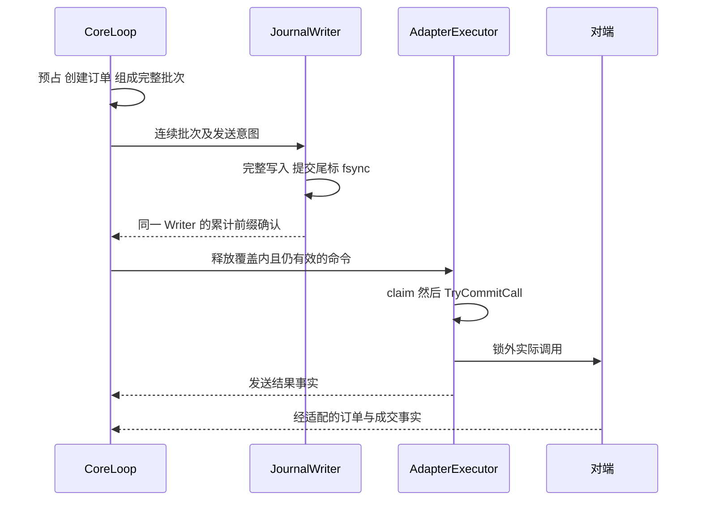

# 五项 P0 与 ADR008 的正式契约

状态：**五项 P0 设计修订均已正式批准**。本文件只按主题重组 V1.1 原节，不产生新的设计决策。J/K/O/P/Q 是项目内契约编号，不是 CTP 原生字段。原节中的“后续实施”按当时设计文档理解，当前候选进度另见 07。

| 项目 | 精确原章节 | 验收族与阶段 |
|---|---|---|
| P0-01 连续前缀与发送恢复 | §12.1～12.4 | J-I1～J-I5；J01～J07；真实文件 M1D |
| P0-02 Kill/claim/SDK | §5.3～5.4 | K-I1～K-I5；K01～K07；真实并发 M1C |
| P0-03 成交证据 | §7.3～7.5、§8.1 | O-I1～O-I5；O01～O09；业务部分 M1A |
| P0-04 四桶/跨日/资金 | §9.1～9.6 | P-I1～P-I5；P01～P06；M1A 先验证业务与阻断 |
| P0-05 回报丢失恢复资格 | §12.6 | Q-I1～Q-I5；Q01～Q09；队列/日志/闭环分阶段 |
| ADR008 | §8.4 及 Q08 | 已正式批准的受限 EmergencyCancel；当前候选未实现 |

以下每项正文均完整保留状态、不变量、正常与故障路径、反例、可自动化条件及 M1A～M1F 影响，不能用一段摘要替代。

## P0-01 Journal 连续前缀（原节）

### 12.1 连续提交前缀与确认

本节至第 12.4 节修订 P0-01。日志仍是一个 JournalWriter 顺序写的业务事件日志。每个 TxBatch 包含 journalId、writerEpoch、连续 batchNo、firstSeq、lastSeq、prevLastSeq、记录长度、输入与决定、预占变化、发送意图、校验和及完整提交尾标。批次内部不能只恢复订单而遗漏其预占；批次间不允许 coreSeq 空洞或重叠。记录不直接使用 C++ 内存布局。

| 前缀 | 精确定义 | 允许的用途 |
|---|---|---|
| producedSeq | 已由核心组成并按序交给日志通道的连续批次末端 | 说明内存进度，不授予发送资格 |
| writtenSeq | 文件写调用已完整接收的连续批次末端 | 仍不代表持久化 |
| durableSeq | Writer 对连续批次完成成功文件同步的最高末端 | 仅由当前 Writer 发布累计确认 |
| acknowledgedSeq | 核心已接受的同一 Writer 累计确认末端 | 运行时可据此释放相应新单效果 |
| recoveredSeq | 重启扫描找到的结构和校验均有效的连续提交前缀末端 | 用于重建状态，不能推断旧发送是否发生 |

**不变量 J-I1 至 J-I5。** 同一活动 Writer 中 acknowledgedSeq 不大于 durableSeq，durableSeq 不大于 writtenSeq，writtenSeq 不大于 producedSeq；前缀只在完整批次末端推进；有空洞则不得越过；新单 requiredJournalSeq 必须被同一身份的 acknowledgedSeq 覆盖；重启重建不恢复旧命令的发送许可。持久化与发送门禁之外的其他风险门禁仍须通过。

一次 write 成功可能只写部分字节，完整写入也不证明数据已持久化。M1 循环处理短写，EINTR 且零进展时按边界重试；无法完成、零进展耗尽或同步失败则停止该 Writer。文件同步、文件创建和目录发布分别验证；不能用用户态 flush 或 write 成功代替 fsync。具体保证按目标文件系统和存储设备的故障假设验收。[R11][R12]

Writer 必须先完整写批次和提交尾标，再执行成功 fsync，才提高 durableSeq。M1 不提供跳过同步的新单开关。确认是带 journalId、writerEpoch、batchNo、durableSeq 的累计状态；例如确认 12 可以覆盖丢失的确认 11，前提是 Writer 已证明 1 至 12 连续。不是“见过最大序号就取最大值”。

核心只接受当前身份且指向已知合法批次边界的确认；重复或较旧确认幂等忽略，旧 Writer 确认不生效，未知未来边界触发协议故障。确认丢失时不重写原批次，也不重新生成同一订单；发送效果留在 AwaitDurability。可经当前 Writer 的有界状态查询再次取得累计确认。

若确认超时，门闩关闭并提升 dispatchEpoch；随后确认到达只补齐日志事实，不能自动重开或恢复旧授权。待发命令由执行器证明未承诺调用后才能撤回；业务需要重新报价时，在合格复位后用新意图与新身份重新评估。单纯确认丢失不自动标为 AuditIncomplete；若没有回报丢失、写入失败或外部未知订单，可不凭空要求额外外部对账，但仍须完成许可清理和门禁复核。

Writer 状态为 Healthy、AckStalled、Poisoned 和 Recovering。不可完成的写入或同步错误置 Poisoned，并同步关闭新发送资格。durableSeq 停在最后一次确认成功同步的前缀；不能把错误之后看起来完整的字节自动升级为成功同步。Poisoned 状态不再在同一尾部继续正常追加；已经 CallCommitted 的调用仍可能发生，按第 5 章保留风险。

日志失败期间的回报尽力处理以减险，但无法保证完整审计，置 AuditIncomplete 与 auditGapUnresolved。恢复需隔离坏尾、验证前缀、恢复健康写入、生成新的 writerEpoch，再强制外部对账。新 Writer 的前缀确认不能复活旧许可或绕过未解决审计缺口。ADR008 的 EmergencyCancel 是明确且唯一的减险例外。

这仍只是正常路径。文件同步与发送均发生在核心线程外，但等待确认仍计入端到端延迟；外部回报可先于本地发送结果进入核心。

### 12.2 崩溃窗口与发送资格恢复

| 窗口 | 可依赖的事实 | 恢复动作 |
|---|---|---|
| 批次未完整写入 | 正常路径尚无该批次发送许可 | 只恢复有效连续前缀，保留坏尾证据 |
| 批次完整但尚未成功同步 | 不能据此证明当时已持久化或已授权 | 若重启后字节完整可纳入 recoveredSeq；重新同步并重建，旧意图仍不自动发 |
| 同步成功但确认丢失 | Writer 可能已安全提交，核心尚未放行 | 同进程探查累计状态；重启按未知旧意图处理，不靠缺确认证明未发 |
| 已确认，未获得调用承诺 | 运行时可撤回；崩溃可能丢失撤回事实 | 只有已持久化的确定未调用证据才可缩小不确定范围，否则按未知核对 |
| 已 CallCommitted，SDK 入口前后 | 可能未调用，也可能已交给外部 | 保留预占和身份，不自动重发 |
| 对端已成交，回报尚未持久化 | 账户可能领先本地账本 | 外部查询或已核验续传，去重、补齐与核对 |
| 成交已持久化又收到查询或重传 | 有身份索引和历史记录 | 同一有效成交只应用一次 |
| 中段损坏或出现序号空洞 | 后续状态链无可信连续性 | 停止自动恢复，不能跳过或取后面最大序号 |

**recoveredSeq 的边界。** 完整提交尾标与校验只能证明记录可解析，不能证明崩溃前 fsync 已返回。未同步字节也可能留在重启后文件里。因此 recoveredSeq 可以包含此前未确认的完整批次；恢复先保持 gate 关闭，把有效前缀重新同步并写恢复记录，不把磁盘上的旧意图作为重发清单。只允许对已提交新运行日志中的新命令重新授予资格。

只有损坏位于最终未提交尾部时，才可在停报状态保存原证据后截到最后有效批次并同步。中段校验失败、有后续记录却缺前序、同一序号异内容均为 Failed；M1 不自动“修复”后继续。新文件及后续快照的目录同步同样属于恢复验证。[R12]

**反例。** 批次 10 的发送意图已同步，确认被核心处理，SDK 接单；本地发送结果未写完即崩溃。若恢复逻辑看见“有意图、无结果”便重发，就会制造重复订单。另一反例是第 11 批次写坏而第 12 批次校验完整，用 maxSeq=12 放行会丢失第 11 批次的风险预占。

**自动化与通过条件。** J01 拒绝跨空洞推进；J02 丢确认后探查同一累计前缀，必须不重复追加且门闩不自动开启；J03 忽略旧 Writer 确认；J04 写或同步失败后前缀不推进且不再授予资格；J05 重启保留旧意图为未知、重发次数零；J06 尾部半写只恢复有效前缀而中段损坏失败；J07 拒绝未知未来确认。实际 M1D 还必须以可注入 Writer 接口验证短写、EINTR、ENOSPC、EIO 和 fsync 失败，并执行进程崩溃恢复；参考模型没有调用真实 fsync，不证明掉电安全。

**对阶段的影响。** M1A 定义批次身份及 requiredJournalSeq；M1B 使用显式内存测试模式且不宣称持久化；M1C 把 Writer 故障 latch 接入 gate；M1D 完成连续前缀、累计确认、文件故障和禁重发恢复；M1E 展示四个运行前缀、recoveredSeq 及 Writer 状态；M1F 验收崩溃窗口与 ADR008。M3 优化提交调度也不得改变这些不变量。

### 12.3 快照与离线回放

M1 先从完整运行日志回放，不强制实现快照。M4 快照在 coreSeq=S 的一致业务边界捕获订单身份、执行证据、持仓桶、预占、去重状态、配置和日志位置，交给写线程保存；使用临时文件、校验、同步和原子发布，之后只应用 S 之后的连续已提交输入。S 必须是完整批次边界，快照发布前须确认该边界已被连续持久化前缀覆盖；不得发布只有内存状态而缺少相应日志的快照。

离线 ReplayRunner 不加载可外发的网关，将计算出的意图与记录意图逐项比较；首个分歧记录 coreSeq、输入、规则版本及状态差异。历史运行原本为 Ready，也不能使恢复过程绕过启动门禁重新发单。

订单墓碑和成交去重记录不能在终态时立即删除。M1 使用有界运行和显式容量上限，耗尽则暂停；后续依据已核验重传和查询范围定义留存策略。SDK 流文件可以是恢复材料，但不取代本项目账本与未知订单对账。

### 12.4 统一恢复流程

启动固定进入 BootHalted；先加载配置和合约基线，再校验日志与可用快照，重建业务状态；连接对端后进入 Reconciling，核对活动委托、唯一成交、四桶持仓、冻结和资金来源。所有新单门禁在此期间保持关闭。

多个查询未必同一时点。恢复期间缓存或合并实时回报，使用去重、查询覆盖标记和必要的重复核对收敛；没有水位保证时不得凭空构造一个全账户原子快照。QueryEnd 失败、缺页或覆盖不足不能算通过。

恢复结果分为 Consistent、NeedsReview 和 Failed。Consistent 必须有第 12.6 节定义的覆盖证据及已持久化 RecoveryCertificate；只有行情、会话、配置、持久化也有效，才进入 ReadyPaused；用户明确复位后开始报价。未查到订单不等于原订单不存在；旧交易日数据查询受限时，使用适用账单或人工核对，缺证据保持暂停。

V1 为单实例恢复，不设计主备选举。单机启动锁只能防止本机重复运行，不能冒充外部账户的跨机器 fencing 或高可用保证。

## P0-02 Kill 与调用边界（原节）

### 5.3 发送与 Kill 的精确边界

本节修订 P0-02。DispatchGate 只保存 open、dispatchEpoch、reasonMask、latchVersion、lossGeneration 和尚未结束的发送许可；不持有第二份持仓或风险账本。所有许可状态转移、关闭和复位检查使用同一短临界区。SDK 调用、排队等待、文件操作和回调处理均在锁外。单个 mutex 的加锁解锁为这些局部转移建立同步关系；它不能把外部 SDK 调用变成与 Kill 原子的操作。[R13]

| 许可状态 | 允许的下一步 | 风险含义 |
|---|---|---|
| Queued | claim 或确定撤回 | 未领取不代表可由核心单方面释放，仍需队列与执行器交接证明 |
| Claimed | CallCommitted 或 AbortedBeforeCall | 占在途许可计数，尚可在调用承诺点前撤回 |
| CallCommitted | SDK 入口，然后 CallReturned | 已承诺尝试调用；关闭门闩不能保证此后不会进入 SDK |
| CallReturned | 交付 SubmitDisposition | 调用结束不代表未接单、已撤单或外部风险消失 |
| AbortedBeforeCall | 交付 DefinitelyNotSent | 该次命令未进入 SDK；仅在不存在更早提交证据时释放对应预占 |

claim 在锁内检查当前 epoch、当前日志资格、授权、有效期、节流与门闩，再登记许可。随后执行器在同一锁下进行 TryCommitCall：门闩仍开且 epoch 匹配才进入 CallCommitted，否则进入 AbortedBeforeCall。TryCommitCall 是本项目“允许执行一次 SDK 调用”的线性化点，**不是 SDK 实际入口时刻**。在它与入口之间仍存在调度空隙。

Kill 在锁内关闭门闩、提升 epoch 和 latchVersion。已经 Claimed 但尚未 CallCommitted 的许可在随后 TryCommitCall 时被撤回；已经 CallCommitted 的许可保留到 SDK 返回或已核验的未调用证明。执行器不得把同一许可调用两次，也不得把 SDK 超时或非零返回值一概解释为 DefinitelyNotSent。

**不变量 K-I1 至 K-I5。** 关闭线性化点之后、下一次合格复位之前，新增 claim 和新增 CallCommitted 都为零；每个许可至多调用一次；未复位时，NewOrderCallsQuiesced 只在所有旧许可均为 CallReturned 或 AbortedBeforeCall 后成立；旧 epoch 许可和命令在复位后仍失效；任何 Kill、关闭、过期或 SDK 返回都不单独释放外部风险。

KillAccepted 表示关闭已生效；NewOrderCallsQuiesced 表示调用侧已静止；ExternalRiskResolved 表示订单和成交风险已有外部证据结清。三个状态分别显示。SDK 永久阻塞时可以已 KillAccepted 而长期无法 Quiesced。撤单通道保持受限可用，但同一执行器被 SDK 阻塞时也可能无法及时执行撤单，不能承诺独立即时撤净。

正常路径为 Queued、Claimed、CallCommitted、实际 SDK 调用、CallReturned、回报归并。故障路径为关闭门闩、撤回未承诺许可、等待已承诺调用、保留未知订单、受限撤单和对账。复位要求旧许可结束、旧队列命令已解释、全部恢复门禁通过且用户明确操作；不把 inFlight 计数清零来伪造静止。epoch 或计数器耗尽直接停报。

### 5.4 可执行的交错规约

C 表示 claim，B 表示 TryCommitCall，I 表示 SDK 实际入口，R 表示调用返回，K 表示 Kill。执行器程序顺序固定 C、B、I、R；模型枚举 K 的五个插入位置。未取得许可的后续步骤为空操作，不能悄悄变成发送。测试不使用 sleep 制造时序。

| 交错 | 必须观察到的结果 | 禁止的推断 |
|---|---|---|
| K C B I R | claim 失败，调用次数零 | 不能因历史授权仍在而领取 |
| C K B I R | B 失败，许可撤回，调用次数零 | Claimed 不等于已经调用 |
| C B K I R | 允许一次发生在 KillAccepted 之后的 SDK 入口 | 不能把 KillAccepted 展示为绝无后续 SDK 调用 |
| C B I K R | K 时调用仍在途，R 前不得 Quiesced | 超时不能当作调用已经返回 |
| C B I R K | K 后可达调用静止，外部订单仍待处理 | 调用结束不等于外部风险为零 |

**反例。** 若只在锁外读取 open，随后无条件登记 claim，则可出现“读到开、Kill 关闭、登记新 claim”。若静止条件只数 SDK 已进入的调用，则 C B K 之后会错误报告 Quiesced，I 随后才进入。随附 K06、K07 是负例测试，必须成功找到这两种错误模型的反例，而不是让错误实现通过。

**自动化与通过条件。** K01 穷举五个位置，每条路径都检查调用次数和静止边界；K02 阻塞在 R 前，必须始终未静止；K03 复位后旧 epoch 不能调用；K04 未获日志确认不能 claim；K05 用回报溢出关闭替代 K，得到同样边界；K06、K07 必须检测到错误模型。M1C 后另以 barrier 和可控 FakeSdk 验证真实 mutex、队列及生命周期，再运行 TSan；模型通过不代替这些并发测试。

**对阶段的影响。** M1A 定义许可事实和授权身份；M1B 使用可控本地适配；M1C 实现同锁转移与交错测试；M1D 把日志资格接入 claim；M1E 分别展示三个停止状态；M1F 验收阻塞、撤回、关闭和旧 epoch 不可复活。没有新增发送线程。

## P0-03 OMS 证据（原节）

### 7.3 累计成交证据与数量分区

本节修订 P0-03。Q 为原始委托数量，B 为唯一有效且已归入该订单正常账本的成交数量，R 为已通过来源策略核验的累计成交下界，E 为 max(B,R)。R 的“可靠”不能由字段名称、数值看似合理或本地模拟通过来定义。

| 证据等级 | 允许的用途 | 进入条件 |
|---|---|---|
| Raw 或 Unverified | 原始材料留存，必要时触发停报 | 字段未验证、身份不完整或 profile 未确认 |
| CumulativeLowerBound | 可增加 R，不生成逐笔成交 | 账户、订单、交易日、作用域、数量范围及来源语义均核验 |
| NoFutureExecution | 确认不再有新的外部执行 | 终止语义有证据；不自动证明最终成交总量 |
| TerminalExactQuantity | 固定最终累计量 F 并支持释放未成交部分 | 可靠终止证据加精确最终量，二者覆盖同一订单生命期 |

**不变量 O-I1 至 O-I5。** 正常订单满足 0 ≤ B、R、E ≤ Q 且 E=max(B,R)；R 只吸收已验证下界；B 只由唯一逐笔成交增加；精确终止 F 必须与已知 B、R 相容；查询和推送共用同一身份索引。异常材料不能通过截断、覆盖或删除来伪装满足不变量。

B 大于 R 可以是逐笔回报先到，R 大于 B 可以是逐笔尚缺，两者本身不构成 Conflict。R 取可信下界最高值；晚到的较小下界在缺乏可信先后证据时视作旧观察，不降低 R。若 profile 能证明同一源的新版本累计倒退，或同一源版本给出不同累计量，则进入 Conflict。时间戳更晚不自动提供这种顺序保证。

为明确资源释放，对正常订单把 Q 分为五个互斥部分：B 是已记成交，H=E−B 是已知成交悬置，P 是未来仍可能成交量，L 是已证明未成交且不再成交的量，V 是终止后最终数量仍不清楚的量；五者之和等于 Q。

| 订单证据 | P H L V 的取值 | 资源动作 |
|---|---|---|
| 仍活动或状态未知 | P=Q−E，H=E−B，L=0，V=0 | 未入账风险共 Q−B，不能因超时释放 |
| 终止且最终精确量为 F | E=F，H=F−B，P=0，L=Q−F，V=0 | 仅释放 L，悬置继续占用 |
| 已确认不再执行但无精确最终量 | P=0，H=E−B，L=0，V=Q−E | V 可能是已成交未补齐量，不能当作未成交释放 |

只有撤单请求响应而无终止证据时仍使用第一行。拒单或 NotSent 只有在覆盖整笔且与成交无冲突时才能作为 F=0；不得从单一状态名字推断。可信下界也不能单独证明 Q−R 已经被撤净。

数值例子保留：买开 Q=3，T1 成交 1 手，随后收到可信已撤和 F=2。此时 B=1、R=2、E=2、H=1、L=1。只能释放 L；T2 的 1 手迟到后 B=2、H=0；T2 查询和推送各到一次也只记一笔。若只有已撤而没有最终精确量，则 B=1、R=1、V=2，不得释放这 2 手。

**冲突处理。** 精确 F=2 后收到可确认的第三手有效成交，或 F 小于 B、R，立即关闭新单资格，保留所有证据。只要身份、数量、开平等本身有效且 B 加该笔数量不超过 Q，迟到成交仍记一次正常账本，即使与早期终止或拒单证据冲突；原终止证据不得继续支持释放。重算保守占用，若之前释放造成资源不足，显示 RiskDeficit，不能把余额修成零掩盖缺口。

若一笔身份有效的真实成交使该订单总量超过 Q，其经济事实不能消失。该笔进入 ExceptionExecutionLedger，正常 B 保持原值，额外数量记为 X，并参与保守风险；界面显示 B 与 X、观察总量超 Q 和 Conflict。正常路径的数量分区此时失效，禁止继续报价。异常账本和正常账本共用成交去重索引，避免恢复时再次记入。负数量、非法价格或身份不明只作隔离证据，不能伪装成有效成交；对应未知风险另保留。

订单已是 Filled、Canceled、Rejected 或 NotSent 也不得丢弃迟到事实。Filled 可以仍是 MissingTrades；Canceled 可以等待悬置成交；与 Rejected、NotSent 矛盾的有效成交必须入账并进入 Conflict。Created 也可能先收到可关联成交，不依赖模拟器先发 Accepted。

查询与推送的去重键使用已核验的账户、交易日、交易所及原始成交身份作用域；不把 transport source 或 queryId 加入经济身份。相同键比对规范化经济字段，忽略通道与请求编号。相同键同内容只应用一次，同键异价格、数量、方向、开平或订单关联进入 Conflict，不覆盖原交易。查询只有聚合数量、没有可信逐笔身份时不能增加 B，也不能宣称逐笔账本已补全。

### 7.4 报价更新与身份

OrderPlanner 比较 desired quote 与 active quote，默认撤旧后再建新单。待撤和未知订单仍占活动报价槽；MissingTrades 或 Unreconciled 时不基于不完整库存继续补单。每个新意图有 generation，防止旧行情生成的待发命令在新配置或 kill 后继续执行。

本地 orderId、commandId、cancelActionId、vendorRequestId、会话键和 externalOrderKey 分开。没有交易所订单号前使用已有合法关联证据，不能编造 OrderSysID。未知回报先进入隔离区及对账；不能仅因项目暂未认识该 ID 就丢弃。

### 7.5 OMS 的自动化验收

O01 检查未验证、负数和超 Q 的累计值不能进入 R；O02 枚举下界与逐笔的先后，B 大于 R 与 R 大于 B 均按证据处理；O03 重放 Q=3 的撤成例子及查询推送重复；O04 注入 F 小于 B 和终止后矛盾成交，必须记有效事实并停报；O05 验证跨通道同键幂等；O06 验证同键异内容不覆盖；O07 验证超 Q 的有效成交保留为 X 且仍去重；O08 验证无精确 F 时 V 不释放；O09 验证具有可信可比版本的累计倒退触发 Conflict。正常路径按证据归并、入账和调整预占；故障路径先关闭发送资格，保存冲突事实、恢复保守占用，再以覆盖证据对账，不修改历史成交来凑数。

**反例。** 把 Canceled 当作 releaseAll，会在 Q=3、B=1、F=2 的时序中错误释放 2 手而不是 1 手；把来源通道放进去重键，会使 T2 在查询与推送中记两次。测试通过要求每一步的 B、R、E、H、P、L、V、X、冻结、Conflict 和风险缺口与规约一致，不只检查最终状态名。

**对阶段的影响。** M1A 完成证据类型、数量分区和共用去重；M1B 由 LocalSim 明确生成不同证据等级；M1C 检查乱序通道；M1D 持久化原始身份、证据等级、异常账本和去重；M1E 展示悬置与 Conflict；M1F 组合迟到、重复和查询恢复。CTP 证据等级仍在 M2 单独核验。

## 8 风控资源预占与发送授权

### 8.1 在一个业务事务内完成

OrderPlanner 提供明确价格、数量及开平分桶。RiskEngine 在同一个核心 step 中依次检查运行资格、行情、合约与价格、数量、可平资源、最坏持仓、资金模型、意图速率和容量；全部通过才建立 reservation、OMS 订单及冻结。事务中途失败整体回滚，输出明确 reasonCode 和命中规则版本。

每份 reservation 关联 orderId、原始数量、当前可能成交量、成交悬置量、开仓风险、平仓桶、费用预算、风险模型版本及最后应用的证据版本。资源更新按最新事实重算目标占用，再与旧值取差额；不对每条重复终态回报执行一次无条件 releaseAll。

订单超时、kill、断线、过期配置或撤单请求都不自动证明外部风险消失。只有未发送证明、可靠拒绝、确认终止余量或唯一成交消费等证据，才能改变相应资源；成交通常把订单风险转入持仓风险，而不是让风险消失。

## P0-04 持仓、跨日与资金（原节）

### 9.1 分桶更新规则

上期技术历史指南说明上期所今昨仓及平今、平昨的区别；它仅作语义依据，当前 SDK 枚举映射仍待核验。[R03] 核心采用以下独立业务模型，不依赖枚举字符值。

| 唯一有效成交 | PositionBook 的更新 | 冻结消费 |
|---|---|---|
| 买开 | LongToday 增加 | 消费开仓订单预占，转为多头持仓风险 |
| 卖开 | ShortToday 增加 | 消费开仓订单预占，转为空头持仓风险 |
| 卖平今 | LongToday 减少 | 消费该订单 LongToday 冻结 |
| 卖平昨 | LongYesterday 减少 | 消费该订单 LongYesterday 冻结 |
| 买平今 | ShortToday 减少 | 消费该订单 ShortToday 冻结 |
| 买平昨 | ShortYesterday 减少 | 消费该订单 ShortYesterday 冻结 |

每个桶保存 booked、closeReserved 和必要的成交悬置冻结。可平量基于已入账且尚未冻结的份额计算，不能让两笔平仓单消费同一持仓。实际柜台拒绝平仓仍需完整处理，本地持仓推导不承诺外部此刻必然接受。

例：LongYesterday 为 3，已有平昨冻结 2，可再平昨只有 1。新的卖平昨 2 手必须拒绝或由规划器拆分为经过分别校验的子单；不能暂时冻结成负数。重复成交和重复撤单确认不重复减少 booked 或 closeReserved。

### 9.2 报价意图怎样选择开平

买侧优先考虑减少已确认空仓，卖侧优先考虑减少已确认多仓；缺少可平资源时才按开仓规则评估。平今与平昨顺序作为项目显式配置，初始可采用平昨优先，不能说成交易所强制要求或最优费用策略。

净仓为零也可能同时持有多空仓，所以策略的库存偏移、总仓约束和开平选择使用不同视图。初版不实现自动移仓、套利组合或对锁保证金优惠，不把买开与卖开自动互相净掉。

### 9.3 本地四桶与外部持仓观察

本节至第 9.6 节修订 P0-04。PositionBook 是本项目在明确交易日和已确认基线之上，由唯一成交推导出的业务持仓。ExternalPositionObservation 保留柜台查询的原始口径、账户、合约、方向、适用投保属性、交易日、查询范围与来源。SettlementRecord 是结算价、费用、保证金和权益等结算证据。三者职责不同，均由现有账本与恢复模块承载，不增加模块或线程。

外部返回不能默认恰好等于 LongToday、LongYesterday、ShortToday、ShortYesterday。聚合持仓、持仓明细、冻结、当日量和历史量的映射由 CtpProfile 核验，不在所有市场上机械采用“总量减今仓”等式。单一交易日字段也不自动证明结算已经完成。M1 的 LocalSimProfile 可以明确给出四桶和基线覆盖，不能据此推断真实柜台。

**不变量 P-I1 至 P-I5。** 每个桶属于确定的 account、instrument、positionEpoch 和 tradingDay；可平量不小于零且每份冻结只消费一次；外部查询不直接覆盖本地账本；新基线与后续成交的覆盖必须不重不漏；旧交易日风险和未识别资金影响未解决前不开放新报价。

恢复时 PositionAnchor 明确基线数量、交易日、来源和所包含成交范围。基线之前已包含的成交保留身份但不再次应用，之后的唯一成交才作为增量。没有可验证覆盖边界时保持 NeedsReview，不能用新查询覆盖桶后又完整重放原交易日志。账本与结算差异要记录成核对项；模型费用和实际结算费用分别标注，不凭成交回报宣称完整账户权益。

正常路径是确认基线、逐笔更新四桶、冻结消费、外部观察核对、结算证据归档。故障路径是保留原基线与原始查询、关闭新单、登记差异和缺失范围、取得新的覆盖证明后再建立基线。

### 9.4 跨日与未解决风险

跨日使用 OpenDay、BoundaryHalted、AwaitDayEvidence、DayAnchorVerified、ReadyPaused 五个业务阶段，归入现有会话与恢复状态。确认交易日边界时先停报价、关闭 gate 并提升 epoch；不在自然日午夜或本机认为夜盘开始时搬桶、清 ID 或重置冻结。

M1 采用保守规则：旧日存在未知发送、未终止订单、H 或 V、冲突、未补齐成交、回报丢失或审计缺口时，不发布可交易的新日持仓基线。CarryRisk 记录旧订单身份、原开平语义、原冻结桶、交易日、缺证据范围和保守暴露；它是现有 reservation 的延续，不是一份可重复相加的新持仓。外部新日查询可保存为候选观察，不能使旧风险消失。

旧日 CloseToday 命令在新日绝不原样重发，也不因本地搬桶自动改成 CloseYesterday。旧日迟到有效成交先按原 positionEpoch 与原语义归并、去重，核对其是否已包含在新日候选基线。旧风险结清且边界映射及覆盖获确认后，才以一个显式 DayAnchor 事务把已确认今仓并入昨仓、建立新交易日，再进入 ReadyPaused。新日参数、资金与行情也必须有效。

真实环境若查不到旧日完整成交或无法确定期末持仓，保持 NeedsReview。人工核对必须附账单或其他适用外部证据、覆盖说明、操作者和审计记录，不能只点击“忽略差异”。M1 可测试停在这个状态；跨日缺证据时继续报价不属于首版交付承诺。M4 再增强跨日恢复材料与独立对端存活实验。

**反例。** D 日卖平今 1 手仍未知，午夜自动把 LongToday 搬到 LongYesterday 并释放旧冻结；D 日成交随后迟到。若把它当新日卖平昨重放，就可能重复减仓或错误冻结。正确行为是保留旧 positionEpoch，停报并核对新日基线覆盖；相同成交无论何时到达只处理一次。

### 9.5 资金查询与本地预占的覆盖

资金查询必须保存 source、account、currency、交易日、口径、请求接收区间、profile 和覆盖证据。Aext 表示这份外部观察的可用金额，不能默认其未包含保证金或委托冻结，也不能从本地回调时间拼造柜台原子时点。

每项风险资源 i 保存本地保守需求 Li 和该外部基线已证实覆盖的金额 Ci。同一外部扣减证据只能归属一份资源覆盖；订单资源转成持仓资源时连同 Ci 迁移，不能复制成两份覆盖。覆盖为 Included、Excluded 或 Unknown；Included 也必须有金额口径，不能仅凭“订单已存在”就假定全部保守需求已覆盖。Ci 只能引用可核对的外部证据；Excluded 和 Unknown 取 Ci=0。

外部可用预算从 Aext 扣除各项 max(0,Li−Ci)、基线后尚未覆盖的费用和其他正向资金消耗，再扣未知及价格变动缓冲；同时独立检查本地配置预算。两套门禁都通过才允许新风险。资源从订单冻结转成持仓占用时继续追踪同一覆盖，不返还后又重新扣一次；基线后的已发生费用也不能随订单终态从预算中消失。未经确认的平仓收益、保证金释放和撤单退款不增加外部可用预算。

例：外部可用 1000 已扣某订单冻结 200，本地需求 200 且覆盖金额证实为 200，则不能再扣这 200；新增尚未外发的预占 100 后预算为 900。若旧 200 的覆盖未知，则保守预算为 700，即扣未知旧资源 200 和新增 100。这是明确展示的保守扣减，不得宣称已完成精确资金核对。需求从 200 增至 250 而覆盖仍为 200 时，额外 50 仍须扣除。金额仅为测试单位，不是 RB 真实保证金。

新查询不能无条件清空所有本地预占。只有它明确覆盖的资源和费用才能换锚；查询窗口内新增的授权、在途订单、悬置成交、异常暴露与费用仍需保留。查询失败、过旧、币种或交易日不符、覆盖不明时，真实接入的资金核对门禁关闭；本地模拟仍可依据已声明的模型运行。CTP 查询字段、冻结口径及覆盖范围留待 M2 核验。

### 9.6 自动化验收与阶段影响

P01 检查平仓冻结竞争与六种开平更新；P02 检查结算或外部查询不会直接覆盖业务桶；P03 注入跨日旧平今单及迟到成交，未解决时必须停在 BoundaryHalted 或 AwaitDayEvidence；P04 检查已证实覆盖不会重复扣减及覆盖不足只扣差额；P05 检查 Unknown 采用 Ci=0；P06 检查订单转持仓和基线后费用不会产生虚假可用资金。

通过要求包括四桶数量、原 positionEpoch、冻结、成交去重、覆盖金额、预算和门禁逐步一致；仅最终净仓相等不算通过。真实外部持仓映射和资金口径另需适配测试，模型通过不能标记其已验证。

M1A 增加基线身份、旧日风险引用和资金覆盖类型；M1B 明确 LocalSim 基线及查询口径；M1C 将交易日边界投递为事件；M1D 记录锚点、冻结和覆盖变更；M1E 分开展示业务桶、外部观察、结算与模型预算；M1F 验收跨日阻断和资金不重复扣减。上期所交易日与当日有效等业务依据沿用当前规则，临时参数仍按运行日期加载。[R02]

## P0-05 回报队列溢出恢复（原节）

### 12.6 关键交易回报队列溢出后的资格

本节修订 P0-05。关键交易回报队列承载订单、成交、发送结果及恢复所需事实；它与可丢弃的 Web 展示队列不同。每次投递尝试分配 adapterIngressSeq，投递失败也消耗该序号。它仅用于定位本地接收丢失，不冒充柜台或交易所序号。

生产线程发现满时，在同一门闩同步边界置 CallbackLoss、提高 lossGeneration 与 latchVersion 并关 gate，记录有界的首个丢失序号、计数、源会话和时间范围。细节投递失败也不能丢掉这个门闩。元数据计数饱和或范围不明则保守扩大为全账户缺口；不能依赖无界备用队列。

**不变量 Q-I1 至 Q-I5。** lossGeneration 只增不减；队列变空、重连、登录、普通 QueryEnd 或清告警不能解除 CallbackLoss；所有受影响未知订单、H、V、异常成交与预占保留；证书只能覆盖同一恢复与丢失代次；复位与新溢出必须在同一 gate 临界区比较代次和 latchVersion，旧证书不能抹掉新故障。

| 恢复阶段 | 正常工作 | 失败或阻塞 |
|---|---|---|
| LossDetected | 立即停领，旧 CallCommitted 按在途处理 | 不把停止领取当成全部调用取消 |
| HaltedDraining | 结束旧许可，处理已入队事实，OMS 尝试适用撤单 | 队列清空不恢复资格 |
| Collecting | 获取声明覆盖范围的订单、逐笔成交、持仓与资金证据 | 缺页、源会话错、错误或再次丢失使本轮失效 |
| Validating | 对身份、数量分区、四桶、资金及覆盖共同核对 | 仅净仓一致或两次查询相等不能算通过 |
| ReadyPaused | 证书已持久化且安全门禁通过，等待显式复位 | 新故障关闭资格，不能凭旧证书复位 |

覆盖描述至少含 account、合约范围、交易日起止、订单范围包含活动和适用终态、逐笔身份作用域、查询能力与缺项、分页及结束状态、源会话、queryId、recoveryEpoch、lossGeneration 和可核验的边界方法。所有查询保留原始证据。一次关键回报丢失可能涉及未知订单，不能只查本地已知订单；首版专用账户也要证明受影响账户范围完整。

**可接受的恢复边界。** LocalSim 可以显式提供 simRevision 快照及其后无损增量；该能力须由 LocalSimProfile 声明。真实适配必须以已核验的私有流续传水位、共同查询边界，或在账户外部执行已静止后具有完整历史范围的查询证据收敛。外部执行静止要求所有可能的新提交已结束、未知发送得到解释、所有可能活动委托已有终止或可靠不存在证明，且不存在其他终端活动；不能仅从本地 inFlight=0 推导。空查询只有在能力明确保证覆盖和不存在语义时才是不存在证据。

当前 CTP 的历史范围、共同水位、空结果语义和续传保证仍为 Unknown，因此不预先批准真实环境自动恢复。仅有活动订单与持仓查询不能证明所有逐笔成交补齐；聚合持仓相等不证明价格、费用、成交身份或未知订单已解决。缺旧交易日成交、缺最终数量或无法消除窗口时进入 NeedsReview；人工材料也必须形成有证据的核对记录，不能强制把缺项改成通过。

RecoveryCertificate 包含 certificateId、runId、account、recoveryEpoch、lossGeneration、预期 latchVersion、查询与原始材料引用、覆盖边界、未解决项清单、状态摘要、validatedCoreSeq、validatedIngressFence、profile 版本和审计缺口核对结果。源边界之后至本地投递栅栏的回报必须已无损归并；证书生成后若相关经济事实、覆盖或摘要改变，证书失效并重新核验。CoreLoop 在复位事件内先核对当前业务版本，进入 gate 临界区后再核对轻量代次与门闩版本，不能只验证历史证书曾经有效。只有未解决项为空且一致性满足时才能给出 Consistent，并先写入连续持久化前缀，再发布 ReadyPaused。历史 AuditIncomplete 保留，已核对的审计缺口单独记录 resolvedThrough。确认之后仍需在复位锁内重新比较丢失代次和所有门闩版本。

**反例。** 容量 1 的队列中已有 T1，T2 投递失败；核心处理完 T1 后队列为空，持仓查询碰巧仍与旧值一致。若立刻重开，就会在漏记 T2 的库存上报价。另一交错是证书针对 lossGeneration=4 完成，准备复位时第 5 次缺口发生；仅检查“曾有证书”会清掉新故障。正确行为是证书 4 失效，第 5 轮继续停报。

**自动化与通过条件。** Q01 队列变空仍禁止复位；Q02 只有活动订单和持仓覆盖不足；Q03 缺旧日范围不能恢复；Q04 错 queryId、源会话或 recoveryEpoch 的查询不得完成当前轮；Q05 查询中再次丢失使证书失效；Q06 完整同代次证据且证书落盘后只能到 ReadyPaused，显式复位才开 gate；Q07 枚举复位与新缺口的先后，旧证书不能清新故障；Q08 日志失败后的 EmergencyCancel 必须可靠定位、标记 AuditIncomplete，且恢复强制外部对账。M1C 后还要在真实有界队列容量 1 和 2 上注入重复溢出与慢消费者，验证门闩可见性；模型不证明实际队列正确。Q09 验证证书后经济状态变更需要重新核验，旧证书不可发布或复位。

**对阶段的影响。** M1A 定义丢失代次和覆盖类型；M1B 为 LocalSim 提供独立查询与声明边界；M1C 验收立即停领与有界丢失元数据；M1D 持久化恢复证书；M1E 展示覆盖缺项与不可复位原因；M1F 验收当前日、单账户的本地恢复和覆盖不足时保持暂停。跨进程存活、跨日复杂材料仍在 M4；真实 CTP 恢复在 M2 核验能力后单独验收。

## ADR008 受限 EmergencyCancel 完整执行契约（原节）

### 8.4 Kill 与持久化故障下的撤单

Kill 流程为关闭新单 gate、使旧待发资格失效、由 OMS 对可能活动订单安排撤单、继续处理回报与对账。复位要通过操作命令并检查全部门禁，不自动开仓或自动平仓。

**ADR008 已正式批准。** 日志不可写时，允许 OMS 对可可靠定位的已有订单尝试受限 EmergencyCancel。适配器必须核对账户、环境、来源、完整且无冲突的外部定位证据和 profile；不能猜测或拼造订单号。该路径只允许撤单，不允许新单、改单增量、自动平仓或复位开仓；仍受撤单和柜台适用节流约束。

进入该路径即置历史标记 AuditIncomplete，并设置 auditGapUnresolved。有界内存记录只能尽力保存，不能冒充已持久化。撤单尝试、SDK 返回和撤单请求响应均不等于撤销成功；风险释放仍由第 7 章证据决定。恢复后必须外部对账，RecoveryCertificate 持久化后才可解除 auditGapUnresolved；历史 AuditIncomplete 永不被“清除告警”抹去。无法可靠定位的订单保持未知并提示后续核对，不发猜测性撤单。

### ADR008 接管核对清单

仅已有订单；可靠定位；账户/环境/来源/profile 一致；不得猜造 OrderSysID；只能撤单；不得新单、增量改单、自动平仓或复位开仓；保持节流；立刻留下 AuditIncomplete 历史和 auditGapUnresolved；内存留痕不是持久化；尝试/返回/请求响应不是成功；风险按 OMS 证据释放；恢复后强制外部对账、证书先持久化；已解决缺口与永久历史标记分别保存。没有一条允许当前 M1A 发送。

### 当前实现边界

参考模型模拟五类规则；M1A 候选实现 OMS/持仓/资金等业务适用部分。没有实际 JournalWriter、DispatchGate、SDK 调用、关键回报队列、RecoveryCertificate 或 EmergencyCancel 发送。不得用这些全文存在作为实现完成证明。
