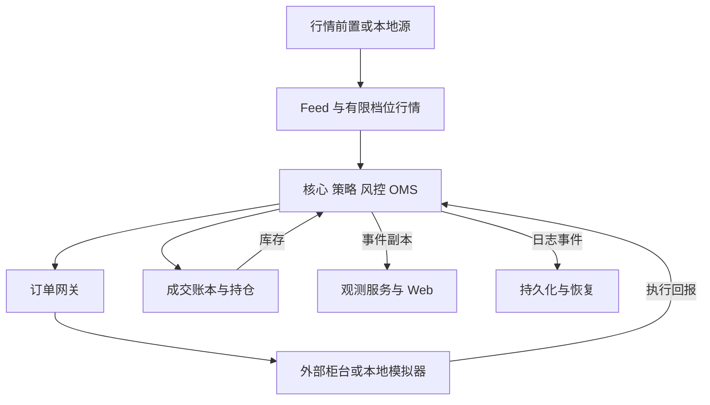

# 项目立项与中国市场技术选型报告 V1.0

PROJECT 03  C++ 高频做市交易与低延迟执行基础设施平台

研究截止日期：2026 年 11 月 5 日。时间基准：北京时间。阶段：M0 市场与协议选型。状态：提交选型建议，等待主市场与接口方案确认。

## 1 立项结论与交付边界

**推荐主线：上海期货交易所商品期货，以螺纹钢 RB 单品种、单个实际挂牌合约为首个业务对象；买方侧通过上期技术 CTP C++ TraderAPI 与 MdAPI 适配；先交付规范约束的本地闭环，再争取接入 SimNow 仿真环境。**

为满足真实报文编解码、序列缺口和恢复实验，增加一个范围受控的必做协议实验子模块：依据上期所 SMDP 2.0 二代行情接口规范 V1.22，生成本地测试报文并实现解析和恢复测试。它与普通 CTP 快照入口分开标识；不代表已经获得交易所组播行情权限。[S01][S04][S06][S09]

这一推荐是工程选型判断：规则可以查证、国内柜台接入有现实对应、开平仓与订单恢复具有教学和面试价值，且不必先承担期权定价与对冲模型的复杂度。它不等于认定螺纹钢最适合真实盈利做市，也不授予专业做市商资格。

V1 的业务角色是普通账户权限语义下的双边限价报价实验。每侧初始最多一笔有效报价，订单起始数量为 1 手，允许在库存或风险边界处只保留一侧或停止报价。专业做市商报价义务、专用编码、费用优惠及特殊接口均不作为默认能力。[S15]

业务默认 1 手不妨碍状态机验证：部分成交测试使用 2 手或以上的专用夹具，夹具参数与日常报价配置分开登记。

本次交付的是立项报告和后续验收方案。没有编写或运行交易核心，没有建立前端，没有注册账户、接入仿真或实盘，没有取得性能和事故实验数据。全部架构、参数、工期和测试指标在未特别注明时均为设计建议。

**接口版本仍有一项实质性待确认事项：本次未取得可校验的当前 CTP 官方 SDK 完整包。** 已核实期货公司提供 API 下载与评测入口，但不能把网上出现的某个 6.7.x 或补丁号直接认定为当前版本。正式适配之前必须锁定 SDK、头文件、动态库、开发手册、运行模式和目标前置的兼容组合。[S07][S08]

## 2 证据规则与金融概念

报告使用三种标记：**已核实**表示本次读取到官方正文或官方发布页面；**设计建议**表示我们提出的实现方法；**待确认**表示缺少当前规范、授权、账户或实测证据。发布页面存在只证明资料被发布，不证明我们已读完附件，也不证明服务此刻可登录。

| 概念 | 通俗解释 | 对程序的直接影响 |
|---|---|---|
| 交易所 | 制定市场规则并集中组织撮合的场所 | 决定价格步长、交易时段、订单规则 |
| 期货公司或证券公司 | 客户账户和交易接入的经纪机构 | 决定账户权限、接入评测、柜台参数 |
| 柜台系统 | 经纪机构处理客户交易、风控及相关业务的系统 | 我们通常接入这一层，而非直接成为交易所会员 |
| 买方系统 | 使用行情并代表自身投资组合发出订单的系统 | 本项目的主体 |
| 一手 | 一份标准化合约的交易单位 | RB 期货一手对应 10 吨，而非一股或一吨 |
| 开仓与平仓 | 建立合约持仓与了结已有持仓 | 买卖方向之外，还必须说明开平属性 |
| 今仓与昨仓 | 当前交易日建立的持仓与此前持仓 | 平仓冻结、费用和接口字段不能只看净仓 |
| 保证金 | 为履约占用的资金 | 保证金不是最大可能损失，报价需要预占资金与持仓额度 |
| 库存 | 做市系统因成交积累的持仓 | 同时约束净持仓、总持仓和未完成订单 |
| 回报 | 柜台通知订单变化或成交的异步消息 | 发送函数返回成功与订单已被接受是不同事件 |

上述 RB 合约单位据业务细则核验；CTP 角色据上期技术产品介绍核验。[S01][S06] 其余解释用于理解工程边界，不构成完整市场业务手册。

## 3 候选市场比较

### 3.1 业务与接入条件

| 候选 | 简化双边报价适用性 | 接入与资料 | 独立开发负担 | 建议 |
|---|---|---|---|---|
| 上期所商品期货 RB | 可围绕日内开平仓构造库存闭环；须区分今昨仓 | CTP 生态、SimNow 官方仿真入口；当前交易所规则与行情规范可查 | 中等；交易日、保证金、开平与恢复必须认真处理 | 首选 |
| 郑商所商品期货 SR | 同样适合普通限价单实验 | 有官方白糖业务细则；易盛 V10 是可核验的柜台 API 备选 | 中等；仍需核对具体柜台、市场差异和当前合约参数 | 备选市场 |
| 大商所商品期货 | 同类业务值得扩展 | 本次未完整取得当前合约规则及接口条件 | 尚不能给出同等精度的版本结论 | 保留候选，不冻结实现 |
| 中金所股指或国债期货 | 可形成双向持仓与执行负载 | 已定位官方接口存档 [S29]；当前版本、账户、仿真和限制待核实 | 中高；更容易引入金融期货适当性与额外业务范围 | 后续扩展 |
| 沪深普通 A 股 | 适合执行系统，直接套用无底仓日内双边循环受限制 | 交易所规范公开；客户通常通过券商 API，如 XTP | 中高；可卖数量、融资融券与库存来源更复杂 | 不作为首发业务 |
| 明确允许当日回转的境内 ETF | 有条件适合；不能把所有 ETF 视为 T+0 | 需逐产品核对回转属性及券商权限 | 中高；还涉及基金业务、行情与卖出库存约束 | 证券方向的后续候选 |
| 境内期权 | 双边做市场景明确 | 资格、接口、业务规则依市场而定 | 高；定价、希腊值、行权和对冲会分散当前工程主线 | M6 再评估 |

这是基于本次证据的工程判断，不是招聘数量或收益能力的统计排名。期货子市场之间没有天然的 C++ 技术含金量高低；选择上期所，是为了先在一套规则上做深。郑商所白糖已读到的是 2024 年修订正文，其后是否有更新仍需核验，不将该版冒充 2026 年全量现行规则。[S16]

### 3.2 A 股与 ETF 的关键限制

上交所《交易规则》已经更新至 2026 年修订版，自 2026 年 7 月 6 日施行。第 3.1.4 条规定买入证券在交收前不得卖出，回转交易另有安排；第 3.1.5 条列明部分基金可当日回转。普通 A 股不能被建模为买入后立即无限循环卖出。已有可卖底仓可以支持一定的日内操作，但这不消除库存与卖出可用量约束。[S10]

允许当日回转的类别包括债券 ETF、货币 ETF、黄金 ETF、商品期货 ETF，以及符合该条条件的跨境基金等。具体证券仍需核对；不能将股票 ETF 或全部跨境基金一概归入 T+0。[S10]

券商 XTP 与交易所 STEP/Binary 接口属于不同层级。中泰证券提供 XTP 及 XTP-Pro 文档和测试服务说明；公开网页并不保证我们自动获得账户、L2、回补或正式通道权限。上交所技术专区列出的 IS122 竞价交易接口 0.58 版、IS120 行情接口 0.63 版，日期均为 2026 年 9 月 18 日，属于交易所与市场参与者相关接口，不能直接当作普通客户账户 API。[S11][S12]

### 3.3 工程收益与机会成本

CTP 主线能够集中训练回调接入、请求与回报关联、订单状态、开平冻结、流控、断线对账和交易日切换。其限制也明确：公网与柜台链路无法证明交易所级微秒竞争能力，SDK 封装内部也不能冒充我们自己的网络编解码实现。

易盛是现实备选。官方接入页列出启明星 V10 交易 API 1.0.1.19、行情 API 1.0.0.7，更新日期 2024 年 7 月 18 日，并说明开发包包含测试环境和授权信息；期货公司开发页另展示 1.0.1.24-20250721。这说明供应商、经纪机构与环境需要逐项匹配，不能只根据版本号大小决定可用性。M0 不同时实施两套柜台 API。[S08][S17]

## 4 推荐市场的规则基线

### 4.1 首发合约范围

推荐 RB 品种下一个有有效行情、尚未进入项目禁入到期窗口的实际挂牌合约。具体月份在联调时查询确认；不把“主连”当成可委托合约，也不将某个当前热门月份硬编码进系统。

| 规则项 | 本次已核实内容 | V1 建模方式 |
|---|---|---|
| 品种与交易所 | 上期所螺纹钢期货，交易代码 RB | 保存交易所代码与实际 InstrumentID，不凭大小写拼接代码 |
| 交易单位 | 10 吨/手 | 数量用整数手；名义价值结合合约乘数计算 |
| 报价与步长 | 人民币元/吨；1 元/吨 | 内部价格用整数 tick，接口浮点值做有效性与步长校验 |
| 合约月份 | 1 至 12 月 | 合约目录驱动，不自行生成可交易月份 |
| 最后交易日 | 合约月份 15 日，存在节假日顺延及特别调整 | 引入到期日字段，初版禁止进入交割流程 |
| 日盘连续交易 | 09:00–10:15、10:30–11:30、13:30–15:00 | 休市和盘间休息为独立会话状态 |
| 夜盘连续交易 | RB 对应 21:00–23:00 | 以交易日历与临时公告决定是否开放 |
| 交易日 | 夜盘归属后续交易日，不能直接用自然日 | 保存 TradingDay 与本地接收日期并分别解释 |
| 指令有效性 | 规则规定当日有效；部分成交余量可继续参与当日竞价 | 首版使用限价当日有效单，跨交易日重新确认 |
| 数量限制 | 投教页列期货限价单 1–500 手；规则允许另行调整 | 项目起始每单 1 手；外部上限通过当前元数据与公告复核 |
| 价格限制与费用 | 合约基础条款不等于当日实际标准 | 涨跌停价、保证金、手续费和交易限额按合约及日期加载 |

来源分别为 2026 年 1 月 1 日施行的 RB 业务细则、交易时间页、2026 年交易规则与当前交易指令说明。[S01][S02][S03][S18] 交易管理办法已读到 2026 年 9 月 14 日施行版，允许的指令不只限价；V1 的限价子集是项目主动收敛范围，不能解释为交易所不支持其他类型。[S05]

集合竞价单独建模，V1 策略只在核实为连续交易状态时报价。开设夜盘品种的开盘集合竞价安排与日盘集合竞价关系以当前规则为准，不能只靠一张时间表重复生成“开盘”。节假日前后的夜盘安排必须读取相应公告。系统时间一律标明北京时间，超时计时另用单调时钟。

### 4.2 程序化交易与做市身份

证监会《期货市场程序化交易管理规定（试行）》自 2025 年 10 月 9 日施行，涉及报告、接入测试和风险管理。上期所配套通知把自主研发或定制程序化软件等列为报告相关情形；不能将低报单速率理解为当然不需要报告。上期所通知所列原有交易者过渡安排已涉及 2026 年 4 月，不宜继续当作未来豁免期。[S13][S14]

交易所认可的专业做市商有资格管理、协议和专用编码要求。项目只验证双边报价的系统流程，不把普通账户描述为交易所做市商。任何未来真实接入均需按目标期货公司的权限和管理流程核对；本次 M0 不申请或使用实盘账户。[S15]

## 5 真实接口与数据能力选型

### 5.1 必须分清的四个接口层级

| 层级 | 本次对象与版本状态 | 使用范围 | 不作出的承诺 |
|---|---|---|---|
| 交易所交易 API | 上期所 NGES v2.00，2025 年 9 月规范；官网另有 2026 年 7 月程序包 | 作为交易所侧接口对照资料 | 不把它叫作 CTP，也不宣称普通客户可直接连接 |
| 柜台客户 API | 上期技术 CTP TraderAPI 与 MdAPI；当前具体 SDK 构建待锁定 | 买方连接期货公司柜台或相应仿真环境的主线 | 不自行臆造其私有网络协议 |
| 交易所行情报文 | SMDP 2.0，接口文档 V1.22；封面日期 2026-07-21，官网发布 2026-07-28 | 本地规范编解码、序列与恢复实验 | 不宣称获得实时组播权限或原始交易所数据 |
| 项目内部接口 | 自定义规范化事件、命令、日志与 Web 消息 | 模块解耦与可回放 | 不冠以交易所或 CTP 官方协议名称 |

注意文档版本、SDK 构建号与报文中的协议版本字段是不同概念。例如不能把 SMDP 文档的 V1.22 直接写成报文版本字段值。[S04][S24]

### 5.2 CTP 接入证据与版本冻结条件

**已核实：** 上期技术官方产品介绍明确 CTP 面向期货公司的业务定位；中信期货公开评测地址、API 下载和外部接入说明，其生产地址在外部接入审核后提供。SimNow 的上期所官方介绍与投教注册指南证实仿真平台和注册路径存在。[S06][S07][S09][S26]

**已核实但仅为历史基线：** 上期技术编写、东方财富期货网站托管的《CTP 客户端开发指南》，正文修订表为 V3.1、2015-10-16，文件名含 2016-10-27。它可支持理解基本回调与订单标识，不能单凭文件名视为最新版。中信期货开发页展示 CTP V6.6.8_20220712，是明确可追溯的历史版本，不据此建议把旧包直接用于 2026 年环境。[S08][S19]

**待确认：** SimNow 当前可用服务窗口、注册条件、前置地址、BrokerID、AppID/AuthCode 要求、SDK 版本与运行模式、证书或采集组件、支持的具体合约、深度档位、回报重传与查询限制。本次官网 API 下载页访问受限，下载包亦未成功校验；没有进行登录或连通性测试。“7×24”历史宣传不能替代当前维护窗口核对。[S09]

接入冻结记录应保存：发布方、原始下载 URL、下载时间、文件 SHA-256、授权条款、头文件版本、GetApiVersion 实际输出、动态库构建号、操作系统及 ABI、采集库依赖、服务端环境名称、兼容性说明。目标是锁定一组可工作的组合，而非追逐某个未经验证的最新版本号。

获取当前 SDK 后再逐项核验以下候选映射：行情连接、登录、订阅与 OnRtnDepthMarketData；交易认证、登录、结算确认；ReqOrderInsert、ReqOrderAction；OnRtnOrder、OnRtnTrade；同步发送返回、响应错误与异步错误；合约、订单、成交、持仓和资金查询；私有流订阅及恢复。历史指南提供基本接口名称和示例，但所有签名、枚举、字段长度与当前行为必须重新核对。[S19]

### 5.3 行情能力不能超过实际数据源

CTP 主线初版维护的是**有限档位行情状态**。上期技术历史指南描述快照推送，而不是逐笔订单事件。实际频率、档位、字段有效性由所用环境验证；不承诺固定每 500ms 一条，也不因结构体存在五档字段就宣称收到五档。[S19]

普通快照入口不预设存在可用的交易所连续序号。内部接收编号只用于检测自己的队列或日志缺失，不能证明上游没有丢消息。CTP 快照重连后的目标是获得当前可用状态；不能承诺补回断线期间全部行情路径。

上期所二代行情规范明确其为按价格档位组织的切片行情，提供 MDQP 查询与 MIRP 增量服务，包含报文号、快照编号和数据中心切换语义。它可支撑本地缺口恢复实验，但仍不是逐笔订单 MBO 数据。[S04]

| 展示或处理能力 | CTP 普通快照模式 | 二代行情规范本地实验 |
|---|---|---|
| 最优买卖价与有效档位 | 只使用实收到且校验有效的字段 | 按测试主题声明的深度处理 |
| 全市场逐笔成交 | 未取得这种数据时明确显示不可用 | 切片中的成交概要仍不等于逐笔成交带 |
| 本账户逐笔成交 | 使用经核验的成交回报 | 由本地交易模拟器提供并标注 |
| 上游序列缺口 | 无已核验序号时不提供该保证 | 依规范检测，区分交易日、主题与中心变化 |
| 本地队列丢失 | 显式记录并标记状态不可用 | 同样显式记录，禁止静默跳过增量 |
| 恢复 | 重新登录或订阅、等待有效快照并做订单对账 | 依规范选择快照恢复或增量补足 |

累计成交量之差只能显示为区间统计，不得编造成该区间每一笔真实成交、成交方向或订单排队位置。行情无效值、无买盘或无卖盘、涨跌停、时间倒退、累计量重置都要有独立处理路径。

### 5.4 测试环境的实际分工

本地环境负责全部性能压测、错误报文、异常报单和故障注入；SimNow 或期货公司评测环境只用于许可范围内的功能联调。取得真实接口文档不等于取得真实接入资格；取得仿真账号也不等于已经完成登录、订阅或订单测试。

无外部账号时，M1 仍可交付明确标识的本地闭环。M2 可以交付官方 SDK 的编译与字段适配、官方行情规范的本地一致性测试；外部环境联调单独列为未完成项，不能用本地模拟结果替代。

## 6 双边做市业务与模拟成交假设

### 6.1 报价如何产生

设计建议：有效买一与卖一形成参考中间价；基础价差以 tick 为单位。库存偏多时下调报价中心，让系统更倾向于减少多头；偏空则相反。买价向下取整、卖价向上取整，经过价格步长、价格带、自成交和风险校验后形成两笔独立普通限价单。

示例参数仅用于解释：最优买价 3000、卖价 3002，参考价 3001；若半价差为 1 tick、库存偏移为 0，可产生买 3000 与卖 3002。价格为教学构造，不是某时点的真实 RB 行情，也不是盈利建议。库存上限、报价刷新阈值、最小存续时间和速率限制属于项目可配置参数，不冒充交易所统一标准。

本地“尽量被动报价”检查不能保证请求到达市场时仍为被动单；除非当前规范和权限明确支持，不声明原生 Post-only、原子改价或双边原子报价能力。

报价更新先生成目标状态，再由 OMS 比较当前订单。基线采取撤旧、确认剩余风险得到处理、再发新单的方式；等待期间仍可能成交。后续如允许新旧订单短暂并存，风控必须把两者同时计入风险，并通过 ADR 记录理由。

### 6.2 期货库存不能只记一个净数

持仓账本保存多今、多昨、空今、空昨及分别冻结的可平数量。策略可使用净库存做偏移，但风控同时检查总持仓、单边持仓、未成交开仓、待撤单和未知订单。买单可能是开多或平空，卖单可能是开空或平多；自动路由必须有明确开平规则。

上期技术历史指南指出上期所今昨仓区分，以及平仓与平今字段的差异；当前环境需要再次核验枚举映射。[S19] 本项目原则是先使用可确认的平仓资源，缺少可平资源时才按配置考虑开仓，不把两笔相反方向的开仓成交直接当成已平仓。

### 6.3 模拟器提供两类不同证据

**确定性场景模式：** 由预设事件控制接单、拒单、成交和撤单时序，用于验证 OMS 和风控。它不声称成交模型真实。

**行情驱动模式：** 使用显式声明的延迟、可见流动性和保守成交条件。快照无法恢复真实队列位置与切片内路径；“碰到报价就必成交”不可作为默认真实性承诺。可引入固定种子的随机填充，但结果只能用于工程负载和模型对比。

每个测试事件携带 provenance：本地构造、已授权录制或外部仿真回报。账本可计算模型下的费用与盈亏，并显示模型和参数版本；项目验收不以盈利、夏普率或模拟成交概率为依据。

## 7 买方链路与 C++ 模块规划

### 7.1 系统边界

真实接入模式中：买方行情适配器连接期货公司或获授权的行情前置；买方订单网关连接 CTP 客户前置，随后由期货公司柜台和报盘链路连接交易所。行情通道与订单通道分开，不能画成订单必须经过行情服务器。

本地模式中：我们自建的 Broker/Exchange Simulator 替代外部柜台及撮合结果，返回测试事件；它不是官方交易所系统，也不承诺重现柜台内部实现。项目一如需复用，只能在实际源码核验后复用明确模块，不能预先宣称已拥有某种撮合或恢复能力。

图示为候选逻辑关系；核心内部下单顺序为策略、风控、OMS，恢复与持久化发送约束见第 9 节。外部柜台和本地模拟器在同一次实验中须明确选择，不能混淆来源。

### 7.2 模块职责与验证目标

| 模块 | 单一主要职责 | 首要验收证据 |
|---|---|---|
| Reference Data 与 Calendar | 合约、时段、交易日与参数版本 | 非法 tick、休市、到期窗口与跨日测试 |
| Feed Adapter 与 Normalizer | SDK 回调或报文解码，形成带来源事件 | 字段校验、畸形输入、时间与档位有效性 |
| Market State | 维护数据源允许的有限档位状态 | 快照替换、失效、重建一致性 |
| Strategy | 根据行情和库存生成报价意图 | 同样事件得到相同决策；异常状态不报价 |
| Pre-trade Risk | 同步检查并预占风险资源 | 无路径绕过；待发、待撤和未知风险不遗漏 |
| OMS | 订单身份、状态、动作及回报归并 | 状态转移表、竞态和幂等测试 |
| Position 与 Execution Ledger | 独立成交账本和分桶持仓 | 重复回报不重复记账；开平冻结守恒 |
| Order Gateway | SDK 调用、会话、节流与错误归一 | 同步返回、异步错误及断线矩阵 |
| Simulator 与 Fault Scheduler | 可重复外部行为和故障注入 | 固定输入与种子得到一致事件序列 |
| Journal 与 Recovery | 事件留痕、快照、恢复与对账 | 崩溃点测试、校验和、截尾和恢复摘要 |
| Telemetry 与 Control Bridge | 汇总观测、转交控制命令 | 慢浏览器和服务断线不阻塞交易核心 |

### 7.3 线程与所有权原则

设计起点是一个拥有策略、风控、OMS 和持仓状态的核心事件循环，由单线程修改这些状态。SDK 回调线程只复制必要数据、打接收时间并投递有界队列，绝不将回调指针在生命周期之外传递。

网关请求、日志落盘和 Web 服务由独立执行上下文承担，是否合并部分线程由实际 SDK 线程约束和基线测量决定。先采用清晰的有界互斥队列；确认跨线程开销值得优化后，再对严格单生产者单消费者通道引入 SPSC。多个 SDK 或控制线程不能未经证明共享一条 SPSC。

核心循环按预算处理行情、回报、控制与定时事件，防止行情洪峰饿死成交回报或停机命令。控制通道与回报通道保留独立容量。回报队列满时进入故障和停止发单状态，不能静默丢回报并继续报价；观测事件则允许受控降采样并计数。

系统只有受控的 OMS 发送入口。网关最终发送前复核 kill 状态和风险批准版本，撤销已经过期的待发批准；在状态改变与实际调用之间确定清楚的发送线性化边界。Kill Switch 不可能召回已经提交给外部系统的请求，相关在途风险必须继续保留。

## 8 OMS 与交易前风控验收设计

### 8.1 身份与状态不能混淆

项目内部订单 ID 应跨重启唯一，候选采用持久化实例标识和递增序号。它与 CTP OrderRef、请求 ID、会话信息和交易所订单 ID 分开保存；收到外部 ID 后建立映射，不用一个字段兼任全部身份。成交去重键必须按当前接口对唯一性范围的定义冻结，至少考虑账户、交易日、交易所及成交标识的作用域，不能假定一个裸 TradeID 全球唯一。

建议将状态拆为订单执行状态、提交状态、撤单动作状态和对账状态。这样，部分成交的订单可以同时处于撤单处理中，而撤单失败不会误改成“原订单被拒绝”。项目的 Unknown 指“无法确定外部结果、需要对账”；它不直接等同于某个 SDK 同名枚举。

### 8.2 初步状态转移与风险处理

下表为设计建议，完整字段转移表在确认选型后编制，不能据此宣称已经完成形式化验证。

| 事件 | 本地行为 | 风险资源处理 |
|---|---|---|
| 报价意图通过风控 | 创建待发订单并留存批准版本 | 先预占再发送 |
| 本地风控拒绝 | 记录本地拒绝；不进入外部发送 | 不形成新的有效预占 |
| 调用提交成功 | 只记已提交，不记已接单 | 继续保留全部可能风险 |
| 外部接单 | 进入有效工作状态 | 保留剩余可成交数量 |
| 部分或全部成交 | 用唯一成交更新账本，更新订单证据 | 已成交转入持仓；剩余继续冻结 |
| 撤单请求发出 | 标记撤单处理中 | 原委托尚可能成交，不能释放冻结 |
| 外部撤单确认 | 对剩余未成交量终止委托 | 仅释放确认未成交且证据一致的部分 |
| 撤单拒绝 | 记录动作失败，保留原执行状态 | 不因动作失败释放风险 |
| 委托结果超时或断线 | 标记需对账，停止依赖其结果的新报价 | 保留可能成交的最坏风险 |
| 重复或迟到回报 | 去重、补齐证据；冲突转入对账 | 不重复释放或重复记账 |

若订单状态回报先显示已成交，而逐笔成交尚未到齐，系统必须保留“状态已知成交量”与“账本已确认成交量”的差异。风险采用保守证据，成交账本只由唯一成交驱动；不能把订单累计量和成交回报各记一遍仓位。

### 8.3 必须守住的不变量

1. 任一订单的唯一已确认成交数量不超过原始委托数量；冲突不能靠截断数量掩盖。
2. 同一唯一成交重复到达不改变账本总额、持仓和手续费。
3. 平仓冻结不超过对应分桶可平数量；两个平仓单不能消费同一份持仓。
4. 风险预算计入待发、有效、待撤、发送结果不明和需对账订单；不能只计算已成交持仓。
5. 所有下单路径，包括策略、网页、回放实验命令，都必须经过 C++ 风控和 OMS。
6. 安全状态失效后不批准新报价；进入恢复状态不等于自动恢复发单。
7. 任一队列溢出、持久化失败、计数溢出或状态冲突都有明确故障事件。

### 8.4 风控计算与 Kill Switch

风控至少包含单笔数量、合法 tick、涨跌停价、相对有效参考价的偏离、净持仓、总持仓、未成交开仓、冻结可平量、保守资金预算、报单与撤单速率、日内累计请求、行情新鲜度、网关状态和 kill 状态。

价格偏离基准、资金和保证金预占模型需要写出适用范围。V1 可以使用保守配置参数验证机制，必须标为模型参数；取得柜台查询后进行核对，不冒充完整柜台保证金试算器。涨跌停或元数据缺失时不猜测可用价格带。

Kill Switch 的语义分为停止新报价、尝试撤销存量、继续接收回报与对账三个动作。撤单也遵守外部通道限制，并预留内部处理能力，避免新单洪峰挤占撤单。无法连通时显示仍可能存在活动订单；“已触发”不等于“已全部撤净”。恢复发单需要状态对账通过以及明确复位动作，默认不自动平仓。

## 9 持久化 回放与断线恢复

### 9.1 日志中要记录什么

版本化事件日志记录：规范化输入、核心接收序、定时事件、配置变更、风险决定、发送意图、同步发送结果、外部回报、故障注入、恢复动作和状态摘要。每个日志段带 schema 版本、来源、交易日、校验信息、构建与参数指纹。

快照记录订单映射、已知成交去重状态、持仓分桶、冻结量、风险限额和日志偏移。回放使用记录的定时事件和随机种子，不重新读取当前系统时间来决定历史报价；外部多线程事件的已记录处理顺序是回放依据。确定性承诺是同版本、同参数、同输入得到相同业务状态，不承诺不同机器获得相同物理延迟。

### 9.2 持久化与低延迟的取舍

建议可靠基线采用“外部发送前，发送意图先达到声明的持久化边界”。落盘线程可以异步工作，但网关必须等待相应持久化完成确认才能发送。M3 再比较逐笔同步、批量提交或明确降级的性能模式，并分别报告延迟和崩溃可能丢失的范围。

仅把事件放进内存日志队列，不等于已持久化；仅写入操作系统缓存，也不能宣称断电后必然恢复。初期至少区分进程崩溃与机器掉电两种故障假设。磁盘满或日志线程故障时停止新增外部风险，不能继续发单却声称具备完整审计回放。

本地日志和外部接单之间不存在可凭空实现的原子事务。进程可能在外部已接单而本地未记下结果时崩溃；解决办法是保留不确定性并查询、续传和对账，不是承诺端到端 exactly-once。

### 9.3 恢复步骤与放行条件

恢复期间先禁止新报价，再重建本地日志状态，恢复会话，并按目标接口允许的方式获取订单、成交、持仓和资金。查询通常不是全账户原子快照：查询期间仍可能收到回报，必须通过事件缓冲、去重、边界标识或重复核对形成一致状态。

若外部查询范围、跨交易日历史、回报重传或账单能力不足，应保留人工核对入口和未解决条目，不能因为“查询没找到”就认定原订单不存在。发送结果不明时禁止盲目创建新订单重试；重新登录成功只证明会话恢复，不证明订单状态已恢复。

恢复放行至少满足：活动订单身份可解释、成交去重完成、持仓分桶与冻结可核对、资金差异在已定义原因范围内、行情有效、风控配置完整、kill 仍可执行。跨日还须处理当日有效单失效、今昨仓迁移、交易日与结算参数更新；按交易日和结算边界处理，不在自然日午夜直接滚动仓位。相应测试在 M4 验收。

## 10 Web 工作台规划

网页是后端状态的工作台。设计建议采用 React、TypeScript 和 WebSocket；具体图表库待页面数据能力确认后选择，首版不依赖复杂金融图表库。C++ 核心不等待浏览器确认，也不在热路径中编码大体积 JSON。

| 页面 | 必须显示的真实后端信息 | 用户操作与完成标准 |
|---|---|---|
| 行情与盘口 | 数据来源、有效档位、行情年龄、会话与连接、快照更新；本账户成交 | 订阅与回放控制；缺失档位和公共逐笔带明确显示不可用 |
| 策略控制台 | 参考价、买卖目标价、当前活动报价、库存偏移、暂停原因 | 配置修改返回校验结果与实际生效版本 |
| OMS 工作台 | 内外订单 ID、开平、数量、状态、回报来源及完整时间线 | 撤单返回“已请求”并持续展示最终结果 |
| 风控控制台 | 净仓、总仓、冻结、在途、未知风险、限额与拒绝原因 | Kill、撤单和复位全部由 C++ 执行并留痕 |
| 性能监控 | 各区间延迟、直方图、计数、队列水位、丢弃与 CPU | 可按运行 ID 比较；注明样本数和测量模式 |
| 故障实验台 | 案例事实、注入方案、保护配置、运行时间线、恢复状态 | 启动本地实验、停止、同条件对比并导出结果 |
| 历史回放 | 日志版本、来源、输入进度、状态摘要、分歧位置 | 播放、暂停、步进和按事件检查 |

WebSocket 观测流可按 5–10Hz 聚合刷新，此为 UI 初始配置建议。订单和控制事件保留完整审计，传输可分页或在重连时由快照与事件游标补齐。前端断线明确标记数据过期，不能继续显示绿色“实时”。

控制命令带命令 ID、目标运行 ID、配置版本和有效期，经认证、授权与幂等检查后进入核心控制队列。网页不能直接调用 CTP 发送函数，不能将前端校验当成唯一风控。慢消费者可以被断开或降采样；后台交易与成交处理继续按其独立状态运行。

## 11 历史事故与故障注入实验室

正式名称：Historical Incident & Fault Injection Center。展示简称：Incident Replay Lab。每个案例分成公开事实、构造场景、实测结果三栏；当前结果统一为未实现、未运行。

### 11.1 Knight Capital 2012 异常订单实验

**公开事实：** SEC 2013 年 10 月 16 日 Release No. 70694 记载，2012 年 8 月 1 日的软件部署和遗留代码问题导致异常订单，风控与应急控制不足。文件记载八台服务器中一台未部署新代码，约 45 分钟内形成大量非预期交易与持仓。历史损失与成交规模只作为公开背景，不能成为本项目结果。[S20]

**构造场景：** 本地部署清单包含一个错误版本实例，遇到指定标志后反复生成子订单意图。使用普通中国期货限价单与开平规则承载异常负载；这是一种故障机制迁移，不是复现 Knight 原系统或美国市场协议。

**对照：** 固定输入、种子和模拟器时序，对比业务保护关闭与开启。开启组使用部署版本校验、父子订单累计数量约束、速率、总持仓和在途风险限额及 kill。关闭组仍走同一风控入口，只在本地测试模式选择无保护策略；外部网关模式禁止此配置。实验调度器另限制总事件数与运行时间。

**指标与恢复：** 分别统计生成意图、风控拒绝、获批、实际发送尝试、外部接受、发送结果不明及成交数量，记录检测与最后一次允许发送时间。触发后停止新单，继续处理回报、撤单和对账；版本一致与对账完成后才允许复位。A/B 不预填任何“保护减少了多少”的数字。

### 11.2 Nasdaq 2013 SIP 行情过载实验

**公开事实：** Nasdaq 2013 年 8 月 29 日补充的初步调查说明连接反复建立与断开、异常符号相关消息及突发流量共同消耗 SIP 能力，并暴露影响故障切换的潜在缺陷。该说明明确未将事故归因于高频交易。它是官方初步调查更新，不是我们掌握了原始数据包。[S21]

**构造场景：** 在本地行情源、连接管理器和消费者处注入突发流量、连接抖动、无效合约消息及慢消费者；再独立注入二代行情测试流的报文缺失。缺口注入是我们的测试设计，不能说成该事故已确认的具体丢包模式。

**负载：** 正常、突发、超载三档。先测本机可持续处理能力，再选低于、接近和超过容量的 offered load；倍率和持续时间记录在实验配置，不套用 Nasdaq 当年的容量作为本机指标。

**指标与恢复：** offered、admitted、completed、dropped 分开计数，报告 P99.9、队列峰值、过期事件比例、缺口位置与恢复耗时。保护组在状态失效时停报，进行快照恢复或规范允许的补足；无缺口入口只验证本地丢失与陈旧检测。恢复后以状态摘要核对盘口，未通过不放行。

### 11.3 光大证券 2013 年 8 月 16 日异常交易实验

**公开事实：** 证监会 2013 年 8 月 30 日调查处理说明指出，重下功能把本应补下的股票订单错误扩展为多组 ETF 篮子订单，订单生成和额度校验存在缺陷。说明披露买入申报 234 亿元、实际成交 72.7 亿元；部分额度控制直到成交回报返回后才生效。[S22]

**构造场景：** 以本地期货订单批次模拟错误倍增：同一个补单动作产生远超预期的意图，同时延迟成交回报。对比仅凭已回报持仓或资金控制，与发送前对所有在途订单预占风险资源的效果。

**指标与恢复：** 统计错误倍增规模、预占额度、峰值总风险、允许发送量、拒绝原因和停止时刻；对账后释放未成交预占。这里复用事故揭示的风险机制，不宣称实现了 ETF 申赎或拿到了光大原始委托。

### 11.4 上交所 2024 年 9 月 27 日成交确认缓慢实验

**公开事实：** 上交所公告确认股票竞价交易成交确认缓慢，并披露于 11:13 起逐步恢复。仅凭这两份公告不能确定内部根因，不能推断是无锁队列、网络丢包、线程池或内存问题。[S23]

**构造场景：** 本地模拟器已经接受或成交，但延迟返回确认，随后断线、重连并补发重复回报。该输入只对应外部观察到的“确认变慢”，不是宣称复刻内部故障。

**指标与恢复：** 记录未知订单数、超时判定、重复发单拦截、冻结持续时间与对账完成时间；验证“超时不代表失败”及“不盲目重发”。到达实验恢复条件后补齐唯一成交与订单证据，状态摘要必须一致。

### 11.5 通用故障目录与恢复条件

| 故障及触发 | 注入位置 | 预期行为与恢复条件 | 核心指标 |
|---|---|---|---|
| Duplicate Order 同意图重复到达 | 策略至 OMS 命令入口 | 意图幂等或受约束的新订单；已有未知订单先对账 | 重复次数、额外发单数 |
| Excessive Order Rate 固定洪峰 | 风控前意图源 | 超速拒绝、保留撤单能力；速率回落且故障复位 | 尝试、拒绝、实际发送速率 |
| Delayed Execution Report 定时扣留 | 模拟器回报出口 | 超时转入未知，不重发；回报与查询核对后恢复 | 未知数、冻结量、对账耗时 |
| Duplicate Execution Report 回报复制 | 网关至 OMS | 重复不改账；冲突进入对账 | 去重次数、账本差额 |
| Lost Connection 在途断开 | 会话层 | 停止新单，保留可能活动订单；重连后对账 | 检测延迟、在途风险 |
| Reconnection 恢复连接并补流 | 会话与查询层 | 分页结果与实时回报合并去重；一致后放行 | 重连次数、未解决条目 |
| Market Data Gap 删除指定报文 | 二代行情本地入口 | 失效后停报；补足或快照恢复并核对摘要 | 缺口数、恢复时间 |
| Stale Market Data 到时不再更新 | 行情与定时器 | 按会话和单调时间停报；新有效状态与复位后恢复 | 年龄、触发与停报延迟 |
| Queue Saturation 超过容量 | 各有界队列 | 不越界、不静默丢交易回报；失效与对账后恢复 | 峰值、拒绝或丢弃量 |
| Slow Consumer 降低消费速率 | 核心消费者或 Web | 区分交易失效与观测降级；清理积压并校验状态 | 排队时间、观测丢弃量 |
| Resource Exhaustion 限额耗尽 | 订单表、日志磁盘、内存预算 | 明确拒绝或安全停报；资源恢复和状态核验后复位 | 容量、水位、错误路径 |
| Process Restart 在指定发送边界退出 | 日志、网关与进程 | 从快照和日志重建，不确定发送先对账 | 恢复点、丢失范围、重复数 |
| Recovery & Reconciliation 差异注入 | 订单、成交、持仓查询结果 | 差异存在不放行；唯一证据齐全后核对通过 | 差异条目、修复过程、状态摘要 |

所有故障都须写明实验运行 ID、源文件、构建 SHA、规范版本、输入哈希、种子、触发条件、观察窗、预期结果与实际结果。注入起点、检测、阻断新单、撤单确认、对账完成分别打时间戳，避免把多个不同时间点合称“恢复耗时”。

## 12 性能与可靠性验收方法

### 12.1 先定义测量边界

| 指标 | 起点与终点 | 解释限制 |
|---|---|---|
| 行情归一化延迟 | SDK 回调或本地报文接收至事件入队 | 普通 SDK 回调不等于网卡硬件接收时间 |
| 排队延迟 | 入队至核心开始处理 | 与模块纯计算时间分别报告 |
| 策略决策延迟 | 读取有效行情至产生报价意图 | 包含的库存与计算步骤固定 |
| 风控延迟 | 开始检查至批准或拒绝 | 成功与失败路径分布分开 |
| 决策至发送 | 意图生成至 SDK 调用或本地发送边界 | 标明是否等待持久化与网关队列 |
| 回报处理延迟 | 回报接收至 OMS 和账本处理结束 | 查询和重复回报另列 |
| 行情至委托端到端 | 本地行情接收到本地发送边界 | 不称为交易所撮合延迟 |
| 外部确认延迟 | 本地发送至关联确认接收 | 混合网络、柜台及外部处理，不能凭此拆出每一段 |

先用 Linux 单调时钟建立跨线程可解释基线，记录具体 clock ID、分辨率与读取开销；CLOCK_MONOTONIC_RAW 可作为本地性能测量候选。交易日与展示时间使用独立墙钟语义。[S28] TSC、RDTSCP 或硬件时间戳须在测量开销、序列化、CPU 迁移、频率和时钟域问题有证据后再采用。

行情原始时间戳与本地时钟未验证同步时，两者相减只能作为带时钟偏差的观测量，不能当作精确单向网络延迟。行情年龄保护至少使用本地单调接收时间，并结合会话、心跳或其他可用健康信号；没有更新也可能只是没有市场变化，因此暂停应显示为保守陈旧保护，不伪称已证明上游丢包。

### 12.2 负载与统计方法

微基准、模块基准、端到端、压力、故障和长稳测试分别交付。使用同一输入与配置比较优化前后，报告 P50、P95、P99、P99.9、最大值、样本数和丢弃数量；不把多个阶段的 P99 相加作为端到端 P99。

压力测试同时设计 open-loop 与 closed-loop。前者按计划时刻投放，包含排队与过载；后者等待完成再推进，可用于受控功能或并发窗口测试，但可能掩盖停顿。Coordinated Omission 指负载或采样在系统停顿期间一并停下来，从而遗漏本应经历等待的请求。wrk2 作者文档提供这种测量偏差的说明，项目只借鉴方法，不将 HTTP 工具直接当成 CTP 性能证明。[S27]

负载生成器保存计划、实际投放与完成时间，分别报告生成器自身落后、入场拒绝、系统丢弃及未完成请求。直方图工具不会自动修正错误的负载设计；如使用 HdrHistogram 的具体移植版本，需核对其线程安全与校正接口并锁定版本。[S25]

建议起始统计方案：每个测点先预热，正式测量至少 5 个独立进程运行；测 P99.9 的高事件量场景以每次至少 100 万样本为目标，并同时给出尾部样本量与运行间差异。100 万样本只意味着最末 0.1% 约 1000 个样本，不是置信度保证。低频仿真结果不足时明确说明，不能补造尾分位。

运行记录必须包含 CPU 型号与核心拓扑、内存、NUMA、宿主或虚拟化信息、内核、编译器、构建 SHA、优化选项、CPU 亲和、负载形态、订阅范围、预热、持续时间、运行次数、时钟及直方图精度。perf 采样用于解释热点与尾延迟，Sanitizer 构建用于正确性，二者结果不冒充普通 Release 延迟。

### 12.3 技术优化进入条件

先确定瓶颈，再考虑布局、预分配、批处理、SPSC、亲和与缓存行隔离。每项优化必须给出相同负载下的收益、尾延迟变化和复杂度。对象池要说明容量耗尽策略；SPSC 要证明生产者与消费者唯一；批处理要说明等待带来的尾延迟；NUMA 要有多节点机器和证据。DPDK、AF_XDP、io_uring 不作为首版必做项。

M0 不承诺纳秒或微秒数值。M3 的通过条件是提供可复现基线、瓶颈证据和至少一项经测量成立的改进，或明确证明某项优化无收益并保留更简单实现。固定硬件与负载后再冻结项目 SLO；任何绝对目标必须与真实基线分开。

### 12.4 可靠性硬门槛

自动化测试至少覆盖重复成交、超量成交、撤单与成交竞态、撤单拒绝、回报乱序与迟到、未知订单、风控绕过、今昨仓冻结、行情陈旧、序列缺口、断线对账、跨日、有界队列满、日志失败和安全关闭。C++ 核心适用的单测、性质测试和本地集成测试进入 CI；解码器增加畸形输入与模糊测试。

关闭时先停止新报价，继续回报处理和必要撤单；无法在截止时间确认的外部订单进入待对账记录，持久化后退出，不能显示为“全部关闭成功”。对长期运行，先安排本地 24 小时稳定性试验，记录内存增长、队列水位、账本不变量与恢复结果；这是计划，不是已完成测试。

## 13 分阶段计划与交付门槛

下列工期按单人每周约 15–20 小时估算，仅用于排优先级，不是交付保证。外部账号、SDK 或环境等待时间另计；教学与返工根据实际理解调整。M1 至 M5 合计约 13–18 周，M6 不纳入首版排期。

| 阶段 | 主要交付 | 退出门槛 | 估算 |
|---|---|---|---|
| M0 选型 | 本报告、官方来源、限制与待确认清单 | 用户确认主市场与接口路径；接入版本未核实处继续显式挂起 | 当前交付 |
| M1 最小闭环 | 单合约行情、报价、风控、OMS、分桶持仓、本地模拟器、基础 Web；最小日志与故障脚手架 | 正常、部分成交、拒单、撤成竞态、重复回报及 kill 可演示；浏览器断开不阻塞核心 | 3–4 周 |
| M2 接口工程 | 当前 CTP SDK 适配、会话和错误矩阵；二代行情 V1.22 本地编解码与恢复夹具 | SDK 与规范版本可追溯；适配测试通过；外部联调独立标注已通过或受阻 | 3–4 周 |
| M3 性能强化 | 分段与端到端基线、open-loop 压测、perf 归因和针对性优化 | 完整环境与原始数据；正确性不退化；固定硬件后定义 SLO | 2–3 周 |
| M4 故障与恢复 | 通用故障目录、四个历史案例实验、快照日志、对账与重启 | 固定种子可重现；保护前后有实测；恢复状态一致，未解决未知不放行 | 3–4 周 |
| M5 完整交付 | 七页工作台、导出、历史回放、CI、部署与运行手册 | 干净环境可构建；自动化测试与本地长稳通过；声明模拟和接入边界 | 2–3 周 |
| M6 高阶增强 | 多合约、多源、更多柜台、NUMA 或网络优化 | 有实际需求、硬件、权限和测量收益后单独立项 | 待评估 |

可靠性基线从 M1 开始，不等到 M4 才处理重复成交和风控。M4 是强化恢复与事故实验，M5 是完善工作台，七个页面范围保留，但不要求在 M1 同时完成全部页面。

首个可演示闭环必须能回答：行情从何而来、为何报价、风控为何接受或拒绝、订单在哪个状态、成交怎样改变今昨仓、kill 后还有多少外部风险。演示使用一个运行 ID 串联各页面与日志，避免各页面使用彼此无关的随机数据。

## 14 技术选型建议与风险清单

### 14.1 初始技术组合

建议 Linux x86_64、C++20、CMake、GCC 为主要构建组合，增加 Clang 与 Sanitizer 的适用检查；若当前 SDK 或部署环境存在明确兼容约束，再评估 C++17。第三方依赖在开始实现时锁定具体版本与许可证，不能拿本报告的技术名称当成已安装版本。

测试优先 GoogleTest 与项目本地集成夹具；基准工具选型围绕可控负载与原始记录，不能只运行通用微基准。事件日志使用版本化格式，配置与报告可用 JSON；SQLite 如引入，仅用于控制或检索，不在交易状态热路径同步写入。初版不引入 Kafka、Kubernetes 或分布式数据库。

Web 服务与交易进程隔离。开发或云端演示可以使用现有机器；性能结论只对被记录的机器和负载有效，轻量云服务器的结果不自动代表专用低延迟机器表现。现在不部署网站，也不改变已有项目。

### 14.2 主要风险及处理

| 风险 | 影响 | 处理与验收证据 |
|---|---|---|
| SDK 与前置模式或版本不兼容 | 无法登录或行为不符 | 官方包校验、兼容矩阵、实际 API 版本与登录记录 |
| 仿真服务不可达或账户未获准 | M2 外部联调阻塞 | 本地与外部测试拆开；阻塞项保留，不冒充通过 |
| 快照缺少逐笔或序号 | 盘口与缺口能力被夸大 | 能力表、valid depth、source tag、两类行情入口分开 |
| 交易规则或参数更新 | 错价、超量、会话判断失误 | 规则版本、有效日期与参数指纹；缺失时停报 |
| 只限制净仓 | 多空同时膨胀或冻结不足 | 总仓、单边、未成交及未知暴露测试 |
| 撤成竞态或重复回报 | 重复记账、过早释放额度 | 状态表、唯一成交账本、性质与顺序组合测试 |
| 对未知订单自动重发 | 重复开仓和外部风险放大 | 发送边界崩溃注入，先对账再决定 |
| 持久化拖慢或写入失败 | 尾延迟或无法恢复 | 分开测持久化模式；落盘确认与故障停止策略 |
| 无界队列或慢 Web | 内存增长、核心阻塞 | 所有通道有容量、溢出策略和压力测试 |
| 模拟成交过于乐观 | 误导成交率和收益 | 模型假设、参数、来源明确；不以收益验收 |
| 公网数据被误当低延迟证明 | 面试与项目结论失真 | 标明测点、链路、SDK 黑盒与时钟限制 |
| 资料或 SDK 再分发受限 | 无法公开代码或数据 | 依赖下载指引、授权核对；仓库不默认提交商业库与录制行情 |
| 范围扩张 | 核心闭环长期不可运行 | M1 单合约、普通限价、有限档位；后续能力按阶段解锁 |
| 用户无法解释生成代码 | 交付与学习目标脱节 | 每模块配源码走读、一次修改与一次失败路径调试 |

## 15 项目管理与学习交付

仓库建立后建议维护 market-rules、protocol-matrix、ADR、module-status、test-results、benchmarks、incidents 和 runbook。当前仅记录规划，不预先创建已批准架构或伪造测试文件。

建议第一组 ADR 分别讨论：选择期货与 RB、CTP 客户 API 与二代行情实验边界、核心状态单写者、有界队列策略、订单与成交身份、开平冻结、持久化发送边界、Web 隔离。每份 ADR 包含问题、证据、候选、决定、代价、反例、验证方法与重新评估条件；确认前标记 proposed。

每完成重要模块，交付四件事：可运行功能、自动化验证、源码与业务说明、一页运行和排错记录。讲解顺序按“场景 → 业务语义 → 关键源码 → 设计取舍 → 故障与验证”展开，每次只用一个小修改或调试任务检查掌握，不把开发变成连续考试。

面试训练优先围绕能从源码证明的问题：为什么需要今昨仓；为什么撤单请求后还会成交；为什么返回成功不能增加仓位；如何避免重复记账；断线订单为什么不能直接重发；P99.9 的样本是什么；浏览器断开如何不影响核心。未实现能力统一回答为规划或限制。

### 15.1 当前进度账本

| 项目 | 当前状态 |
|---|---|
| 立项范围与主市场比较 | V1.0 报告已形成 |
| RB 核心规则、当前上期所交易规则与行情规范 | 已取得本报告所列官方依据 |
| CTP 当前完整 SDK 与环境兼容组合 | 待确认，不能声称已冻结 |
| SimNow 或期货公司账号与联调 | 未申请、未连接、未测试 |
| C++ 核心与 Web | 未实现 |
| 历史事故与注入方案 | 官方事实已整理；实验未运行 |
| 性能、压力与稳定性数据 | 尚无项目实测结果 |
| 旧项目复用 | 未检查本次实际源码；不作复用能力承诺 |

## 16 待确认事项与确认后的第一步

| 编号 | 待确认事项 | 必须完成的时间点 |
|---|---|---|
| Q01 | 当前官方 CTP SDK、文档、模式、构建与许可 | 编写当前 CTP 适配前 |
| Q02 | 目标仿真账号、认证信息、前置及服务窗口 | 外部连通测试前 |
| Q03 | 实际挂牌合约、深度、更新模式与无效字段 | 任何外部行情驱动报价前 |
| Q04 | 当前 SDK 回调顺序保证、错误路径、流控与重传 | 冻结网关与恢复契约前 |
| Q05 | 订单与成交 ID 的作用域、查询范围及跨日记录 | 成交去重和恢复逻辑冻结前 |
| Q06 | 当日价格带、手续费、保证金、交易限额与会话公告 | 外部仿真订单测试前 |
| Q07 | 二代行情测试主题参数、夹具及未覆盖字段 | 声称相应规范子集测试通过前 |
| Q08 | SDK、示例、行情录制与公开分发许可 | 向公开仓库提交相关材料前 |
| Q09 | 开发主机、编译器、资源预算与部署环境 | M1 环境基线；性能机器于 M3 再冻结 |
| Q10 | 大商所、中金所及证券备选市场的当前细则 | 如决定切换或新增市场，先补充 M0 |

确认推荐后，先完成短暂的接入条件核对与 ADR，再制定事件数据模型、状态机和目录结构。任何拿不到资料的能力都明确降为待确认或本地模拟，不用猜测填空。若当前 SDK 暂不可取得，可以继续已批准范围内的本地业务闭环，但不能把 CTP 当前版本适配标为已完成。

**本次待确认的决策包：上期所 RB 作为首发市场；CTP C++ TraderAPI 与 MdAPI 作为客户接入主线；本地模拟先行、SimNow 仿真联调随后；二代行情 V1.22 本地协议实验作为必做子模块。当前 SDK 精确版本在取得官方包与兼容证据后另行锁定。**

## 17 来源与版本登记

以下来源核验日期均为 2026 年 11 月 5 日。官网动态页面仅表示本次检索时内容；具体接入、行情授权及临时交易参数仍须按执行日期复核。未取得的当前 CTP SDK 没有版本指纹，不列为已验证依赖。本文没有使用媒体猜测来补充事故内部根因。

**[S01] 上期所螺纹钢期货业务细则。** 2026-01-01 发布并施行；已读正文。适用 RB 期货，支持单位、价格步长、月份和到期等业务结论。[官方正文](https://www.shfe.com.cn/regulation/exchangerules/productrules/202512/t20251231_829962.html)

**[S02] 上期所交易时间。** 动态页面；已读 RB 所在时段及交易日说明。临时节假日公告优先，页面未给独立版本号。[官方页面](https://www.shfe.com.cn/services/calenderandholidays/tradinghours/)

**[S03] 上期所交易规则。** 官网发布日期 2026-06-12；已读相关正文。适用上期所，支持交易日、当日有效、撮合优先原则及持仓限额的背景。[官方正文](https://www.shfe.cn/regulation/exchangerules/rules/202606/t20260603_831934.html)

**[S04] 上期所第二代行情发布平台接口规范 V1.22。** 正文封面 2026-07-21，发布页 2026-07-28；已读协议正文相关章节。适用 SMDP 2.0，重点章节 2、4、5、6、7；不等于 CTP MdAPI 规范，不证明本项目有行情许可。[官方 PDF](https://www.shfe.com.cn/services/technology/technical_download/202607/P020260728318635042109.pdf)

**[S05] 上期所交易管理办法。** 2026-09-14 发布并施行；已核对指令、集合竞价及附则。具体下单量可另行公告调整。[官方正文](https://www.shfe.com.cn/regulation/exchangerules/otherrules/202609/t20260914_833388.html)

**[S06] 上期技术 CTP 软件主用业务介绍。** 官方产品动态页，无独立版本号；已读。支持供应商与柜台角色区分。页面上厂商宣称的性能不作为本项目测量结果。[官方页面](https://www.shfe.com.cn/sfit/memberbusiness/ctpsoftwareproduct/ctpsoftwaremain/)

**[S07] 中信期货信息系统外部接入。** 期货公司官方动态页；已读环境、API 下载及生产接入审核说明。地址与参数未实际连接，不能据此保证可用。[官方页面](https://www.citicf.com/e-futures/csc/app/external_access)

**[S08] 中信期货开发专栏。** 官方动态页展示 CTP V6.6.8_20220712 与易盛 V10 1.0.1.24-20250721 等资料入口；已读页面，未成功校验下载包。它们是该页明示版本，不是本项目已冻结版本。[官方页面](https://www.citicf.com/e-futures/csc/app?type=7)

**[S09] 上期所关于 SimNow 仿真交易环境的介绍。** 2021-08-04；已读。证明平台身份与仿真定位，当前服务窗口及准入条件待确认。[官方介绍](https://www.shfe.com.cn/services/indexopt/promotion/202108/t20210804_797695.html)；[平台入口](https://www.simnow.com.cn/)；[API 下载入口](https://www.simnow.com.cn/static/apiDownload.action)。本次后两个入口存在访问超时或拒绝，未完成注册或下载验证。

**[S10] 上交所交易规则 2026 年修订。** 上证发〔2026〕41 号，2026-04-24 发布，2026-07-06 施行；已核对官方发布内容及第 3.1.4、3.1.5 条。继续暂缓实施条文须同时注意，不能将全部新条文视为无条件生效。[官方正文与附件入口](https://www.sse.com.cn/lawandrules/sselawsrules2025/trade/universal/c/c_20260424_10816492.shtml)

**[S11] 中泰证券 XTP 与 XTP-Pro 文档。** 官网动态资料；主页展示传统 XTP SDK 2.2.39.3，XTP-Pro 文档另有迁移与接口说明，未冻结 Pro 版本。已核验产品与文档入口；测试账号、具体功能权限和可达性未测试。[XTP 官网](https://xtp.zts.com.cn/)；[XTP-Pro 官方文档](https://xtp.zts.com.cn/xtp-pro/)

**[S12] 上交所技术接口专区。** 目录列 IS122 竞价 STEP/Binary 0.58 版、IS120 行情 STEP/Binary 0.63 版，日期 2026-09-18。已核验发布目录，未逐字段审查这些候选接口附件。[官方目录](https://www.sse.com.cn/services/tradingtech/data/)

**[S13] 证监会期货市场程序化交易管理规定试行发布说明。** 2025-06-13 发布，自 2025-10-09 实施；已读发布说明。适用于期货市场，不能将证券市场高频阈值直接搬来使用。[官方说明](https://www.csrc.gov.cn/csrc/c100028/c7564353/content.shtml)

**[S14] 上期所关于程序化交易有关事项的通知。** 上期发〔2025〕232 号，2025-08-08；已核验报告范围与过渡安排。报告时点在 2026 年，不能继续使用过期过渡期假设。[官方通知](https://www.shfe.cn/publicnotice/notice/202508/t20250808_828608.html)

**[S15] 上期所做市商管理办法。** 2026-09-11 发布并施行；已读资格、协议及专用编码相关条款。适用经交易所认可的做市商，不授予本项目或普通账户资格。[官方正文](https://www.shfe.com.cn/regulation/exchangerules/otherrules/202609/t20260907_833239.html)

**[S16] 郑商所白砂糖期货业务细则。** 2024-06-26 公告修订版，部分条款 2024-12-01 实施；已读正文。用于候选研究，未确认其后有无整体修订，不作为当前实接参数冻结依据。[官方 PDF](https://www.czce.com.cn/cn/uploadfile/2024/06/26/20240626165544343.pdf)

**[S17] 易盛 API 接入。** 官方页面列 V10 交易 1.0.1.19、行情 1.0.0.7，更新 2024-07-18；已核验页面中的测试和授权说明。当前最新版及可登录性待确认。[官方说明](https://www.esunny.com.cn/market/info/155)

**[S18] 上期所交易投教说明。** 动态页；已核验交易指令与数量说明。实施时仍核对具体合约元数据和最新公告。[官方页面](https://www.shfe.cn/specialtopic/investor/trade/)

**[S19] 上期技术 CTP 客户端开发指南。** 作者为上海期货信息技术有限公司，东方财富期货官方网站托管；正文修订表 V3.1、2015-10-16，文件名含 2016-10-27。已读相关章节，仅作历史基本语义依据，不是当前 SDK 全量规范。[官方期货公司托管 PDF](https://www.eastmoneyfutures.com/software/9809db08-c8cb-4cc4-b631-8a16f0c2dfb9/0f757a06-10a5-48c2-817e-362b42202b51/a7a19350-141d-48c0-b586-253cb3ec5b18/CTPcdg_ch_2016-10-27.pdf)

**[S20] SEC Knight Capital Americas LLC 行政命令。** Release No. 70694，2013-10-16，File No. 3-15570；已读事故事实相关段落。适用美国 2012 年历史事件，本项目为机制迁移实验。[SEC 原文 PDF](https://www.sec.gov/litigation/admin/2013/34-70694.pdf)

**[S21] Nasdaq 对 2013 年 8 月 22 日事件的更新。** 2013-08-29 官方初步调查更新；已读相关结论。早期通报与后续更新应按日期区分，不将 HFT 误当已确认根因。[Nasdaq 官方更新](https://ir.nasdaq.com/news-releases/news-release-details/nasdaq-omx-provides-updates-events-august-22-2013)

**[S22] 证监会光大证券异常交易事件调查处理情况。** 2013-08-30；已读技术过程与额度控制事实。文中亦有后续处置信息，本报告仅提取工程实验需要的技术背景。[监管原文](https://www.csrc.gov.cn/csrc/c100028/c1002255/content.shtml)

**[S23] 上交所 2024 年股票竞价交易异常公告。** 上证公告〔2024〕31 号及 32 号，2024-09-27；已核验异常现象与恢复时刻，内部根因未确认。[31 号公告](https://www.sse.com.cn/disclosure/announcement/general/c/c_20240927_10762480.shtml)；[32 号公告](https://www.sse.com.cn/disclosure/announcement/general/c/c_20240927_10762482.shtml)

**[S24] 上期所 NGES 交易和行情接口规范。** v2.00，2025-09-12 发布，已核验 PDF 版本与官方入口；2026 年 7 月另有程序包目录。仅用于接口层级对照，未声称完成全规范审查或实接。[规范发布页](https://www.shfe.com.cn/services/technology/technical_download/202509/t20250912_829016.html)；[官方更新目录](https://www.shfe.com.cn/services/technology/technical_download/)

**[S25] HdrHistogram 作者仓库。** 在线方法与实现说明，未冻结项目依赖版本。用于直方图与线程隔离方法参考，不能照搬 Java 版的具体性能为 C++ 项目结果。[作者资料](https://github.com/HdrHistogram/HdrHistogram)

**[S26] 上期所投教网 SimNow 使用指南。** 动态页面，无独立版本号；已核验平台归属及注册路径，当前注册与账号能力仍须实际确认。[官方指南](https://edu.shfe.com.cn/home/simulate/simnow.html)

**[S27] wrk2 作者仓库。** 在线 README，无本项目依赖冻结；已读恒定负载与 Coordinated Omission 的方法说明，仅引用测量思想。[作者资料](https://github.com/giltene/wrk2)

**[S28] Linux clock_gettime 手册。** 在线 man-pages；已核验时钟语义，具体运行内核与时钟读取开销待实测。[原始手册](https://man7.org/linux/man-pages/man2/clock_gettime.2.html)

**[S29] 中金所交易员应用程序接口官方存档。** 官方文件路径为 2018 年 12 月，检索正文含报单接口；完整附件抓取受限，精确规范版本与当前适用范围待确认。只证明候选资料线索，未据此冻结金融期货接口。[官方存档](https://www.cffex.com.cn/u/cms/www/201812/06163529dh4x.pdf)

