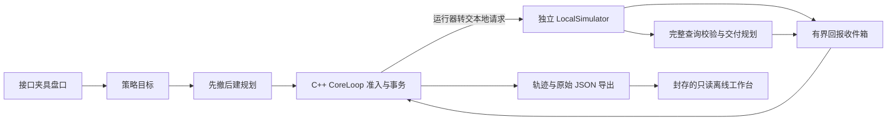

# PROJECT03 阶段总结报告

> 本文保留截至第五十二轮的历史状态。2026-11-10 后续已完成行情资格及运行器接入、M1B 本地证据复核，并开始 M1C 队列基础；最新进展见 [工作副本记录](../WORKING_COPY.md) 和 [M1C 进度](M1C_ACCEPTANCE.md)，不要把下文历史缺项当作当前状态。

日期：2026-11-08（Asia/Tokyo）  
范围：当前工作副本，截至第五十二轮；依据当前源码与最新 Debug / Release 封存证据。  
项目定位：**C++ 买方电子交易系统与可视化交易工作台，面向量化开发工程师的交易基础设施方向。**

方向复核补记：见 [完成方向核对](DIRECTION_REVIEW_2026-11-08.md)。正式基线允许 M1B 纯内存验收；线程、耐久日志和在线桥接分别属于后续阶段，不作为 M1B 的额外前置。当前应按 A02/A03 明确收口，重点补齐行情资格层。

## 1. 当前结论

项目已形成一个可以执行、解释、重放和验证的**单账户、单策略、单合约、单线程同步本地交易闭环**。C++ 核心实际处理订单、成交、持仓、风险和资金；独立模拟对端产生回报；工作台展示经过验证的真实程序输出。

现阶段最有价值的成果，是把异常情况下的风险保留、证据补齐、失败重试和停机行为落实到代码与回归。尚不能称为实盘 HFT 系统或生产可用交易平台；长期运行、真实连接、耐久恢复和多合约账户级风险仍有关键工作。

| 阶段 | 当前判断 |
|---|---|
| M1A 本地核心回归 | 本地门禁通过；订单、持仓、风险、资金及事务能力已有证据。Journal / 发送 / 恢复的部分内容仍只是值契约，不能视为运行时已实现 |
| M1B 本地闭环 | 独立 LocalSimulator、策略、规划、同步运行器和查询已有证据；须按 A02/A03 复核行情资格等具体缺项后收口。允许纯内存验收，不以未完成 M1C/M1D 为阻挡理由 |
| M1C 并发运行时 | 未实现真实线程运行时、线程间队列和后台持续服务 |
| M1D Journal 与持久化发送 | 有事实类型，尚无耐久 Writer、落盘确认及受日志前缀约束的发送链路 |
| M1E 在线工作台桥接 | 当前为只读离线包，尚无在线 WebBridge |
| M1F 完整关闭与恢复 | 有本地停机/迟到成交/查询补齐验证，尚无完整恢复证书、断线重连和安全重新开放发送机制 |

“第五十二轮”是开发记录编号，不代表五十二个正式验收里程碑，也不适合据此估算完成百分比。

## 2. 已实现的核心能力

### 2.1 身份、规则与内存事务

- 订单、命令、撤单、资源预占等使用强类型 ID；账户、交易所、合约、交易日和持仓代次进入业务作用域。
- ClientOrderId 按策略关联和去重；相同请求不会重复创建订单，冲突请求不能覆盖原身份。
- 核验合约价格区间、价格步长、最小/最大手数、手数步长和显式交易时段。
- CoreLoop 单写入者，采用 copy / validate / noexcept swap 内存事务；提交失败不留下已提交的订单、成交、持仓或资金变更。
- 失败调用仍可推进尝试编号、业务序号和逻辑时间；业务回滚不等于删除调用历史。

### 2.2 订单、成交与持仓

订单以 B/H/P/L/V 分解数量：已记账成交、缺失成交证据占用、可能成交量、确认释放量及未决量。撤单成功响应和最终成交数量证明分开处理，不能只凭撤单按钮或成功响应直接释放全部风险。

支持部分成交、撤单竞态、迟到回报、推送/查询重复成交去重，以及矛盾或超量成交的异常账本保留。Kill 后已经发生的成交继续入账，重复 Stop 不重复撤销只有缺失证据占用的终态单。

持仓分为多今、多昨、空今、空昨四桶，并维护平仓冻结。多空持仓不会因净仓为零就被当成没有风险；净仓、总仓和最坏成交区间分别计算。

### 2.3 风险与资金

核心逐笔执行数量、仓位、最坏暴露、资金、速率、自成交和参考价时效等检查。反向报价不自动抵消风险。

资金覆盖区分 Proven / Unknown / Excluded，限制唯一扣减归属；保证金证明不覆盖手续费，开仓订单转为持仓时不重复复制资金覆盖，资源缩减后旧证明不能虚构覆盖。所有金额均为本地模型单位，尚不是柜台真实保证金或结算系统。

### 2.4 策略和订单规划

已有简化、确定性的被动报价策略，用于驱动执行系统，不做收益或预测效果承诺。策略检查盘口来源、作用域、代次、序号、健康和时效；接近库存上限时按剩余空间缩量，并按合约手数步长向下取整。

规划器先整体检查双侧目标，再生成意图；任一侧非法时不返回半份提交计划。已有报价需要调整时先撤后建；平仓按项目约定优先平昨、再平今，裁剪后再次检查手数。零碎昨仓不足最小手数时暂停该侧，不跳桶、不擅自改为开仓。零碎持仓处置仍未完成。

合法双边计划仍需逐笔通过核心准入，不具备双边原子发送或全部接纳承诺。

## 3. 本地闭环和故障处理

LocalSimulator 自己维护订单、成交、持仓、冻结和预算，不复用核心的订单/风险账本来冒充独立对账。运行器通过显式输入推进，没有后台线程或系统定时器。

已覆盖的机制包括：

| 场景 | 当前实际行为 |
|---|---|
| 回报暂扣或迟到 | 对端与核心可暂时分歧；核心保留风险，收到可信成交后再记账 |
| 回报提交失败 | 失败项及同批尚未处理项留在收件箱，显式重试 |
| 积压时重复查询 | 普通查询背压，不反复追加同一批成交制造队列压力 |
| 暂扣报告重复释放 | 完整相同且仍在等待的报告不重复占队列；不同证据不被隐藏 |
| 收件箱溢出 | 批次不能入箱时保留已有项并设置丢失标记，不因排空或查询成功自动解除 |
| 无新行情 | 调用者显式投递定时事件，超时后实际请求撤单；不能凭时间到期直接释放资源 |
| 容量耗尽 | 停止普通报价，保留独立且有界的 Stop、回报重试及查询收尾额度；不能自动重开 |
| 完整查询 | 检查身份、完整性、已知订单/成交、持仓、冻结和预算；交付后再核对核心视图 |
| 最新增量：撤单终态缺失 | 显式漏送下一条本地撤单终态；完整查询先补成交，再补精确取消终态，经收件箱处理失败与重试 |

最新查询恢复只适用于同步 LocalSimulator。它不伪造某个撤单动作的成功响应，不解除 Kill，也不证明真实厂商查询具有同样语义。

## 4. 重放、工作台与交付物

### 重放核验

统一帧核验入口在独立运行器中重放输入，逐帧核对策略、核心调用载荷及返回值、核心摘要、订单、完整对端快照和交付状态，返回首个差异位置。

收尾固定实验另记录九次输入尝试、六帧和三次拒绝，核对返回码、帧数、核心摘要、停报及最终收尾耗尽状态。它是有限实验序列的核验，不是通用审计写入器，也不能证明外部没有漏记输入。

### 可视化

执行工作台与报价轨迹页展示 C++ 导出数据；报价页有八个可选场景：报价/成交/Kill、行情过期、查询补齐、提交失败重试、收件箱溢出、容量收尾、Kill 后迟到成交、库存边界。

页面可查看实际调用顺序、订单数量分区、四桶、模型资金、原始输入、策略决定、来源哈希，以及总持仓/订单占用/回报状态趋势。输入尝试表明确区分“产生帧”和“没有新增帧”的拒绝。最新撤单终态缺失故障已在 C++ 验证，**尚未新增独立页面场景**。

### 归档

最新运行封存 92 个核心/测试/示例/诊断/脚本源码文件、13 个静态界面文件及 39 项构建产物哈希。独立 offline-preview 包有 16 个内容文件和包清单，支持脱离当前 demos 目录打开。

这些哈希用于可追溯性，不是外部签名或可信时间戳。页面交互由 Node DOM 检查验证，**原生浏览器视觉布局尚未验收**。

## 5. 数据来源与“真实”的边界

正常订单案例采用官方 FIX Order State Changes A.1.a accepted/filled 数量序列，原数量 10000、分笔 2000/1000/7000，缩放为 10、2/1/7。账户、RB 合约、价格、开仓方向、日历、保证金与费用仍为明确本地适配；不称为真实交易所逐笔数据。

策略盘口为 InterfaceFixture，执行为 LocalSimulator；故障和压力输入明确标注为工程实验，不是随机行情，也不是实际网络事故记录。

Knight Capital、Nasdaq SIP 等历史事故方向尚未形成完整真实逐笔事故复刻。当前成果是与之相关的工程机制实验，不能宣称已重现事故真实流量、部署故障或损失过程。

## 6. 最新验证依据

最新源码匹配的运行：

- Debug：`2026-11-08-query-cancel-terminal-debug`
- Release：`2026-11-08-query-cancel-terminal-release`

| 检查 | 结果 |
|---|---|
| C++ 业务回归 | 每种配置 261 项、28,093 次断言，0 失败、0 跳过 |
| 测试清单 | 源码声明、编译注册表、聚合结果、CTest JUnit 四方一致 |
| 证据负控 | 12 项，验证失败/陈旧/修改/缺项等记录会被拒绝 |
| 性能诊断负控 | 11 项，验证样本、分位数、状态或范围误标等错误会被拒绝 |
| 离线包负控 | 4 项，验证修改、缺失、多出、重复文件记录会被拒绝 |
| 确定性输出 | 13 份在 Debug / Release 间一致，且与上一轮 Release 一致 |
| 页面逻辑 | 主工作台、本地回放、八种报价场景及九次尝试表通过；独立包重复检查 |
| 本次总结前复核 | 两种配置的当前源码、归档、产物与离线包验证均通过 |

261 是不同业务测试的数量，Debug / Release 分别执行，不能把它说成 522 种业务测试。Node 负控与页面检查不混入 C++ 断言数。通过用例不能替代代码覆盖率、形式化证明、目标平台或生产验收。

## 7. 性能诊断与优化结论

已有三组单线程本机诊断：标准案例 3,000 次 step；八档状态规模 800 次 ReferenceMark；资金覆盖配对算法 4,000 次调用。保留原始纳秒样本及分位数，计时范围明确。

最新 Release 样本如下，均不是生产 SLA：

| 工作负载 | p50 / 微秒 | p99 / 微秒 |
|---|---:|---:|
| 标准案例 SubmitOrder | 2.2 | 3.4 |
| 标准案例末笔成交 Fill7 | 2.9 | 3.5 |
| 63 笔工作单下 ReferenceMark | 47.4 | 52.6 |
| 63 笔已成交订单及记录下 ReferenceMark | 68.2 | 80.2 |

最新资金覆盖 64 项配对诊断的 p50：当前实现 0.8 微秒，嵌套参考 3.8 微秒。参考实现的编译/内联条件与生产函数不同；历史 Debug 结果还出现反向差异，因此不作普遍加速保证。

已完成两类优化：账本正常/异常数量在调用内汇总，减少逐订单反复扫成交；覆盖证明直接查资源，减少资源×证明嵌套扫描。保留原算法对照和事务检查，没有以删除风控换取速度。

当前仍使用复制/校验式内存事务、动态容器和分配。状态规模成本明显；没有绑核、隔离系统负载、接入网关或耐久日志，不能把微秒样本换算成可持续实盘吞吐，也不能据此宣称达到 HFT 生产要求。

## 8. 单合约范围与扩展基础

**当前运行上仍是严格的单合约模型。** 每个 CoreLoop 持有一个合约作用域，当前合约检查还限定 SHFE / RB；四桶、风险和资金闭环均处在该本地上下文内。

已打的基础包括 InstrumentKey、BusinessScope、账户/交易日/代次隔离、强类型 ID、策略限定的客户端身份，以及核心、策略、规划、对端的模块分离。

这些基础不等于已经支持多合约：尚无真实合约目录、账户级共享资金与组合限额、多合约路由/调度、多策略风险分配或跨合约风险汇总。单独创建多个核心实例也不会自动解决共享账户风险。多品种还需要扩展交易所、合约规则、日历与真实持仓/资金映射，不能只增加几个合约字符串。

## 9. 尚未完成的关键工作

1. **持续运行与并发。** 真实事件源、后台时钟、线程所有权、有界线程间队列、系统级背压和关闭协议尚未接通。
2. **长期状态容量。** 当前订单/成交记录累计到配置上限会停报；缺少生产级归档、安全回收及长时间驻留验证。默认核心订单/成交容量为 64/256，是受控本地模型配置，不是高频生产容量目标。
3. **耐久性与发送约束。** 无 Journal Writer、fsync/落盘确认、崩溃恢复、日志前缀驱动的发送门禁或完整受控命令执行。
4. **恢复完整性。** 尚无异步旧查询响应、分页乱序、连接代次切换及完整恢复证书；Kill 和丢失锁定不能被简单按钮或一次查询复位。
5. **真实接入。** 未接真实行情/交易协议、账户、厂商 SDK 或外部资金观察；当前不具备实盘发送能力。
6. **多合约/多品种。** 上述账户级组合风险和规则目录仍需实现。
7. **跨日与真实结算。** 新基线发布、跨日恢复、柜台持仓/保证金映射尚未完成。
8. **目标平台和展示验收。** Linux、真实并发/网络/耐久性能及原生浏览器视觉布局尚未验证。

## 10. 下一阶段优先顺序

| 优先方向 | 建议交付与通过条件 |
|---|---|
| 收拢完整 M1B 范围 | 以 A02/A03 建立源码/测试/缺项矩阵，补齐 MarketSnapshot / MarketState / FeedHealth、有限档位有效性和旧订阅代次隔离，复核报价及独立查询后收口；新页面不作为额外门槛 |
| 受控运行时 | 引入明确事件源与线程所有权、有界队列/背压、时钟和关闭协议；验证长时间容量与异步事件排列 |
| 日志及发送资格 | 实现耐久日志、确认边界、命令关联与发送门禁；在本地对端证明落盘/恢复/授权顺序，再考虑真实外部效果 |
| 恢复与真实协议 | 实现异步查询相关性、代次、完整性和对账，再按所选协议资料核对厂商身份及回报语义 |
| 多合约与组合风控 | 按账户级资金、合约级持仓/订单分层，加入目录、路由和组合限额，再扩大品种 |

这不是按轮数估算工期的承诺。后续仍按代码与证据推进，不需要例行逐阶段人工审批；真实协议、环境或权限缺失时再明确提出具体资料需求。当前不需要用户购买数据或提供交易账号。

## 11. 阅读与演示入口

- [最新执行工作台](../evidence-local/2026-11-08-query-cancel-terminal-release/offline-preview/index.html)
- [最新报价轨迹、趋势与输入尝试表](../evidence-local/2026-11-08-query-cancel-terminal-release/offline-preview/runner.html)
- [当前业务测试清单](M1A_CURRENT_TEST_MATRIX.md)
- [最新 Release 证据报告](../evidence-local/2026-11-08-query-cancel-terminal-release/m1a-evidence-report.json)
- [开发状态与历史记录](../WORKING_COPY.md)
- [最新查询终态恢复说明](QUERY_CANCEL_TERMINAL_ROUND52.md)

以量化开发工程师作品的角度，当前可以具体展示：C++20 状态机、内存事务、证据驱动风险、独立模拟对账、故障注入、确定性重放和构建可追溯性。展示时应同步说明单合约、同步内存和离线观察边界，避免写成实盘系统或已完成完整恢复。
